# Bobeda de Agentes Antigravity IDE - Map of Content (MOC)

Bienvenido a la Bóveda de Obsidian para la gestión estructurada de agentes con habilidades avanzadas, **soporte para nuevos perfiles futuros**, **historial de evoluciones** y **sistema de resguardo/rollback preventivo**.

---

## 📌 Datos del Entorno
- **Cuenta GitHub**: `inventarioenergycpy`
- **Correo Electrónico**: `inventario.energycpy@gmail.com`
- **Modo de Autenticación**: Inicio directo con Google OAuth.
- **Protocolo de Desarrollo**: **Metodología Estandarizada en 6 Etapas** aplicada al 100% de las habilidades (`Investigación en Fuentes Confiables -> Diseño & Tesis -> Pruebas Parciales -> Prueba Piloto con Aprobación -> Pruebas Finales -> Auto-Documentación & Bóveda Obsidian`).

---

## 🏗️ Arquitectura del Sistema de Agentes y Repositorios Dedicados

```mermaid
graph TD
    Hub["antigravity-agents-repository (Hub Bóveda Central)"] --> MOC["00-Dashboard-MOC"]
    
    MOC --> AF["01-Analista-Financiero"]
    MOC --> CD["02-Ciencia-de-Datos"]
    MOC --> DW["03-Desarrollador-Web-Showroom"]
    MOC --> PA["04-Planificador-de-Agentes"]
    MOC --> LF["05-Asesor-Legal-Financiero"]
    MOC --> ASE["06-Arquitecto-Sistemas-EPEC"]
    MOC --> PYT["07-Procesador-Cursos-YouTube"]
    MOC --> TAV["08-Transcriptor-Analizador-Audiovisual"]
    MOC --> PEM["09-Profesor-Experto-Mercado-Electrico"]
    MOC --> AAA["10-Alumno-Auditor-Academico"]
    MOC --> CO["11-Copiloto-Orquestador-de-Skills"]
    MOC --> FRE["12-Especialista-Facturacion-Reverse-Engineering"]
    MOC --> NA["Nuevos Agentes Futuros"]
    
    MOC --> AutoDoc["Auto-Documentación"]
    AutoDoc --> Backup["Bóveda de Backups (docs/Backups/)"]
    AutoDoc --> Historial["Histórico de Mejoras (docs/Historial-Mejoras/)"]
    
    MOC --> ProyectosHub["Proyectos Independientes (docs/Proyectos/)"]
    ProyectosHub --> RepoWeb["Repo Web: inventarioenergycpy/showroom-energycpy"]
    ProyectosHub --> RepoData["Repo Data: inventarioenergycpy/protelem-..."]
    ProyectosHub --> RepoDash["Repo Finanzas: inventarioenergycpy/dashboard-..."]
    ProyectosHub --> RepoForwarded["Repo VPU: inventarioenergycpy/forwarded-message"]
    ProyectosHub --> RepoCIER["Repo CIER: inventarioenergycpy/encuesta-cier-epec"]
    ProyectosHub --> RepoSolar["Repo Solar: asesoramiento-parque-solar-fotovoltaico"]
    ProyectosHub --> RepoFact["Repo Facturación: PROTELEM-EPEC/facturacion-reverse-engineering"]
    ProyectosHub --> RepoAMI["Repo AMI: PROTELEM-EPEC/despliegue-medidores-inteligentes-ami"]
    
    MOC --> SyncProtelem["Protocolo Sincronización Red PROTELEM (\\srvfs01\...)"]
    MOC --> SyncObsidian["Protocolo Sincronización Obsidian - GitHub"]
    
    Backup --> Rollback["Habilidad Rollback-Agente"]
```

---

## 📂 Áreas de la Bóveda Obsidian

### 1. [[Agentes/01-Analista-Financiero|Analista Financiero & Modelador Económico]]
- **Entregables**: Google Drive (`inventario.energycpy@gmail.com`) / Repositorios Financieros Dedicados / Memorias de Cálculo & Doble Estructura Documental.

### 2. [[Agentes/02-Ciencia-de-Datos|Ciencia de Datos (PySpark, Python, SQL, Power BI TMDL & Reglas BI EPEC)]]
- **Entregables**: Descargas / Repositorios de Datos / Motor Text-to-SQL / Diccionario 505 QVDs Qlik Sense / Reglas BI Normativa EPEC.

### 3. [[Agentes/03-Desarrollador-Web-Showroom|Desarrollador Web Showroom e Informes Técnicos]]
- **Entregables**: Repositorios Web Dedicados en GitHub (`inventarioenergycpy/<proyecto-web>`) / Sitios Estáticos de Reportes HTML.

### 4. [[Agentes/04-Planificador-Disenador-de-Agentes|Planificador y Diseñador de Agentes AI]]
- **Entregables**: Investigación verídica, diseño pre-implementación, roadmap de pruebas parciales, pruebas piloto y auto-documentación de nuevos agentes.

### 5. [[Agentes/05-Asesor-Legal-Financiero|Asesor Legal en Intermediación Financiera y Regulación Energética]]
- **Entregables**: Estrategia documental en 3 capas, NCNDA, corretaje con overprice, mandatos, fee sharing, Reglamento EPEC en Google Drive (`inventario.energycpy@gmail.com`).

### 6. [[Agentes/06-Arquitecto-Sistemas-EPEC|Arquitecto de Sistemas EPEC (CIS / MDM / Licitaciones)]]
- **Entregables**: Arquitectura de Sistemas Comerciales, seguimiento de pliegos licitatorios (929 requerimientos en 35 grupos), benchmarking de proveedores (Oracle C2M/CCS, OPEN, PRETECO/ESC) en Bóveda Central y repositorios dedicados.

### 7. [[Agentes/07-Procesador-Cursos-YouTube|Procesador y Documentador de Cursos Académicos YouTube]]
- **Entregables**: Ingesta automatizada de playlists, extracción de transcripciones, resúmenes de clases y estructura de notas `.md` en `docs/Cursos/` (`[[Cursos/00-Indice-General-Cursos|Índice General de Cursos]]`).

### 8. [[Agentes/08-Transcriptor-Analizador-Audiovisual|Transcriptor y Analizador Audiovisual de Cursos]]
- **Entregables**: Transcripción profunda de audio, detección y catalogación de diapositivas/pizarras, integración de esquemas unifilares y marcos regulatorios en las 70 clases de diplomaturas en `docs/Cursos/`.

### 9. [[Agentes/09-Profesor-Experto-Mercado-Electrico|Profesor Experto en Mercado Eléctrico y Transición]]
- **Entregables**: Rúbricas académicas de posgrado/diplomatura, formulación de evaluaciones de grado sobre MEM/CAMMESA y control dialéctico de calidad técnica.

### 10. [[Agentes/10-Alumno-Auditor-Academico|Alumno Auditor e Investigador Académico]]
- **Entregables**: Auditoría de notas `.md`, resolución de exámenes de cátedra y ejecución del circuito de 10 iteraciones de enriquecimiento de diapositivas y clases.

### 11. [[Agentes/11-Copiloto-Orquestador-de-Skills|Copiloto Orquestador y Selector Dinámico de Habilidades]]
- **Entregables**: Diagnóstico semántico de consultas, despacho dinámico de agentes especialistas, investigación de estándares Google / desarrolladores reconocidos y creación de nuevas habilidades bajo la Metodología en 6 Etapas.

### 12. [[Agentes/12-Especialista-Facturacion-Reverse-Engineering|Especialista en Reverse Engineering de Facturación EPEC]]
- **Habilidad**: `.agents/skills/facturacion-reverse-engineering/SKILL.md`
- **Protocolo de Arranque**: Sincronización mandatoria y automática contra `PROTELEM-EPEC/facturacion-reverse-engineering` (rama `main`) antes de cada uso.
- **Entregables**: Reconstrucción por ingeniería inversa de la factura EPEC, simulador interactivo offline, motor JS puro de prorrateos tarifarios, mapeo de 31 tablas de SIGEC y auditoría de ordenanzas/tasas municipales.

### 13. [[Protocolo-Sincronizacion-Red-PROTELEM|Protocolo Operativo de Sincronización Red PROTELEM (\\srvfs01\...)]]
- **Habilidad**: `.agents/skills/sincronizacion-red-protelem/SKILL.md`
- **Propósito**: Sincronizar automáticamente cualquier nueva documentación o proyecto guardado en la red `\\srvfs01\ProyectoTelemedicion\Documentación\PROTELEM\PROJECTS` hacia la Bóveda Central con backups preventivos `.bak` y sin pérdida de información.

### 14. [[Protocolo-Sincronizacion-Obsidian-GitHub|Protocolo Operativo: Sincronización de Obsidian con GitHub]]
- **Propósito**: Vincular la Bóveda Obsidian con `antigravity-agents-repository`, habilitando el plugin nativo `obsidian-git` para auto-pull al arranque y auto-backup periódico cada 10 minutos.

### 15. [[Proyectos/README|Índice de Proyectos e Repositorios Dedicados]]
- Fichas técnicas, enlaces a repositorios remotos y URLs live de cada proyecto desarrollado por los agentes.

### 16. [[docs/PROTELEM/00-Indice-PROTELEM-EPEC|Organización PROTELEM-EPEC: Repositorios y Documentación Unificada]]
- **Repositorios**: `PROTELEM-EPEC/facturacion-reverse-engineering` (Modelo SIGEC, Tarifas, Impuestos, Motor JS) y `PROTELEM-EPEC/demo-dashboard` (Factura Digital UI).
- **Proyectos de Red**: `docs/PROTELEM/PROJECTS/` (SIGEC Explorer, QVD Explorer, Normativa EPEC, Oracle CIS/MDM).
- **Sincronización**: Multi-bóveda y visualización unificada en Obsidian con auto-pull/push.

---

## 🛡️ Sistema de Seguridad, Histórico y Rollback

1. **Creación de Nuevos Agentes Futuros**:
   - Para agregar un agente en el futuro, crear `.agents/skills/<nuevo-agente>/SKILL.md` y su ficha en `docs/Agentes/`.
2. **Backups Preventivos**:
   - Cada mejora genera automáticamente una copia de respaldo en `[[docs/Backups/README|docs/Backups/]]`.
3. **Registro Histórico**:
   - Cada cambio queda registrado cronológicamente en `docs/Historial-Mejoras/`.
4. **Capacidad de Rollback / Reversión**:
   - Si un cambio no resulta satisfactorio, la habilidad `rollback-agente` restaura cualquier versión anterior almacenada en `docs/Backups/`.

---

## 📜 Historial de Mejoras Continuas
- [[Historial-Mejoras/2026-10-23_copiloto-orquestador_equilibrio-relevamiento-instalacion-ami-zona-a|2026-10-23 Copiloto Orquestador - Equilibrio Relevamiento vs Instalación vs Stock AMI Zona A (7.559 inst/mes, 3.620 relev/mes, Reserva 10%)]]
- [[Historial-Mejoras/2026-10-23_ciencia-de-datos_control-geoespacial-dibujo-poligonos-rutas-redistribucion-manzanas|2026-10-23 Ciencia de Datos - Control Geoespacial de Rutas, Dibujo de Polígonos Disjuntos y Redistribución de Manzanas (Distrito 1)]]
- [[Historial-Mejoras/2026-10-23_ciencia-de-datos_controles-topologicos-calles-alturas-georef-distrito1|2026-10-23 Ciencia de Datos - Controles Topológicos de Rutas, Enriquecimiento de Manzanas con Calles y Alturas, Triangulación de 2 Vecinos y Control Geo +-70m (Distrito 1)]]
- [[Historial-Mejoras/2026-10-23_ciencia-de-datos_reasignacion-rutas-conexo-calles-compartidas-distrito1|2026-10-23 Ciencia de Datos - Reasignación de Rutas de Lectura Conexas, Maximización de Calles Internas Compartidas y Escalamiento al Distrito 1 (585.727 Suministros)]]
- [[Historial-Mejoras/2026-10-23_copiloto-orquestador_configuracion-boveda-obsidian-proyectos|2026-10-23 Copiloto Orquestador - Configuración y Apertura de Bóveda Maestra de Proyectos en Obsidian (D:\Proyectos)]]
- [[Historial-Mejoras/2026-10-22_analisis-cier-ic1-at1-fe1-campana-factura-digital-ahorro-postal|2026-10-22 Ciencia de Datos & Finanzas - Diagnóstico Atributos CIER Cuadrante I (IC1, AT1, FE1), Modelo de Ahorro Correo F-218 y Campaña de Factura Digital]]
- [[Historial-Mejoras/2026-10-22_copiloto-orquestador_protocolo-snapshot-local-minima-interferencia-red|2026-10-22 Copiloto Orquestador - Protocolo Obligatorio de Snapshot Local de Mínima Interferencia de Red (\\srvfs01) y Fuentes Online]]
- [[Historial-Mejoras/2026-10-21_copiloto-orquestador_exclusividad-onepager-y-flujo-leads-showroom|2026-10-21 Copiloto Orquestador - Exclusividad de Resumen Ejecutivo One-Pager A4 y Nuevo Flujo de Derivación de Leads vía inventario.energycpy]]
- [[Historial-Mejoras/2026-10-21_copiloto-orquestador_visor-onepager-a4-dashboard-gestion|2026-10-21 Copiloto Orquestador - Integración de Visor y Exportador One-Pager A4 Nativo con Marca de Agua en Dashboard de Gestión]]
- [[Historial-Mejoras/2026-10-21_ciencia-de-datos_analisis-cier-atributos-foco-cronograma-sigec-reclamos-ersep|2026-10-21 Ciencia de Datos - Diagnóstico Atributos Foco CIER (IC1, AT1, FE1), Cronograma SIGEC y Casuística RO/RC/NT/ERSeP]]
- [[Historial-Mejoras/2026-10-20_ciencia-de-datos_creacion-modelo-f218-ocasa-op26211|2026-10-20 Ciencia de Datos - Creación y Normalización del Archivo de Datos F-218 OCASA (O.P. 26211)]]
- [[Historial-Mejoras/2026-10-19_creacion-agente-12-facturacion-reverse-engineering|2026-10-19 Creación e Integración del Agente 12: Especialista en Reverse Engineering de Facturación EPEC]]
- [[Historial-Mejoras/2026-10-14_copiloto-orquestador_creacion-repositorio-asesoramiento-parque-solar-fotovoltaico|2026-10-14 Copiloto Orquestador - Creación Repositorio Dedicado asesoramiento-parque-solar-fotovoltaico]]
- [[Historial-Mejoras/2026-10-14_ciencia-de-datos_creacion-repositorio-sigec-ruta-nueva-catastro-georef|2026-10-14 Ciencia de Datos - Creación Repositorio Dedicado sigec-ruta-nueva-catastro-georef en protelemepec-coder]]
- [[Historial-Mejoras/2026-10-14_ciencia-de-datos_reasignacion-rutas-lectura-catastrales-distrito1-g16|2026-10-14 Ciencia de Datos - Reorganización Catastral de Rutas de Lectura (Piloto Distrito 1 / Grupo 16 - Bin-Packing 180±20)]]
- [[Historial-Mejoras/2026-10-09_ciencia-de-datos_creacion-repo-adelat-cier-benchmarking|2026-10-09 Ciencia de Datos - Creación Repositorio Dedicado Benchmarking Canales de Atención ADELAT 2026 vs CIER EPEC]]
- [[Historial-Mejoras/2026-10-05_creacion-agente-11-copiloto-orquestador-skills|2026-10-05 Creación e Integración del Agente 11: Copiloto Orquestador y Selector Dinámico de Habilidades]]
- [[Historial-Mejoras/2026-10-01_ciencia-de-datos_adecuacion-nomenclatura-cuadrantes-matriz-mejora|2026-10-01 Ciencia de Datos - Adecuación de Nomenclatura Ejecutiva y Orden de Intervención en Cuadrantes de la Matriz de Mejora CIER]]
- [[Historial-Mejoras/2026-09-23_ciencia-de-datos_sinonimos-medidores-y-mapeo-distritos-sucursales|2026-09-23 Ciencia de Datos - Sinónimos de Medición, Último Medidor y Mapeo de Distritos SUCURSALES]]
- [[Historial-Mejoras/00-Registro-Inicial|00-Registro Inicial de Arquitectura]]
- [[Historial-Mejoras/2026-08-12_desarrollador-web-showroom_maquetacion-energy-cpy|2026-08-12 Desarrollador Web Showroom - Maquetación Benchmark Energy CPY]]
- [[Historial-Mejoras/2026-08-12_desarrollador-web-showroom_buenas-practicas-github|2026-08-12 Desarrollador Web Showroom - Integración de Buenas Prácticas Oficiales de GitHub]]
- [[Historial-Mejoras/2026-08-14_protocolo-multi-repositorio-proyectos|2026-08-14 Redefinición Bóveda Central de Agentes 100% y Protocolo Multi-Repositorio por Proyecto]]
- [[Historial-Mejoras/2026-08-14_registro-agente-planificador|2026-08-14 Creación e Integración del Agente Planificador y Diseñador de Agentes AI]]
- [[Historial-Mejoras/2026-08-14_estandarizacion-estricta-protocolo-6-etapas|2026-08-14 Estandarización Secuencial del Protocolo de 6 Etapas en todas las Skills]]
- [[Historial-Mejoras/2026-08-20_ciencia-de-datos_ingenieria-inversa-pbip-tmdl|2026-08-20 Ciencia de Datos - Integración de Estrategias de Ingeniería Inversa y Documentación TMDL / PBIP]]
- [[Historial-Mejoras/2026-08-21_registro-agente-legal-financiero|2026-08-21 Asesor Legal en Intermediación Financiera - Integración de Estrategia Documental en 3 Capas y Marco CCCN/ICC]]
- [[Historial-Mejoras/2026-08-23_desarrollo-dashboard-gestion-intermediacion|2026-08-23 Desarrollo y Despliegue del Dashboard de Gestión e Intermediación Financiera con Matriz Legal en 3 Capas]]
- [[Historial-Mejoras/2026-08-27_dashboard_importador-excel-dinamico-diff-rollback|2026-08-27 Plantillas Excel Dinámicas Adaptables, Motor de Diff Visual, Cargas Parciales y Rollback]]
- [[Historial-Mejoras/2026-08-28_desarrollador-web-showroom_mejoras-estrategicas-showroom|2026-08-28 Desarrollador Web Showroom - Selector Bilingüe, Filtros Desde-Hasta, Ruteo Silencioso y Gestión de Estados]]
- [[Historial-Mejoras/2026-09-02_protelem_integracion-conocimiento-y-nuevo-agente-arquitecto|2026-09-02 Integración de Conocimiento Red PROTELEM y Creación del Agente 6: Arquitecto de Sistemas EPEC]]
- [[Historial-Mejoras/2026-09-03_forwarded-message_integracion-escritura-83-y-vpu-fideicomiso|2026-09-03 Proyecto Forwarded Message - Integración Notarial Escritura Nº 83 y VPU Fideicomiso]]
- [[Historial-Mejoras/2026-09-08_forwarded-message_presentacion-google-slides|2026-09-08 Proyecto Forwarded Message - Generación de Presentación Ejecutiva Google Slides para Google Drive]]
- [[Historial-Mejoras/2026-09-03_analista-financiero_regla-replicabilidad-doble-estructura-fehaciente|2026-09-03 Analista Financiero - Regla Elemental de Replicabilidad, Doble Estructura Documental y Memorias de Cálculo]]
- [[Configuracion-Credenciales-GitHub|Configuración y Resguardo de Credenciales GitHub PAT]]

---

## 🚀 Proyectos y Soluciones en Repositorios Dedicados
- [[docs/Proyectos/2026-10-22_estrategia-campana-captacion-factura-digital|2026-10-22 Plan Estratégico y Modelo de Campañas de Captación para Factura Digital (Base 922.958 Titulares EPEC)]] (`inventarioenergycpy/encuesta-cier-epec`)
- [[docs/Proyectos/2026-10-22_estimacion-ahorro-financiero-factura-digital-epec|2026-10-22 Modelo Financiero: Estimación del Ahorro Anual por Migración a Factura Digital y Sensibilidad WhatsApp]] (`inventarioenergycpy/encuesta-cier-epec`)
- [[docs/Proyectos/2026-10-22_analisis-critico-cier-ic1-at1-fe1-sigec-redes|2026-10-22 Análisis Crítico Atributos CIER Cuadrante I: IC1, AT1 y FE1 frente a Canales Masivos, SIGEC y Migración a Factura Digital]] (`inventarioenergycpy/encuesta-cier-epec`)
- [[docs/Proyectos/2026-10-21_despliegue-medidores-inteligentes-ami|2026-10-21 Plan Maestro de Despliegue de Medidores Inteligentes AMI y Concentradores PLC]] (`PROTELEM-EPEC/despliegue-medidores-inteligentes-ami`)
- [[docs/Proyectos/2026-10-21_analisis-cier-atributos-foco-cronograma-sigec-reclamos-ersep|2026-10-21 Análisis Integral CIER: Diagnóstico de Atributos Foco (IC1, AT1, FE1), Cronograma SIGEC, Casuística RO/RC y Quiebre de Notificaciones NT]]
- [[docs/Proyectos/Prompt-Retomar-Sesion-CIER-Foco-SIGEC|2026-10-21 Prompt Maestro para Retomar Sesión: Análisis CIER, Cronograma SIGEC y Reclamos RC/RO/NT]]
- [[docs/Proyectos/2026-10-20_memo-gtic-accesos-tramites-comerciales-xxww-sigec|2026-10-20 Memorándum Técnico: Solicitud de Accesos a Datos de Oficina Virtual (XXWW) y SIGEC para Gestión de Trámites Comerciales (GTIC EPEC)]]
- [[docs/Proyectos/2026-10-20_procedimiento-carga-y-control-plantilla-f218|2026-10-20 Instructivo Operativo: Procedimiento de Carga, Control de Duplicidad y Normalización de Plantillas F-218]]
- [[docs/Proyectos/2026-10-14_asesoramiento-parque-solar-fotovoltaico|2026-10-14 Asesoramiento para Parque Solar Fotovoltaico Georreferenciado (Simulador Growatt & Lecturas SIGEC)]] (`inventarioenergycpy/asesoramiento-parque-solar-fotovoltaico`)
- [[docs/Proyectos/2026-10-09_adelat-cier-benchmarking|2026-10-09 Benchmarking Canales de Atención: ADELAT 2026 (Parte II) vs. Encuesta CIER EPEC-AR]] (`protelemepec-coder/adelat-cier-benchmarking`)
- [[docs/Proyectos/2026-09-30_propuesta-inversion-avex-rio-cuarto|2026-09-30 Propuesta de Inversión y Adquisición Planta Avícola Avex (Río Cuarto)]] (Agroindustria / Distress M&A / Leaseback ACA)
- [[Proyectos/2026-08-14_showroom-energycpy|2026-08-14 Showroom Energy CPY (Web Showroom Benchmark)]]
- [[Proyectos/2026-08-20_protelem-indicadores-gerencia-comercial|2026-08-20 PROTELEM - Indicadores Gerencia Comercial (Documentación & Arquitectura Semántica)]]
- [[Proyectos/2026-08-23_dashboard-gestion-intermediacion|2026-08-23 Dashboard de Gestión e Intermediación Financiera con Matriz Legal en 3 Capas]]
- [[Proyectos/2026-09-02_forwarded-message|2026-09-02 Proyecto Forwarded Message (Green Hydrogen, Solar Hub & Granja Marítima Abisal - VPU Fideicomiso)]]
- [[Proyectos/2026-09-02_protelem-conocimiento-integrado|2026-09-02 Compendio Integrado de Conocimiento Red PROTELEM (5 Proyectos EPEC)]]
- [[docs/Proyectos/2026-09-03_control-rutas-lecturas-nuevas-rutas|2026-09-03 Control de Rutas de Lecturas y Nuevas Rutas Comerciales EPEC]]
- [[docs/Proyectos/2026-09-15_encuesta-cier-epec|2026-09-15 Encuesta de Calidad de Servicio CIER - EPEC]] (`inventarioenergycpy/encuesta-cier-epec`)
- [[docs/Proyectos/2026-09-23_control-catastral-georeferencia|2026-09-23 Control de Relevamiento Catastral & Georreferenciación (SET 4223 / 4225)]] (`inventarioenergycpy/control-catastral-georeferencia`)

## 📂 Proyectos Entregados
- [[docs/Proyectos/2026-09-23_control-catastral-georeferencia|Control de Relevamiento Catastral & Georreferenciación (SET 4223 / 4225)]] (`inventarioenergycpy/control-catastral-georeferencia`)

