# Bobeda de Agentes Antigravity IDE - Map of Content (MOC)

Bienvenido a la Bóveda de Obsidian para la gestión estructurada de agentes con habilidades avanzadas, **soporte para nuevos perfiles futuros**, **historial de evoluciones** y **sistema de resguardo/rollback preventivo**.

---

- [[docs/Proyectos/2026-10-27_auditoria-relevamiento-conectar|2026-10-27 Auditoría de Relevamientos CONECTAR: Reglas de Negocio y Resolución SIGEC]] (`PROTELEM-EPEC/auditoria-relevamiento-conectar`)

## 📌 Datos del Entorno
- **Cuenta GitHub**: `inventarioenergycpy`
- **Correo Electrónico**: `inventario.energycpy@gmail.com`
- **Modo de Autenticación**: Inicio directo con Google OAuth.
- **Protocolo de Desarrollo**: **Metodología Estandarizada en 6 Etapas** aplicada al 100% de las habilidades (`Investigación en Fuentes Confiables -> Diseño & Tesis -> Pruebas Parciales -> Prueba Piloto con Aprobación -> Pruebas Finales -> Auto-Documentación & Bóveda Obsidian`).

---

## 🏗️ Arquitectura del Sistema de Agentes y Repositorios Dedicados

```mermaid
graph TD
    Hub["antigravity-agents-repository (Hub Bóveda Central)"] --> MOC["00-Dashboard-MOC"]
    
    MOC --> AF["01-Analista-Financiero"]
    MOC --> CD["02-Ciencia-de-Datos"]
    MOC --> DW["03-Desarrollador-Web-Showroom"]
    MOC --> PA["04-Planificador-de-Agentes"]
    MOC --> LF["05-Asesor-Legal-Financiero"]
    MOC --> ASE["06-Arquitecto-Sistemas-EPEC"]
    MOC --> PYT["07-Procesador-Cursos-YouTube"]
    MOC --> TAV["08-Transcriptor-Analizador-Audiovisual"]
    MOC --> PEM["09-Profesor-Experto-Mercado-Electrico"]
    MOC --> AAA["10-Alumno-Auditor-Academico"]
    MOC --> CO["11-Copiloto-Orquestador-de-Skills"]
    MOC --> FRE["12-Especialista-Facturacion-Reverse-Engineering"]
    MOC --> DPS["13-Desarrollador-Parques-Solares-Renovables"]
    MOC --> ITM["14-Investigador-Mercado-Laboral-Talento"]
    MOC --> EIB["15-Experto-Inmobiliario-Bienes-Raices-Financiero"]
    MOC --> NA["Nuevos Agentes Futuros"]
    
    MOC --> AutoDoc["Auto-Documentación"]
    AutoDoc --> Backup["Bóveda de Backups (docs/Backups/)"]
    AutoDoc --> Historial["Histórico de Mejoras (docs/Historial-Mejoras/)"]
    
    MOC --> ProyectosHub["Proyectos Independientes (docs/Proyectos/)"]
    ProyectosHub --> RepoWeb["Repo Web: inventarioenergycpy/showroom-energycpy"]
    ProyectosHub --> RepoData["Repo Data: inventarioenergycpy/protelem-..."]
    ProyectosHub --> RepoDash["Repo Finanzas: inventarioenergycpy/dashboard-..."]
    ProyectosHub --> RepoForwarded["Repo VPU: inventarioenergycpy/forwarded-message"]
    ProyectosHub --> RepoCIER["Repo CIER: inventarioenergycpy/encuesta-cier-epec"]
    ProyectosHub --> RepoSolar["Repo Solar: asesoramiento-parque-solar-fotovoltaico"]
    ProyectosHub --> RepoCutralCo["Repo Solar: PSFV Cutral Có II (30 MWac / 36.29 MWdc)"]
    ProyectosHub --> RepoFact["Repo Facturación: PROTELEM-EPEC/facturacion-reverse-engineering"]
    ProyectosHub --> RepoAMI["Repo AMI: PROTELEM-EPEC/despliegue-medidores-inteligentes-ami"]
    ProyectosHub --> RepoSanAntonio["Repo Minero: Mina San Antonio (San Juan, Au)"]
    ProyectosHub --> RepoCareer["Repo Carrera: inventarioenergycpy/career-market-intelligence"]
    ProyectosHub --> RepoRealEstate["Repo Real Estate: inventarioenergycpy/real-estate-investment-intelligence"]
    
    MOC --> SyncProtelem["Protocolo Sincronización Red PROTELEM (\\srvfs01\...)"]
    MOC --> SyncObsidian["Protocolo Sincronización Obsidian - GitHub"]
    MOC --> MultiAgente["Protocolo Multi-Agente PM + 3 Operadores (Triple QA)"]
    
    Backup --> Rollback["Habilidad Rollback-Agente"]
```

---

## 📂 Áreas de la Bóveda Obsidian

### 1. [[Agentes/01-Analista-Financiero|Analista Financiero & Modelador Económico]]
- **Entregables**: Google Drive (`inventario.energycpy@gmail.com`) / Repositorios Financieros Dedicados / Memorias de Cálculo & Doble Estructura Documental.

### 2. [[Agentes/02-Ciencia-de-Datos|Ciencia de Datos (PySpark, Python, SQL, Power BI TMDL & Reglas BI EPEC)]]
- **Entregables**: Descargas / Repositorios de Datos / Motor Text-to-SQL / Diccionario 505 QVDs Qlik Sense / Reglas BI Normativa EPEC.

### 3. [[Agentes/03-Desarrollador-Web-Showroom|Desarrollador Web Showroom, Reportes e Interfaces]]
- **Entregables**: Repositorios Web Dedicados en GitHub (inventarioenergycpy/<proyecto-web>) / Sitios Estáticos de Reportes HTML.
- **Pipeline Google Stitch & DESIGN.md**: Prototipado rápido asistido con Google Stitch (stitch.withgoogle.com), especificación de tokens en DESIGN.md, maquetación responsive Vanilla CSS optimizada para PC y móviles, y batería de validación UX (Core Web Vitals, Touch Targets ≥ 48px, WCAG 2.2 AA).
- **Guía Maestra**: [[docs/Protocolos/Guia-Maestra-Diseno-Web-Google-Stitch-DESIGN-MD|Guía Maestra de Diseño Web con Google Stitch y DESIGN.md]].

### 4. [[Agentes/04-Planificador-Disenador-de-Agentes|Planificador y Diseñador de Agentes AI]]
- **Entregables**: Investigación verídica, diseño pre-implementación, roadmap de pruebas parciales, pruebas piloto y auto-documentación de nuevos agentes.

### 5. [[Agentes/05-Asesor-Legal-Financiero|Asesor Legal en Intermediación Financiera y Regulación Energética]]
- **Entregables**: Estrategia documental en 3 capas, NCNDA, corretaje con overprice, mandatos, fee sharing, Reglamento EPEC en Google Drive (`inventario.energycpy@gmail.com`).

### 6. [[Agentes/06-Arquitecto-Sistemas-EPEC|Arquitecto de Sistemas EPEC (CIS / MDM / Licitaciones)]]
- **Entregables**: Arquitectura de Sistemas Comerciales, seguimiento de pliegos licitatorios (929 requerimientos en 35 grupos), benchmarking de proveedores (Oracle C2M/CCS, OPEN, PRETECO/ESC) en Bóveda Central y repositorios dedicados.

### 7. [[Agentes/07-Procesador-Cursos-YouTube|Procesador y Documentador de Cursos Académicos YouTube]]
- **Entregables**: Ingesta automatizada de playlists, extracción de transcripciones, resúmenes de clases y estructura de notas `.md` en `docs/Cursos/` (`[[Cursos/00-Indice-General-Cursos|Índice General de Cursos]]`).

### 8. [[Agentes/08-Transcriptor-Analizador-Audiovisual|Transcriptor y Analizador Audiovisual de Cursos]]
- **Entregables**: Transcripción profunda de audio, detección y catalogación de diapositivas/pizarras, integración de esquemas unifilares y marcos regulatorios en las 70 clases de diplomaturas en `docs/Cursos/`.

### 9. [[Agentes/09-Profesor-Experto-Mercado-Electrico|Profesor Experto en Mercado Eléctrico y Transición]]
- **Entregables**: Rúbricas académicas de posgrado/diplomatura, formulación de evaluaciones de grado sobre MEM/CAMMESA y control dialéctico de calidad técnica.

### 10. [[Agentes/10-Alumno-Auditor-Academico|Alumno Auditor e Investigador Académico]]
- **Entregables**: Auditoría de notas `.md`, resolución de exámenes de cátedra y ejecución del circuito de 10 iteraciones de enriquecimiento de diapositivas y clases.

### 11. [[Agentes/11-Copiloto-Orquestador-de-Skills|Copiloto Orquestador y Selector Dinámico de Habilidades]]
- **Entregables**: Diagnóstico semántico de consultas, despacho dinámico de agentes especialistas, investigación de estándares Google / desarrolladores reconocidos y creación de nuevas habilidades bajo la Metodología en 6 Etapas.

### 12. [[Agentes/12-Especialista-Facturacion-Reverse-Engineering|Especialista en Reverse Engineering de Facturación EPEC]]
- **Habilidad**: `.agents/skills/facturacion-reverse-engineering/SKILL.md`
- **Protocolo de Arranque**: Sincronización mandatoria y automática contra `PROTELEM-EPEC/facturacion-reverse-engineering` (rama `main`) antes de cada uso.
- **Entregables**: Reconstrucción por ingeniería inversa de la factura EPEC, simulador interactivo offline, motor JS puro de prorrateos tarifarios, mapeo de 31 tablas de SIGEC y auditoría de ordenanzas/tasas municipales.

### 13. [[Agentes/13-Desarrollador-Parques-Solares-Renovables|Desarrollador de Parques Solares Fotovoltaicos y Energías Renovables]]
- **Habilidad**: `.agents/skills/desarrollador-parques-solares-renovables/SKILL.md`
- **Modelo Rector**: [[docs/Modelos/Modelo-Ingenieria-Parques-Solares-Renovables-Argentina|Modelo Maestro de Ingeniería para Parques Solares y Renovables en Argentina]].
- **Proyecto de Referencia**: [[docs/Proyectos/2026-11-02_psfv-cutral-co-ii-30mw|PSFV Cutral Có II (30 MWac / 36.29 MWdc - Data Room FCS)]].
- **Entregables**: Ciclo de vida en 7 fases (Origination a COD), modelado PVSyst, interconexión MT/AT (33/132 kV), dimensionamiento de trackers 1 eje con backtracking y protección de viento CIRSOC 102, sismo INPRES-CIRSOC 103, y encuadre en CAMMESA (Cap. XXXVI, Anexo 30, SMEC/SOTR), MATER, RIGI (Ley 27.742) e Iniciativa Privada.

### 14. [[Agentes/14-Investigador-Mercado-Laboral-Talento|Investigador de Talento y Mercado Laboral]]
- **Habilidad**: `.agents/skills/investigador-talento-mercado-laboral/SKILL.md`
- **Repositorio Dedicado**: `https://github.com/inventarioenergycpy/career-market-intelligence.git` (`D:\Proyectos\career-market-intelligence`)
- **Entregables**: Diagnóstico integral de perfil, matriz FODA, análisis de brechas (*Skill Gap Analysis*), macro-tendencias 2025–2026 (impacto de IA, Two-Track market, proyecciones WEF 2025-2030), benchmarking salarial US/LATAM/Argentina, radar de vacantes activas y optimización para filtros ATS.

### 15. [[Agentes/15-Experto-Inmobiliario-Bienes-Raices-Financiero|Experto en Bienes Raíces, Inversiones Inmobiliarias & Modelado Financiero]]
- **Habilidad**: `.agents/skills/experto-inmobiliario-bienes-raices-financiero/SKILL.md`
- **Repositorio Dedicado**: `https://github.com/inventarioenergycpy/real-estate-investment-intelligence.git` (`D:\Proyectos\real-estate-investment-intelligence`)
- **Entregables**: Inteligencia de mercado inmobiliario en Córdoba Capital e Interior, análisis comparativo de mercado (CMA), cálculo de m² efectivos y Opportunity Score (0-100), simulador de Escalamiento Patrimonial Inmobiliario (Trade-Up Ladder) con deducción de costos CPI Córdoba (Ley 9445) y Sellos DGR, modelado financiero DCF a 5-10 años (NOI, CAP Rate, TIR, VAN) y exportador tabular para Google Drive (`inventario.energycpy@gmail.com`).

### 16. [[Protocolo-Sincronizacion-Red-PROTELEM|Protocolo Operativo de Sincronización Red PROTELEM (\\srvfs01\...)]]
- **Habilidad**: `.agents/skills/sincronizacion-red-protelem/SKILL.md`
- **Propósito**: Sincronizar automáticamente cualquier nueva documentación o proyecto guardado en la red `\\srvfs01\ProyectoTelemedicion\Documentación\PROTELEM\PROJECTS` hacia la Bóveda Central con backups preventivos `.bak` y sin pérdida de información.

### 15. [[Protocolo-Sincronizacion-Obsidian-GitHub|Protocolo Operativo: Sincronización de Obsidian con GitHub]]
- **Propósito**: Vincular la Bóveda Obsidian con `antigravity-agents-repository`, habilitando el plugin nativo `obsidian-git` para auto-pull al arranque y auto-backup periódico cada 10 minutos.

### 16. [[Proyectos/README|Índice de Proyectos e Repositorios Dedicados]]
- Fichas técnicas, enlaces a repositorios remotos y URLs live de cada proyecto desarrollado por los agentes.

### 17. [[docs/PROTELEM/00-Indice-PROTELEM-EPEC|Organización PROTELEM-EPEC: Repositorios y Documentación Unificada]]
- **Repositorios**: `PROTELEM-EPEC/facturacion-reverse-engineering` (Modelo SIGEC, Tarifas, Impuestos, Motor JS) y `PROTELEM-EPEC/demo-dashboard` (Factura Digital UI).
- **Proyectos de Red**: `docs/PROTELEM/PROJECTS/` (SIGEC Explorer, QVD Explorer, Normativa EPEC, Oracle CIS/MDM).
- **Sincronización**: Multi-bóveda y visualización unificada en Obsidian con auto-pull/push.

### 18. [[Protocolo-Arquitectura-Multi-Agente-PM-Operadores|Protocolo de Arquitectura Multi-Agente Adaptativa: Selección Dinámica Top-2 de Modelos Gemini (PM Top-1 + 3 Operadores Top-2) y Triple QA]]
- **Fase 0 de Armado Adaptativo**: Análisis en tiempo real de los modelos Gemini disponibles en su configuración más alta, ordenamiento estricto del mejor al peor (`M1 > M2 > ... > Mn`) y selección de los **dos mejores** para estructurar el Squad.
- **Composición del Squad**: Project Manager (PM) sobre el mejor modelo disponible (`Top-1`) y 3 Agentes Operadores sobre el segundo mejor modelo disponible (`Top-2`).
- **Orquestación Dinámica**: El PM utiliza el Copiloto Orquestador (`copiloto-orquestador-skills`) para asignar dinámicamente qué habilidades tendrán los 3 operadores según el objetivo.
- **Planificación Ágil**: Definición de Full Stack Backlog y división en Sprints bajo la Metodología en 6 Etapas.
  - **Compuerta de Inception & WBS Jerárquico**: Formulación obligatoria de preguntas de planificación y verificación antes de iniciar, estructuración en Etapas, Tareas y Subtareas, y validación continua Stage-Gate por etapas.
- **Validación en 3 Instancias de QA**: QA Técnico y Algorítmico (Instancia 1), QA de Dominio y Regulación EPEC/Legal (Instancia 2), y QA de Usabilidad y Replicabilidad UX (Instancia 3).

---

## 🛡️ Sistema de Seguridad, Histórico y Rollback

1. **Creación de Nuevos Agentes Futuros**:
   - Para agregar un agente en el futuro, crear `.agents/skills/<nuevo-agente>/SKILL.md` y su ficha en `docs/Agentes/`.
2. **Backups Preventivos**:
   - Cada mejora genera automáticamente una copia de respaldo en `[[docs/Backups/README|docs/Backups/]]`.
3. **Registro Histórico**:
   - Cada cambio queda registrado cronológicamente en `docs/Historial-Mejoras/`.
4. **Capacidad de Rollback / Reversión**:
   - Si un cambio no resulta satisfactorio, la habilidad `rollback-agente` restaura cualquier versión anterior almacenada en `docs/Backups/`.

---

## 📜 Historial de Mejoras Continuas
- [[Historial-Mejoras/2026-11-02_analista-financiero_integracion-mina-san-antonio-usd-3500m-blind-teaser|2026-11-02 Analista Financiero & Squad - Integración de Mina San Antonio (USD 3.5B), Respaldo en Bóveda, Blind Teaser Confidencial y Sincronización Web en Producción]]
- [[Historial-Mejoras/2026-10-30_squad-finanzas_proyecto-pistacho-alcaparra-neuquen-etapa4|2026-10-30 Squad Ágil [S-C] - Investigación, Modelado DCF v2.0 Bancable (USD 30k/ha, DSRA & Ley 3502) y Estructuración Fiduciaria del Complejo Pistacho & Alcaparra en Neuquén (Etapas 1-4)]]
- [[Historial-Mejoras/2026-10-30_copiloto-orquestador_protocolo-retardos-throttling-consultas-bases-datos|2026-10-30 Copiloto Orquestador & Ecosistema de Agentes - Protocolo Obligatorio de Pacing, Retardos Inter-Consulta (Throttling >= 300ms a 1000ms) y Protección contra Sobrecarga en Oracle y Bases de Datos]]
- [[Historial-Mejoras/2026-10-30_copiloto-orquestador_adaptabilidad-ranking-top2-modelos-gemini|2026-10-30 Copiloto Orquestador & Squad Ágil - Adaptabilidad Multi-Generacional: Ranking de Mejor a Peor en Configuración Más Alta y Selección Dinámica Top-2 de Modelos Gemini (PM Top-1 + Operadores Top-2)]]
- [[Historial-Mejoras/2026-10-28_dashboard-intermediacion_reingenieria-ui-stitch-design-md|2026-10-28 Dashboard de Gestión de Inversiones - Reingeniería de Interfaz Gráfica con Google Stitch, DESIGN.md y Ergonomía PC/Móviles en Rama de Desarrollo]]
- [[Historial-Mejoras/2026-10-28_desarrollador-web_integracion-google-stitch-design-md-ux-responsive|2026-10-28 Desarrollador Web - Integración de Google Stitch, Estándar DESIGN.md, Pautas PC/Móviles y Batería de Pruebas UX]]
- [[Historial-Mejoras/2026-10-28_copiloto-orquestador_documentacion-propuesta-despliegue-mi-2027|2026-10-28 Despliegue AMI - Documentación de la Propuesta Operativa 2027: Escenarios de Contratistas (14k vs. 21k u./mes), Gestión Dinámica de Stock y Balance de Fases]]
- [[Historial-Mejoras/2026-10-28_pm-squad_mejora-gestion-clarificacion-wbs-stage-gate|2026-10-28 PM & Squad Ágil - Mejora en Gestión y Organización: Compuerta de Clarificación Interactiva, WBS Jerárquico y Stage-Gate con Triple QA]]
- [[Historial-Mejoras/2026-10-28_copiloto-orquestador_integracion-graficas-excel-simulacion-ami-307k|2026-10-28 Copiloto Orquestador - Integración y Carga de Gráficas Nativas de Excel (Simulación AMI 307k vs. 93k Cooperativas) en Documentación Oficial y README]]
- [[Historial-Mejoras/2026-10-27_qlik_especificacion-disposicion-visual-layout-grilla-24-columnas|2026-10-27 Qlik Sense - Especificación y Codificación de Disposición Visual de Gráficos (Grilla 24 Cols equivalente a Power BI PBIP)]]
- [[Historial-Mejoras/2026-10-27_despliegue-ami_grafica-instalacion-sostenida-deficit-amarillo-naranja|2026-10-27 Despliegue AMI - Actualización de Gráfica: Curva de Instalación Acumulada vs. Descenso de Stock Remanente con Instalación Sostenida y Déficit en Amarillo-Naranja]]
- [[Historial-Mejoras/2026-10-25_fase2_escalamiento-provincial-manzanas-alta-resolucion-convergencia-1.2M|2026-10-25 Squad Arquetipo A - Escalamiento Provincial Unificado de Manzanas de Alta Resolución y Motor de Convergencia en 1.2M Suministros (771.428 Alta Certeza, 91.60% en Capital, 33.655 Manzanas HR, 580.330 Parcelas)]]
- [[Historial-Mejoras/2026-10-25_sprint3_propagacion-vecindad-ruta-knn-orden-lectura|2026-10-25 Squad Arquetipo A - Consolidación Sprint 3: Propagación por Vecindad de Ruta y Resolución de Ambigüedades (86.88% Alta Certeza, 94.67% Cobertura Territorial, 66.529 Suministros)]]
- [[Historial-Mejoras/2026-10-25_sprint2_motor-convergencia-4partes-asignacion-parcelaria-suministros|2026-10-25 Squad Arquetipo A - Consolidación Sprint 2: Motor de Convergencia en 4 Partes para Asignación Parcelaria de Suministros (83.33% Alta Certeza, 66.529 Suministros)]]
- [[Historial-Mejoras/2026-10-25_sprint1_recomposicion-manzanas-alta-resolucion-disolucion-parcelaria|2026-10-25 Squad Arquetipo A - Consolidación Sprint 1: Recomposición de Manzanas de Alta Resolución por Disolución Parcelaria e Ingesta Incremental WFS (1.617 Manzanas, 34.891 Parcelas)]]
- [[Historial-Mejoras/2026-10-24_sprint2_optimizacion-visor-geoespacial-separacion-poligonos-canvas-interactivo|2026-10-24 Squad Arquetipo A - Consolidación Sprint 2: Optimización Visor Geoespacial, Separación de Polígonos >10ha, Pintado por Ruta Nueva y Canvas Interactivo sin Bloqueo de Cursor]]
- [[Historial-Mejoras/2026-10-24_sprint2_visor-cartografico-interactivo-rutas-distrito1|2026-10-24 Squad Arquetipo A - Consolidación Sprint 2: Visor Cartográfico Interactivo Web de Nuevas Rutas de Lectura (Distrito 1, 3.299 Rutas, Leaflet, 60 FPS)]]
- [[Historial-Mejoras/2026-10-24_sprint1_consolidacion-control-geoespacial-rutas-poligonos-distrito1|2026-10-24 Squad Arquetipo A - Consolidación Sprint 1: Control Geoespacial, Polígonos de Rutas y Redistribución Disjunta Distrito 1 (585.727 Suministros, 3.299 Rutas)]]
- [[Historial-Mejoras/2026-10-24_copiloto-orquestador_apendice-tecnico-buenas-practicas-multi-agente|2026-10-24 Copiloto Orquestador - Apéndice Técnico Normativo, Patrón Blackboard, Guardrails Deterministas y Arquetipos Multi-Agente]]
- [[Historial-Mejoras/2026-10-24_copiloto-orquestador_arquitectura-multi-agente-pm-3-operadores-triple-qa|2026-10-24 Copiloto Orquestador - Arquitectura Multi-Agente Squad de 4 (PM Gemini 3.8 Flash High + 3 Operadores Gemini 3.7 Flash High) con Triple QA]]
- [[Historial-Mejoras/2026-10-23_copiloto-orquestador_equilibrio-relevamiento-instalacion-ami-zona-a|2026-10-23 Copiloto Orquestador - Equilibrio Relevamiento vs Instalación vs Stock AMI Zona A (7.559 inst/mes, 3.620 relev/mes, Reserva 10%)]]
- [[Historial-Mejoras/2026-10-23_ciencia-de-datos_control-geoespacial-dibujo-poligonos-rutas-redistribucion-manzanas|2026-10-23 Ciencia de Datos - Control Geoespacial de Rutas, Dibujo de Polígonos Disjuntos y Redistribución de Manzanas (Distrito 1)]]
- [[Historial-Mejoras/2026-10-23_ciencia-de-datos_controles-topologicos-calles-alturas-georef-distrito1|2026-10-23 Ciencia de Datos - Controles Topológicos de Rutas, Enriquecimiento de Manzanas con Calles y Alturas, Triangulación de 2 Vecinos y Control Geo +-70m (Distrito 1)]]
- [[Historial-Mejoras/2026-10-23_ciencia-de-datos_reasignacion-rutas-conexo-calles-compartidas-distrito1|2026-10-23 Ciencia de Datos - Reasignación de Rutas de Lectura Conexas, Maximización de Calles Internas Compartidas y Escalamiento al Distrito 1 (585.727 Suministros)]]
- [[Historial-Mejoras/2026-10-23_copiloto-orquestador_configuracion-boveda-obsidian-proyectos|2026-10-23 Copiloto Orquestador - Configuración y Apertura de Bóveda Maestra de Proyectos en Obsidian (D:\Proyectos)]]
- [[Historial-Mejoras/2026-10-22_analisis-cier-ic1-at1-fe1-campana-factura-digital-ahorro-postal|2026-10-22 Ciencia de Datos & Finanzas - Diagnóstico Atributos CIER Cuadrante I (IC1, AT1, FE1), Modelo de Ahorro Correo F-218 y Campaña de Factura Digital]]
- [[Historial-Mejoras/2026-10-22_copiloto-orquestador_protocolo-snapshot-local-minima-interferencia-red|2026-10-22 Copiloto Orquestador - Protocolo Obligatorio de Snapshot Local de Mínima Interferencia de Red (\\srvfs01) y Fuentes Online]]
- [[Historial-Mejoras/2026-10-21_copiloto-orquestador_exclusividad-onepager-y-flujo-leads-showroom|2026-10-21 Copiloto Orquestador - Exclusividad de Resumen Ejecutivo One-Pager A4 y Nuevo Flujo de Derivación de Leads vía inventario.energycpy]]
- [[Historial-Mejoras/2026-10-21_copiloto-orquestador_visor-onepager-a4-dashboard-gestion|2026-10-21 Copiloto Orquestador - Integración de Visor y Exportador One-Pager A4 Nativo con Marca de Agua en Dashboard de Gestión]]
- [[Historial-Mejoras/2026-10-21_ciencia-de-datos_analisis-cier-atributos-foco-cronograma-sigec-reclamos-ersep|2026-10-21 Ciencia de Datos - Diagnóstico Atributos Foco CIER (IC1, AT1, FE1), Cronograma SIGEC y Casuística RO/RC/NT/ERSeP]]
- [[Historial-Mejoras/2026-10-20_ciencia-de-datos_creacion-modelo-f218-ocasa-op26211|2026-10-20 Ciencia de Datos - Creación y Normalización del Archivo de Datos F-218 OCASA (O.P. 26211)]]
- [[Historial-Mejoras/2026-10-19_creacion-agente-12-facturacion-reverse-engineering|2026-10-19 Creación e Integración del Agente 12: Especialista en Reverse Engineering de Facturación EPEC]]
- [[Historial-Mejoras/2026-10-14_copiloto-orquestador_creacion-repositorio-asesoramiento-parque-solar-fotovoltaico|2026-10-14 Copiloto Orquestador - Creación Repositorio Dedicado asesoramiento-parque-solar-fotovoltaico]]
- [[Historial-Mejoras/2026-10-14_ciencia-de-datos_creacion-repositorio-sigec-ruta-nueva-catastro-georef|2026-10-14 Ciencia de Datos - Creación Repositorio Dedicado sigec-ruta-nueva-catastro-georef en protelemepec-coder]]
- [[Historial-Mejoras/2026-10-14_ciencia-de-datos_reasignacion-rutas-lectura-catastrales-distrito1-g16|2026-10-14 Ciencia de Datos - Reorganización Catastral de Rutas de Lectura (Piloto Distrito 1 / Grupo 16 - Bin-Packing 180±20)]]
- [[Historial-Mejoras/2026-10-09_ciencia-de-datos_creacion-repo-adelat-cier-benchmarking|2026-10-09 Ciencia de Datos - Creación Repositorio Dedicado Benchmarking Canales de Atención ADELAT 2026 vs CIER EPEC]]
- [[Historial-Mejoras/2026-10-05_creacion-agente-11-copiloto-orquestador-skills|2026-10-05 Creación e Integración del Agente 11: Copiloto Orquestador y Selector Dinámico de Habilidades]]
- [[Historial-Mejoras/2026-10-01_ciencia-de-datos_adecuacion-nomenclatura-cuadrantes-matriz-mejora|2026-10-01 Ciencia de Datos - Adecuación de Nomenclatura Ejecutiva y Orden de Intervención en Cuadrantes de la Matriz de Mejora CIER]]
- [[Historial-Mejoras/2026-09-23_ciencia-de-datos_sinonimos-medidores-y-mapeo-distritos-sucursales|2026-09-23 Ciencia de Datos - Sinónimos de Medición, Último Medidor y Mapeo de Distritos SUCURSALES]]
- [[Historial-Mejoras/00-Registro-Inicial|00-Registro Inicial de Arquitectura]]
- [[Historial-Mejoras/2026-08-12_desarrollador-web-showroom_maquetacion-energy-cpy|2026-08-12 Desarrollador Web Showroom - Maquetación Benchmark Energy CPY]]
- [[Historial-Mejoras/2026-08-12_desarrollador-web-showroom_buenas-practicas-github|2026-08-12 Desarrollador Web Showroom - Integración de Buenas Prácticas Oficiales de GitHub]]
- [[Historial-Mejoras/2026-08-14_protocolo-multi-repositorio-proyectos|2026-08-14 Redefinición Bóveda Central de Agentes 100% y Protocolo Multi-Repositorio por Proyecto]]
- [[Historial-Mejoras/2026-08-14_registro-agente-planificador|2026-08-14 Creación e Integración del Agente Planificador y Diseñador de Agentes AI]]
- [[Historial-Mejoras/2026-08-14_estandarizacion-estricta-protocolo-6-etapas|2026-08-14 Estandarización Secuencial del Protocolo de 6 Etapas en todas las Skills]]
- [[Historial-Mejoras/2026-08-20_ciencia-de-datos_ingenieria-inversa-pbip-tmdl|2026-08-20 Ciencia de Datos - Integración de Estrategias de Ingeniería Inversa y Documentación TMDL / PBIP]]
- [[Historial-Mejoras/2026-08-21_registro-agente-legal-financiero|2026-08-21 Asesor Legal en Intermediación Financiera - Integración de Estrategia Documental en 3 Capas y Marco CCCN/ICC]]
- [[Historial-Mejoras/2026-08-23_desarrollo-dashboard-gestion-intermediacion|2026-08-23 Desarrollo y Despliegue del Dashboard de Gestión e Intermediación Financiera con Matriz Legal en 3 Capas]]
- [[Historial-Mejoras/2026-08-27_dashboard_importador-excel-dinamico-diff-rollback|2026-08-27 Plantillas Excel Dinámicas Adaptables, Motor de Diff Visual, Cargas Parciales y Rollback]]
- [[Historial-Mejoras/2026-08-28_desarrollador-web-showroom_mejoras-estrategicas-showroom|2026-08-28 Desarrollador Web Showroom - Selector Bilingüe, Filtros Desde-Hasta, Ruteo Silencioso y Gestión de Estados]]
- [[Historial-Mejoras/2026-09-02_protelem_integracion-conocimiento-y-nuevo-agente-arquitecto|2026-09-02 Integración de Conocimiento Red PROTELEM y Creación del Agente 6: Arquitecto de Sistemas EPEC]]
- [[Historial-Mejoras/2026-09-03_forwarded-message_integracion-escritura-83-y-vpu-fideicomiso|2026-09-03 Proyecto Forwarded Message - Integración Notarial Escritura Nº 83 y VPU Fideicomiso]]
- [[Historial-Mejoras/2026-09-08_forwarded-message_presentacion-google-slides|2026-09-08 Proyecto Forwarded Message - Generación de Presentación Ejecutiva Google Slides para Google Drive]]
- [[Historial-Mejoras/2026-09-03_analista-financiero_regla-replicabilidad-doble-estructura-fehaciente|2026-09-03 Analista Financiero - Regla Elemental de Replicabilidad, Doble Estructura Documental y Memorias de Cálculo]]
- [[Configuracion-Credenciales-GitHub|Configuración y Resguardo de Credenciales GitHub PAT]]

---

## 🚀 Proyectos y Soluciones en Repositorios Dedicados
- [[docs/Proyectos/2026-11-04_real-estate-investment-intelligence|2026-11-04 Real Estate Investment Intelligence (Valuación CMA, Escalamiento Patrimonial y Modelado DCF Córdoba)]] (`inventarioenergycpy/real-estate-investment-intelligence`)
- [[docs/Proyectos/2026-11-04_career-market-intelligence|2026-11-04 Career Market Intelligence & Talent Radar (Diagnóstico 360°, Tendencias WEF, Salarios y Radar de Vacantes)]] (`inventarioenergycpy/career-market-intelligence`)
- [[docs/PROTELEM/2026-11-03_analisis-sinergia-skill-solar-protelem-epec-simulador|2026-11-03 Análisis Estratégico de Sinergia: Habilidad Solar Renovables & Ecosistema PROTELEM-EPEC (SimuladorFotovoltaico, SIGEC & AMI)]]
- [[docs/Proyectos/2026-11-02_psfv-cutral-co-ii-30mw|2026-11-02 Parque Solar Fotovoltaico Cutral Có II (30 MWac / 36.29 MWdc - P50 72,49 GWh/año, Trina 720Wp, Huawei 330kW, ARCTECH Skysmart II & Ord. 2959/2025)]] (Energía Solar Utility-Scale / Cutral Có, Neuquén / Sol Litio & FCS Ingeniería)
- [[docs/Modelos/Modelo-Ingenieria-Parques-Solares-Renovables-Argentina|2026-11-02 Modelo Maestro de Ingeniería para Parques Solares Fotovoltaicos y Energías Renovables en Argentina (Estándares IEC, IEEE, IFC, CAMMESA, MATER, RIGI & IP)]]
- [[docs/Proyectos/2026-11-02_proyecto-minero-oro-san-antonio|2026-11-02 Proyecto Minero de Oro 'Mina San Antonio' (2.708 ha, NI 43-101, ALS 65,7 g/t Au, Canon 2025 al día & Valuación USD 3.500M (USD 3.5B) & 35,68M Oz Au)]] (Minería Metalífera / Iglesia, San Juan / CBR Compañía Minera S.A.)
- [[docs/Proyectos/2026-11-02_relevamiento-alumbrado-publico-medidores|2026-11-02 Relevamiento de Alumbrado Público Conectado a Medidores (Web App Google Apps Script, Sheets & Drive)]] (`PROTELEM-EPEC/relevamiento-alumbrado-publico-medidores`)
- [[docs/Proyectos/2026-10-30_proyecto-pistacho-alcaparra-neuquen|2026-10-30 Complejo Agroindustrial Integrado de Pistacho y Alcaparra en Neuquén (Blended Finance, Fideicomiso CCCN & Tesis USD 30k/ha)]] (`inventarioenergycpy/proyecto-pistacho-alcaparra-neuquen`)
- [[docs/Proyectos/2026-10-27_especificacion-disposicion-visual-qlik-sense|2026-10-27 Especificación y Codificación de Disposición Visual en Qlik Sense (Blueprints Grilla 24x12, Bundle JSON & Visor)]]
- [[docs/Proyectos/2026-10-26_migracion-powerbi-tablero-mi-zona-a-qlik-sense|2026-10-26 Conversión de Power BI a Qlik Sense (Tablero MI - Zona A, Capa Extractores Oracle & Modelo)]]
- [[docs/Proyectos/2026-10-25_vector-convergente-asignacion-parcelaria-epec-parcelas-union|2026-10-25 Asignación Parcelaria Multivariada y Recomposición de Manzanas de Alta Resolución (Vector Bottom-Up EPEC:parcelas_union)]]
- [[docs/Proyectos/2026-10-22_estrategia-campana-captacion-factura-digital|2026-10-22 Plan Estratégico y Modelo de Campañas de Captación para Factura Digital (Base 922.958 Titulares EPEC)]] (`inventarioenergycpy/encuesta-cier-epec`)
- [[docs/Proyectos/2026-10-22_estimacion-ahorro-financiero-factura-digital-epec|2026-10-22 Modelo Financiero: Estimación del Ahorro Anual por Migración a Factura Digital y Sensibilidad WhatsApp]] (`inventarioenergycpy/encuesta-cier-epec`)
- [[docs/Proyectos/2026-10-22_analisis-critico-cier-ic1-at1-fe1-sigec-redes|2026-10-22 Análisis Crítico Atributos CIER Cuadrante I: IC1, AT1 y FE1 frente a Canales Masivos, SIGEC y Migración a Factura Digital]] (`inventarioenergycpy/encuesta-cier-epec`)
- [[docs/Proyectos/2026-10-21_despliegue-medidores-inteligentes-ami|2026-10-21 Plan Maestro de Despliegue de Medidores Inteligentes AMI y Concentradores PLC]] (`PROTELEM-EPEC/despliegue-medidores-inteligentes-ami`)
- [[docs/Proyectos/2026-10-21_analisis-cier-atributos-foco-cronograma-sigec-reclamos-ersep|2026-10-21 Análisis Integral CIER: Diagnóstico de Atributos Foco (IC1, AT1, FE1), Cronograma SIGEC, Casuística RO/RC y Quiebre de Notificaciones NT]]
- [[docs/Proyectos/Prompt-Retomar-Sesion-CIER-Foco-SIGEC|2026-10-21 Prompt Maestro para Retomar Sesión: Análisis CIER, Cronograma SIGEC y Reclamos RC/RO/NT]]
- [[docs/Proyectos/2026-10-20_memo-gtic-accesos-tramites-comerciales-xxww-sigec|2026-10-20 Memorándum Técnico: Solicitud de Accesos a Datos de Oficina Virtual (XXWW) y SIGEC para Gestión de Trámites Comerciales (GTIC EPEC)]]
- [[docs/Proyectos/2026-10-20_procedimiento-carga-y-control-plantilla-f218|2026-10-20 Instructivo Operativo: Procedimiento de Carga, Control de Duplicidad y Normalización de Plantillas F-218]]
- [[docs/Proyectos/2026-10-14_asesoramiento-parque-solar-fotovoltaico|2026-10-14 Asesoramiento para Parque Solar Fotovoltaico Georreferenciado (Simulador Growatt & Lecturas SIGEC)]] (`inventarioenergycpy/asesoramiento-parque-solar-fotovoltaico`)
- [[docs/Proyectos/2026-10-09_adelat-cier-benchmarking|2026-10-09 Benchmarking Canales de Atención: ADELAT 2026 (Parte II) vs. Encuesta CIER EPEC-AR]] (`protelemepec-coder/adelat-cier-benchmarking`)
- [[docs/Proyectos/2026-09-30_propuesta-inversion-avex-rio-cuarto|2026-09-30 Propuesta de Inversión y Adquisición Planta Avícola Avex (Río Cuarto)]] (Agroindustria / Distress M&A / Leaseback ACA)
- [[Proyectos/2026-08-14_showroom-energycpy|2026-08-14 Showroom Energy CPY (Web Showroom Benchmark)]]
- [[Proyectos/2026-08-20_protelem-indicadores-gerencia-comercial|2026-08-20 PROTELEM - Indicadores Gerencia Comercial (Documentación & Arquitectura Semántica)]]
- [[Proyectos/2026-08-23_dashboard-gestion-intermediacion|2026-08-23 Dashboard de Gestión e Intermediación Financiera con Matriz Legal en 3 Capas]]
- [[Proyectos/2026-09-02_forwarded-message|2026-09-02 Proyecto Forwarded Message (Green Hydrogen, Solar Hub & Granja Marítima Abisal - VPU Fideicomiso)]]
- [[Proyectos/2026-09-02_protelem-conocimiento-integrado|2026-09-02 Compendio Integrado de Conocimiento Red PROTELEM (5 Proyectos EPEC)]]
- [[docs/Proyectos/2026-09-03_control-rutas-lecturas-nuevas-rutas|2026-09-03 Control de Rutas de Lecturas y Nuevas Rutas Comerciales EPEC]]
- [[docs/Proyectos/2026-09-15_encuesta-cier-epec|2026-09-15 Encuesta de Calidad de Servicio CIER - EPEC]] (`inventarioenergycpy/encuesta-cier-epec`)
- [[docs/Proyectos/2026-09-23_control-catastral-georeferencia|2026-09-23 Control de Relevamiento Catastral & Georreferenciación (SET 4223 / 4225)]] (`inventarioenergycpy/control-catastral-georeferencia`)

## 📂 Proyectos Entregados
- [[docs/Proyectos/2026-09-23_control-catastral-georeferencia|Control de Relevamiento Catastral & Georreferenciación (SET 4223 / 4225)]] (`inventarioenergycpy/control-catastral-georeferencia`)

## 📈 Registro de Mejoras y Evolución Reciente
- **2026-11-04 (13:40)**: `[Creación de Nuevo Agente: Agente 15 & Repositorio Dedicado]` Creación e integración del **Agente 15** (`experto-inmobiliario-bienes-raices-financiero`) y desarrollo de la suite en Python de Inteligencia de Mercado Inmobiliario en Córdoba Capital e Interior, valuación comparativa CMA con Opportunity Score, simulador de Escalamiento Patrimonial (Trade-Up Ladder) con deducción de costos transaccionales CPI Córdoba (Ley 9445) y Sellos DGR, modelador DCF a 5-10 años y exportador tabular para Google Drive (`inventario.energycpy@gmail.com`). Inicialización del repositorio dedicado `inventarioenergycpy/real-estate-investment-intelligence`. Ver ficha: [[docs/Agentes/15-Experto-Inmobiliario-Bienes-Raices-Financiero|Agente 15]], [[docs/Proyectos/2026-11-04_real-estate-investment-intelligence|Proyecto]] y [[Historial-Mejoras/2026-11-04_creacion-agente-15-experto-inmobiliario-bienes-raices-financiero|Nota Histórica]].
- **2026-11-04 (10:25)**: `[Creación de Nuevo Agente: Agente 14 & Repositorio Dedicado]` Creación e integración del **Agente 14** (`investigador-talento-mercado-laboral`) y desarrollo de la suite en Python de prospección laboral, diagnóstico FODA de perfil, investigación de macro-tendencias (IA, Two-Track market, WEF 2025-2030), benchmarking salarial en 3 geografías (US Remote, LATAM USD, Argentina) y radar de vacantes con fit score determinista. Inicialización del repositorio dedicado `inventarioenergycpy/career-market-intelligence`. Ver ficha: [[docs/Agentes/14-Investigador-Mercado-Laboral-Talento|Agente 14]], [[docs/Proyectos/2026-11-04_career-market-intelligence|Proyecto]] y [[Historial-Mejoras/2026-11-04_creacion-agente-14-investigador-talento-mercado-laboral|Nota Histórica]].
- **2026-11-03 (19:50)**: [Squad Ágil S-C: Renovables, Legal, GIS & Finanzas] Ingesta de la Matriz Oficial de 58 Requisitos Ready to Build (RTB) desde Etapas_Proyectos_FV.xlsx. Actualización transversal de 4 agentes: **Agente 13** (desarrollador-parques-solares-renovables - auditoría 58 ítems y 23 Fatal Flaws), **Agente 05** (asesor-legal-financiero - contratos notariales, servidumbres LAT, cruces DNV, licencias DIA e INAI), **Agente 02** (ciencia-de-datos - análisis espacial KMZ de interferencias con ductos de hidrocarburos, minería, APN y cauces) y **Agente 01** (analista-financiero - garantías bancarias CAMMESA, riesgo Curva S y presupuestación ambiental). Ver modelo: [[docs/Modelos/Modelo-Ingenieria-Parques-Solares-Renovables-Argentina|Modelo Maestro]] y [[Historial-Mejoras/2026-11-03_integracion-matriz-etapas-rtb-58-items|Nota Histórica]].
- **2026-11-03 (17:55)**: [Squad Ágil S-C: Renovables & Finanzas] Estandarización e incorporación del **Protocolo de Auditoría y Certificación Ready to Build (RTB)** con los 9 Pilares de Madurez bancable en el marco de ingeniería renovable y en el Agente 13 (desarrollador-parques-solares-renovables). Ver modelo: [[docs/Modelos/Modelo-Ingenieria-Parques-Solares-Renovables-Argentina|Modelo Maestro]], [[docs/Agentes/13-Desarrollador-Parques-Solares-Renovables|Agente 13]] y [[Historial-Mejoras/2026-11-03_incorporacion-etapas-rtb-proyectos-fv|Nota Histórica]].
- **2026-11-03 (15:30)**: `[Squad Ágil: Alumbrado Público]` Implementación de persistencia continua de borrador en `localStorage` (protección contra recarga accidental de página / pull-to-refresh) con restauración automática de postes, fotos y GPS, e incorporación del selector opcional de potencia en Watts (50W, 100W, 150W, 200W, 250W). Ver ficha: [[docs/Proyectos/2026-11-02_relevamiento-alumbrado-publico-medidores|Proyecto]] y [[Historial-Mejoras/2026-11-03_squad-alumbrado_persistencia-localstorage-y-potencia-luminaria|Nota Histórica]].
- **2026-11-03 (09:20)**: [Squad Ágil: Alumbrado Público] Elaboración y generación de la Guía Operativa Ilustrada en archivo Word (.docx, 485 KB) con 6 capturas de pantalla de la aplicación móvil, maquetación editorial premium y redacción de la plantilla sintetizada de correo electrónico para despliegue en cuadrillas de campo. Ver ficha: [[docs/Proyectos/2026-11-02_relevamiento-alumbrado-publico-medidores|Proyecto]] y [[Historial-Mejoras/2026-11-03_squad-alumbrado_guia-operativa-word-y-comunicacion-email|Nota Histórica]].
- **2026-11-03 (06:30)**: `[Squad Ágil S-C: Renovables & EPEC]` Análisis estratégico de sinergia entre la nueva habilidad del Agente 13 (`desarrollador-parques-solares-renovables`) y el ecosistema `PROTELEM-EPEC` (`SimuladorFotovoltaico` y `asesoramiento-parque-solar-fotovoltaico`). Diagnóstico del repositorio privado `PROTELEM-EPEC/SimuladorFotovoltaico`, auditoría del motor Python (`simulador_solar.py`, `descargar_lecturas_sigec.py`, radiación solar NASA POWER, modelos Growatt MOD/MID, autoconsumo 46% e inyección 54%), y diseño de arquitectura para el **Simulador Fotovoltaico Multi-Nivel** (Micro DG residencial/comercial, Meso comunitaria LET, y Macro Utility-Scale con CAMMESA/MATER). Ver informe: [[docs/PROTELEM/2026-11-03_analisis-sinergia-skill-solar-protelem-epec-simulador|Análisis de Sinergia]] y [[Historial-Mejoras/2026-11-03_analisis-sinergia-skill-solar-simulador-protelem-epec|Nota Histórica]].
- **2026-11-03 (00:15)**: `[Squad Ágil S-C: Renovables & Finanzas]` Ingesta, ingeniería inversa y documentación técnica integral del Data Room "Cutral Có II - FCS" (30 MWac / 36.29 MWdc, 50.400 módulos Trina 720Wp bifaciales, inversores Huawei SUN2000-330KTL, STS 9000/3000 kVA, trackers ARCTECH Skysmart II, interconexión ET Cutral Có #151 en 33 kV y Ordenanza 2959/2025). Creación del Modelo Maestro de Ingeniería para Parques Solares y Renovables en Argentina bajo estándares internacionales (IEC 62548, IEC 62446, IEC 61724, IEEE 1547/2800, IFC) y marco nacional (CAMMESA Anexo 30, MATER, RIGI Ley 27.742 e Iniciativa Privada). Creación e integración del Agente 13: Desarrollador de Parques Solares Fotovoltaicos y Energías Renovables (`.agents/skills/desarrollador-parques-solares-renovables/SKILL.md`). Ver ficha: [[docs/Proyectos/2026-11-02_psfv-cutral-co-ii-30mw|Proyecto]], [[docs/Modelos/Modelo-Ingenieria-Parques-Solares-Renovables-Argentina|Modelo]] y [[Historial-Mejoras/2026-11-02_creacion-skill-desarrollador-parques-solares-renovables_cutral-co-ii|Nota Histórica]].
- **2026-11-02 (23:55)**: `[Squad Agil S-C: Finanzas & Legal]` Ingesta, auditoría legal, modelado DCF integral (USD 3.5B / 35,68M Oz Au), generación de modelo Excel en Downloads, script Google Apps Script (.gs), resolución de sincronización en ramas de producción (`main`/`master`) en Showroom y Dashboard, y aplicación de blindaje de confidencialidad para inversores (**Blind Teaser**). Ver ficha: [[docs/Proyectos/2026-11-02_proyecto-minero-oro-san-antonio|Proyecto]] y [[Historial-Mejoras/2026-11-02_analista-financiero_integracion-mina-san-antonio-usd-3500m-blind-teaser|Nota Histórica]].
- **2026-11-02 (12:30)**: `[Squad Ágil: Alumbrado Público]` Desarrollo integral de Google Apps Script Web App para relevamiento móvil en calle de medidores de energía eléctrica (E, EAR, EAP, EAV, ERT) y postes/luminarias con clonación dinámica, fotos a Drive y 23 columnas en Google Sheets. Ver ficha: [[docs/Proyectos/2026-11-02_relevamiento-alumbrado-publico-medidores|Proyecto]] y [[Historial-Mejoras/2026-11-02_squad-alumbrado_formulario-web-apps-script-medidores-luminarias|Nota Histórica]].
- **2026-10-30 (16:10)**: `[Squad Ágil S-C: Finanzas & Legal]` Estructuración y modelado DCF a 20 años v2.0 Bancable del Complejo de Pistacho y Alcaparra en San Patricio del Chañar, Neuquén (300 ha central, escalable 200-500 ha, VAN USD 6,37M, TIR 16,94%, TIR Equity 17,74%, DSCR >= 1,85x, Ley Prov. 3502) y publicación de repo dedicado para continuar en Etapa 5. Ver ficha: [[docs/Proyectos/2026-10-30_proyecto-pistacho-alcaparra-neuquen|Proyecto]] y [[Historial-Mejoras/2026-10-30_squad-finanzas_proyecto-pistacho-alcaparra-neuquen-etapa4|Nota Histórica]].
- **2026-10-30 (13:45)**: `[Copiloto Orquestador & Ecosistema]` Implementación transversal del Protocolo de Consultas Seguras a Bases de Datos (Oracle 19c y motores SQL): retardos obligatorios (pacing / throttling de 300 ms a 1.000 ms), chunking controlado (<= 500-900), `SET TRANSACTION READ ONLY` y protección contra sobrecarga en todos los agentes asociados. Ver nota: [[Historial-Mejoras/2026-10-30_copiloto-orquestador_protocolo-retardos-throttling-consultas-bases-datos|Nota Histórica]].
- **2026-10-30 (11:15)**: `[Copiloto Orquestador & PM]` Incorporación de la Fase 0 de Ensamblaje Adaptativo del Squad: evaluación de modelos Gemini disponibles en su configuración más alta, ranking de mejor a peor y asignación dinámica de los dos mejores (`Top-1` para PM y `Top-2` para los 3 Operadores). Ver nota: [[Historial-Mejoras/2026-10-30_copiloto-orquestador_adaptabilidad-ranking-top2-modelos-gemini|Nota Histórica]].
- **2026-10-28 (14:40)**: `[Copiloto Orquestador]` Incorporación formal de Planes 14 y 15 (Centro de Córdoba) al plan AMI con salvedad estricta de red 100% subterránea (cámaras de transformación, antenas remotas, absorción de 6.339 trifásicos y enlace con CLOU E4). Ver nota: [[Historial-Mejoras/2026-10-28_copiloto-orquestador_incorporacion-planes-14-15-centro-subterraneo|Nota Histórica]].
