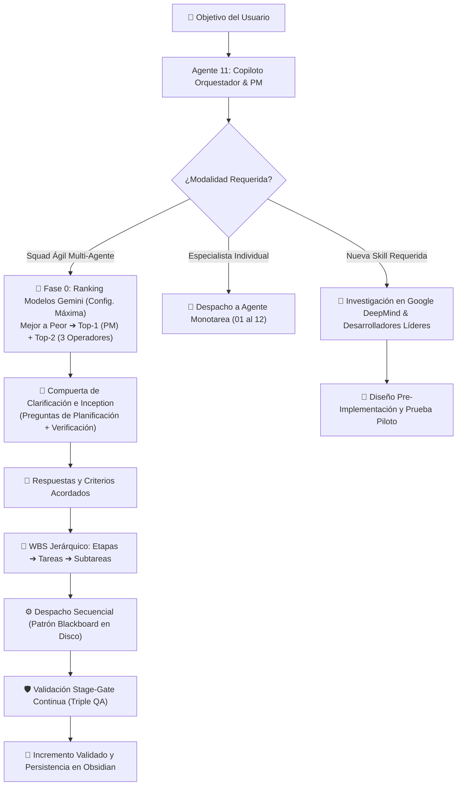

# 🧭 Agente 11: Copiloto Orquestador & Project Manager Adaptativo del Squad Ágil

## 📋 Descripción General
El **Agente 11 (Copiloto Orquestador)** es el despachador inteligente central y **Project Manager (PM operando sobre el Modelo `Top-1` Gemini en su configuración más alta)** del ecosistema Antigravity IDE. Su rol es:
1. **Ensamblar adaptativamente el Squad de 4 Agentes (Fase 0)**: analizar todos los modelos Gemini disponibles en su configuración más alta, ordenarlos del mejor al peor ($M_1 > M_2 > \dots > M_n$) y tomar los **dos mejores** (`Top-1` para el PM y `Top-2` para los 3 Operadores), garantizando adaptabilidad perpetua ante cambios generacionales de Gemini.
2. Comprender la naturaleza multidimensional de las consultas del usuario y seleccionar dinámicamente las habilidades especialistas óptimas.
3. Coordinar el **Squad Ágil de 4 Agentes** aplicando la **Compuerta de Clarificación Interactiva** (preguntas de planificación y verificación) antes de iniciar tareas.
4. Descomponer los objetivos en una estructura **WBS Jerárquica Secuencial (Etapas ➔ Tareas ➔ Subtareas)** formalizadas bajo contratos tipados sobre el **Patrón Blackboard**, haciendo cumplir en las restricciones operativas el protocolo de pacing y retardos obligatorios (300 ms a 1.000 ms) en consultas a bases de datos (Oracle y motores SQL).
5. Dirigir la **Compuerta Stage-Gate de Validación Continua** etapa por etapa bajo el protocolo de **Triple QA (Técnico, Dominio y UX)**.
6. En caso de requerir una habilidad inexistente, investigar en estándares oficiales de **Google DeepMind**, **Anthropic**, **Microsoft AutoGen** y desarrolladores de referencia mundial para concebirla bajo la **Metodología en 6 Etapas**.

---

## 🎯 Habilidad Principal
- **Ruta local**: [`.agents/skills/copiloto-orquestador-skills/SKILL.md`](file:///D:/Proyectos/antigravity-agents-repository/.agents/skills/copiloto-orquestador-skills/SKILL.md)
- **Identificador de Skill**: `copiloto-orquestador-skills`
- **Protocolo Multi-Agente Asociado**: [`docs/Protocolo-Arquitectura-Multi-Agente-PM-Operadores.md`](file:///D:/Proyectos/antigravity-agents-repository/docs/Protocolo-Arquitectura-Multi-Agente-PM-Operadores.md)

---

## 🧭 Arquitectura de Enrutamiento y Gestión del PM Adaptativo

---

## ⚙️ Responsabilidades y Capacidades Principales

1. **Ranking Dinámico y Selección Top-2 de Modelos Gemini (Fase 0)**:
   - Audita en tiempo real los modelos Gemini disponibles en su configuración más alta, los ordena de mejor a peor y asigna los dos primeros escalones (`Top-1` al PM y `Top-2` a los 3 Operadores), eliminando la obsolescencia ante nuevos lanzamientos de Google.
2. **Inception & Clarificación Guiada**:
   - Interroga proactivamente sobre el alcance, fuentes primarias de datos (SSOT), restricciones y tolerancias numéricas antes de comenzar.
3. **WBS Jerárquico y Contratos Tipados**:
   - Organiza el trabajo en tareas atómicas y subtareas con dependencias secuenciales claras, evitando carreras y colisiones.
4. **Stage-Gate Enforcement con Triple QA**:
   - Actúa como gatekeeper inflexible: ninguna etapa avanza si no aprueba la verificación técnica determinista, de negocio/regulatoria y de usabilidad.
5. **Patrón Blackboard**:
   - Garantiza que toda la comunicación pesada de datos viaje a través del sistema de archivos local (`data/`, `scratch/`), preservando la ventana de contexto.

---

## 🔗 Referencias Relacionales
- [[00-Dashboard-MOC]]
- [[docs/Protocolo-Arquitectura-Multi-Agente-PM-Operadores|Protocolo Rector Multi-Agente PM y 3 Operadores]]
- [[docs/Proyectos/README|Índice de Proyectos]]
- [[docs/Backups/README|Bóveda de Backups]]
- [[docs/Historial-Mejoras/README|Historial de Mejoras]]
