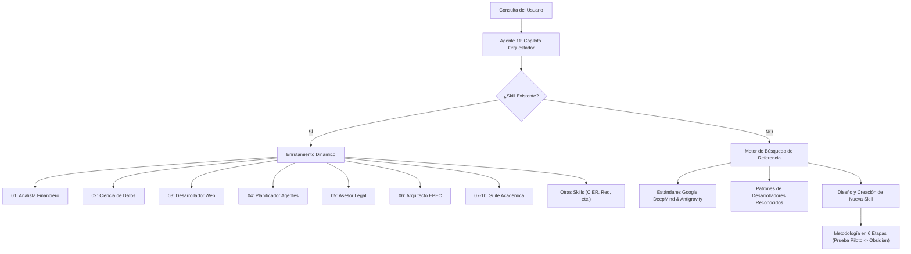

# 🧭 Agente 11: Copiloto Orquestador y Selector Dinámico de Habilidades

## 📌 Descripción General
El **Agente 11 (Copiloto Orquestador)** es el despachador inteligente central del ecosistema Antigravity IDE. Su rol es comprender la naturaleza multidimensional de las consultas del usuario, seleccionar dinámicamente la habilidad especialista que mejor se adapte al problema (Finanzas, Data Science, Web, Legal, EPEC, Cursos, etc.) y, en caso de necesitar una habilidad inexistente, investigar en estándares oficiales de **Google** y desarrolladores de referencia mundial para concebirla, estructurarla e integrarla bajo la **Metodología en 6 Etapas**.

---

## 🛠️ Habilidad Principal
- **Ruta local**: `.agents/skills/copiloto-orquestador-skills/SKILL.md`
- **Identificador de Skill**: `copiloto-orquestador-skills`

---

## 🏗️ Arquitectura de Enrutamiento y Expansión

---

## 📋 Responsabilidades y Capacidades

1. **Diagnóstico Semántico y Despacho Inteligente**:
   - Evalúa intención, datos técnicos y formato de salida para invocar al especialista idóneo sin fricción.
2. **Investigación Basada en Google y Desarrolladores Reconocidos**:
   - Para nuevos dominios, recopila patrones de `agy-customizations`, Google AI / DeepMind framework, Anthropic/OpenAI prompt & tool standards, Microsoft AutoGen y GitHub reference skills.
3. **Gobernanza del Ecosistema y Auto-Documentación**:
   - Garantiza que toda nueva habilidad cuente con su `SKILL.md`, ficha técnica en `docs/Agentes/`, nodo en `docs/00-Dashboard-MOC.md`, respaldo preventivo `.bak` en `docs/Backups/` y nota en `docs/Historial-Mejoras/`.

---

## 🔗 Referencias Relacionales
- [[00-Dashboard-MOC]]
- [[docs/Proyectos/README|Índice de Proyectos]]
- [[docs/Backups/README|Bóveda de Backups]]
- [[docs/Historial-Mejoras/README|Historial de Mejoras]]

- **Nuevo Repositorio EPEC Orquestado**: [[docs/Proyectos/2026-10-27_auditoria-relevamiento-conectar|Auditoría Relevamiento CONECTAR (PROTELEM-EPEC)]]
