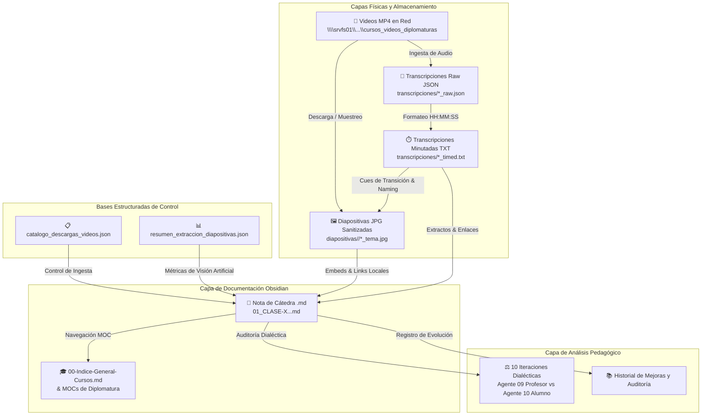

# 🧭 Guía Maestra: Relación entre Datos, Imágenes e Informes

Esta guía detalla la arquitectura de información, las habilidades técnicas desarrolladas y el modelo de navegación para consultar e interrelacionar todos los componentes del ecosistema de cursos de la bóveda: **videos crudos en red, transcripciones minutadas, imágenes de diapositivas filtradas por visión artificial, informes estructurados en Obsidian y evaluaciones dialécticas de cátedra**.

---

## 🗺️ 1. Diagrama de Relación Integral del Ecosistema



---

## 🧩 2. Matriz de Correspondencia entre Componentes

Cada clase de una diplomatura está modelada en **5 dimensiones interconectadas**:

| Dimensión | Ubicación en el Sistema | Clave de Asociación | Función Principal |
| :--- | :--- | :--- | :--- |
| **1. Video Original** | `\\srvfs01\...\Diplomatura-*\*.mp4` | `video_id` (ej. `_pxx_P8pkcU`) | Fuente audiovisual primaria en red institucional. |
| **2. Transcripción** | `docs/Cursos/<Curso>/transcripciones/<video_id>_transcript_timed.txt` | `[HH:MM:SS]` timestamp | Registro textual completo segundo a segundo. |
| **3. Diapositivas** | `docs/Cursos/<Curso>/diapositivas/<video_id>/<NN>_<HH-MM-SS>_<slug>.jpg` | `video_id` + `HH-MM-SS` | Evidencia visual filtrada (excluye rostros/webcams). |
| **4. Nota de Cátedra** | `docs/Cursos/<Curso>/<NN>_CLASE-<X>...md` | `video_id` en frontmatter YAML | Documentación ejecutiva en 6 ejes temáticos + Galería. |
| **5. Evaluación Dialéctica** | Sección `## 🎓 Evaluación Dialéctica` en la nota | Vínculo bidireccional de agentes | 10 iteraciones profesor-alumno calificadas con 10/10. |

---

## 🔍 3. Cómo Navegar e Interrogar la Información

### Caso A: Buscar un tema conceptual y ver su lámina explicativa
1. Abrir la nota de clase correspondiente en Obsidian (ej. [[docs/Cursos/Diplomatura-Energia-Electrica/02_CLASE-1--COMISIÓN-1--DIPLOMATURA-EN-ENER|Clase 1 - Comisión 1]]).
2. Ir a la sección **`## 🖼️ Registro y Desglose Exhaustivo de Diapositivas Proyectadas`**.
3. Localizar la fila con el tema (ej. `⏱️ 01:09:15 - Balance Nivel Nacional`).
4. Ver la previsualización directa de la diapositiva y hacer clic en el enlace del archivo para abrir la imagen en resolución completa.

### Caso B: Encontrar el minuto exacto donde se debatió una duda o normativa
1. Abrir el archivo minutado [`transcripciones/<video_id>_transcript_timed.txt`](file:///C:/Users/jidiaz/.gemini/antigravity-ide/scratch/antigravity-agents-repository/docs/Cursos/Diplomatura-Energia-Electrica/transcripciones/_pxx_P8pkcU_transcript_timed.txt).
2. Usar búsqueda por palabra clave (ej. `"Ley 24.065"`, `"SAIFI"`, `"CAMMESA"`).
3. Obtener el timestamp `[01:25:35]` y correlacionarlo con la filmina correspondiente: `63_01-25-35_normas-particulares-relevantes.jpg`.

### Caso C: Búsqueda Programática o Automatizada en Python
Consultar el archivo JSON maestro [`docs/Cursos/resumen_extraccion_diapositivas.json`](file:///C:/Users/jidiaz/.gemini/antigravity-ide/scratch/antigravity-agents-repository/docs/Cursos/resumen_extraccion_diapositivas.json):
```python
import json

with open("docs/Cursos/resumen_extraccion_diapositivas.json", "r", encoding="utf-8") as f:
    cursos = json.load(f)

# Buscar todas las filminas que traten sobre 'balance' o 'regulacion'
for video in cursos:
    for slide in video.get("slides", []):
        if "balance" in slide["topic"].lower() or "regulacion" in slide["topic"].lower():
            print(f"[{video['video_id']}] {slide['timestamp_str']} -> {slide['filename']}")
```

---

## 🧠 4. Habilidades y Capacidades Técnicas Desarrolladas

1. **Ingesta y Automatización Audiovisual**:
   - Descarga asincrónica y validación de integridad de 69 clases (25.97 GB) en recursos de red compartidos (`\\srvfs01\...`).
   - Manejo de seek temporal acelerado con FFmpeg para extracción de fotogramas sin recodificación innecesaria.

2. **Visión Artificial Aplicada a la Educación**:
   - Modelado de clasificadores de contenido técnico vs. cámaras web usando espacios de color multicanal (**YCrCb** para supresión de tonos de piel, **Canny** para densidad de bordes tipográficos y **Histogramas 3D** para detección de lienzo).
   - Deduplicación perceptual de imágenes mediante matrices de error cuadrático medio (MSE).

3. **Sincronización Multimodal Audio-Imagen-Texto**:
   - Extracción de indicios lingüísticos (*verbal transition cues*) a partir de transcripciones temporizadas para calibrar el momento exacto en que un orador cambia de diapositiva.
   - Generación automática de slugs descriptivos kebab-case a partir de los conceptos técnicos tratados en la ventana temporal adyacente.

4. **Gestión Documental Avanzada en Obsidian**:
   - Estructuración de notas MOC (Maps of Content), tablas de galería embebida, fichas técnicas normalizadas y evaluación dialéctica con agentes especializados.

---

## 📦 5. Resumen de Entregables Generados

- **40 Notas de Cátedra**: `Diplomatura en Energía Eléctrica` con 40 carpetas de diapositivas y transcripciones completas.
- **29 Notas de Cátedra**: `Diplomatura en Transición Energética` (Módulos 03, 04, 05, 06 y General) con sus carpetas de diapositivas y transcripciones.
- **Catálogos Centrales**:
  - [`docs/Cursos/catalogo_descargas_videos.json`](file:///C:/Users/jidiaz/.gemini/antigravity-ide/scratch/antigravity-agents-repository/docs/Cursos/catalogo_descargas_videos.json)
  - [`docs/Cursos/resumen_extraccion_diapositivas.json`](file:///C:/Users/jidiaz/.gemini/antigravity-ide/scratch/antigravity-agents-repository/docs/Cursos/resumen_extraccion_diapositivas.json)
- **Habilidades y Reglas Registradas**:
  - Skill Global: `config/skills/procesador-audiovisual-cursos/SKILL.md`
  - Skill Local: `.agents/skills/procesador-audiovisual-cursos/SKILL.md`
- **Registros Históricos de Auditoría**:
  - [`docs/Historial-Mejoras/2026-10-01_procesador-cursos-youtube_descarga-masiva-videos-red-protelem.md`](file:///C:/Users/jidiaz/.gemini/antigravity-ide/scratch/antigravity-agents-repository/docs/Historial-Mejoras/2026-10-01_procesador-cursos-youtube_descarga-masiva-videos-red-protelem.md)
  - [`docs/Historial-Mejoras/2026-10-01_transcriptor-analizador-audiovisual_prueba-piloto-transcripcion-y-documentacion-clases-0-y-1.md`](file:///C:/Users/jidiaz/.gemini/antigravity-ide/scratch/antigravity-agents-repository/docs/Historial-Mejoras/2026-10-01_transcriptor-analizador-audiovisual_prueba-piloto-transcripcion-y-documentacion-clases-0-y-1.md)
  - [`docs/Historial-Mejoras/2026-10-01_transcriptor-analizador-audiovisual_extraccion-masiva-diapositivas-y-asociacion-transcripcion.md`](file:///C:/Users/jidiaz/.gemini/antigravity-ide/scratch/antigravity-agents-repository/docs/Historial-Mejoras/2026-10-01_transcriptor-analizador-audiovisual_extraccion-masiva-diapositivas-y-asociacion-transcripcion.md)
