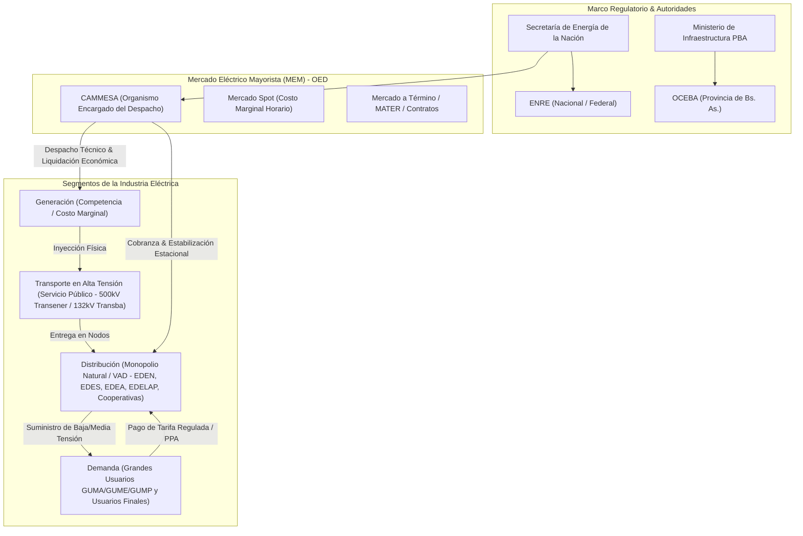
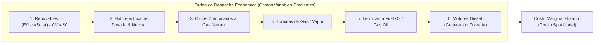

# ⚡ Monografía Integral: Mercado Eléctrico Mayorista (MEM), Regulación Institucional, Despacho Económico y Calidad del Servicio Eléctrico

---

## 🏛️ Resumen Ejecutivo & Ficha Institucional

La presente monografía constituye el compendio académico y doctrinario integral de la **Diplomatura en Energía Eléctrica en la Provincia de Buenos Aires**, dictada por el **Instituto de Desarrollo Energético (IDE) de la Universidad Tecnológica Nacional - Facultad Regional San Nicolás (UTN.FRSN)**. 

A lo largo de 40 clases magistrales dictadas en dos comisiones académicas, este trabajo sistematiza el funcionamiento físico, legal, económico y operativo del **Sistema Argentino de Interconexión (SADI)** y del **Mercado Eléctrico Mayorista (MEM)**. Se articulan las transcripciones minutadas de cátedra, el análisis de la normativa madre (**Ley Nacional N.º 24.065** y **Ley Provincial N.º 11.769 de Buenos Aires**), los procedimientos técnicos de **CAMMESA**, la formación de precios spot y estacionales, el despacho económico por orden de mérito, el régimen de remuneración a la potencia, y los estándares de calidad técnica y comercial del servicio público de distribución.



---

## 📜 1. Marco Institucional y Desintegración Vertical del Sector

### 1.1 Génesis del Marco Regulatorio Eléctrico: Ley Nacional N.º 24.065
Promulgada en 1992, la **Ley Nacional N.º 24.065** transformó de raíz la industria eléctrica argentina, que pasó de un esquema de integración vertical monopólica estatal (SEGBA, Agua y Energía Eléctrica, Hidronor) a un **modelo desintegrado verticalmente** basado en tres principios rectores:

1. **Segmentación Funcional de Actividades**:
   - **Generación**: Actividad de interés general desarrollada en régimen de **libre competencia** y riesgo empresario. Los generadores perciben ingresos por energía entregada al mercado spot o mediante contratos bilaterales a término, y por disponibilidad de potencia.
   - **Transporte en Alta Tensión**: Actividad declarada **servicio público**, prestada bajo monopolio regulado mediante concesiones exclusivas. El transportista no puede comprar ni vender energía eléctrica, garantizando el libre acceso indiscriminado (*open access*).
   - **Distribución**: Actividad calificada como **servicio público monopólico territorial**, obligada a abastecer a todos los usuarios de su área de concesión bajo tarifas reguladas que reflejan el **Valor Agregado de Distribución (VAD)**.
   - **Comercialización / Demanda**: Grandes Usuarios que pueden contratar directamente su energía con generadores o comercializadores habilitados.

2. **Prohibición Estricta de Integración Vertical y Concentración**:
   - Ningún generador, distribuidor o gran usuario puede ser propietario ni tener control mayoritario sobre empresas transportistas (Art. 30 a 32, Ley 24.065).
   - Se prohíbe a los distribuidores poseer plantas de generación que abastezcan a su propia área cautiva por fuera de las reglas del MEM.

3. **Creación del Ente Nacional Regulador de la Electricidad (ENRE)**:
   - Organismo autárquico encargado de aplicar la regulación, auditar las concesiones federales (Transener, Edenor, Edesur), resolver controversias y velar por la seguridad pública y el cumplimiento de las normas de calidad.

### 1.2 El Marco Regulatorio de la Provincia de Buenos Aires: Ley N.º 11.769
En el ámbito bonaerense, la **Ley Provincial N.º 11.769** y sus decretos reglamentarios (Decreto 186/97) estructuran el subsector eléctrico provincial:

- **Autoridad de Aplicación**: Ministerio de Infraestructura y Servicios Públicos de la Provincia de Buenos Aires y Dirección Provincial de Energía (DPE).
- **Ente Regulador Provincial**: **OCEBA (Organismo de Control de Energía Eléctrica de la Provincia de Buenos Aires)**, con facultades tarifarias, sancionatorias y de control sobre las cuatro distribuidoras provinciales (EDELAP, EDEN, EDES, EDEA) y más de 200 cooperativas eléctricas concesionarias municipales.
- **Régimen de Concesión**: Concesiones por 95 años divididas en períodos de gestión de 10 años, con revisiones tarifarias integrales (RTI) cada 5 años.

> [!IMPORTANT]
> **Cita Textual de Cátedra (Clase 1 - Comisión 1, `[00:08:15]` - `_pxx_P8pkcU`)**:
> *"La Ley 11.769 adopta la filosofía de la 24.065 pero con particularidades locales: reconoce la coexistencia histórica de las cooperativas eléctricas del interior bonaerense, establece el Fondo Provincial de Compensaciones Tarifarias para homogeneizar el costo de abastecimiento en zonas rurales de baja densidad, y crea el OCEBA como policía técnica y guardián de los cuadros tarifarios y servidumbres de paso."*

---

## ⚙️ 2. Estructura y Funcionamiento Operativo de CAMMESA y el MEM

### 2.1 Naturaleza Jurídica y Composición Societaria de CAMMESA
La **Compañía Administradora del Mercado Mayorista Eléctrico Sociedad Anónima (CAMMESA)** fue constituida por el Decreto 1192/92 como una sociedad anónima sin fines de lucro encargada de operar el sistema y administrar las transacciones económicas del MEM. Su capital social está dividido en 5 partes iguales (20% cada una):

1. **Estado Nacional** (Secretaría de Energía, quien ejerce la presidencia con poder de veto en decisiones regulatorias).
2. **Asociación de Generadores de Energía Eléctrica de la República Argentina (AGEERA)**.
3. **Asociación de Transportistas de Energía Eléctrica de la República Argentina (ATEERA)**.
4. **Asociación de Distribuidores de Energía Eléctrica de la República Argentina (ADEERA)**.
5. **Asociación de Grandes Usuarios de Energía Eléctrica de la República Argentina (AGUEERA)**.

### 2.2 Despacho Económico Centralizado y Orden de Mérito
El despacho físico de generación se realiza minuto a minuto siguiendo el **principio de minimización del costo total de operación**:

$$\min \sum_{i=1}^{N} C_i(P_i) \quad 	ext{sujeto a:} \quad \sum_{i=1}^{N} P_i = D + P_{	ext{pérdidas}}, \quad P_i^{\min} \le P_i \le P_i^{\max}, \quad 	ext{Restricciones de Red}$$

Donde $C_i(P_i)$ representa la función de costo variable de producción de la unidad generadora $i$.

```
Orden de Mérito Típico en el SADI:
1. Generación Renovable (Costo Variable ≈ 0: Eólica, Solar, Biomasa)
2. Hidroeléctrica de Pasada y Nuclear (Base sin modulación)
3. Hidroeléctrica de Embalse (Costo de Oportunidad / Valor del Agua)
4. Ciclos Combinados a Gas Natural (Alta eficiencia térmica, heat rate ≈ 1.600-1.800 kcal/kWh)
5. Turbinas de Gas / Turbinas de Vapor a Gas Natural
6. Ciclos Combinados / TV a Fuel Oil y Gas Oil (Generación forzada / Pico de alto costo)
7. Generación Diésel Distribuida (Motores de arranque rápido, costo marginal máximo)
```



### 2.3 Formación de Precios: Spot, Estacional y Régimen de Remuneración
- **Precio Spot del Mercado**: Se define horario por el **Costo Marginal del Sistema (CMg)**, correspondiente al costo variable de la última máquina despachada para satisfacer el último megavatio de demanda.
- **Precio Estacional (PEST)**: Precio estabilizado trimestral o semestralmente que pagan las distribuidoras en el nodo de entrega para trasladar a los usuarios finales cautivos (Pass-Through).
- **Fondo de Estabilización**: Instrumento administrado por CAMMESA que amortigua las discrepancias entre el precio spot real horario y el precio estacional facturado a las distribuidoras.
- **Remuneración a la Potencia Disponible**: Compensación fijada por la Secretaría de Energía para remunerar los costos fijos y asegurar la confiabilidad del sistema ante contingencias $N-1$.

---

## ⚡ 3. Infraestructura de Generación, Transporte en 500 kV y Redes de Distribución

### 3.1 Parque Generador del SADI
El sistema eléctrico argentino cuenta con una potencia instalada superior a **44.000 MW**, con una composición diversificada:
- **Térmica Convencional (≈ 58%)**: Turbinas de gas, ciclos combinados, turbinas de vapor y motores de combustión interna alimentados por gas natural de cuencas locales (Neuquina / Vaca Muerta, Austral, Noroeste) o GNL regasificado en Escobar.
- **Hidráulica (≈ 25%)**: Grandes aprovechamientos binacionales (Yacyretá, Salto Grande), complejos de embalse (El Chocón, Piedra del Águila, Alicurá) y centrales de pasada.
- **Energías Renovables (≈ 14%)**: Parques eólicos en Patagonia, PBA y Comahue; parques solares fotovoltaicos en Cuyo y NOA (Cauchari, San Juan).
- **Nuclear (≈ 3%)**: Centrales Atucha I, Atucha II y Embalse (tecnología de uranio natural y agua pesada presurizada PHWR).

### 3.2 Red Troncal de Transporte en 500 kV y Distribución Troncal en 132 kV
El transporte de energía se organiza jerárquicamente en:
- **Sistema de Transporte en Extra Alta Tensión (500 kV)**: Operado por **Transener S.A.** con más de 15.000 km de líneas que interconectan las regiones de Comahue, Cuyo, NOA, NEA, Litoral, Centro y Buenos Aires / GBA.
- **Sistemas de Transporte por Distribución Troncal (132 kV / 220 kV)**: Operados por empresas regionales concesionarias (**Transba** en PBA, **Transnoa**, **Transnea**, **Distrocuyo**, **Transpa**, **EPEC** en Córdoba).
- **Factores de Nodo y Pérdidas Técnicas**: Cada barra del sistema tiene un **Factor de Nodo ($FN_k$)** que corrige el precio spot local por las pérdidas marginales de transporte y las restricciones de transmisión:

$$P_{	ext{spot, nodo } k} = CMg_{	ext{Mercado}} 	imes FN_k$$

Si el nodo $k$ es importador deficitario alejado de la generación, $FN_k > 1.0$ (precio spot mayor); si es un nodo exportador superavitario con excedentes, $FN_k < 1.0$.

---

## 📊 4. Distribución Eléctrica: Valor Agregado de Distribución (VAD), Estructura Tarifaria y Calidad de Servicio

### 4.1 Componentes de la Tarifa de Distribución
La tarifa final abonada por los usuarios se compone de tres bloques no miscibles:

$$	ext{Tarifa Final} = 	ext{Precio Estacional de Abastecimiento (MEM)} + 	ext{Peaje de Transporte} + 	ext{VAD (Valor Agregado de Distribución)} + 	ext{Carga Impositiva}$$

El **VAD** remunera los costos de la distribuidora para operar, mantener y expandir su red:
1. **Costos de Capital (CAPEX)**: Amortización de activos e inversiones y tasa de rentabilidad razonable sobre el capital inmovilizado.
2. **Costos de Operación y Mantenimiento (OPEX)**: Sueldos, flota operativa, atención comercial, lectura de medidores y despacho local.
3. **Pérdidas Técnicas y No Técnicas Reconocidas**: Porcentaje estándar de energía perdida en conductores y transformadores admitido en la tarifa.

### 4.2 Control de Calidad de Servicio Técnico y Comercial
Los contratos de concesión y las normas de OCEBA y ENRE imponen estrictos regímenes de control:

| Índice | Denominación | Fórmula Matemática | Significado Técnico |
| :--- | :--- | :---: | :--- |
| **SAIFI** | System Average Interruption Frequency Index | $rac{\sum \lambda_i \cdot N_i}{N_{	ext{total}}}$ | **Frecuencia Media de Interrupciones por Usuario**: Número promedio de cortes sufridos por un cliente en el semestre/año. |
| **SAIDI** | System Average Interruption Duration Index | $rac{\sum r_i \cdot N_i}{N_{	ext{total}}}$ | **Duración Media de Interrupciones por Usuario**: Cantidad promedio de horas sin servicio por cliente en el período. |
| **CAIDI** | Customer Average Interruption Duration Index | $rac{	ext{SAIDI}}{	ext{SAIFI}}$ | **Tiempo Medio de Reposición del Servicio**: Duración promedio de cada interrupción una vez ocurrida la falla. |

Las distribuidoras que superan los umbrales máximos tolerados de SAIFI o SAIDI deben pagar **multas y bonificaciones directas en la factura** de los usuarios afectados.

---

## 🖼️ 5. Evidencia Visual, Láminas Técnicas & Transcripciones de Cátedra

A continuación se destacan momentos clave registrados en las diapositivas y transcripciones del curso:

### Lámina 1: Estructura del Marco Regulatorio y Desagregación Vertical
- **Archivo**: [`diapositivas/019ZeUUa4fg/05_00-08-15_marco-regulatorio.jpg`](file:///C:/Users/jidiaz/.gemini/antigravity-ide/scratch/antigravity-agents-repository/docs/Cursos/Diplomatura-Energia-Electrica/diapositivas/019ZeUUa4fg/05_00-08-15_marco-regulatorio.jpg)
- **Timestamp**: `⏱️ 00:08:15` | **Video ID**: `019ZeUUa4fg`
- **Extracto Textual**: *"La desintegración vertical impuesta por la Ley 24.065 y la 11.769 buscó separar de forma irreversible las actividades monopólicas naturales de los segmentos potencialmente competitivos, asegurando que el transportista no tenga intereses comerciales en la generación."*

### Lámina 2: Conceptualización del Mercado Eléctrico y Matriz Energética
- **Archivo**: [`diapositivas/_pxx_P8pkcU/03_00-04-15_parte-denomina-conceptualizacion-mercado.jpg`](file:///C:/Users/jidiaz/.gemini/antigravity-ide/scratch/antigravity-agents-repository/docs/Cursos/Diplomatura-Energia-Electrica/diapositivas/_pxx_P8pkcU/03_00-04-15_parte-denomina-conceptualizacion-mercado.jpg)
- **Timestamp**: `⏱️ 00:04:15` | **Video ID**: `_pxx_P8pkcU`
- **Extracto Textual**: *"Para entender la economía del sector eléctrico, primero debemos analizar el balance energético nacional y cómo se correlaciona la disponibilidad de gas natural con el costo marginal del despacho térmico."*

### Lámina 3: Formulación de Normas y Responsabilidad en Fallas de Servicio
- **Archivo**: [`diapositivas/019ZeUUa4fg/101_01-13-35_responsabilidad-debe-atribuirse-cada-par.jpg`](file:///C:/Users/jidiaz/.gemini/antigravity-ide/scratch/antigravity-agents-repository/docs/Cursos/Diplomatura-Energia-Electrica/diapositivas/019ZeUUa4fg/101_01-13-35_responsabilidad-debe-atribuirse-cada-par.jpg)
- **Timestamp**: `⏱️ 01:13:35` | **Video ID**: `019ZeUUa4fg`
- **Extracto Textual**: *"La responsabilidad ante daños por variaciones de tensión o interrupciones indebidas es de naturaleza contractual objetiva para la distribuidora, salvo prueba fehaciente de caso fortuito o fuerza mayor ajena a sus instalaciones."*

---

## ⚖️ 6. Análisis Crítico, Debates de Cátedra y Prospectiva del SADI

1. **Sostenibilidad Económica y Régimen de Subsidios**:
   - El desfasaje histórico entre el costo real monómico de generación y las tarifas de abastecimiento estacional generó déficits estructurales cubiertos por transferencias del Tesoro Nacional hacia CAMMESA. La normalización tarifaria y la segmentación por ingresos buscan recomponer la señal de precios sin desproteger a los sectores vulnerables (Tarifa Social / Nivel 2).
2. **Cuellos de Botella en la Red de 500 kV**:
   - El crecimiento de la demanda en los centros de consumo (AMBA, Centro) y la incorporación de nueva potencia renovable en regiones periféricas (NOA solar, Patagonia eólica) exige la construcción urgente de nuevas líneas troncales de 500 kV (ej. Líneas Río Diamante - Charlone - Plomer, Puerto Madryn - Bahía Blanca).
3. **Electrificación de la Demanda y Redes Inteligentes**:
   - La masificación de la movilidad eléctrica y la generación distribuida demandarán la digitalización integral de las subestaciones de distribución (protocolo IEC 61850), medidores inteligentes (AMI) y sistemas avanzados de gestión de distribución (ADMS).

---

## 📚 7. Bibliografía y Fuentes Normativas de Referencia

1. **Leyes y Decretos Nacionales**:
   - Ley Nacional N.º 24.065: *Régimen del Sector Eléctrico Nacional*.
   - Decreto PEN N.º 1398/92 y N.º 1192/92 (Constitución de CAMMESA).
   - Resoluciones Secretaría de Energía N.º 61/92: *Los Procedimientos para la Programación de la Operación, el Despacho de Cargas y el Cálculo de Precios (Los Procedimientos)*.
2. **Normativa Provincial de Buenos Aires**:
   - Ley Provincial N.º 11.769: *Marco Regulatorio de la Energía Eléctrica en la Provincia de Buenos Aires*.
   - Decreto Provincial N.º 186/97 y modificaciones.
   - Reglamentos de Suministro y Normas de Calidad de OCEBA.
3. **Material Académico**:
   - Clases grabadas de la Diplomatura en Energía Eléctrica (IDE-UTN.FRSN, 40 clases).
   - Catálogo de videos: [`docs/Cursos/catalogo_descargas_videos.json`](file:///C:/Users/jidiaz/.gemini/antigravity-ide/scratch/antigravity-agents-repository/docs/Cursos/catalogo_descargas_videos.json).
   - Base de diapositivas: [`docs/Cursos/resumen_extraccion_diapositivas.json`](file:///C:/Users/jidiaz/.gemini/antigravity-ide/scratch/antigravity-agents-repository/docs/Cursos/resumen_extraccion_diapositivas.json).
