# 🌿 Monografía Integral: Transición Energética, Almacenamiento BESS/H2, Transporte HVDC, Regulaciones y Finanzas Verdes

---

## 🏛️ Resumen Ejecutivo & Ficha Institucional

La presente monografía constituye el tratado académico, ingenieril y regulatorio integral de la **Diplomatura en Transición Energética**, dictada a través de **SomoslaSEU (Secretaría de Extensión Universitaria)**. Sintetiza las **30 clases magistrales** distribuidas en cuatro módulos troncales (**Módulo 03: Almacenamiento Energético**, **Módulo 04: Transporte Energético**, **Módulo 05: Regulaciones** y **Módulo 06: Beneficios y Políticas de la Transición Energética**), integrando las **3.052 diapositivas extraídas por visión artificial** y las transcripciones minutadas de cátedra con la **realidad operativa y regulatoria de la República Argentina en 2025–2026** (Licitación BESS **AlmaGBA de 713 MW**, reforma del MEM por **Decreto PEN N.º 450/2025** y **Resolución SE N.º 400/2025**, esquemas **MATER Pleno / Referencial A** con 8% de *curtailment*, y proyectos renovables aprobados bajo el **RIGI Ley 27.742** como **PSFV El Quemado de 305 MW** y **PE Olavarría de 180 MW**).

```mermaid
graph TD
    subgraph "Módulo 03: Almacenamiento (BESS & PHES)"
        BESS["BESS LiFePO4 (RTE 88-92%)\nBMS + PCS Grid-Forming"]
        PHES["Bombeo Hidroeléctrico (PHES)\nRío Grande / Los Reyunos"]
        AlmaGBA["Hito Real 2025/2026: Licitación AlmaGBA\n713 MW adjudicados (4h) ~USD 10.161/MW-mes"]
    end

    subgraph "Módulo 04: Transporte Energético (HVAC & HVDC)"
        HVAC["SADI 500 kV / 132 kV\nLímite SIL y Compensación Serie/Shunt"]
        HVDC["HVDC VSC (IGBT Multinivel MMC)\nDistancia crítica > 600 km sin reactiva"]
        Obras500["Hito Real 2025/2026: Ampliación 500 kV\nCorredor Bahía Blanca - Ezeiza (ET Olavarría)"]
    end

    subgraph "Módulo 05: Regulaciones y Mercados"
        L27191["Ley 27.191 (Meta 20% Demanda >300 kW)\nMATER Pleno vs. Referencial A (8% Curtailment)"]
        L27424["Ley 27.424 Generación Distribuida\nNet Billing vs. Net Metering + Ley Cba 10.604"]
        Dec450["Hito Real 2025/2026: Decreto 450/2025 & Res. SE 400/2025\nNormalización MEM y CAMMESA como OED puro"]
    end

    subgraph "Módulo 06: Descarbonización, H2 Verde y Finanzas"
        Kaya["Identidad de Kaya & NDC Acuerdo de París"]
        H2["Hidrógeno Verde (50-55 kWh/kg)\ny Amoníaco Verde Haber-Bosch (-33°C)"]
        RIGI_Fin["Finanzas Verdes (Bonos Verdes, I-REC, Greenium)\n& RIGI Ley 27.742 (El Quemado 305 MW / Olavarría 180 MW)"]
    end

    BESS --> AlmaGBA
    HVAC --> Obras500
    HVDC --> Obras500
    L27191 --> Dec450
    H2 --> RIGI_Fin
```

---

## 🔋 1. Módulo 03: Tecnologías de Almacenamiento Energético (BESS, Bombeo y Térmico)

### 1.1 Química Electroquímica y Sistemas BESS (Battery Energy Storage Systems)
En las 5 clases del Módulo 03 se demuestra que la integración masiva de generación renovable variable (solar fotovoltaica y eólica) exige desacoplar temporalmente la generación de la demanda:
- **Litio-Ferrofosfato ($\text{LiFePO}_4$ / LFP) vs. Níquel-Manganeso-Cobalto (NMC)**: La tecnología LFP se consolidó como el estándar *Utility-Scale* estacionario por su altísima estabilidad térmica (sin liberación de oxígeno ni *thermal runaway* temprano), vida útil de **6.000 a 8.000 ciclos** al 80% de profundidad de descarga ($DoD$) y ausencia de cobalto.
- **Eficiencia de Ciclo Completo (*Round-Trip Efficiency* - RTE)**:
  $$\eta_{\text{RTE}} = \frac{E_{\text{descarga AC}}}{E_{\text{carga AC}}} \times 100 \approx 88\% - 92\% \quad [\text{BESS LiFePO}_4]$$
- **Arquitectura de Control**:
  - **BMS (Battery Management System)**: Monitoreo de tensión y temperatura celda a celda, estimación del Estado de Carga ($SoC$) y Estado de Salud ($SoH$), y balanceo activo/pasivo.
  - **PCS (Power Conversion System) Grid-Following vs. Grid-Forming**:
    - *Grid-Following (GFL)*: Opera como fuente de corriente sincronizada mediante lazo de enganche de fase (*PLL*) siguiendo una onda de tensión impuesta por generadores síncronos. Colapsa en redes débiles con baja potencia de cortocircuito ($SCR < 2$).
    - *Grid-Forming (GFM)*: Opera como fuente de tensión ideal detrás de una impedancia acoplada, **sintetizando inercia virtual instantánea ($H_{\text{sint}}$)**, amortiguando la tasa de cambio de frecuencia ($RoCoF = df/dt$), fijando la referencia de tensión/frecuencia y permitiendo arranque en negro (*Black Start*).

### 1.2 Almacenamiento Hidráulico por Bombeo (PHES) y Térmico (TES)
- **Centrales de Bombeo (ej. Complejo Río Grande en Córdoba - 750 MW, y Los Reyunos en Mendoza)**:
  $$P_{\text{hidro}} = \rho \cdot g \cdot Q \cdot H \cdot \eta_{\text{turbina}} \quad [\text{W}]$$
  Con eficiencia de ciclo completo $\eta_{\text{PHES}} \approx 75\% - 80\%$, proveen almacenamiento estacional y diario de gran escala e inercia mecánica síncrona real.
- **Baterías de Flujo Redox (Vanadio)** y **Sales Fundidas ($\text{NaNO}_3 + \text{KNO}_3$)**: Soluciones para almacenamiento de larga duración ($> 8\text{ horas}$).

### 1.3 Contraste con la Realidad Argentina 2025–2026: Licitación BESS "AlmaGBA"
La teoría dictada en el Módulo 03 se materializó en Argentina mediante la histórica convocatoria **AlmaGBA** (Resolución SE 67/2025 / CAMMESA):
- **Objetivo Técnico**: Instalar bancos de baterías BESS con **4 horas de descarga continua** en nodos críticos del AMBA (áreas de Edenor y Edesur) para recortar picos de demanda (*peak shaving*), desplazar generación térmica forzada a gasoil/fuel oil y evitar cortes de suministro en verano/invierno.
- **Resultado del Mercado**: Sobre un objetivo inicial de **500 MW**, se recibieron **27 ofertas por 1.347 MW** (> USD 1.000 millones). Frente a un precio máximo de referencia de **USD 15.000/MW-mes**, la competencia redujo los precios adjudicados hasta **~USD 10.161/MW-mes**, permitiendo ampliar la adjudicación a **más de 713 MW** (incluyendo centrales como *BESS Nuevo Puerto*, *BESS Costanera* y *BESS Chingolo* de Central Puerto, MSU Energy y Genneia).
- **Esquema Contractual Modernizado**: Contratos PPA de capacidad a **15 años** firmados directamente entre los adjudicatarios y las distribuidoras **Edenor y Edesur**, con **CAMMESA** actuando como garante de pago de última instancia.

---

## ⚡ 2. Módulo 04: Transporte Energético de Alta Tensión (HVAC vs. HVDC)

### 2.1 Limitaciones Físicas del Transporte en Corriente Alterna (HVAC 500 kV)
En el SADI, los recursos renovables de clase mundial se ubican a más de 1.000 km de la demanda concentrada en AMBA/Litoral (viento en Patagonia con factores de planta del 50–60%, radiación solar en Puna/Cuyo con $> 2.500\text{ kWh/m}^2\text{-año}$). El transporte en CA a 500 kV enfrenta tres límites físicos:
1. **Límite de Estabilidad Angular Estática y Transitoria**:
   $$P_{ij} = \frac{V_i V_j}{X_L} \sin(\delta_i - \delta_j)$$
   A medida que crece la longitud $L$, aumenta la reactancia longitudinal $X_L = \omega L_{\text{ind}} \cdot L$, reduciendo la potencia máxima transmisible y obligando a instalar **bancos de capacitores serie** para compensar virtualmente la longitud eléctrica de la línea.
2. **Potencia Natural o Impedancia Característica (SIL - *Surge Impedance Loading*)**:
   $$SIL = \frac{V_n^2}{Z_c} \quad \text{donde} \quad Z_c = \sqrt{\frac{l}{c}}$$
   Cuando la línea opera por debajo del $SIL$ (horas valle), predomina el efecto capacitivo transversal, provocando sobretensiones en el extremo receptor (**Efecto Ferranti**) que exigen **reactores shunt** de absorción reactiva.
3. **Corrientes Capacitivas y Efecto Piel (*Skin Effect*)**: Aumentan las pérdidas Joule ($3 I^2 R_{AC}$).

### 2.2 Transmisión en Corriente Continua de Alta Tensión (HVDC LCC y VSC)
- **Distancia Crítica de Equilibrio Económico (*Break-Even Distance*)**: Para líneas aéreas superiores a **600–800 km** (o cables submarinos/subterráneos $> 50\text{ km}$), el menor costo de torres, servidumbre y conductores bipolares ($\pm 500\text{ kV}$ o $\pm 800\text{ kV}$ DC) compensa el mayor costo de las estaciones conversoras AC/DC:
  $$P_{\text{loss, HVDC}} = 2 \cdot I_{\text{DC}}^2 \cdot R_{\text{DC}} \ll P_{\text{loss, HVAC}} \quad (\text{para } L > 600\text{ km})$$
- **Tecnología HVDC VSC (*Voltage Source Converters*) con IGBT Multinivel (MMC)**:
  - Permite control independiente y continuo de potencia activa ($P$) y potencia reactiva ($Q$) en los cuatro cuadrantes sin necesidad de red síncrona fuerte en el extremo receptor.
  - Desacopla asíncronamente las frecuencias de las regiones interconectadas, impidiendo la propagación en cascada de perturbaciones o apagones.

### 2.3 Contraste con la Realidad Argentina 2025–2026: Obras de Transporte Privadas bajo RIGI
- **Caso Real — Parque Eólico Olavarría (PCR y ArcelorMittal Acindar, 180 MW, USD 250–275M)**: Aprobado bajo el **RIGI**, demuestra en la práctica la solución a los cuellos de botella del transporte enseñada en el Módulo 04: el proyecto financia e integra el **reemplazo de bancos de capacitores serie y equipamiento en las ETs Olavarría y Ezeiza sobre el corredor de 500 kV Bahía Blanca – Ezeiza/Abasto**, ampliando el límite de estabilidad de la línea troncal para evacuar tanto la energía propia hacia las acerías de Acindar como nuevos bloques renovables de terceros.

---

## ⚖️ 3. Módulo 05: Marcos Regulatorios (Leyes 27.191, 27.424, MATER y Reforma Decreto 450/2025)

### 3.1 Régimen de Fomento a las Energías Renovables (Ley N.º 27.191 y MATER)
- **Obligación de los Grandes Usuarios**: Todo Gran Usuario del MEM con demanda media $\ge 300\text{ kW}$ (GUMAs y grandes GUMEs) debe abastecer como mínimo el **20% de su consumo eléctrico** con fuentes renovables (meta legal desde el 31/12/2025).
- **Penalidad por Incumplimiento**:
  $$\text{Multa} = \left(E_{\text{obligatoria}} - E_{\text{renovable abastecida}}\right) \times CMg_{\text{gasoil CAMMESA}}$$
- **Mecanismos de Asignación de Prioridad de Despacho en CAMMESA (Realidad 2025–2026)**:
  1. **MATER Pleno**: Asignación en corredores y nodos con capacidad de transporte vacante al 100%.
  2. **MATER Referencial A**: Esquema innovador instrumentado por CAMMESA para corredores saturados que habilita el ingreso de nuevos parques renovables admitiendo una probabilidad de **recorte o vertimiento programado (*curtailment*) de hasta el 8% anual** de la energía generada hasta que se concreten las ampliaciones de transmisión.
  3. **Proyectos con Demanda Incremental / Obras de Transporte Asociadas**: Prioridad para generadores que financian ampliaciones de red o integran almacenamiento BESS.

### 3.2 Generación Distribuida y Parques Comunitarios (Ley Nacional N.º 27.424 y Ley Córdoba N.º 10.604)
- **Esquema de Facturación *Net Billing* (Balance Neto de Facturación)** vs. *Net Metering* (Balance Neto de Energía):
  - En Argentina rige el **Net Billing** (Art. 12 Ley 27.424, Decreto 986/2018): la energía consumida de la red se paga a la tarifa minorista plena (que incluye PEST + Transporte + VAD + Impuestos), mientras que la energía excedente inyectada a la red se remunera al **Precio Estacional Mayorista (PEST)** de energía (y potencia según banda horaria), dejando intacta la remuneración del **VAD** de la distribuidora por el uso bidireccional de su red física.
  $$\text{Saldo Neto Factura} = \left(E_{\text{consumida}} \times T_{\text{minorista}}\right) - \left(E_{\text{inyectada}} \times P_{\text{inyección PEST}}\right) + \text{Cargos Fijos VAD} + \text{Impuestos (s/ consumo bruto)}$$
- **Generación Distribuida Comunitaria Virtual (Carácter Multi-Usuario)**: Habilita a consorcios, pymes o cooperativas a ser copropietarios de un parque solar remoto dentro de la misma área de concesión y recibir créditos de inyección en sus facturas individuales conforme a un porcentaje de cesión o algoritmo de reparto LET.

### 3.3 Reforma Estructural del MEM 2025–2026: Decreto PEN N.º 450/2025 y Resolución SE N.º 400/2025
Dictado en ejercicio de las facultades delegadas por la **Ley de Bases N.º 27.742**, el **Decreto N.º 450/2025** actualiza las Leyes 15.336 y 24.065 fijando un período de transición de **24 meses** hacia la desregulación y normalización del MEM:
1. **Retorno de CAMMESA a su Rol Puro de OED**: CAMMESA deja progresivamente de ser el comprador/vendedor centralizado de combustibles y firmante de contratos masivos de abastecimiento, retomando su rol técnico estricto de **Organismo Encargado del Despacho (OED)** y liquidador de transacciones.
2. **Desregulación de Combustibles**: Los generadores térmicos pasan a contratar libremente su propio gas natural, GNL y combustibles líquidos directamente con los productores.
3. **Contractualización Obligatoria en el Mercado a Término (MAT)**: Las distribuidoras deben cubrir un porcentaje creciente de su demanda mediante contratos bilaterales a término con generadores, reduciendo la exposición al spot y promoviendo señales de inversión de largo plazo.
4. **Intangibilidad y Transparencia de la Factura Eléctrica**: Prohibición de incluir tasas municipales ajenas al servicio eléctrico o cargos locales encubiertos en la boleta de luz, transparentando el Pass-Through y el VAD.

---

## 🌍 4. Módulo 06: Descarbonización Profunda, Hidrógeno Verde y Finanzas Sostenibles

### 4.1 La Identidad de Kaya y las Contribuciones Determinadas a Nivel Nacional (NDC)
La formulación macroeconómica que gobierna las políticas climáticas del Acuerdo de París (meta de limitar el calentamiento a $< 1,5^\circ\text{C} - 2,0^\circ\text{C}$) se expresa mediante la **Identidad de Kaya**:
$$F_{\text{CO}_2} = P \times \left(\frac{PIB}{P}\right) \times \left(\frac{E}{PIB}\right) \times \left(\frac{\text{CO}_2}{E}\right)$$
Donde:
- $P$: Población.
- $PIB / P$: Producto Bruto Interno per cápita (crecimiento económico).
- $E / PIB$: **Intensidad Energética de la Economía** (se reduce mediante **Eficiencia Energética** y electrificación con bombas de calor y motores eléctricos de rendimiento $> 90\%$).
- $\text{CO}_2 / E$: **Intensidad de Carbono de la Matriz Energética** (se reduce mediante **Energías Renovables, Energía Nuclear, Almacenamiento BESS e Hidrógeno Verde**).

### 4.2 Economía del Hidrógeno Verde ($\text{H}_2$) y Amoníaco Verde ($\text{NH}_3$)
Para descarbonizar sectores de abatimiento complejo (*Hard-to-Abate Sectors*: siderurgia de reducción directa DRI como Acindar, petroquímica, fertilizantes, transporte marítimo y aviación SAF):
1. **Electrólisis del Agua (Alcalina, PEM y SOEC)**:
   $$2\,\text{H}_2\text{O}_{(l)} + \text{Energía Eléctrica Renovable } (50 - 55\text{ kWh/kg }\text{H}_2) \longrightarrow 2\,\text{H}_{2(g)} + \text{O}_{2(g)}$$
   - *Alcalina (KOH)*: Tecnología madura y de menor CAPEX, pero menor respuesta dinámica.
   - *PEM (Membrana de Intercambio Protónico)*: Respuesta en milisegundos ideal para acoplarse a parques eólicos y solares variables, alta pureza ($99,999\%$).
2. **El Problema Logístico del Hidrógeno y el Vector Amoníaco Verde ($\text{NH}_3$)**:
   - El $\text{H}_2$ posee altísima densidad energética gravimétrica ($120\text{ MJ/kg} = 33,33\text{ kWh/kg}$ LHV, casi $3\times$ la del gas natural), pero **bajísima densidad volumétrica**. Comprimirlo exige $350 - 700\text{ bar}$ y licuarlo requiere enfriar a **$-253^\circ\text{C}$** consumiendo ~30% de su energía contenida y provocando fragilización metalúrgica (*hydrogen embrittlement*) en aceros al carbono.
   - **Síntesis de Haber-Bosch Verde**: Combinando $\text{H}_2$ verde con nitrógeno ($\text{N}_2$) separado criogénicamente del aire:
     $$\text{N}_{2(g)} + 3\,\text{H}_{2(g)} \xrightarrow{400\text{-}500^\circ\text{C},\; 150\text{-}250\text{ bar},\; \text{Cat. Fe}} 2\,\text{NH}_{3(g)} \quad (\Delta H^\circ = -92,4\text{ kJ/mol})$$
   - El **Amoníaco Verde ($\text{NH}_3$)** se licúa a solo **$-33^\circ\text{C}$ a presión atmosférica** (o a $8\text{-}10\text{ bar}$ a temperatura ambiente), permitiendo su transporte marítimo intercontinental en buques gaseros LPG estándar ya existentes y su uso directo como fertilizante descarbonizado o combustible marítimo.

### 4.3 Finanzas Sostenibles, LCOE / LCOS y Proyectos RIGI en Argentina
- **Costo Nivelado de la Energía (LCOE) y del Almacenamiento (LCOS)**:
  $$\text{LCOE} = \frac{\sum_{t=0}^{N} \frac{\text{CAPEX}_t + \text{OPEX}_t}{(1 + WACC)^t}}{\sum_{t=1}^{N} \frac{E_{\text{neta}, t} \cdot (1 - d)^{t-1}}{(1 + WACC)^t}} \quad [\text{USD/MWh}]$$
- **Instrumentos de Deuda y Certificación Verde**:
  - **Bonos Verdes (*Green Bonds* - Principios ICMA)**: Financiamiento afectado exclusivamente a proyectos renovables/eficiencia, obteniendo una prima de tasa favorable (**Greenium** de $15\text{ a }50\text{ bps}$).
  - **Bonos Vinculados a la Sostenibilidad (*Sustainability-Linked Bonds* - SLBs)**: Tasa de cupón atada al cumplimiento de KPIs ambientales corporativos (*step-up / step-down*).
  - **Certificados I-REC y Créditos de Carbono**: Trazabilidad de Atributos Ambientales (1 I-REC = 1 MWh renovable) y mercados de carbono regulados (Art. 6 Acuerdo de París / CBAM europeo) vs. voluntarios (Verra VCS / Gold Standard).
- **Proyectos Reales Aprobados bajo RIGI (Ley 27.742) en 2025–2026**:
  1. **Parque Solar El Quemado (YPF Luz — Las Heras, Mendoza)**: **305 MW** con más de 500.000 paneles bifaciales, inversión de **USD 211–220 millones**, primer proyecto renovable adherido al RIGI en entrar en construcción/operación con subestación GIS conectada a Distrocuyo.
  2. **Parque Eólico Olavarría (PCR y ArcelorMittal Acindar — PBA)**: **180 MW** (30 aerogeneradores de 6 MW), inversión de **USD 250–275 millones**, destinado a descarbonizar el acero de Acindar (mitigación directa frente al impuesto al carbono fronterizo CBAM de la Unión Europea) e integrando obras de ampliación en 500 kV.

---

## 🎓 5. Tabla Maestra de Articulación: De la Cátedra a los Agentes Antigravity

| Módulo / Eje de Cátedra | Ecuación / Norma Rectora | Hito Real Argentino 2025–2026 | Agentes Enriquecidos |
| :--- | :--- | :--- | :--- |
| **M03: Almacenamiento BESS & PHES** | $\eta_{\text{RTE}} \approx 88\text{-}92\%$, Grid-Forming ($RoCoF$, $SCR$) | **Licitación AlmaGBA**: 713 MW BESS (4h) en AMBA a ~USD 10.161/MW-mes (Edenor/Edesur + CAMMESA) | `09-Profesor-MEM`, `13-Solar-Renovables`, `01-Analista-Financiero`, `06-Arquitecto-EPEC` |
| **M04: Transporte HVDC & 500 kV** | $SIL = V_n^2/Z_c$, $P_{ij} = \frac{V_i V_j}{X}\sin\delta$, Break-even $>600\text{ km}$ | **PE Olavarría (180 MW RIGI)**: Ampliación privada de capacitores serie en corredor 500 kV Bahía Blanca–Ezeiza | `09-Profesor-MEM`, `13-Solar-Renovables`, `02-Ciencia-de-Datos` |
| **M05: Regulaciones & MATER** | Ley 27.191 (20%), Ley 27.424 (Net Billing), Decreto 450/2025 | **Decreto 450/2025 & Res. SE 400/2025** (CAMMESA OED puro, MAT obligatorio) + **MATER Referencial A (8% curtailment)** | `05-Asesor-Legal`, `12-Facturacion-EPEC`, `09-Profesor-MEM`, `13-Solar-Renovables` |
| **M06: H2 Verde, Kaya & Finanzas** | Identidad de Kaya, Haber-Bosch ($\text{NH}_3$ a $-33^\circ\text{C}$), LCOE/LCOS | **PSFV El Quemado (305 MW RIGI, USD 220M)** + Bonos Verdes, I-RECs y mitigación CBAM en siderurgia | `01-Analista-Financiero`, `13-Solar-Renovables`, `09-Profesor-MEM`, `10-Alumno-Auditor` |

---

## 🔗 6. Navegación Relacional en la Bóveda
- [[docs/Cursos/00-Indice-General-Cursos|⬅️ Índice General de Cursos y Diplomaturas]]
- [[docs/Cursos/Diplomatura-Transicion-Energetica/00-MOC-Diplomatura-Transicion-Energetica|MOC - Diplomatura en Transición Energética (30 Clases)]]
- [[docs/Cursos/Diplomatura-Energia-Electrica/Monografia-Integral-Diplomatura-Energia-Electrica|Monografía Hermana: Diplomatura en Energía Eléctrica (40 Clases)]]
- [[00-Dashboard-MOC|🏠 Dashboard MOC Principal]]

