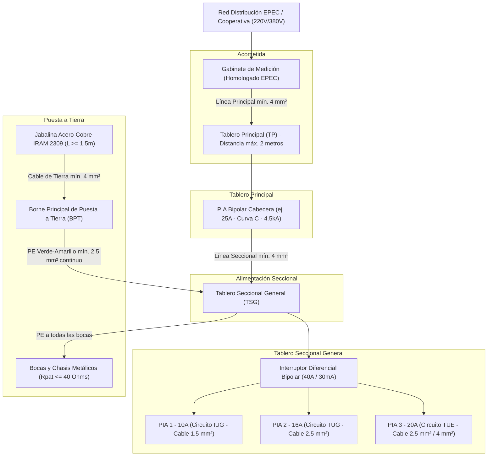

# ⚡ Guía de Estudio Integral y Banco de Ejercicios: Electricista Habilitado Categoría III (ERSeP - Ley Provincial N° 10.281)

Documento técnico elaborado por el **Agente 11: Copiloto Orquestador y Selector Dinámico de Habilidades** bajo la **Metodología Estandarizada en 6 Etapas** para la preparación, estudio y ejercitación práctica para rendir y aprobar el examen de idoneidad ante el **ERSeP (Ente Regulador de Servicios Públicos de la Provincia de Córdoba)**.

---

## 🏛️ Fase 1: Marco Institucional, Normativo y Alcance de Incumbencia

### 1.1. Contexto Legal y Autoridad de Aplicación
- **Marco Legal Rector**: **Ley Provincial de Seguridad Eléctrica N° 10.281** de la Provincia de Córdoba y su **Decreto Reglamentario N° 1022/2015**.
- **Autoridad de Aplicación**: **ERSeP**. Administra el Registro Provincial de Instaladores Electricistas Habilitados (RPIEH).
- **Normativa Técnica de Referencia**: **Reglamentación para la Ejecución de Instalaciones Eléctricas en Inmuebles de la Asociación Electrotécnica Argentina (AEA 90364 - Parte 7, Sección 771: Viviendas, Oficinas y Locales Unitarios)**.
- **Distribuidoras Reguladas**: EPEC (Empresa Provincial de Energía de Córdoba) y la totalidad de Cooperativas Eléctricas del territorio provincial.

### 1.2. Clasificación de Categorías según Decreto 1022/2015
1. **Categoría I (Especialistas Universitarios)**: Ingenieros Electricistas, Electromecánicos, Mecánicos-Electricistas con título de grado habilitante. Sin límite de potencia en BT, MT y AT.
2. **Categoría II (Técnicos de Nivel Medio)**: Técnicos Electricistas o Electromecánicos egresados de escuelas técnicas. Límite hasta Media Tensión según incumbencia de su título.
3. **Categoría III (Idóneos)**: Personas con oficio práctico que aprueban el curso oficial de formación y/o el examen de suficiencia y evaluación teórica-práctica ante el ERSeP.

### 1.3. Alcance e Incumbencias Estrictas de la Categoría III
- **Ámbito**: Inmuebles destinados a vivienda unifamiliar, unidades habitacionales individuales en propiedad horizontal, oficinas individuales y locales comerciales o de servicios unitarios.
- **Tensión de Operación**: Baja Tensión nominal ($220\,\text{V}$ monofásica / $380\,\text{V}$ trifásica).
- **Límite de Potencia Máxima**: Demanda de Potencia Máxima Simultánea (DPMS) **hasta 10 kW** inclusive.
- **Entregable Oficial**: Emisión, suscripción y registro del **Certificado de Instalación Eléctrica Apta (CIEA)** a través de la plataforma digital provincial (Ciudadano Digital - CIDI) para tramitar conexión de suministro nuevo, cambio de titularidad o rehabilitación ante EPEC y cooperativas.
- **Exclusiones Terminantes**: Quedan excluidos establecimientos industriales de envergadura, locales de pública concurrencia de alta afluencia (cines, teatros, estadios), salas médicas / quirófanos (sección 710 AEA), locales con riesgo de explosión (sección 704/720) y redes de distribución externa.

---

## 📚 Fase 2: Marco Teórico-Normativo Indispensable para el Examen

### 2.1. Las "Cinco Reglas de Oro" de la Seguridad Eléctrica
Procedimiento de cumplimiento obligatorio para trabajar en instalaciones sin tensión:
1. **Corte visible o efectivo**: Desconectar todas las fuentes de alimentación (abrir seccionadores, disyuntores o termomagnéticas).
2. **Bloqueo o enclavamiento**: Bloquear mecánicamente los aparatos de corte para impedir su reconexión accidental (candados, trabas, tarjetas de advertencia "No Operar").
3. **Verificación de ausencia de tensión**: Comprobar con multímetro, voltímetro o detector de tensión verificado la ausencia total de potencial entre fases y entre fase-neutro/tierra.
4. **Puesta a tierra y en cortocircuito**: Colocar electrodos y puentes de cortocircuito provisorios en los extremos de la zona de trabajo (especialmente crítico ante inducciones o reconexiones externas).
5. **Señalización y delimitación**: Colocar carteles de seguridad y vallado que delimiten el área de trabajo protegida.

---

### 2.2. Grados de Electrificación en Viviendas (AEA 771.8)
Se determina por la **Superficie Límite de Aplicación ($S_l$)**:
$$S_l = S_{\text{cubierta}} + 0.50 \times S_{\text{semicubierta}}$$

| Grado de Electrificación | Superficie Límite ($S_l$) | Cantidad Mínima de Circuitos | Composición Mínima Obligatoria |
|---|---|---|---|
| **Mínimo** | Hasta $60\,\text{m}^2$ | **2** | 1 IUG + 1 TUG |
| **Medio** | Más de $60\,\text{m}^2$ hasta $130\,\text{m}^2$ | **3** | 1 IUG + 1 TUG + 1 circuito a libre elección (IUG / TUG / TUE) |
| **Elevado** | Más de $130\,\text{m}^2$ hasta $200\,\text{m}^2$ | **5** | 2 IUG + 2 TUG + 1 TUE |
| **Superior** | Más de $200\,\text{m}^2$ | **6** | 2 IUG + 3 TUG + 1 TUE |

*Nomenclatura reglamentaria de circuitos:*
- **IUG**: Iluminación de Uso General (bocas en techo/pared, máx. 15 bocas por circuito).
- **TUG**: Tomacorrientes de Uso General (fichas de 10 A, máx. 15 bocas por circuito; los tomas dobles en la misma caja cuentan como 1 boca).
- **IUE**: Iluminación de Uso Especial (bocas de iluminación a la intemperie o con lámparas de más de 16 A, máx. 12 bocas).
- **TUE**: Tomacorrientes de Uso Especial (fichas de 20 A para aires acondicionados, termotanques eléctricos, cocinas, soldadoras; máx. 12 bocas por circuito).

---

### 2.3. Secciones Mínimas de Conductores de Cobre (AEA 771.13)
Los conductores deben responder a normas **IRAM NM 247-3** (aislación PVC no propagante de llama) o **IRAM 62266** (libres de halógenos y baja emisión de humos oscuros tóxicos):

| Tipo de Circuito / Tramo | Sección Mínima Admisible |
|---|---|
| **Línea Principal** (Medidor a Tablero Principal) | **$4\,\text{mm}^2$** (cobre) |
| **Línea Seccional** (Tablero Principal a Tablero Seccional) | **$2.5\,\text{mm}^2$** (mínimo general) / **$4\,\text{mm}^2$** recomendado |
| **Circuitos Terminales IUG** (Fase y Neutro) | **$1.5\,\text{mm}^2$** |
| **Retornos de interruptores de efecto** (llaves de luz) | **$1.5\,\text{mm}^2$** |
| **Circuitos Terminales TUG y TUE** (Fase y Neutro) | **$2.5\,\text{mm}^2$** |
| **Conductor de Protección (PE - Puesta a Tierra)** | **$2.5\,\text{mm}^2$** (sin seccionar, aislado en Verde-Amarillo) |
| **Conductor de Puesta a Tierra** (de jabalina a Borne Principal de Tierra) | **$4\,\text{mm}^2$** (mínimo con protección mecánica) / **$10\,\text{mm}^2$** sin protección mecánica |

---

### 2.4. Código de Colores Obligatorio de Conductores (IRAM 2183)
- **Fase R (Línea 1)**: Marrón.
- **Fase S (Línea 2)**: Negro.
- **Fase T (Línea 3)**: Rojo.
- **Neutro (N)**: **Celeste exclusivo** (prohibido utilizarlo para fases, retornos o tierra).
- **Protección (PE)**: **Verde y Amarillo exclusivo** (bicolor, prohibido para cualquier otro fin).
- **Retornos de iluminación**: Pueden ser blanco, gris u otro color excepto celeste o verde-amarillo.

---

### 2.5. Capacidad de Corriente Admisible ($I_z$) y Coordinación de Protecciones
Para conductores de cobre en cañería embutida en mampostería termoplástica, a temperatura ambiente de $40^\circ\text{C}$ (2 conductores con carga - monofásica):

| Sección Nominal ($S$) | Corriente Admisible ($I_z$) | Calibre Típico PIA ($I_n$) |
|---|---|---|
| $1.5\,\text{mm}^2$ | **$15\,\text{A}$** | **$10\,\text{A}$** (Curva C) |
| $2.5\,\text{mm}^2$ | **$21\,\text{A}$** | **$16\,\text{A}$** (Curva C) |
| $4.0\,\text{mm}^2$ | **$28\,\text{A}$** | **$20\,\text{A}$** o **$25\,\text{A}$** (Curva C) |
| $6.0\,\text{mm}^2$ | **$36\,\text{A}$** | **$32\,\text{A}$** (Curva C) |
| $10.0\,\text{mm}^2$ | **$50\,\text{A}$** | **$40\,\text{A}$** o **$50\,\text{A}$** (Curva C) |

**Condición Obligatoria de Coordinación contra Sobrecargas (AEA 771.19)**:
$$I_b \le I_n \le I_z$$
$$I_2 \le 1.45 \times I_z$$
Donde:
- $I_b$: Corriente de proyecto o carga del circuito.
- $I_n$: Corriente nominal del pequeño interruptor termomagnético (PIA).
- $I_z$: Corriente máxima admisible del conductor a temperatura de régimen.
- $I_2$: Corriente convencional de desconexión de la protección (para PIA curva B o C, $I_2 = 1.45 \times I_n$).

---

### 2.6. Sistema de Puesta a Tierra (PAT) y Protección Diferencial
- **Esquema de Conexión a Tierra (ECT)**: **Esquema TT obligatorio** en inmuebles según AEA y ERSeP.
- **Electrodo de Tierra**: Jabalina cilíndrica de acero cobreado según **IRAM 2309** (mínimo $1.50\,\text{m}$ de longitud y $14.3\,\text{mm}$ de diámetro exterior, con capa de cobre electrolítico de $254\,\mu\text{m}$ depositada).
- **Caja de Inspección**: En piso de mampostería o material termoplástico resistente, con tapa extraíble y tomacable de bronce asegurado sin soldadura blanda.
- **Resistencia Máxima de Puesta a Tierra**:
  $$R_{\text{PAT}} \le 40\,\Omega$$
  *(Medida con telurímetro con estacas auxiliares a 10 y 20 metros, o telurímetro de lazo homologado).*
- **Interruptor Diferencial (ID)**:
  - Sensibilidad nominal de disparo: **$I_{\Delta n} = 30\,\text{mA}$** (protege contra contactos indirectos y como protección complementaria contra contactos directos).
  - Tiempo de disparo: instantáneo, $\le 40\,\text{ms}$ ante una corriente de defecto de $5 \times I_{\Delta n}$.
  - Coordinación de seguridad de tensiones de contacto:
    $$U_L = I_{\Delta n} \times R_{\text{PAT}} = 0.030\,\text{A} \times 40\,\Omega = 1.2\,\text{V} \ll 24\,\text{V}$$
    *(Garantiza que la tensión residual sobre la masa metálica jamás alcance los $24\,\text{V}$ peligrosos para el ser humano).*

---

### 2.7. Caída de Tensión Admisible ($\Delta V$)
Calculada desde los bornes de salida del medidor hasta el punto de consumo más desfavorable:
- **Circuitos terminales de iluminación (IUG/IUE)**: Máximo **$3\%$** ($0.03 \times 220\,\text{V} = 6.6\,\text{V}$).
- **Circuitos terminales de tomacorrientes y fuerza motriz**: Máximo **$5\%$** ($0.05 \times 220\,\text{V} = 11.0\,\text{V}$).
- **Línea principal (del medidor al Tablero Principal)**: Máximo **$1\%$** ($2.2\,\text{V}$).

**Fórmula de cálculo para corriente alterna monofásica ($220\,\text{V}$)**:
$$\Delta V = \frac{2 \times L \times I \times \cos \phi}{\gamma \times S}$$
Donde:
- $L$: Longitud del circuito en metros (distancia simple entre tablero y carga).
- $I$: Corriente nominal transportada en Amperios.
- $\cos \phi$: Factor de potencia (generalmente adoptado $0.9$ o $0.85$ en cálculos de dimensionamiento).
- $\gamma$: Conductividad eléctrica del cobre a régimen térmico (se adopta $\gamma = 56\,\frac{\text{m}}{\Omega \cdot \text{mm}^2}$ para cobre electrolítico).
- $S$: Sección del conductor en $\text{mm}^2$.

---

## 📐 Fase 3: Diagrama de la Arquitectura de una Instalación Tipo ERSeP

---

## 🧪 Fase 4: Banco Integral de Ejercicios y Casos Prácticos de Examen

### Bloque 1: Simulacro de Preguntas Teórico-Normativas Tipo Examen ERSeP

#### Pregunta 1
**¿Cuál es la función específica y obligatoria de un Interruptor Termomagnético (PIA) en una instalación domiciliaria?**
- A) Proteger a los usuarios contra electrocución por contacto indirecto.
- B) Proteger a los conductores eléctricos contra sobrecargas continuadas y cortocircuitos francos.
- C) Medir la energía consumida en kilowatt-hora.
- D) Limitar la corriente de fuga hacia la jabalina de puesta a tierra.
> **Respuesta Correcta: B.**  
> *Fundamento normativo*: La parte térmica (bimetal) protege contra sobrecargas lentas y la parte magnética (bobina) desconecta instantáneamente ante cortocircuitos.

---

#### Pregunta 2
**En un circuito de Tomacorrientes de Uso General (TUG), ¿cuántas bocas de salida como máximo permite conectar la norma AEA 771 y cuál es la sección mínima de conductor permitida?**
- A) Hasta 20 bocas con conductor de $1.5\,\text{mm}^2$.
- B) Hasta 15 bocas con conductor de $2.5\,\text{mm}^2$.
- C) Hasta 12 bocas con conductor de $4.0\,\text{mm}^2$.
- D) Sin límite de bocas si el termomagnético es de 25 A.
> **Respuesta Correcta: B.**  
> *Fundamento normativo*: AEA 771.8 tabla 771.8.II limita los circuitos TUG a un máximo de 15 bocas de salida (un tomacorriente doble en una caja equivale a 1 boca), con sección mínima de cobre de $2.5\,\text{mm}^2$ protegidos con PIA de $16\,\text{A}$.

---

#### Pregunta 3
**¿Cuál es el valor máximo reglamentario admitido para la resistencia del electrodo de puesta a tierra ($R_{\text{PAT}}$) según la reglamentación AEA y las resoluciones del ERSeP?**
- A) $100\,\Omega$.
- B) $800\,\Omega$.
- C) $40\,\Omega$.
- D) $10\,\text{k}\Omega$.
> **Respuesta Correcta: C.**  
> *Fundamento normativo*: AEA 90364-7-771.18.5 fija que la resistencia de la toma de tierra no debe ser superior a $40\,\Omega$ para garantizar la operación segura y durable en esquemas TT con disyuntores de $30\,\text{mA}$.

---

#### Pregunta 4
**¿Qué sección mínima obligatoria debe tener la Línea Principal que une los bornes del medidor de energía de la distribuidora con el Tablero Principal (TP)?**
- A) $1.5\,\text{mm}^2$.
- B) $2.5\,\text{mm}^2$.
- C) $4.0\,\text{mm}^2$.
- D) $6.0\,\text{mm}^2$.
> **Respuesta Correcta: C.**  
> *Fundamento normativo*: AEA 771.13.1 establece que la línea principal jamás podrá tener una sección inferior a $4\,\text{mm}^2$ de cobre electrolítico, independientemente de que la demanda calculada sea pequeña.

---

#### Pregunta 5
**En un inmueble donde se instala un termomagnético de cabecera de $32\,\text{A}$, ¿cuál debe ser la capacidad de corriente nominal del Interruptor Diferencial ($I_{n,\text{ID}}$) instalado aguas abajo para que quede debidamente protegido?**
- A) Exactamente de $25\,\text{A}$ con sensibilidad de $300\,\text{mA}$.
- B) Como mínimo igual o mayor a $32\,\text{A}$ (típicamente $40\,\text{A}$) con sensibilidad de $30\,\text{mA}$.
- C) De $16\,\text{A}$ para que salte antes ante una sobrecarga.
- D) El disyuntor no necesita coordinarse con la termomagnética.
> **Respuesta Correcta: B.**  
> *Fundamento normativo*: El interruptor diferencial puro no posee protección térmica propia; por ende, sus contactos deben soportar como mínimo la corriente que deja pasar la termomagnética que lo respalda ($I_{n,\text{ID}} \ge I_{n,\text{PIA}}$). Por lo tanto, ante una PIA de $32\,\text{A}$, el diferencial comercial normalizado debe ser de $40\,\text{A}$ ($30\,\text{mA}$).

---

#### Pregunta 6
**¿Qué color de aislación exige la norma IRAM 2183 para el conductor neutro en corriente alterna monofásica y trifásica?**
- A) Negro.
- B) Blanco.
- C) Celeste exclusivo.
- D) Marrón.
> **Respuesta Correcta: C.**  
> *Fundamento normativo*: El color celeste está reservado única y exclusivamente al conductor Neutro. Está terminantemente prohibido utilizar conductor celeste como retorno de llave o conductor activo de fase.

---

#### Pregunta 7
**¿Cuál de las siguientes situaciones invalida la emisión de un Certificado de Instalación Eléctrica Apta (CIEA) por parte de un instalador Categoría III?**
- A) Constatar cañerías metálicas conectadas al conductor de protección equipotencial.
- B) Comprobar la presencia de caño corrugado naranja no ignífugo (inflamable) embutido o a la vista.
- C) Encontrar una jabalina con resistencia medida de $18\,\Omega$.
- D) Tener un circuito exclusivo para un aire acondicionado de $2.5\,\text{kW}$.
> **Respuesta Correcta: B.**  
> *Fundamento normativo*: La Ley 10.281 prohíbe taxativamente los caños corrugados naranjas que no superan el ensayo de no propagación de llama según norma IRAM 62386. Solo se permiten caños corrugados blancos, grises o azules con sello de certificación IRAM ignífugo.

---

#### Pregunta 8
**¿Qué distancia máxima debe existir entre la caja o gabinete del medidor de energía y el Tablero Principal (TP) según el reglamento de acometidas de EPEC y la norma AEA?**
- A) Hasta $15\,\text{metros}$.
- B) No más de $2\,\text{metros}$ de longitud de cañería.
- C) No existe límite si el cable es de $10\,\text{mm}^2$.
- D) Exactamente $5\,\text{metros}$.
> **Respuesta Correcta: B.**  
> *Fundamento normativo*: El tablero principal debe ubicarse a una distancia no mayor a $2\,\text{m}$ del medidor, en un lugar de libre y fácil acceso, para minimizar la longitud de la línea principal no protegida aguas arriba.

---

#### Pregunta 9
**¿Cómo se protege una persona contra un contacto directo con una parte conductora bajo tensión según la reglamentación?**
- A) Conectando la masa metálica a la jabalina de puesta a tierra.
- B) Mediante aislamiento de las partes activas, barreras, envolventes con grado IP mínimo IP2X / IPXXB y protección diferencial complementaria de 30 mA.
- C) Incrementando el calibre de los conductores a $6\,\text{mm}^2$.
- D) Reemplazando las termomagnéticas curva C por curva D.
> **Respuesta Correcta: B.**  
> *Fundamento normativo*: El contacto directo es el contacto con partes normalmente bajo tensión. La protección primaria es el aislamiento básico y envolventes que impidan el acceso con los dedos (IP2X). El disyuntor de 30 mA actúa como protección de respaldo de alta sensibilidad.

---

#### Pregunta 10
**Un electricista Categoría III es contratado para realizar la instalación de un taller mecánico cuya potencia solicitada es de $18\,\text{kW}$ trifásicos. Según la Ley 10.281 de Córdoba, ¿qué debe hacer?**
- A) Realizar la instalación y firmar el CIEA dividiendo la instalación en dos medidores de 9 kW.
- B) No puede ejecutar ni certificar la instalación, debiendo derivar el legajo a un instalador habilitado Categoría I o II.
- C) Solicitar una excepción al ERSeP para que lo autoricen por única vez.
- D) Cobrar el CIEA como obra especial sin registrarlo en el CIDI.
> **Respuesta Correcta: B.**  
> *Fundamento normativo*: El límite de incumbencia de la Categoría III es improrrogable: hasta $10\,\text{kW}$. Superada esa demanda, la responsabilidad civil, penal y técnica recae exclusivamente en profesionales de Categoría I o II.

---

### Bloque 2: Problemas y Ejercicios Numéricos de Cálculo de Examen

---

#### Ejercicio Práctico N° 1: Grado de Electrificación y Cantidad Mínima de Circuitos
**Enunciado**:  
Se debe proyectar la instalación eléctrica de una vivienda unifamiliar en Córdoba con las siguientes superficies:
- Superficie cubierta: $95\,\text{m}^2$
- Superficie semicubierta (galería y cochera techada abierta): $24\,\text{m}^2$

**Se solicita**:
1. Calcular la Superficie Límite de Aplicación ($S_l$).
2. Determinar el Grado de Electrificación correspondiente.
3. Indicar el número mínimo de circuitos reglamentarios y sugerir una distribución típica conforme a la AEA 771.

**Resolución Paso a Paso**:
1. **Cálculo de Superficie Límite**:
   $$S_l = S_{\text{cub}} + 0.50 \times S_{\text{semicub}} = 95\,\text{m}^2 + 0.50 \times 24\,\text{m}^2 = 95 + 12 = 107\,\text{m}^2$$
2. **Determinación del Grado de Electrificación**:
   - Como $60\,\text{m}^2 < S_l \le 130\,\text{m}^2$ ($107\,\text{m}^2$), el inmueble encuadra en **Grado de Electrificación MEDIO**.
3. **Cantidad Mínima de Circuitos**:
   - Exige un **mínimo de 3 circuitos independientes**:
     - Circuito 1: **IUG** (Iluminación de Uso General, máx. 15 bocas, cable $1.5\,\text{mm}^2$, PIA $10\,\text{A}$).
     - Circuito 2: **TUG** (Tomacorrientes de Uso General, máx. 15 bocas, cable $2.5\,\text{mm}^2$, PIA $16\,\text{A}$).
     - Circuito 3: A libre elección según proyecto. Se recomienda un circuito **TUE** (Tomacorrientes de Uso Especial para aire acondicionado en sala principal, cable $2.5\,\text{mm}^2$, PIA $20\,\text{A}$) o un segundo circuito de tomas **TUG** para dormitorios y cocina.

---

#### Ejercicio Práctico N° 2: Cálculo de Demanda de Potencia Máxima Simultánea (DPMS) y Corriente de Proyecto ($I_b$)
**Enunciado**:  
Para la vivienda anterior (Grado de Electrificación Medio), el relevamiento de cargas arroja la siguiente composición de circuitos:
- **Circuito 1 (IUG)**: 12 bocas de iluminación.
- **Circuito 2 (TUG)**: 14 bocas de tomacorrientes generales.
- **Circuito 3 (TUE)**: 1 toma de uso especial para aire acondicionado split de 3000 frigorías.

**Se solicita**:
1. Calcular la potencia aparente en Volt-Amperes (VA) de cada circuito según coeficientes reglamentarios AEA 771.
2. Calcular la Demanda de Potencia Máxima Simultánea total (DPMS) aplicando el factor de simultaneidad correspondiente.
3. Determinar la corriente de proyecto nominal ($I_b$) en suministro monofásico ($220\,\text{V}$).

**Resolución Paso a Paso**:
1. **Potencia asignada a cada circuito**:
   - *Circuito 1 (IUG)*: Al no conocerse la potencia puntual de cada artefacto, la norma adopta $150\,\text{VA}$ por boca o dos tercios ($66\%$) de la suma total.
     $$S_{\text{IUG}} = 12 \text{ bocas} \times 150\,\text{VA/boca} \times 0.66 = 1.188\,\text{VA}$$
   - *Circuito 2 (TUG)*: La norma AEA 771 fija una potencia mínima estándar de **$2.200\,\text{VA}$** por circuito para electrificación media.
     $$S_{\text{TUG}} = 2.200\,\text{VA}$$
   - *Circuito 3 (TUE)*: La norma AEA 771 fija una potencia base de **$3.300\,\text{VA}$** por circuito.
     $$S_{\text{TUE}} = 3.300\,\text{VA}$$
   - **Suma de Potencias Instaladas**:
     $$S_{\text{total}} = 1.188\,\text{VA} + 2.200\,\text{VA} + 3.300\,\text{VA} = 6.688\,\text{VA}$$

2. **Aplicación del Factor de Simultaneidad ($f_s$)**:
   - Para Grado de Electrificación Medio, el factor de simultaneidad fijado por tabla AEA es **$f_s = 0.9$**:
     $$\text{DPMS} = S_{\text{total}} \times f_s = 6.688\,\text{VA} \times 0.9 = 6.019.2\,\text{VA} \approx 6.02\,\text{kVA}$$
   - *Verificación de incumbencia*: $6.02\,\text{kVA} \approx 5.4\,\text{kW} < 10\,\text{kW}$. **Apta para Categoría III**.

3. **Cálculo de la Corriente de Proyecto ($I_b$)**:
   $$I_b = \frac{\text{DPMS}}{V_{\text{nominal}}} = \frac{6.019.2\,\text{VA}}{220\,\text{V}} = 27.36\,\text{A}$$
   *(La corriente de carga simultánea máxima en la línea seccional es de $27.36\,\text{A}$).*

---

#### Ejercicio Práctico N° 3: Dimensionamiento de Línea Seccional y Coordinación de Protecciones
**Enunciado**:  
Utilizando el resultado del Ejercicio 2 ($I_b = 27.36\,\text{A}$):
1. Seleccionar la sección normalizada de los conductores de cobre en cañería embutida.
2. Seleccionar el calibre comercial de la termomagnética (PIA) de cabecera.
3. Verificar la condición de coordinación $I_b \le I_n \le I_z$.

**Resolución Paso a Paso**:
1. **Selección de la Protección Termomagnética ($I_n$)**:
   - Debe cumplir que $I_n \ge I_b$ ($I_n \ge 27.36\,\text{A}$).
   - Calibres comerciales estándar: $25\,\text{A}$, $32\,\text{A}$, $40\,\text{A}$.
   - Se selecciona: **$\text{PIA} = 32\,\text{A}$** (Curva C, poder de corte $\ge 3\,\text{kA}$).
2. **Selección de la Sección del Conductor ($S$)**:
   - El cable debe tener una corriente admisible $I_z \ge I_n$ ($I_z \ge 32\,\text{A}$).
   - Según tabla AEA 771.16:
     - Cable $4.0\,\text{mm}^2 \rightarrow I_z = 28\,\text{A}$ (Insuficiente, $28\,\text{A} < 32\,\text{A}$).
     - Cable $6.0\,\text{mm}^2 \rightarrow I_z = 36\,\text{A}$ (**Cumple**, $36\,\text{A} > 32\,\text{A}$).
   - Por tanto, la sección de la Línea Seccional debe ser de **$6\,\text{mm}^2$** (Fase, Neutro y Conductor PE de $6\,\text{mm}^2$).
3. **Verificación de la Condición Reglamentaria**:
   $$I_b \le I_n \le I_z \implies 27.36\,\text{A} \le 32\,\text{A} \le 36\,\text{A} \quad \text{(Verificación Exitosa)}$$
   - Verificación térmica de sobrecarga:
     $$I_2 = 1.45 \times I_n = 1.45 \times 32\,\text{A} = 46.4\,\text{A}$$
     $$1.45 \times I_z = 1.45 \times 36\,\text{A} = 52.2\,\text{A}$$
     $$46.4\,\text{A} \le 52.2\,\text{A} \quad \text{(Verificación Térmica Exitosa)}$$

---

#### Ejercicio Práctico N° 4: Verificación de Caída de Tensión ($\Delta V$) en la Línea Seccional
**Enunciado**:  
La distancia entre el Tablero Principal (en la entrada del lote) y el Tablero Seccional General (en el interior de la vivienda) es de $L = 25\,\text{metros}$.  
Con los datos de los ejercicios anteriores:
- Corriente $I_b = 27.36\,\text{A}$
- Tensión nominal $V_n = 220\,\text{V}$
- Factor de potencia $\cos \phi = 0.90$
- Conductor adoptado: cobre $S = 6\,\text{mm}^2$ (conductividad $\gamma = 56\,\frac{\text{m}}{\Omega \cdot \text{mm}^2}$)

**Se solicita**:
1. Calcular la caída de tensión absoluta en voltios ($\Delta V$).
2. Calcular la caída de tensión porcentual ($\Delta V \%$) respecto de $220\,\text{V}$.
3. Evaluar si cumple con el límite reglamentario del $1\%$ admisible para líneas seccionales principales (o $3\%$ total).

**Resolución Paso a Paso**:
1. **Cálculo de la caída de tensión absoluta**:
   $$\Delta V = \frac{2 \times L \times I \times \cos \phi}{\gamma \times S}$$
   $$\Delta V = \frac{2 \times 25\,\text{m} \times 27.36\,\text{A} \times 0.90}{56 \times 6\,\text{mm}^2} = \frac{1.231.2}{336} = 3.66\,\text{V}$$
2. **Cálculo porcentual**:
   $$\Delta V \% = \left( \frac{\Delta V}{V_n} \right) \times 100 = \left( \frac{3.66\,\text{V}}{220\,\text{V}} \right) \times 100 = 1.66\%$$
3. **Evaluación de Cumplimiento**:
   - Como línea seccional individual es inferior al $2\%$ y la caída total hasta los circuitos terminales de iluminación ($1.66\% + 1.1\% = 2.76\%$) permanece por debajo del **$3\%$ máximo**, la sección de **$6\,\text{mm}^2$ resulta técnicamente admisible y reglamentaria**.

---

#### Ejercicio Práctico N° 5: Medición y Verificación de Puesta a Tierra y Protección Diferencial
**Enunciado**:  
Un instalador mide la resistencia de la toma de tierra de un inmueble recién construido mediante un telurímetro de 3 bornes (estacas a 10m y 20m) obteniendo un valor de $R_{\text{PAT}} = 18.5\,\Omega$.  
En el tablero seccional se encuentra instalado un interruptor diferencial con $I_{\Delta n} = 30\,\text{mA}$ ($0.030\,\text{A}$).  

**Se solicita**:
1. Determinar si el valor de resistencia cumple con la exigencia del ERSeP.
2. Calcular la tensión de contacto indirecto presunta ($U_c$) que aparecería en las carcasas metálicas de los electrodomésticos en el instante previo al disparo del diferencial.
3. Contrastar dicha tensión con la tensión límite de seguridad ($U_L = 24\,\text{V}$) en locales secos según norma AEA.

**Resolución Paso a Paso**:
1. **Cumplimiento de $R_{\text{PAT}}$**:
   - El reglamento AEA 90364-7-771 y el ERSeP fijan un límite superior de $R_{\text{PAT}} \le 40\,\Omega$.
   - Como $18.5\,\Omega < 40\,\Omega$, **la resistencia de tierra es reglamentariamente APROBADA**.
2. **Cálculo de la tensión de contacto**:
   $$U_c = R_{\text{PAT}} \times I_{\Delta n} = 18.5\,\Omega \times 0.030\,\text{A} = 0.555\,\text{V}$$
3. **Contraste con la Tensión de Seguridad**:
   - La tensión que alcanzará la masa metálica es de apenas $0.555\,\text{V}$, valor inmensamente inferior al umbral de peligro humano ($24\,\text{V}$).
   - El interruptor diferencial operará en un tiempo $\le 40\,\text{ms}$, garantizando la desconexión automática instantánea de la alimentación y preservando la vida de las personas.

---

## 🎯 Fase 5: Matriz de Criterios Críticos de Aprobación ante ERSeP

| Ítem Inspeccionado | Criterio de Aprobación Directa | Motivo de Rechazo Inmediato (No Apto) |
|---|---|---|
| **Canalizaciones** | Caños de acero liviano o corrugado ignífugo blanco/gris/azul con sello IRAM. | Presencia de caño corrugado naranja no ignífugo embutido o a la vista. |
| **Puesta a Tierra** | Jabalina IRAM 2309 hincada, tomacable de bronce, cable de tierra continuo $2.5\,\text{mm}^2$ verde-amarillo a todas las bocas. | Inmueble sin jabalina, cable verde-amarillo cortado, o tomas de 2 patas sin conexión de tierra. |
| **Protección Diferencial** | Disyuntor de $30\,\text{mA}$ que dispara correctamente con pulsador de test y telurímetro. | Falta de disyuntor, disyuntor trabado o sensibilidad de $300\,\text{mA}$ en vivienda. |
| **Tableros Eléctricos** | Envolventes clase II (doble aislación), contratapa ciega, señalización de circuitos. | Tablero de madera, cables expuestos al tacto con puerta abierta, falta de contratapa. |
| **Identificación de Fases** | Fase identificada (marrón/negro/rojo), neutro celeste exclusivo. | Uso de cable celeste para retornos o verde-amarillo para transportar fase. |
| **Secciones Mínimas** | Línea principal $\ge 4\,\text{mm}^2$, TUG $\ge 2.5\,\text{mm}^2$, IUG $\ge 1.5\,\text{mm}^2$. | Tomas cableados con $1.5\,\text{mm}^2$ o alimentador principal con $2.5\,\text{mm}^2$. |

---

## 💾 Fase 6: Resguardo en Bóveda Obsidian e Histórico

- **Ficha Técnica Generada**: `docs/Cursos/Electricista-Matriculado-Categoria-3/01-Guia-Completa-Curso-y-Ejercicios-Examen-ERSeP-Cat-3.md`
- **Mapeo Relacional**: Vinculado al [[00-Dashboard-MOC]], al índice general de cursos en [[Cursos/00-Indice-General-Cursos]] y al marco regulatorio del Mercado Eléctrico en [[Agentes/09-Profesor-Experto-Mercado-Electrico|Profesor Experto Mercado Eléctrico]].
