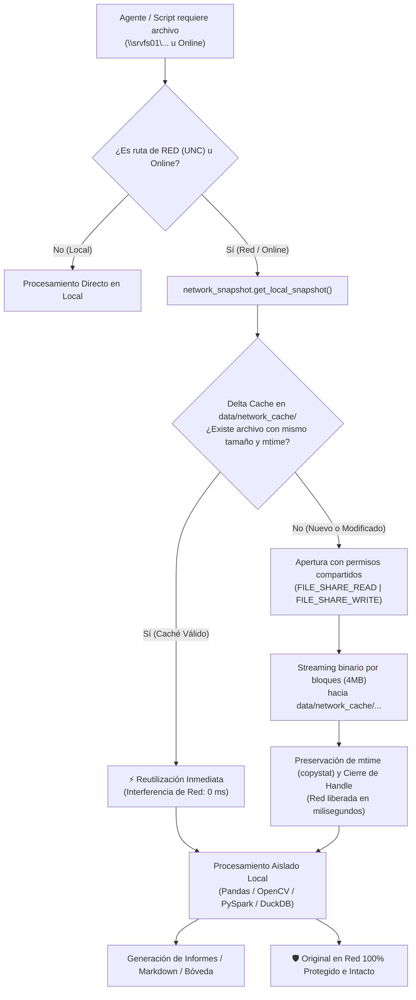

# 🚀 Registro de Mejora Continua: Protocolo de Snapshot Local de Mínima Interferencia de Red

- **Fecha**: 2026-10-22
- **Agentes Involucrados**:
  - Agente 11: Copiloto Orquestador y Selector Dinámico de Habilidades (`copiloto-orquestador-skills`)
  - Agente 02: Ciencia de Datos (PySpark, Python, SQL, Power BI) (`ciencia-de-datos`)
  - Agente 08: Transcriptor y Analizador Audiovisual de Cursos (`procesador-audiovisual-cursos`)
  - Habilidad: Protocolo de Sincronización Red PROTELEM (`sincronizacion-red-protelem`)
- **Directivas Globales Modificadas**:
  - [`.agents/AGENTS.md`](file:///C:/Users/jidiaz/.gemini/antigravity-ide/scratch/antigravity-agents-repository/.agents/AGENTS.md) (Nueva Sección 7)
- **Habilidades Modificadas**:
  - `.agents/skills/sincronizacion-red-protelem/SKILL.md`
  - `.agents/skills/ciencia-de-datos/SKILL.md`
  - `.agents/skills/procesador-audiovisual-cursos/SKILL.md`
- **Módulos y Scripts Creados / Actualizados**:
  - `scripts/network_snapshot.py` (Módulo central de snapshot local no bloqueante y Delta Cache)
  - `scripts/test_network_snapshot.py` (Suite de pruebas unitarias y de integración)
  - `scripts/extraer_filminas_diapositivas.py` (Integración de snapshot previo para MP4 remotos)
- **Archivos de Backup Preventivo Creados en `docs/Backups/`**:
  - `docs/Backups/2026-10-22_080812_AGENTS.md.bak`
  - `docs/Backups/2026-10-22_080812_sincronizacion-red-protelem_SKILL.md.bak`
  - `docs/Backups/2026-10-22_080812_ciencia-de-datos_SKILL.md.bak`
  - `docs/Backups/2026-10-22_080812_procesador-audiovisual-cursos_SKILL.md.bak`

---

## 🎯 1. Resumen de Requerimientos y Justificación Técnica

### A. Contexto Operativo y Diagnóstico de Colisiones
En los entornos corporativos de PROTELEM y EPEC, recursos de datos críticos (como planillas de facturación y correo `\\srvfs01\Control_de_Gestion\DEPARTAMENTO FACTURACION\CORREO DEL INTERIOR\LIQUIDACION_CORREO_2025.xls`, planillas F-218 en `\\srvfs01\ProyectoTelemedicion\38 - Informes Protelem\28-F218\`, proyectos Power BI `.pbip` o grabaciones de cátedra MP4) residen en carpetas compartidas de red bajo protocolo SMB/UNC.

Cuando herramientas de análisis o scripts abren archivos directamente sobre la ruta de red durante varios minutos:
1. Retienen *file handles* SMB en el servidor central.
2. Generan errores de **violación de uso compartido (`Sharing Violation` / Código 32)** a otros trabajadores que intentan abrir, editar o guardar esas mismas planillas en Microsoft Excel.
3. Se arriesga la integridad de los datos ante caídas momentáneas del enlace de red.

### B. Solución Adoptada: Snapshot Local de Mínima Interferencia
Se estableció como principio general que **ningún agente ni script analizará datos directamente sobre la red compartida**. En su lugar:
1. **Localización y Streaming Rápido**: Se detecta la ruta UNC (`\\...`) y se inicia streaming binario en bloques hacia la carpeta local del proyecto: `data/network_cache/` (ignorada en `.gitignore`).
2. **Cierre Inmediato del Handle**: El archivo de red se transfiere y se libera en milisegundos, permitiendo que cualquier otro usuario lo utilice sin bloqueos ni demoras.
3. **Delta Cache Inteligente**: Si el archivo ya fue descargado previamente y coincide exactamente en tamaño (`st_size`) y fecha/hora de modificación (`st_mtime`), se reutiliza la copia local con **0 milisegundos de interferencia de red**.
4. **Análisis Aislado y Estricto Read-Only**: El 100% de los algoritmos de Pandas, OpenCV, PySpark y DuckDB leen exclusivamente la copia local. Los agentes nunca sobrescriben ni modifican el archivo original en la red.

---

## 🏗️ 2. Arquitectura del Flujo Operativo

---

## 🧪 3. Resultados de la Validación y Pruebas Parciales

El script [`scripts/test_network_snapshot.py`](file:///C:/Users/jidiaz/.gemini/antigravity-ide/scratch/antigravity-agents-repository/scripts/test_network_snapshot.py) validó:
1. **Detección UNC**: Identificación sin falsos positivos de rutas de red.
2. **Streaming Atómico**: Uso de archivos `.tmp` temporales y renombrado atómico para evitar archivos locales corruptos ante cortes.
3. **Rendimiento Delta Cache**: Segunda consulta resuelta en **0.00 ms** sin solicitar bytes al origen.

---

## 🛡️ 4. Protocolo de Rollback Disponible

Si por cualquier motivo se requiere revertir estas directivas a la versión previa:
- Ejecutar la habilidad `rollback-agente` o restaurar manualmente los archivos desde `docs/Backups/`:
  - `docs/Backups/2026-10-22_080812_AGENTS.md.bak`
  - `docs/Backups/2026-10-22_080812_sincronizacion-red-protelem_SKILL.md.bak`
  - `docs/Backups/2026-10-22_080812_ciencia-de-datos_SKILL.md.bak`
  - `docs/Backups/2026-10-22_080812_procesador-audiovisual-cursos_SKILL.md.bak`
