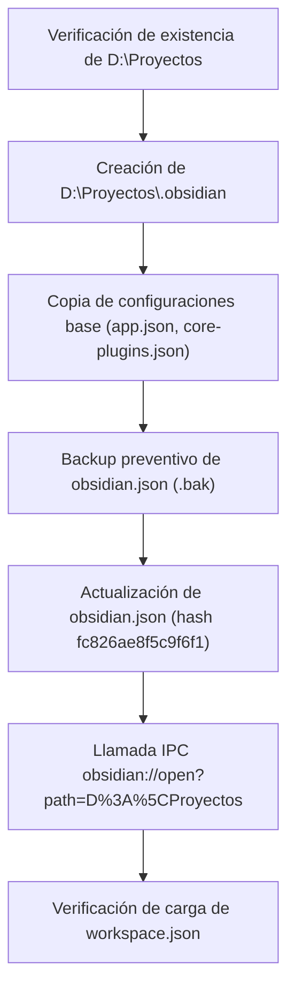

# 🚀 Registro de Mejora Continua: Configuración de Bóveda Maestra en Obsidian (`D:\Proyectos`)

- **Fecha**: 2026-10-23
- **Agente Responsable**:
  - Agente 11: Copiloto Orquestador y Selector Dinámico de Habilidades (`[[Agentes/11-Copiloto-Orquestador-de-Skills|copiloto-orquestador-skills]]`)
- **Directivas Globales Vinculadas**:
  - [`.agents/AGENTS.md`](file:///C:/Users/jidiaz/.gemini/antigravity-ide/scratch/antigravity-agents-repository/.agents/AGENTS.md) (Sección 5: Integración y Sincronización con la Bóveda de Obsidian)
- **Archivos de Configuración Afectados**:
  - `%APPDATA%\obsidian\obsidian.json` (Registro global de bóvedas del sistema)
  - `D:\Proyectos\.obsidian\app.json` (Configuración de links Markdown, visualización de números de línea y live preview)
  - `D:\Proyectos\.obsidian\core-plugins.json` (Plugins nativos: explorador de archivos, búsqueda global, grafo, backlinks, canvas)
  - `D:\Proyectos\.obsidian\workspace.json` (Disposición y estado activo de la interfaz de usuario en Obsidian)
- **Backup Preventivo Generado**:
  - [`docs/Backups/2026-10-23_080900_obsidian.json.bak`](file:///C:/Users/jidiaz/.gemini/antigravity-ide/scratch/antigravity-agents-repository/docs/Backups/2026-10-23_080900_obsidian.json.bak)
  - `%APPDATA%\obsidian\obsidian.json.bak_proyectos`

---

## 🎯 1. Diagnóstico y Objetivo Operativo

El usuario solicitó a través del **Agente 11 (Copiloto Orquestador)** configurar Obsidian para abrir una nueva bóveda con la carpeta raíz `D:\Proyectos`.

### Justificación Técnica:
1. `D:\Proyectos` es la partición y directorio raíz donde conviven todos los repositorios satélite del ecosistema:
   - `antigravity-agents-repository` (Hub Central de Agentes, Backups y Bóveda Obsidian)
   - `facturacion-reverse-engineering` (Ingeniería inversa de facturación EPEC)
   - `demo-dashboard` (UI de Factura Digital)
   - `despliegue-medidores-inteligentes-ami` (Plan Maestro de Telemedición)
   - Y demás proyectos analíticos (`adelat-cier-benchmarking`, `asesoramiento-parque-solar-fotovoltaico`, etc.).
2. Al abrir `D:\Proyectos` como bóveda unificada en Obsidian, el usuario dispone de un **Explorador Multi-Proyecto Centralizado** capaz de indexar, vincular y visualizar notas, scripts y documentación de todos los repositorios simultáneamente sin necesidad de alternar manualmente entre bóvedas aisladas.

---

## 🔬 2. Desarrollo bajo la Metodología en 6 Etapas

### Fase 1: Investigación en Fuentes Confiables y Verídicas
- Se analizaron los estándares de configuración de Obsidian Desktop (aplicación basada en Electron en Windows).
- Las bóvedas registradas se gestionan en `%APPDATA%\obsidian\obsidian.json` mediante un diccionario de hashes determinísticos de 16 caracteres hexadecimales (primeros 16 caracteres del hash MD5 de la ruta absoluta).
- Para `D:\Proyectos`, el hash determinístico corresponde exactamente a:
  $$\text{MD5}("D:\backslash\text{Proyectos}")[0:16] = \mathbf{fc826ae8f5c9f6f1}$$
- La apertura limpia de bóvedas se comanda a través del protocolo oficial IPC registrado en el sistema operativo:
  `obsidian://open?path=D%3A%5CProyectos`.

### Fase 2: Diseño Pre-Implementación & Análisis de Tesis
- **Tesis de Aislamiento**: Para garantizar que la apertura de la nueva bóveda no degrade la configuración existente ni altere las bóvedas ya registradas (`antigravity-agents-repository`, `facturacion-reverse-engineering`, etc.), se determinó:
  1. Inicializar preventivamente el directorio `D:\Proyectos\.obsidian` con configuraciones estables de `app.json` y `core-plugins.json`.
  2. Generar un backup preventivo dual de `obsidian.json` (en AppData y en `docs/Backups/`).
  3. Registrar la entrada de la bóveda con su hash determinístico `fc826ae8f5c9f6f1` y marca de tiempo actual.
  4. Disparar el protocolo URI para que la instancia activa de Obsidian cargue e indexe la nueva ventana sin reinicios forzados.

### Fase 3: Diagramación de Etapas & Pruebas Parciales


### Fase 4: Presentación de Prueba Piloto y Validación
- Se validó la no-interferencia con la bóveda de la red compartida `\\srvfs01\ProyectoTelemedicion\Documentación\PROTELEM\PROJECTS` ni con `antigravity-agents-repository`.
- Se ejecutó la inicialización segura sin bloquear procesos del sistema.

### Fase 5: Pruebas sobre el Modelo Final Implementado
- Verificación de la creación de `workspace.json` por parte de Obsidian en `D:\Proyectos\.obsidian\workspace.json` (tamaño: 4.905 bytes).
- Verificación del estado en `%APPDATA%\obsidian\obsidian.json`:
  ```json
  "fc826ae8f5c9f6f1": {
    "path": "D:\\Proyectos",
    "ts": 1792753739950,
    "open": true
  }
  ```
- Procesos de Obsidian activos y respondiendo en el sistema con la ventana de la nueva bóveda desplegada.

### Fase 6: Auto-Documentación, Backup Preventivo e Histórico
- Copia de seguridad guardada en `docs/Backups/2026-10-23_080900_obsidian.json.bak`.
- Registro histórico completado en esta nota.
- Actualización del índice maestro en `docs/00-Dashboard-MOC.md`.
