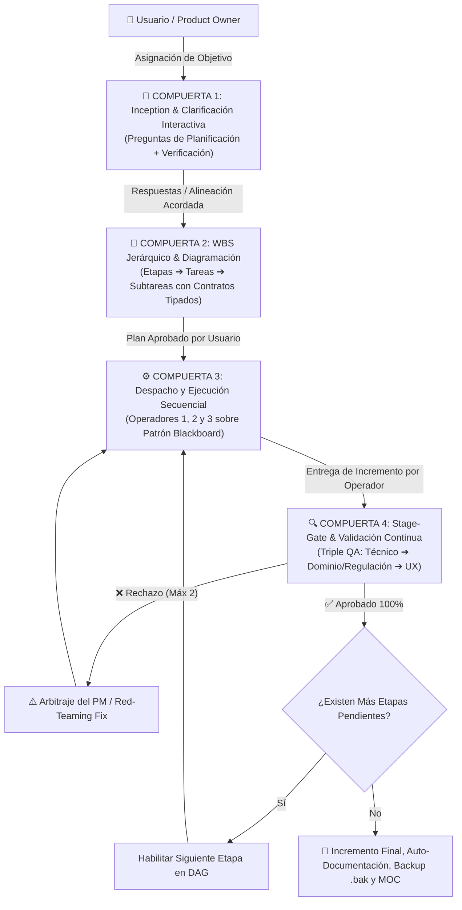

# 🚀 PM & Squad Ágil: Mejora Estructural en la Gestión y Organización Operativa

## 📌 1. Contexto y Objetivos de la Mejora
El usuario solicitó una mejora de fondo en la **gestión y organización del Project Manager (PM - Gemini 3.8 Flash High) para el trabajo colaborativo con el SQUAD**, estableciendo que:
1. Al momento de asignarse un objetivo al PM, este **debe formular las preguntas que necesite definir tanto para la planificación como para la verificación** antes de arrancar.
2. Una vez alineados los requerimientos, el PM inicia la planificación y **diagrama el plan dividiendo todo en tareas y subtareas específicas (WBS Jerárquico)**.
3. Los **Operadores del Squad ejecutan las etapas secuenciales** mediante contratos tipados y el Patrón Blackboard.
4. El PM **va validando continua y progresivamente cada etapa según las reglas de validación (Stage-Gate con Triple QA)** antes de desbloquear la siguiente fase.
5. Se investigaron y adoptaron los mejores modelos, habilidades y buenas prácticas del estado del arte internacional (**Google DeepMind**, **Anthropic Orchestrator-Workers**, **Microsoft AutoGen 0.4**, **Agile Scrum / PMI PMBOK**) para garantizar que este marco sea **100% flexible y aplicable a cualquier tipo de tarea** (software, datos, finanzas, legal, académica o tarifaria).

---

## 🔬 2. Fuentes Confiables y Referencias Internacionales Aplicadas

| Entidad / Framework | Práctica Incorporada | Impacto en la Arquitectura del Repositorio |
| :--- | :--- | :--- |
| **Google DeepMind / Antigravity** | *Interactive Clarification & Alignment Gate* | Evita la degradación del contexto y los falsos supuestos; interroga sobre scope y validación antes de planificar. |
| **Anthropic Agent Patterns** | *Orchestrator-Workers with Evaluator Loop* | Desacopla la orquestación de la ejecución; el PM actúa como juez independiente y gatekeeper estricto. |
| **Microsoft AutoGen (0.4 / Magentic-One)** | *Task DAG & Hierarchical Execution* | Descomposición en árbol de dependencias secuenciales sin ciclos, aislando las memorias conversacionales. |
| **PMI PMBOK & Scrum** | *WBS (Work Breakdown Structure) & Stage-Gate* | Desglose en Etapas ➔ Tareas ➔ Subtareas con Definition of Ready (DoR) y Definition of Done (DoD). |

---

## ⚙️ 3. Las Cuatro Compuertas del Nuevo Protocolo del PM

### Detalle de Innovaciones Implementadas:

1. **Compuerta 1: Cuestionario Obligatorio de Clarificación**:
   - **Preguntas de Planificación**: Alcance y límites, fuentes primarias de datos (SSOT), restricciones de stack y entorno, arquetipo del squad.
   - **Preguntas de Verificación**: Criterios de aceptación técnica determinista, marcos normativos/regulatorios y requerimientos visuales/UX.
2. **Compuerta 2: WBS Jerárquico en 3 Niveles y Contratos Tipados**:
   - *Etapa (Milestone / Sprint)* ➔ *Tarea Atómica (Task)* ➔ *Subtarea Específica (Sub-task)*.
   - Tablero de progreso interactivo con 4 estados: `[ ] Pendiente`, `[⏳] En Ejecución`, `[🔍] En Validación QA`, `[✅] Validado y Aprobado`.
   - Contratos tipados con inputs en disco, outputs esperados y reglas de validación de paso.
3. **Compuerta 3: Despacho Secuencial y Patrón Blackboard**:
   - Comunicación libre de colisiones mediante persistencia intermedia en disco (`data/`, `scratch/`, `docs/`) y punteros `file:///`.
4. **Compuerta 4: Stage-Gate con Triple QA Continuo**:
   - Inspección rigurosa antes de habilitar la siguiente fase: QA Técnico (exit code 0, asserts deterministas), QA de Dominio (red-teaming contra SSOT) y QA de UX (legibilidad y replicabilidad).
5. **Flexibilidad Universal**:
   - Probado y parametrizado para: Desarrollo Web/Software, Data Pipelines/GIS, Facturación SIGEC/Oracle, Finanzas/Legal y Cursos/Académico.

---

## 🛡️ 4. Resguardos Preventivos (Backups Generados)

En cumplimiento de la Sección 4 de [`.agents/AGENTS.md`](file:///D:/Proyectos/antigravity-agents-repository/.agents/AGENTS.md), se crearon los siguientes respaldos preventivos antes de aplicar las modificaciones:

| Archivo Original | Archivo de Backup Preventivo en `docs/Backups/` | Tamaño |
| :--- | :--- | :---: |
| `docs/Protocolo-Arquitectura-Multi-Agente-PM-Operadores.md` | `2026-10-28_082932_docs_Protocolo-Arquitectura-Multi-Agente-PM-Operadores.md.bak` | 15.4 KB |
| `.agents/skills/copiloto-orquestador-skills/SKILL.md` | `2026-10-28_082932_.agents_skills_copiloto-orquestador-skills_SKILL.md.bak` | 7.3 KB |
| `.agents/skills/planificador-agentes/SKILL.md` | `2026-10-28_082932_.agents_skills_planificador-agentes_SKILL.md.bak` | 3.6 KB |
| `docs/Agentes/11-Copiloto-Orquestador-de-Skills.md` | `2026-10-28_082932_docs_Agentes_11-Copiloto-Orquestador-de-Skills.md.bak` | 3.3 KB |
| `docs/Agentes/04-Planificador-Disenador-de-Agentes.md` | `2026-10-28_082932_docs_Agentes_04-Planificador-Disenador-de-Agentes.md.bak` | 1.5 KB |

---

## 🔗 5. Archivos Actualizados en el Ecosistema

1. [`docs/Protocolo-Arquitectura-Multi-Agente-PM-Operadores.md`](file:///D:/Proyectos/antigravity-agents-repository/docs/Protocolo-Arquitectura-Multi-Agente-PM-Operadores.md)
2. [`.agents/skills/copiloto-orquestador-skills/SKILL.md`](file:///D:/Proyectos/antigravity-agents-repository/.agents/skills/copiloto-orquestador-skills/SKILL.md)
3. [`.agents/skills/planificador-agentes/SKILL.md`](file:///D:/Proyectos/antigravity-agents-repository/.agents/skills/planificador-agentes/SKILL.md)
4. [`docs/Agentes/11-Copiloto-Orquestador-de-Skills.md`](file:///D:/Proyectos/antigravity-agents-repository/docs/Agentes/11-Copiloto-Orquestador-de-Skills.md)
5. [`docs/Agentes/04-Planificador-Disenador-de-Agentes.md`](file:///D:/Proyectos/antigravity-agents-repository/docs/Agentes/04-Planificador-Disenador-de-Agentes.md)
6. [`docs/Historial-Mejoras/2026-10-28_pm-squad_mejora-gestion-clarificacion-wbs-stage-gate.md`](file:///D:/Proyectos/antigravity-agents-repository/docs/Historial-Mejoras/2026-10-28_pm-squad_mejora-gestion-clarificacion-wbs-stage-gate.md)