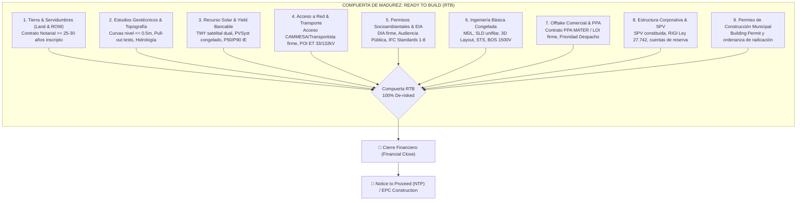

# Historial de Mejoras: Incorporación del Protocolo de Auditoría y Certificación Ready to Build (RTB) para Proyectos Solares Fotovoltaicos

- **Fecha**: 2026-11-03
- **Autor / Squad**: Squad Ágil S-C: Renovables & Finanzas / Agente 13 (`desarrollador-parques-solares-renovables`)
- **Tipo de Cambio**: Feature & Estandarización Bancable (Ready to Build - RTB)
- **Repositorio Central**: `https://github.com/inventarioenergycpy/antigravity-agents-repository.git`

---

## 📌 1. Resumen Ejecutivo de la Mejora

Se integró al marco de ingeniería renovable y al **Agente 13** (`desarrollador-parques-solares-renovables`) el **Protocolo de Auditoría y Certificación de Estado Ready to Build (RTB)**. Este marco sistematiza las compuertas de madurez (*stage gates*) que un parque solar fotovoltaico (*Utility-Scale* o de Generación Distribuida comunitaria) debe superar para alcanzar el **100% de de-risking**, posibilitando el **Cierre Financiero (*Financial Close*)** y la emisión de la orden formal de inicio de obras (*Notice to Proceed - NTP*) hacia el contratista EPC bajo contratos llave en mano (FIDIC Silver Book).

---

## 🏗️ 2. Los 9 Pilares de Madurez y Certificación Ready to Build (RTB)

### Detalle de Verificación de los 9 Pilares:
1. **Tierra y Servidumbres (Land & ROW)**: Escritura de dominio o contrato notarial de usufructo/arrendamiento a $\ge 25-30$ años inscripto en el Registro de la Propiedad Inmueble; servidumbres de paso y electroducto vigentes; libre de gravámenes (*Title Due Diligence*).
2. **Estudios Geotécnicos & Topografía**: Topografía LIDAR/dron con curvas de nivel $\le 0,5\text{ m}$; calicatas y ensayos de hincabilidad y tracción vertical/lateral (*pull-out tests*); estudio hidrológico CIRSOC/HEC-RAS con período de retorno de 100 años.
3. **Recurso Solar & Yield Bancable**: Serie TMY dual de largo plazo (Solargis / PVGIS / Meteonorm); simulación PVSyst $\ge 7.4$ con diseño 3D congelado; informe de ingeniero independiente (*Independent Engineer*) con P50, P90, P95 e incertidumbre $\le 6\%$.
4. **Interconexión Eléctrica y Capacidad de Evacuación**: Autorización formal de acceso emitida por CAMMESA y la distribuidora/transportista (EPEN, EPEC, Transener); estudio eléctrico aprobado (flujo de potencia, cortocircuito IEC 60909 y estabilidad dinámica PSS/E); convenio de conexión listo para suscripción.
5. **Permisos y Licencias Socioambientales**: Aprobación del EIA y Declaración de Impacto Ambiental (DIA) firme; audiencia pública realizada; autorizaciones de cruces viales, recursos hídricos y patrimonio arqueológico; conformidad con las 8 Normas de Desempeño de la IFC y Principios de Ecuador IV.
6. **Ingeniería Básica Consolidada (Basic Engineering & MDL)**: Lista Maestra de Documentos (MDL) aprobada para construcción (IFC); Diagrama Unifilar General (SLD) en CC (1.500 V), MT (33 kV) y AT (132 kV); especificaciones técnicas congeladas (TOPCon bifacial, inversores string, centros STS y seguidores con protección de viento CIRSOC 102).
7. **Estructuración Comercial & Offtake**: Contrato PPA firmado a 10-20 años (MATER o con cooperativa/distribuidora); prioridad de despacho otorgada por CAMMESA (Res. MEyM 281-E/17 o SE 330/23).
8. **Estructura Societaria y Vehículo de Proyecto (SPV)**: Sociedad de Propósito Específico constituida y capitalizada; adhesión confirmada al Régimen RIGI (Ley 27.742) para estabilidad fiscal y arancel 0% en bienes de capital; modelo financiero DCF congelado con DSCR $\ge 1,20x$ sobre escenario P90.
9. **Permisos Municipales de Construcción**: Planos aprobados y permiso de obra (*Building Permit*) emitido por el municipio; ordenanza de radicación y exención de tasas locales vigente.

---

## 📂 3. Archivos Impactados y Actualizados

| Componente | Ruta en el Repositorio | Modificación |
| :--- | :--- | :--- |
| **Skill del Agente 13** | `.agents/skills/desarrollador-parques-solares-renovables/SKILL.md` | Sección 5: Protocolo de Auditoría y Certificación Ready to Build (RTB) con los 9 Pilares. |
| **Modelo Maestro** | `docs/Modelos/Modelo-Ingenieria-Parques-Solares-Renovables-Argentina.md` | Sección 5: Protocolo RTB bancable, diagramas Mermaid y reordenamiento del Checklist de Auditoría (Sección 6). |
| **Perfil del Agente 13** | `docs/Agentes/13-Desarrollador-Parques-Solares-Renovables.md` | Incorporación del pilar de Auditoría y Certificación RTB en el perfil operativo. |
| **Dashboard Central** | `docs/00-Dashboard-MOC.md` | Registro en el historial cronológico y actualización del perfil del Agente 13. |
| **Backups Preventivos** | `docs/Backups/` | Resguardos `.bak` fechados con timestamp antes de cada modificación. |

---

## 🛡️ 4. Protocolo de Validación Multi-Perspectiva (Triple QA)

- **QA 1: Técnico & Algorítmico**: Cero fallas sintácticas en los diagramas Mermaid, coherencia técnica en tensiones (1.500 Vcc, 33 kV, 132 kV), dimensionamiento de conductores y factores de incertidumbre de recurso solar ($\le 6\%$).
- **QA 2: Dominio & Normativo**: Coherencia absoluta con la reglamentación CAMMESA (Anexo 30, Res. MEyM 281-E/17, Res. SE 330/23), Ley Nacional 27.742 (RIGI e Iniciativa Privada), y normativas internacionales (IEC 62548, IEC 62446, IEEE 1547/2800, IFC PS 1-8).
- **QA 3: Usabilidad & UX**: Trazabilidad completa mediante enlaces internos Obsidian `[[...]]`, tablas comparativas ejecutivas y formato limpio de lectura.
