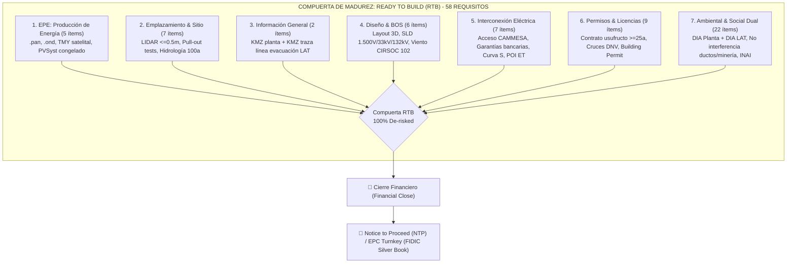

# Historial de Mejoras: Ingesta de Matriz de 58 Requisitos Ready to Build (RTB) y Mejora Integral del Ecosistema de Agentes

- **Fecha**: 2026-11-03
- **Autor / Squad**: Squad Ágil S-C: Renovables, Legal, GIS & Finanzas
- **Agentes Mejorados**: 
  - **Agente 13**: `desarrollador-parques-solares-renovables` (Auditoría RTB, 58 ítems en 7 categorías)
  - **Agente 05**: `asesor-legal-financiero` (Due diligence de tierras, servidumbres LAT, permisos DNV, licencias DIA e INAI)
  - **Agente 02**: `ciencia-de-datos` (Análisis espacial de interferencias KMZ: ductos hidrocarburos, minería, APN, cauces)
  - **Agente 01**: `analista-financiero` (Modelado de garantías CAMMESA, riesgo Curva S y presupuestación ambiental)
- **Archivo Fuente**: `C:\Users\majon\Downloads\Etapas_Proyectos_FV.xlsx`
- **Repositorio Central**: `https://github.com/inventarioenergycpy/antigravity-agents-repository.git`

---

## 📌 1. Resumen Ejecutivo de la Mejora

Se realizó la lectura, desensamblado e ingesta integral del documento maestro `Etapas_Proyectos_FV.xlsx` ubicado en la carpeta de descargas del usuario. Dicho archivo contiene la **Matriz Maestra de Due Diligence y Compuertas Ready to Build (RTB) de 58 Requisitos** para proyectos solares fotovoltaicos (*Utility-Scale* y Generación Distribuida comunitaria) e infraestructura de transporte eléctrico asociada.

A partir de esta ingesta, se mejoraron transversalmente las habilidades de **cuatro agentes clave** del ecosistema y se actualizó el [Modelo Maestro de Ingeniería para Parques Solares y Renovables en Argentina](file:///C:/Users/majon/.gemini/antigravity-ide/scratch/antigravity-agents-repository/docs/Modelos/Modelo-Ingenieria-Parques-Solares-Renovables-Argentina.md).

---

## 🏗️ 2. Estructura de la Matriz RTB de 58 Requisitos en 7 Categorías

### Desglose por Categoría y Criticidad:

1. **EPE (Estimación de Producción de Energía) [Ítems 1 al 5]**:
   - Modelado PVSyst con archivos de fabricante `.pan` (módulos TOPCon/HJT bifaciales) y `.ond` (inversores de 1.500 Vcc).
   - Serie horaria típica TMY obtenida de bases satelitales duales (Solargis / PVGIS / Meteonorm) con incertidumbre $\le 6\%$.
   - Configuración eléctrica optimizada (ratio DC/AC 1.20 - 1.25, pérdidas de string $< 1,5\%$).

2. **Emplazamiento y Sitio [Ítems 6 al 12]**:
   - Levantamiento topográfico con LIDAR (curvas $\le 0,5\text{ m}$) y pendientes $\le 2\% - 3\%$.
   - Estudio geotécnico completo con resistividad de suelo, agresividad química y ensayos de tracción vertical y lateral en terreno (*pull-out tests*).
   - Estudio hidrológico de cuenca de aporte (HEC-HMS) y mancha de inundabilidad centenaria (HEC-RAS, T = 100 años) con diseño de zanjas de guarda.

3. **Información General [Ítems 13 y 14]**:
   - Georreferenciación WGS 84 vectorial en `.kmz` del predio del parque y de la traza completa de la Línea de Transmisión (LAT).

4. **Diseño e Ingeniería Básica [Ítems 15 al 20]**:
   - Plano de implantación 3D (*layout*) con distribución de seguidores a 1 eje (*backtracking* 3D).
   - Diagrama Unifilar General (SLD) en 1.500 Vcc, 33 kV y 132 kV.
   - Lista Maestra de Documentos (MDL) congelada y memoria estructural bajo CIRSOC 102 (viento) e INPRES-CIRSOC 103 (sismo).
   - Servicios auxiliares: SCADA, CCTV perimetral y estaciones meteorológicas Clase A (IEC 61724-1).

5. **Interconexión Eléctrica y CAMMESA [Ítems 21 al 27]**:
   - Convenios de interconexión con distribuidora (EPEC/EPEN) y transportista troncal (Transener).
   - Estudios eléctricos de detalle aprobados (flujo de potencia, cortocircuito IEC 60909 y estabilidad transitoria PSS/E).
   - Boletas de garantía bancaria de transporte vigentes ante CAMMESA (Res. MEyM 281-E/17 y Res. SE 330/23).
   - Aprobación formal de reserva de capacidad de transporte, cronograma de Curva S y verificación de celda/campo disponible en la ET (POI).

6. **Permisos, Licencias y Cruces Viales [Ítems 28 al 36]**:
   - Contratos notariales de usufructo o arrendamiento por $\ge 25-30$ años inscriptos en el Registro de la Propiedad Inmueble con libre de gravámenes (*Title Due Diligence*).
   - Franja de servidumbre de electroducto constituida para la LAT.
   - Permiso de Construcción municipal (*Building Permit*) y certificado de zonificación / compatibilidad de uso de suelo.
   - Permisos de cruce de rutas de Vialidad Nacional (DNV), rutas provinciales y concesiones viales.
   - Aprobación aeronáutica de la ANAC (dictamen de no afectación de aproximación aérea ni deslumbramiento óptico).

7. **Ambiental & Social Dual (Planta FV vs. LAT) [Ítems 37 al 58]**:
   - Certificación de no interferencia con gasoductos, oleoductos y pozos activos de hidrocarburos.
   - Libre de concesiones mineras, cateos y pedimentos en planta y traza de LAT.
   - Licencia ambiental independiente: DIA firme del parque y DIA firme de la línea de transmisión.
   - Plan de Manejo Ambiental (PMA) y audiencias públicas comunitarias concluidas.
   - Certificado oficial del INAI de presencia de comunidades indígenas y cumplimiento estricto del proceso de Consulta Previa, Libre e Informada (Convenio 169 OIT).
   - Permisos de aprovechamiento forestal (desmonte/poda) y planes de compensación biótica para planta y LAT.
   - Programa de arqueología preventiva y prospección en terreno aprobada por Patrimonio Cultural.
   - Permisos de ocupación de cauce ante Recursos Hídricos / DPA para planta y LAT.
   - Certificados de no superposición con Parques Nacionales (APN), reservas naturales provinciales ni humedales estratégicos (RAMSAR/AICAs).

---

## 🚀 3. Habilidades Mejoradas en los Agentes

| Agente | Habilidad Mejorada | Alcance Incorporado |
| :--- | :--- | :--- |
| **Agente 13** | `desarrollador-parques-solares-renovables` | Auditoría de los 58 ítems, detección y bloqueo por los **23 Fatal Flaws**, clasificación de riesgos (CP-FC / CP-COD) y emisión del dictamen formal de madurez RTB. |
| **Agente 05** | `asesor-legal-financiero` | Due diligence de títulos, contratos notariales $\ge 25-30$ años, servidumbres de electroducto LAT, cruces DNV, licencias DIA duales, consultas indígenas INAI (Convenio 169 OIT) y avales bancarios CAMMESA. |
| **Agente 02** | `ciencia-de-datos` | Procesamiento de `.kmz` de planta y LAT, algoritmos espaciales Shapely/GeoPandas para cruce automático contra ductos de hidrocarburos, catastro minero, áreas protegidas (APN/RAMSAR) y cauces aluviales. |
| **Agente 01** | `analista-financiero` | Modelado financiero del costo de emisión y riesgo de ejecución de boletas de garantía de transporte CAMMESA (Curva S), y presupuestación en Capex/Opex de servidumbres LAT, compensación biótica y rescate arqueológico. |

---

## 🛡️ 4. Protocolo de Validación Multi-Perspectiva (Triple QA)

- **Instancia 1: QA Técnico & Algorítmico**: Cero inconsistencias en la matriz de 58 requisitos, validación sintáctica de diagramas Mermaid, coherencia técnica en estándares (IEC 62548, 62446, 61724, IEEE 1547/2800, CIRSOC 102/103).
- **Instancia 2: QA de Dominio & Regulación**: Conformidad absoluta con Los Procedimientos de CAMMESA (Res. 281/330), reglamentación de la DNV para cruces de rutas, normativa ambiental provincial para DIAs duales, y marco legal de tierras (CCCN) y comunidades (Convenio 169 OIT / INAI).
- **Instancia 3: QA de Usabilidad & UX**: Tablas ejecutivas de auditoría, vínculos bidireccionales en Obsidian (`[[...]]`), trazabilidad histórica y respaldos preventivos `.bak` asegurados.

