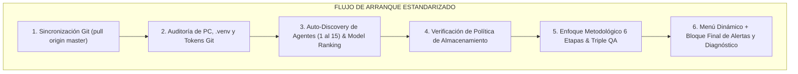

# Historial de Mejoras: Actualización del Prompt Maestro de Inicio Rápido con Auditoría de PC, Vigencia de Tokens Git y Bloque de Alertas

- **Fecha**: 2026-11-04
- **Autor / Squad**: Copiloto Orquestador & Arquitectura del Sistema
- **Tipo de Cambio**: Estandarización de Inicialización, Health Check y Control de Entorno Multi-PC
- **Archivo Modificado**: `PROMPT_INICIO_RAPIDO.md`
- **Backup Preventivo**: `docs/Backups/2026-11-04_172957_PROMPT_INICIO_RAPIDO.md.bak`
- **Repositorio Central**: `https://github.com/inventarioenergycpy/antigravity-agents-repository.git`

---

## 📌 1. Resumen Ejecutivo de la Mejora

Se perfeccionó el archivo maestro [`PROMPT_INICIO_RAPIDO.md`](file:///C:/Users/majon/.gemini/antigravity-ide/scratch/antigravity-agents-repository/PROMPT_INICIO_RAPIDO.md) para que, en cada inicio de sesión desde cero en cualquier computadora, el agente ejecute obligatoriamente un protocolo riguroso de diagnóstico y validación previa antes de desplegar el menú de trabajo.

La nueva versión incorpora:
1. **Control de Estructura y Organización de la PC**: Detección dinámica de particiones, validación de la carpeta unificada de proyectos (`%USERPROFILE%\.gemini\antigravity-ide\Proyectos\` o `D:\Proyectos\`), comprobación de enlaces simbólicos/Junctions y verificación de espacio libre en disco ($\ge 20\text{ GB}$).
2. **Auditoría de Entorno Python y Toolchain**: Comprobación del entorno virtual aislado `.venv` y verificación de disponibilidad de las librerías críticas para los squads (`pandas`, `geopandas`, `shapely`, `pvlib`, `duckdb`, `matplotlib`, `scipy`, `openpyxl`, `requests`, `pymupdf`).
3. **Validación Activa de Tokens Classic de GitHub**: Comprobación en tiempo real contra la API de GitHub (`https://api.github.com/user`) de la vigencia del Personal Access Token (PAT) almacenado en `.env` o en Git Credential Manager, verificando permisos para `inventarioenergycpy` y `PROTELEM-EPEC`.
4. **Ampliación del Catálogo a 15 Agentes Especialistas**: Incorporación del Agente 13 (Desarrollador de Parques Solares y Renovables), Agente 14 (Investigador de Talento y Mercado Laboral) y Agente 15 (Experto en Bienes Raíces e Inversiones Inmobiliarias).
5. **Bloque Obligatorio de Alertas y Diagnóstico con Explicación de Valor**: Presentación al final de la salida de un cuadro semáforo destacando las alertas detectadas y una justificación técnica del porqué conviene tener la PC 100% estructurada antes de continuar con la ejecución operativa.

---

## 🏗️ 2. Comparativa de Componentes del Prompt de Inicio

| Sección | Versión Anterior | Nueva Versión Mejorada |
| :--- | :--- | :--- |
| **Paso 1: Detección Git** | Búsqueda solo en `D:\Proyectos` y `.gemini`. | Búsqueda y priorización en `D:\Proyectos` o en `C:\Users\majon\.gemini\antigravity-ide\Proyectos\`. |
| **Paso 2: Health Check PC** | *No existía formalmente*. | **Auditoría de PC obligatoria**: particiones, espacio libre, `.venv` operativo, librerías científicas y vigencia del PAT clásico en la API de GitHub. |
| **Paso 3: Auto-Discovery** | Reconocimiento de 12 agentes. | **Reconocimiento de 15 agentes** y 5 arquetipos de Squad (incluyendo Renovables/RTB). |
| **Paso 6: Salida y UX** | Solo presentaba el menú dinámico. | **Menú Dinámico + Bloque Final de Alertas y Diagnóstico** con semáforo y justificación técnica del porqué de la organización previa. |

---

## 🛡️ 3. Justificación Técnica: Por qué Conviene Estructurar la PC Antes de Iniciar

1. **Prevención de Fallas en Runtime**: Proyectos como el simulador solar, el análisis de facturación SIGEC o el cruce catastral requieren librerías de alto impacto (`pandas`, `geopandas`, `pvlib`). Si no se verifican al inicio, los scripts fallan a mitad de la ejecución, perdiendo tiempo y dejando archivos inconsistentes.
2. **Blindaje de la Sincronización Git**: Un token vencido detiene silenciosamente o bloquea los comandos `git push`. La validación en el arranque asegura que los commits se publiquen sin bloqueos interactivos.
3. **Resguardo de Espacio en Disco**: Los Data Rooms (ej. Cutral Có II) o backups locales consumen almacenamiento. Alertar si el disco baja de 20 GB evita errores de I/O en bases de datos o congelamiento del sistema operativo.
4. **Integridad de la Bóveda Obsidian**: Mantener repositorios satélites centralizados en `Proyectos\` evita que el repositorio central `antigravity-agents-repository` se contamine con código pesado o datos crudos, preservando su peso ultraliviano (~10 MB).

---

## 📂 4. Archivos Impactados

- `PROMPT_INICIO_RAPIDO.md`: Actualizado con las nuevas instrucciones y directivas.
- `docs/Backups/2026-11-04_172957_PROMPT_INICIO_RAPIDO.md.bak`: Copia de respaldo previa.
- `docs/00-Dashboard-MOC.md`: Registro en el historial cronológico de mejoras.

