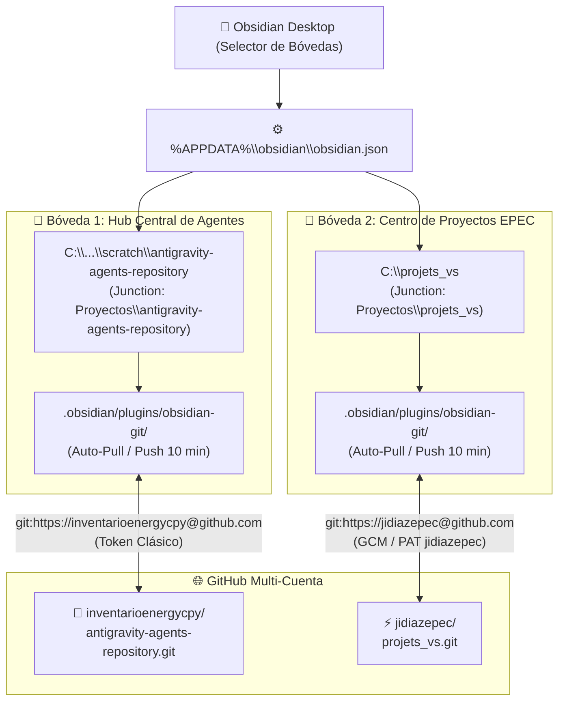

# 💎 Configuración Integral de Obsidian Multi-Bóveda y Acceso Dual a GitHub

**Fecha:** 4 de Noviembre de 2026  
**Entorno:** Windows 11 — Estación de Trabajo Antigravity IDE  
**Bóvedas Vinculadas:**
1. **Hub Central:** `antigravity-agents-repository` (`inventarioenergycpy`)
2. **Centro de Proyectos:** `projets_vs` (`jidiazepec` / `PROTELEM-EPEC`)

---

## 🎯 1. Diagnóstico Inicial y Problemas Resueltos

| Componente | Estado Anterior | Problema Identificado | Solución Aplicada |
| :--- | :--- | :--- | :--- |
| **`obsidian.json`** | Solo listaba `C:\projets_vs\documentacion` | Carpeta incompleta (2 notas) y el Hub Central de Agentes no aparecía en Obsidian. | Registro multi-bóveda completo de `antigravity-agents-repository` y `C:\projets_vs`. |
| **Bóveda `projets_vs`** | Sin `.obsidian` en raíz ni plugin Git | Al abrir la raíz no había sincronización automática con GitHub. | Despliegue de `.obsidian` completo con `obsidian-git` configurado. |
| **Unificación de Proyectos** | `projets_vs` estaba aislado en `C:\` | No figuraba en la carpeta unificada `Proyectos`. | Creación de Junction NTFS `Proyectos\projets_vs <<===>> C:\projets_vs`. |
| **Git Credential Manager** | Solo tenía clave para `github.com` general | Provocaba que GitHub usara `inventarioenergycpy` para repos de `jidiazepec` (Error 404). | `credential.useHttpPath true`, URLs con usuario explícito y registro `cmdkey`. |

---

## 🛠️ 2. Arquitectura de Sincronización Multi-Bóveda



---

## ⚙️ 3. Parámetros Técnicos Configurados

### A. Registro de Bóvedas (`%APPDATA%\obsidian\obsidian.json`)
```json
{
  "vaults": {
    "7da1bbfc5338cdd9": {
      "path": "C:\\Users\\majon\\.gemini\\antigravity-ide\\scratch\\antigravity-agents-repository",
      "ts": 1793842280171,
      "open": true
    },
    "f7737f13415e9084": {
      "path": "C:\\projets_vs",
      "ts": 1793842279171,
      "open": false
    }
  },
  "insider": false
}
```

### B. Configuración de Git en Repositorios Locales
- **Global:** `git config --global credential.useHttpPath true` (evita que las credenciales de una cuenta colisionen con la otra).
- **`antigravity-agents-repository`:**
  - Remote: `https://inventarioenergycpy@github.com/inventarioenergycpy/antigravity-agents-repository.git`
  - Local User: `user.name = inventarioenergycpy`, `user.email = inventario.energycpy@gmail.com`
  - Windows Credential Manager: entrada específica `git:https://inventarioenergycpy@github.com`.
- **`projets_vs`:**
  - Remote: `https://jidiazepec@github.com/jidiazepec/projets_vs.git`
  - Local User: `user.name = jidiazepec`, `user.email = jidiaz@epec.com.ar`
- **`App_Central_Bicentenario`:**
  - Remote: `https://jidiazepec@github.com/PROTELEM-EPEC/App_Central_Bicentenario.git`

### C. Automatización de Obsidian Git (`data.json`)
Ambas bóvedas cuentan con:
- `autoPullOnBoot: true`
- `autoSaveInterval: 10`
- `autoPushInterval: 10`
- `pullBeforePush: true`
- `syncMethod: "merge"`

---

## 🔗 4. Documentación y Enlaces Cruzados
- [[Protocolo-Sincronizacion-Obsidian-GitHub|Protocolo de Sincronización Obsidian-GitHub]]
- [[PROTELEM/00-Indice-PROTELEM-EPEC|Índice Maestro PROTELEM-EPEC]]
- [[00-Dashboard-MOC|Dashboard Central de Agentes MOC]]
- Nota puente en `C:\projets_vs\docs\vinculacion-antigravity-hub.md`
