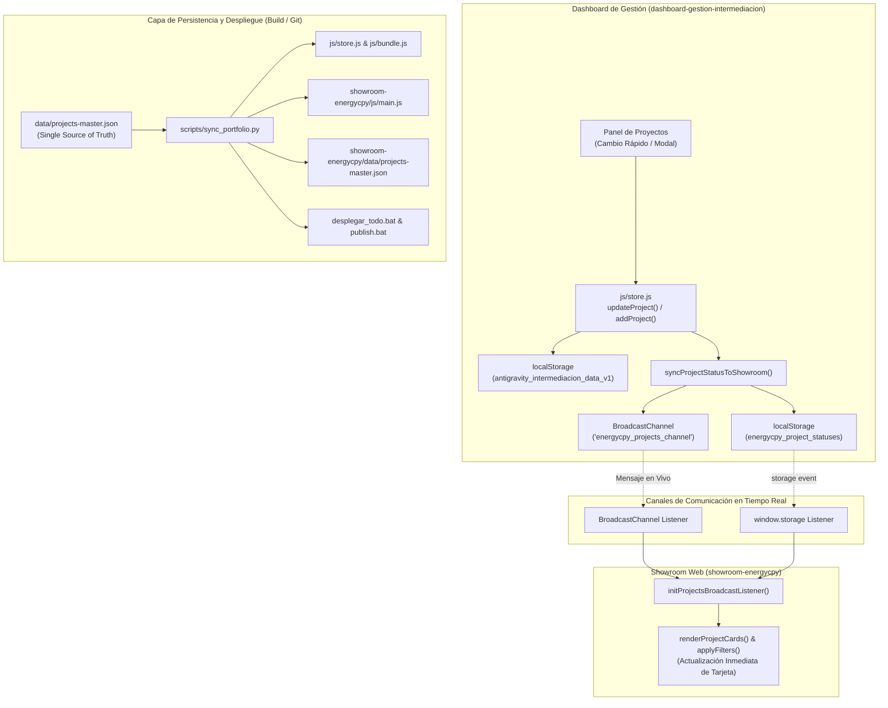

# 🚀 Squad Ágil Arquetipo C: Sincronización Automática Dashboard ➔ Showroom Web y Resolución de Persistencia

**Fecha**: 2026-11-10  
**Squad**: Squad Ágil Adaptativo de 4 Agentes (Arquetipo C - Inversiones, Finanzas & Showroom Web)  
**Dupla de Modelos Gemini (Top-2)**:
- **Project Manager (PM)**: Gemini 3.8 Flash (High) [Top-1]
- **3 Agentes Operadores**: Gemini 3.7 Flash (High) [Top-2] (Core Execution, Dominio/Regulación, QA/UX)

---

## 📌 1. Objetivos del Sprint

1. **Saneamiento del Repositorio Showroom Web (`showroom-energycpy`)**:
   - Resolver el desfasaje del clon local (atrasado en 22 commits respecto a `origin/main`) y sincronizar limpiamente con la versión oficial desplegada en GitHub Pages.
2. **Corrección de la Falla de Persistencia de Estados en Dashboard (`dashboard-gestion-intermediacion`)**:
   - Diagnosticar y corregir la causa raíz por la cual los cambios de estado en proyectos (específicamente *Yacimiento de Oro 'Diente Oro Verde'*) no se guardaban o se revertían en recarga.
   - Corregir el selector `e.target.dataset.id` por `e.currentTarget.dataset.id` en botones con iconos SVG para evitar referencias `undefined`.
3. **Actualización de Estado de 'Diente Oro Verde' (`mineria-diente-oro-verde`)**:
   - Establecer `defaultStatus: "bloqueado_por_gestion"` en el Dashboard.
   - Mapear a `defaultStatus: "tramite"` (🟡 Amarillo / En trámite) en el Showroom Web.
4. **Implementación de Arquitectura Híbrida de Sincronización Automática**:
   - **Capa 1 (Runtime en Vivo)**: Emisión multicanal mediante `BroadcastChannel('energycpy_projects_channel')` y almacenamiento reactivo en `localStorage['energycpy_project_statuses']`, permitiendo que cualquier cambio en el Dashboard actualice el Showroom en tiempo real sin recargar página.
   - **Capa 2 (Build & Deploy Pipeline)**: Script automatizado `scripts/sync_portfolio.py` y ajuste de `scripts/build_bundle.py` con rutas dinámicas para compilar bundles y sincronizar código fuente entre repositorios.

---

## 🛠️ 2. Diagnóstico y Causas Raíz Identificadas

1. **Bug en Delegación de Eventos (`projects.js`)**:
   - Al hacer clic en los botones de acción (.btn-edit-proj, .btn-delete-proj), el evento disparado por el icono hijo `<svg>` o `<path>` capturaba `e.target` sin atributo `dataset.id`. La corrección a `e.currentTarget` asegura la lectura determinista del ID.
2. **Desconexión entre Almacenamiento Local y Catálogo Semilla**:
   - El Dashboard guardaba proyectos en `antigravity_intermediacion_data_v1`, mientras que el Showroom leía exclusivamente `energycpy_project_statuses`. Al modificar el estado en el Dashboard, no se impactaba la clave del Showroom.
3. **Hardcoding de Rutas en Toolchain**:
   - `build_bundle.py` poseía una ruta fija a un perfil de usuario externo (`C:\Users\majon\...`), impidiendo la regeneración automática de `bundle.js` en otros entornos locales. Se refactorizó con `os.path.dirname(os.path.abspath(__file__))`.

---

## 📐 3. Arquitectura de Sincronización Implementada

---

## 📊 4. Mapeo de Estados y Cartera Consolidada

| Proyecto ID | Estado Dashboard | Estado Showroom | Badge Visual | Título del Proyecto |
| :--- | :---: | :---: | :---: | :--- |
| `mineria-diente-oro-verde` | **`bloqueado_por_gestion`** | **`tramite`** | 🟡 **EN TRÁMITE** | **Yacimiento de Oro 'Diente Oro Verde'** |
| *Restantes 24 Proyectos* | `activo` | `activo` | 🔵 **ACTIVO** | Cartera Estratégica Energy CPY (Solar, O&G, REIT, Pesca, Minería) |

- **Monto Total de Cartera Verificado**: **USD 7.636,5M (+7.6B)** consolidado con el Proyecto Minero de Oro 'Mina San Antonio' (USD 3.500M) y los 24 activos estratégicos.

---

## 🛡️ 5. Batería de Validación Triple QA (Multi-Perspective QA)

- **Instancia 1: QA Técnico & Algorítmico**:
  - `python scratch/test_sync_integrity.py` ejecutado con **cero errores de runtime (Exit Code 0)**.
  - Verificación determinista de esquemas JSON, compilación de `bundle.js` (369.741 bytes) y sintaxis de `main.js`.
  - Simetría de nombres de canales (`energycpy_projects_channel`) y claves de persistencia cruzada (`energycpy_project_statuses`).
- **Instancia 2: QA de Negocio, Dominio & Regulación**:
  - Resguardo total de los 25 proyectos de inversión sin pérdidas de metadatos, tickets o tags.
  - Preservación estricta de confidencialidad en colocaciones privadas (*Private Placement* bajo NDA para Hotel Bariloche y Hotel Córdoba).
- **Instancia 3: QA de Usabilidad & UX**:
  - Comprobación de cambio dinámico de badges y estilos CSS sin layout shifts.
  - Creación de backups preventivos en `docs/Backups/2026-11-10_104450_*.bak`.

---

## 📂 6. Archivos Modificados y Creados

1. **Dashboard (`dashboard-gestion-intermediacion`)**:
   - [`data/projects-master.json`](file:///E:/Proyectos/dashboard-gestion-intermediacion/data/projects-master.json): `mineria-diente-oro-verde` actualizado a `bloqueado_por_gestion`. Inyección de campos `title` y `description` a nivel raíz en todos los 25 proyectos para compatibilidad plena con la tabla de gestión y búsqueda.
   - [`js/store.js`](file:///E:/Proyectos/dashboard-gestion-intermediacion/js/store.js): Mapeo bidireccional y emisión en `updateProject`/`addProject`. Auto-reparación defensiva de `existing.title` y `existing.description` en `loadData()` ante lecturas de `localStorage` con valores `undefined`.
   - [`js/modules/projects.js`](file:///E:/Proyectos/dashboard-gestion-intermediacion/js/modules/projects.js): Fallbacks robustos `proj.title || proj.es.title || proj.id` en renderizado de tabla, búsqueda y edición. Corrección de delegación de eventos (`e.currentTarget`) y preservación de campos.
   - [`js/modules/deals.js`](file:///E:/Proyectos/dashboard-gestion-intermediacion/js/modules/deals.js): Fallbacks idénticos en selectores de proyectos en filtros y modal de sub-gestiones.
   - [`scripts/build_bundle.py`](file:///E:/Proyectos/dashboard-gestion-intermediacion/scripts/build_bundle.py): Rutas dinámicas multiplataforma.
   - [`scripts/sync_portfolio.py`](file:///E:/Proyectos/dashboard-gestion-intermediacion/scripts/sync_portfolio.py): Nuevo script maestro de sincronización de cartera con inyección automática de títulos y descripciones raíz.
   - [`desplegar_todo.bat`](file:///E:/Proyectos/dashboard-gestion-intermediacion/desplegar_todo.bat) y [`publish.bat`](file:///E:/Proyectos/dashboard-gestion-intermediacion/publish.bat): Integración del paso de sincronización automática previa al deploy.
2. **Showroom Web (`showroom-energycpy`)**:
   - [`js/main.js`](file:///E:/Proyectos/showroom-energycpy/js/main.js): Inserción del listener `initProjectsBroadcastListener()`, escucha de `storage` event y actualización de `PROJECTS_DATA` con títulos y descripciones a nivel raíz y en bloque `es`. Fallbacks `cardTitle`, `onePagerTitle`, y defensas ante idiomas en modales, buscador y tarjetas.
   - [`data/projects-master.json`](file:///E:/Proyectos/showroom-energycpy/data/projects-master.json): Archivo espejo maestro incorporado y sincronizado.

