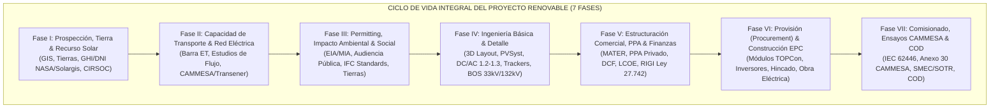

# ⚡ Modelo Maestro de Ingeniería para Parques Solares Fotovoltaicos y Energías Renovables en Argentina
### Guía Técnica, Regulatoria y de Bancabilidad bajo Estándares Internacionales (IEC / IEEE / IFC) y Normativa Nacional (CAMMESA / RIGI / MATER)

---

## 🧭 1. Fundamentos y Enfoque de Ingeniería Inversa

Este modelo sintetiza los aprendizajes técnicos, jurídicos y económicos obtenidos a partir de la **ingeniería inversa de proyectos reales de gran escala en Argentina** (como el **PSFV Cutral Có II de 30 MWac / 36.29 MWdc**, y parques de referencia nacional como Cauchari, Altiplano, Zonda y Ullum), extrapolando una **metodología sistemática, reproducible y bancable** para desarrollar cualquier proyecto renovable fotovoltaico en el territorio argentino, desde la prospección inicial hasta su operación comercial y despacho en el Mercado Eléctrico Mayorista (MEM).

---

## 🌐 2. Matriz de Estándares Internacionales de Cumplimiento Obligatorio

Para que un parque solar sea apto para financiamiento internacional (*Project Finance* sin recurso con agencias como BID Invest, IFC, CAF, DFC o banca comercial internacional), el diseño debe alinearse con la siguiente suite de normas:

### 2.1. Normas IEC (International Electrotechnical Commission)
1. **IEC 62548 (Diseño de Matrices Fotovoltaicas)**:
   - Requisitos de aislamiento, seccionamiento en CC, protecciones contra sobrecorriente (fusibles gPV), descargadores de sobretensión (SPD Tipo I+II), y cálculo de corrientes máximas de cortocircuito ($I_{sc} \times 1,25$).
2. **IEC 62446-1 y IEC 62446-2 (Ensayos de Puesta en Marcha, Inspección y O&M)**:
   - **Categoría 1**: Continuidad de conductores de puesta a tierra y equipotencial, polaridad de strings, tensión a circuito abierto ($V_{oc}$), corriente de cortocircuito ($I_{sc}$), y resistencia de aislamiento en seco y húmedo ($R_{iso} \ge 1\text{ M}\Omega$ a 1.000/1.500 Vcc).
   - **Categoría 2**: Trazado de curvas I-V (corriente-voltaje) para cada string y termografía infrarroja (IR) aérea o manual para detección de *hot spots* y diodos en bypass abiertos.
3. **IEC 61724-1, -2 y -3 (Monitoreo de Rendimiento y Performance Ratio - PR)**:
   - Clasificación de estaciones meteorológicas en sitio (Clase A de alta precisión: piranómetros secundarios de patrón, termorresistencias PT100 para temperatura de módulo, anemómetros sónicos y pluviómetros/soiling stations).
   - Cálculo del **Performance Ratio Corregido por Temperatura ($PR_{corr}$)** para descartar variaciones estacionales ajenas a la degradación física.
4. **IEC 62817 (Calificación de Seguidores Solares - Trackers)**:
   - Resistencia a la fatiga por torsión y deflexión por viento, ciclos de vida acelerados (mínimo 25 años equivalentes), y prueba de posicionamiento de emergencia ante ráfagas extremas (*Aeroelastic Instability / Galloping*).
5. **IEC 61215 e IEC 61730 (Calificación y Seguridad de Módulos Fotovoltaicos)**:
   - Ensayos de durabilidad térmica (-40°C a +85°C), granizo (impacto de bolas de hielo de 25-35 mm), resistencia mecánica a carga de nieve/viento (2.400 Pa / 5.400 Pa) y aislamiento eléctrico a 1.500 Vcc.

### 2.2. Normas IEEE (Institute of Electrical and Electronics Engineers)
1. **IEEE 1547-2018 / IEEE 2800-2022 (Interconexión a Redes de Potencia de Recursos Basados en Inversores - IBR)**:
   - **Capacidad de Soporte ante Huecos de Tensión (Fault / Low Voltage Ride-Through - LVRT)**: El parque debe permanecer conectado y aportar corriente reactiva durante fallas en la red de transporte sin disparar protecciones.
   - **Control de Potencia Activa y Reactiva**: Capacidad de responder a variaciones de frecuencia ($P(f)$ - estatismo de $2\%$ a $5\%$) y control dinámico de tensión en barras mediante regulación $Q(V)$ en cuatro cuadrantes ($\cos \varphi = \pm 0,90$).
2. **IEEE 80 (Seguridad en Puesta a Tierra de Subestaciones de CA)**:
   - Cálculo determinista de tensiones de paso y de contacto (*Step and Touch Voltages*) en la subestación elevadora y centros de transformación, verificando que los valores calculados no superen los umbrales de fibrilación ventricular humana.

### 2.3. Criterios de Sostenibilidad y Bancabilidad (IFC & Principios de Ecuador IV)
1. **Normas de Desempeño Ambiental y Social de la IFC (1 a 8)**:
   - Evaluación y gestión de riesgos socioambientales (ND 1), condiciones laborales y transición justa (ND 2), eficiencia del uso de recursos y prevención de la contaminación (ND 3), salud y seguridad de la comunidad (ND 4), adquisición de tierras y reasentamiento involuntario (ND 5), conservación de la biodiversidad (ND 6), pueblos indígenas (ND 7), y patrimonio cultural / hallazgos arqueológicos (ND 8).
2. **Informe de Bancabilidad de Rendimiento Energético (DNV GL / NREL)**:
   - Exigencia de evaluación independiente de rendimiento energético (*Independent Engineer Report*) con análisis de incertidumbre global ($< 6\%$) y curvas de probabilidad de excedencia P50, P90 y P95 para el dimensionamiento del ratio de cobertura de deuda (DSCR $\ge 1,20x - 1,30x$).

---

## 🇦🇷 3. Marco Normativo, Regulatorio y Tarifario Específico de Argentina

### 3.1. Procedimientos y Códigos de Red de CAMMESA
El ingreso al Mercado Eléctrico Mayorista (MEM) como Agente Generador Renovable se rige por:
1. **Capítulo XXXVI de Los Procedimientos**:
   - Solicitud de Ingreso y Habilitación Comercial como Agente Generador / Cogenerador Renovable.
   - Presentación del Proyecto de Detalle de Interconexión y Estudio de Acceso a la Capacidad de Transporte Eléctrico.
2. **Anexo 30 de CAMMESA (Ensayos de Puesta en Servicio y Comisionado)**:
   - Medición de potencia neta inyectada al Sistema Argentino de Interconexión (SADI).
   - Verificación de la curva $P-Q$ del generador en bornes y límites de inyección de reactivos.
   - Ensayos de respuesta de frecuencia y control de rampas de subida/bajada ($\text{MW/min}$).
3. **Sistemas Obligatorios de Medición y Telecontrol**:
   - **SMEC (Sistema de Medición Comercial)**: Medidores de energía activa y reactiva de clase 0.2s redundantes (principal y respaldo), sincronizados por GPS, con conexión vía módem satelital o fibra óptica IP al sistema central de CAMMESA.
   - **SOTR (Sistema de Operación en Tiempo Real)**: Telemetría obligatoria mediante protocolo ICCP (TASE.2) o DNP3/IEC 60870-5-104 reportando en tiempo real tensión, corriente, potencia activa, reactiva, frecuencia, estado de interruptores y variables meteorológicas (irradiancia y viento).

### 3.2. Régimen del Mercado a Término de Energías Renovables (MATER)
- Regulado por la **Resolución MEyM 281-E/2017** y **Resolución SE 330/2023**:
  - Permite a los generadores renovables suscribir contratos privados de compraventa de energía (PPA) bilaterales y libremente pactados en dólares (USD/MWh) con Grandes Usuarios del MEM (GUMAs y GUMEs con demanda media anual $\ge 300\text{ kW}$).
  - Asignación trimestral de **Prioridad de Despacho** administrada por CAMMESA:
    - *Prioridad Tipo A*: Capacidad de transporte firme y plena en el corredor eléctrico.
    - *Prioridad Tipo B / Referencial (Curtailment aceptado)*: Asignación supeditada a recortes de generación programados ante congestión de red, requiriendo análisis de costo-beneficio del vertido energético (*curtailment loss* $\le 3\% - 8\%$).

### 3.3. Estructuras de Contratación: Iniciativa Privada (IP) y Régimen RIGI
1. **Régimen de Iniciativa Privada (Nacional Ley 27.742 / Provincias / Municipios)**:
   - **Fase de Propuesta**: Presentación formal no vinculante que acredite viabilidad técnica, económica y ambiental, solvencia patrimonial y principio estricto de **riesgo empresario** (sin garantías directas de repago estatal).
   - **Declaración de Interés Público**: Aprobación por parte de la autoridad ejecutiva o legislativa (ordenanza/decreto), convocando a licitación pública.
   - **Preferencia del Iniciador**: Derecho de preferencia ante igualdad de ofertas (margen del $5\%$) o derecho a mejorar oferta (*mejora de postura*) si la oferta externa es hasta un $15\% - 20\%$ más conveniente.
2. **Régimen de Incentivo para Grandes Inversiones (RIGI - Ley 27.742)**:
   - Aplicable a proyectos energéticos con inversión computable en bienes de capital y obras de infraestructura elegibles:
     - **Estabilidad Fiscal a 30 años**: Inalterabilidad de alícuotas de Ganancias (tasa reducida del $25\%$), amortización acelerada de bienes de capital y devolución anticipada de IVA en créditos fiscales dentro de los 3 meses.
     - **Exenciones Aduaneras**: Arancel de importación del $0\%$ para bienes de capital, módulos solares, inversores, trackers y repuestos nuevos.
     - **Libre Disponibilidad de Divisas**: Exención progresiva de la obligación de liquidación de divisas de exportación y libre remesa de dividendos al exterior.

### 3.4. Normativa Geotécnica y Estructural Argentina
- **INPRES-CIRSOC 103 (Reglamento Argentino para Construcciones Sismorresistentes)**: Zonificación de amenaza sísmica (Zona 0 muy reducida a Zona 4 muy elevada). Exige cálculo de fundaciones de centros de transformación, pórticos de subestación y estructuras de hincado según espectro de respuesta del sitio.
- **CIRSOC 102 (Acción del Viento sobre las Construcciones)**: Prescripción indispensable en la Patagonia y Cuyo, donde ráfagas sostenidas de viento obligan a recalcular los coeficientes de presión de forma ($C_p$) sobre las superficies inclinadas de los módulos y verificar el torque dinámico sobre los ejes de los seguidores (*aeroelastic torsional flutter*).

---

## 🛠️ 4. Metodología de Diseño en 7 Fases Operativas

### Fase I: Prospección, Terreno & Evaluación de Recurso Solar
1. **Criterios de Land Scouting**:
   - Ratio de superficie territorial: **$1,3\text{ a }1,6\text{ hectáreas por MWac}$** para plantas con seguidores monofila 1P o 2P.
   - Pendientes topográficas: Idealmente $\le 2\% - 3\%$ (máximo $5\%$ en sentido Norte-Sur para evitar cortes/rellenos en trackers).
   - Disponibilidad jurídica: Dominio privado con título perfecto, usufructo público municipal/provincial a largo plazo ($\ge 30\text{ años}$) o servidumbre minera/industrial.
2. **Modelado Satelital del Recurso**:
   - Extracción de series históricas de irradiancia horizontal global (GHI), directa normal (DNI) y difusa (DHI) de fuentes combinadas: **NASA POWER, PVGIS 5.3, Solargis y Meteonorm 8.2**.
   - Generación de serie horaria típica TMY (Typical Meteorological Year).

### Fase II: Conexión Eléctrica & Capacidad de Evacuación (Grid Interconnection)
1. **Identificación del Punto de Conexión (POI)**:
   - Distancia al nodo: Líneas de evacuación en 33 kV para potencias hasta 30-40 MWac (distancias $< 10-15\text{ km}$); subestaciones dedicadas elevadoras 33/132 kV para proyectos $\ge 50\text{ MWac}$.
2. **Estudios de Red Eléctrica Requeridos por CAMMESA / Distribuidor**:
   - **Flujo de Potencia en Régimen Permanente**: Verificación de sobrecargas térmicas en líneas y transformadores bajo escenarios de máxima generación solar y mínima demanda local.
   - **Cálculo de Cortocircuito (IEC 60909)**: Determinación de la potencia de cortocircuito trifásica y monofásica en la barra para especificar el poder de corte del *switchgear* (ej. 25 kA / 31,5 kA).
   - **Estabilidad Transitoria y Dinámica**: Modelado de inversores IBR (Grid-following / Grid-forming) en software PSS/E o DigSILENT PowerFactory.

### Fase III: Permitting, Impacto Socioambiental & Factibilidad
1. **Manifiesto de Impacto Ambiental (MIA / EIA)**:
   - Línea de base ambiental (flora, fauna, avifauna esteparia/andina, hidrología superficial y escorrentías).
   - Plan de Gestión Ambiental y Social (PGAS): Manejo de residuos de obra, supresión de polvo en caminos y desmantelamiento/cierre.
   - Audiencia Pública obligatoria y Declaración de Impacto Ambiental (DIA) emitida por la autoridad provincial.
2. **Permisos Sectoriales**:
   - Dirección Provincial de Recursos Hídricos (autorización de cruces de cauces y escorrentías aluvionales).
   - Vialidad Nacional / Provincial (permisos de acceso sobre rutas nacionales, ej. RN 22, RN 40).
   - Dirección de Patrimonio Cultural y Arqueológico (monitoreo paleontológico/arqueológico previo al movimiento de suelos).

### Fase IV: Ingeniería Básica, Simulación 3D & Ingeniería de Detalle
1. **Selección Óptima de Componentes**:
   - **Módulos Fotovoltaicos**: Monocristalinos N-Type TOPCon o HJT bifaciales de gran formato ($\ge 650 - 720\text{ Wp}$), factor de bifacialidad $\ge 80\%$, encapsulante POE/EVA con vidrio doble (dual glass) para resistencia mecánica y degradación mínima ($< 0,40\%/\text{año}$).
   - **Inversores**: Inversores de string de alta potencia ($300\text{ a }350\text{ kWac}$ a 800 Vca) con 6 a 12 MPPTs independientes, facilitando la modularidad, reposición rápida y reducción de cajas de combinación (combiner boxes).
   - **Seguidores (Trackers)**: Seguidores solares a 1 eje horizontal (N-S) con accionamiento descentralizado o multitorque, con algoritmo de *backtracking* 3D (para compensar irregularidades del terreno) y ganancia bifacial optimizada.
2. **Dimensionamiento y Ratios de Diseño**:
   - **DC/AC Ratio**: Típicamente entre **$1,18\text{ y }1,30$** en Argentina (permite aplanar la curva de generación al mediodía y maximizar la inyección en horas tempranas y tardías, compensando el *clipping loss* con mayor volumen total anual).
   - **Ground Coverage Ratio (GCR)**: Típicamente entre **$0,28\text{ y }0,38$** (Pitch entre 6 y 8 metros para seguidores 2P).
   - **Pérdidas Óhmicas de Cableado**: $\le 1,2\%$ en corriente continua y $\le 1,0\%$ en corriente alterna hasta el centro de transformación.
3. **Centros de Transformación (Power Stations / STS)**:
   - Configuración compacta exterior sobre *skid* de hormigón o contenedor metálico, integrando transformador elevador BT/MT (800 V / 33 kV) con aceite dieléctrico biodegradable o mineral, celdas de media tensión aisladas en SF6 o aire comprimido, transformador de servicios auxiliares y UPS.

### Fase V: Estructuración Comercial, PPA & Modelo Financiero (Bancabilidad)
1. **Estructura de Ingresos**:
   - PPA Privado a Largo Plazo (10 a 20 años) con tarifa fija en USD/MWh o indexada por CPI americano.
   - PPA con Distribuidoras Locales / Municipales con precio sostén de garantía.
   - Despacho spot en el MEM (remuneración base por energía entregada y potencia disponible).
2. **Métricas Financieras del Modelo DCF (Flujo de Fondos Descontado)**:
   - **CAPEX Típico Utility-Scale Argentina**: $650.000\text{ a }820.000\text{ USD / MWdc}$ (incluyendo conexión en 33 kV).
   - **OPEX de Referencia**: $9.500\text{ a }14.000\text{ USD / MWdc / año}$ (incluye O&M preventivo/correctivo, seguros todo riesgo, canon de tierra, peajes y gestión administrativa).
   - **LCOE (Levelized Cost of Electricity)**: $32\text{ a }45\text{ USD / MWh}$ (en regiones de excelente recurso solar como Cuyo, NOA y Patagonia Norte).
   - **DSCR (Debt Service Coverage Ratio)**: Mínimo $1,20x$ sobre escenario P90.

### Fase VI: Provisión (Procurement) & Construcción EPC
1. **Estrategia Contractual**:
   - Contrato EPC Llave en Mano (*Turnkey EPC*) con cláusulas FIDIC Silver Book (EPC/Turnkey Contract), penalidades por mora (*Liquidated Damages - LDs*) y garantías de rendimiento (*Performance Guarantees*).
2. **Ensayos de Suelos y Pruebas de Hincado (Pull-Out Tests)**:
   - Ensayos geotécnicos de hincabilidad y pruebas de tracción vertical (*pull-out*) y esfuerzo lateral sobre perfiles de acero C/H para determinar la profundidad óptima de hincado sin requerir zapatas de hormigón.
3. **Logística y Cadena de Suministro**:
   - Despacho marítimo en contenedores high-cube, internación aduanera bajo régimen RIGI/Renovables, transporte terrestre carretero con sobredimensión para transformadores y trackers, y acopio seguro en obrador perimetrado.

### Fase VII: Testing, Comisionado, Ensayos CAMMESA & Operación (COD)
1. **Ensayos Pre-Operativos (Cold & Hot Commissioning)**:
   - Verificación de rigidez dieléctrica, apriete de torques mecánicos, calibración de sensores de viento y comunicación SCADA.
2. **Protocolo de Ensayos CAMMESA (Anexo 30)**:
   - Coordinación con el Centro de Control Regional (Comahue, Cuyo, NOA, etc.).
   - Pruebas de estatismo, rampa de carga, verificación de corte por sobretensión/subtensión y energización bajo carga.
3. **Firma del Acta de Habilitación Comercial (COD)**:
   - Emisión de la autorización formal de despacho por CAMMESA y la Secretaría de Energía, habilitando la facturación comercial de la energía generada.

---

## 📋 5. Checklist Maestro de Auditoría para Nuevos Proyectos Solares

| Eje de Evaluación | Ítems Obligatorios a Verificar | Criterio de Aprobación Bancable |
| :--- | :--- | :--- |
| **1. Recurso & Sitio** | • Coordenadas WGS 84 y archivo KMZ. • Estudio de pendientes topográficas $< 3\%$. • Base satelital dual (PVGIS + Meteonorm / Solargis). • Estudio de riesgo sísmico (INPRES-CIRSOC 103) y viento (CIRSOC 102). | P50 / P90 con incertidumbre global $\le 6\%$. Terreno sin zonas inundables ni escorrentías activas. |
| **2. Red Eléctrica** | • Distancia a la Estación Transformadora más cercana. • Tensión de evacuación (33 kV o 132 kV). • Capacidad disponible de transporte confirmada por CAMMESA/Transportista. • Disponibilidad de campo o celda de reserva en la ET. | Nota formal de la transportista/distribuidora o prioridad de despacho MATER asignada sin riesgo de congestión severa. |
| **3. Ingeniería** | • Simulación PVSyst versión $\ge 7.4$ u $8.x$ con archivo `.PAN` y `.OND`. • Módulos Tier-1 BloombergNEF con certificación IEC 61215/61730. • Inversores con certificación IEEE 1547 / IEC 62109. • Trackers con certificación IEC 62817 y posición de bandera automática. • Balance Balance of System (BOS) con caída óhmica $< 1,5\%$. | Performance Ratio (PR) Año 1 entre $80\%$ y $85\%$. Pérdida por suciedad modelada con ciclo de limpieza local. |
| **4. Legal & Tierras** | • Título de propiedad o contrato de arrendamiento/usufructo $\ge 25 - 30$ años inscripto en el Registro de la Propiedad Inmueble. • Permisos de cruce de caminos y servidumbres de electroducto. • En proyectos públicos: Ordenanza o Decreto de Iniciativa Privada formalmente protocolizado. | Libre de gravámenes, hipotecas o embargos. Aprobación municipal/provincial con fuerza de ley. |
| **5. Ambiental** | • Estudio de Impacto Ambiental (EIA) aprobado con Declaración de Impacto Ambiental (DIA). • Audiencia pública realizada. • Cumplimiento de las 8 Normas de Desempeño de la IFC. | Cero afectación crítica de hábitats protegidos o comunidades sin consulta previa informada. |
| **6. Comercial** | • Contrato PPA firmado o Carta de Intención de compra del $100\%$ de la energía. • Matriz de precio USD/MWh garantizado o contrato MATER indexado. • Mecanismo de despacho y asunción de riesgo de desvíos (CAMMESA). | Riesgo de cobro mitigado por garante de primera línea (GUMA/GUME solvente o distribuidora con fideicomiso). |

---

## 🔗 Referencias Cruzadas en la Bóveda Obsidian
- [[00-Dashboard-MOC]]
- [[docs/Agentes/13-Desarrollador-Parques-Solares-Renovables]]
- [[docs/Proyectos/2026-11-02_psfv-cutral-co-ii-30mw]]
- [[docs/Proyectos/2026-10-14_asesoramiento-parque-solar-fotovoltaico]]
- [[docs/Agentes/01-Analista-Financiero]]
- [[docs/Agentes/02-Ciencia-de-Datos]]
- [[docs/Agentes/06-Arquitecto-Sistemas-EPEC]]
- [[docs/Agentes/11-Copiloto-Orquestador-de-Skills]]
