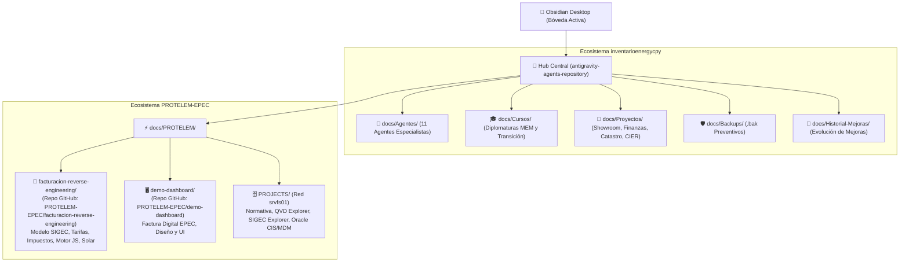

# 🏢 Índice Maestro: Documentación Unificada PROTELEM-EPEC & inventarioenergycpy

Bienvenido a la integración de documentación y repositorios entre las organizaciones de GitHub **`PROTELEM-EPEC`** y **`inventarioenergycpy`** dentro de la Bóveda de Obsidian.

---

## 🗺️ Mapa de Arquitectura y Vinculación

---

## ⚡ 1. Ecosistema PROTELEM-EPEC

### A. Repositorio: `facturacion-reverse-engineering`
- **Repositorio Remoto**: [https://github.com/PROTELEM-EPEC/facturacion-reverse-engineering](https://github.com/PROTELEM-EPEC/facturacion-reverse-engineering)
- **Ruta Local**: `D:\Proyectos\facturacion-reverse-engineering`
- **Rama Activa**: `main` (Sincronizada con `origin/main`)
- **Acceso Directo en Bóveda**: `[[docs/PROTELEM/facturacion-reverse-engineering/|Carpeta de Documentación Viva]]`

#### 📋 Principales Documentos Técnicos Disponibles:
1. **Modelo de Facturación y Liquidación**:
   - `[[docs/PROTELEM/facturacion-reverse-engineering/modelo_facturacion_sigec.md|Modelo de Facturación SIGEC]]`: Arquitectura del motor de cálculo de liquidación mensual y bimestral.
   - `[[docs/PROTELEM/facturacion-reverse-engineering/reglas_por_tarifa.md|Reglas por Tarifa]]`: Lógica de aplicación por cuadros tarifarios EPEC (T1, T2, T3, T4, Peajes, etc.).
   - `[[docs/PROTELEM/facturacion-reverse-engineering/impuestos.md|Estructura de Impuestos y Tributos]]`: Tasas municipales (OIM), IVA, ERSeP, FODEP y fondos provinciales.
   - `[[docs/PROTELEM/facturacion-reverse-engineering/tipos_concepto.md|Tipos de Conceptos de Facturación]]`: Desglose de cargos fijos, cargos variables y adicionales.
2. **Generación Distribuida y Comunitaria**:
   - `[[docs/PROTELEM/facturacion-reverse-engineering/generacion_comunitaria.md|Generación Comunitaria]]`: Esquemas de cesión, autoconsumo y parques solares comunitarios.
   - `[[docs/PROTELEM/facturacion-reverse-engineering/evaluacion_solar.md|Evaluación y Radiación Solar]]`: Integración con NASA POWER y perfiles de generación fotovoltaica.
   - `[[docs/PROTELEM/facturacion-reverse-engineering/reparto_let.md|Reparto LET]]`: Algoritmo de distribución de energía inyectada.
3. **Casuísticas Reales y Validación**:
   - `[[docs/PROTELEM/facturacion-reverse-engineering/cliente_real.md|Análisis de Clientes Reales]]`: Metodología de cotejo de facturación real vs. simulador.
   - `[[docs/PROTELEM/facturacion-reverse-engineering/caso_72677900.md|Auditoría Caso N.º 72677900]]`: Caso testigo con desglose de potencias y energía.
4. **Arquitectura del Motor y Datos**:
   - `[[docs/PROTELEM/facturacion-reverse-engineering/motor_js.md|Motor JavaScript de Cálculo]]`: Especificación del motor cliente de liquidación.
   - `[[docs/PROTELEM/facturacion-reverse-engineering/snapshot.md|Estructura del Snapshot de Tarifas]]`: Serialización JSON de los cuadros tarifarios históricos.
   - `[[docs/PROTELEM/facturacion-reverse-engineering/glosario_tablas.md|Glosario de Tablas SIGEC]]`: Diccionario de campos y claves del ERP comercial Oracle.

---

### B. Repositorio: `demo-dashboard`
- **Repositorio Remoto**: [https://github.com/PROTELEM-EPEC/demo-dashboard](https://github.com/PROTELEM-EPEC/demo-dashboard)
- **Ruta Local**: `D:\Proyectos\demo-dashboard`
- **Rama Activa**: `main`
- **Objetivo**: Interfaz web interactiva de factura digital, visualización de cargos desglosados y componentes gráficos para usuarios de EPEC.

---

### C. Repositorio: `despliegue-medidores-inteligentes-ami`
- **Repositorio Remoto**: [https://github.com/PROTELEM-EPEC/despliegue-medidores-inteligentes-ami](https://github.com/PROTELEM-EPEC/despliegue-medidores-inteligentes-ami)
- **Ruta Local**: `D:\Proyectos\despliegue-medidores-inteligentes-ami`
- **Rama Activa**: `main`
- **Acceso Directo en Bóveda**: `[[docs/PROTELEM/despliegue-medidores-inteligentes-ami/|Carpeta de Documentación Viva]]`
- **Ficha en Bóveda**: `[[docs/Proyectos/2026-10-21_despliegue-medidores-inteligentes-ami|Plan Maestro de Despliegue AMI]]`
- **Objetivo**: Plan Maestro Contractual para instalar **360.000 medidores inteligentes** (neto de 10% de reserva = 40.000 u.) al **25 de enero de 2028** con relevamiento anticipado ($\ge$ 15 días). Distribución: 316.980 en Zona A (88,05%) y 43.020 en Interior (11,95%: Río Cuarto completo 13.000 u., San Francisco 24.154 u., Villa María 5.176 u., Villa Allende 690 u.).

#### 📋 Principales Documentos Técnicos Disponibles:
1. `[[docs/PROTELEM/despliegue-medidores-inteligentes-ami/01_analisis_licitacion_5573_ordenes_provision.md|01. Análisis de Licitación 5573 y Órdenes de Provisión]]`
2. `[[docs/PROTELEM/despliegue-medidores-inteligentes-ami/02_metodologia_despliegue_set_concentradores_plc.md|02. Metodología de Despliegue SET y Concentradores PLC]]`
3. `[[docs/PROTELEM/despliegue-medidores-inteligentes-ami/03_compatibilidad_marcas_y_fronteras_electricas.md|03. Compatibilidad de Marcas y Fronteras Eléctricas]]`
4. `[[docs/PROTELEM/despliegue-medidores-inteligentes-ami/04_plan_de_accion_cuadrillas_y_relevamientos.md|04. Plan de Acción de Cuadrillas y Relevamientos]]`
5. `[[docs/PROTELEM/despliegue-medidores-inteligentes-ami/05_equilibrio_relevamiento_instalacion_stock_zona_a.md|05. Equilibrio Relevamiento vs. Instalación vs. Stock Zona A]]`
6. `[[docs/PROTELEM/despliegue-medidores-inteligentes-ami/06_plan_maestro_despliegue_contractual_360k.md|06. Plan Maestro Contractual de Despliegue 360k]]`

---

### D. Compendio Integrado de Proyectos de Red (`docs/PROTELEM/PROJECTS/`)
- **Única Fuente de la Verdad (SSOT)** documentada para datos históricos de EPEC:
  1. `[[docs/PROTELEM/PROJECTS/sigec-explorer/|SIGEC Explorer]]`: Catálogo completo de 1.036 tablas del esquema Oracle comercial.
  2. `[[docs/PROTELEM/PROJECTS/qvd-explorer/|QVD Explorer]]`: Diccionario de 505 QVDs Qlik Sense con linaje de datos.
  3. `[[docs/PROTELEM/PROJECTS/normativa-epec/|Normativa EPEC]]`: Reglamento comercial, resoluciones tarifarias y regímenes sancionatorios.
  4. `[[docs/PROTELEM/PROJECTS/sistema-epec-oracle/|Sistema EPEC Oracle (CIS/MDM)]]`: Pliego licitatorio con 929 requerimientos en 35 grupos funcionales.
  5. `[[docs/PROTELEM/PROJECTS/reportes/|Reportes]]`: Guías de diseño de tableros ejecutivos HTML.

---

## 🌐 2. Ecosistema inventarioenergycpy

- **Bóveda Central**: `antigravity-agents-repository` ([GitHub](https://github.com/inventarioenergycpy/antigravity-agents-repository.git)).
- **Tablero MOC General**: `[[00-Dashboard-MOC|Dashboard Principal de Agentes]]`.
- **Cursos y Diplomaturas**:
  - `[[docs/Cursos/00-Indice-General-Cursos|Índice General de Cursos]]`.
  - `[[docs/Cursos/Diplomatura-Energia-Electrica/Monografia-Integral-Diplomatura-Energia-Electrica|Monografía Integral MEM y Regulación Eléctrica]]`.
  - `[[docs/Cursos/Diplomatura-Transicion-Energetica/Monografia-Integral-Diplomatura-Transicion-Energetica|Monografía Transición Energética, BESS e Hidrógeno]]`.
- **Proyectos Independientes en Repositorios Satélite**:
  - `showroom-energycpy`: [Showroom Web](https://github.com/inventarioenergycpy/showroom-energycpy)
  - `dashboard-gestion-intermediacion`: [Dashboard Financiero 3 Capas](https://github.com/inventarioenergycpy/dashboard-gestion-intermediacion)
  - `forwarded-message`: [Proyecto Hidrógeno & RIGI](https://github.com/inventarioenergycpy/forwarded-message)
  - `encuesta-cier-epec`: [Estudio de Satisfacción CIER](https://github.com/inventarioenergycpy/encuesta-cier-epec)
  - `control-catastral-georeferencia`: [Auditoría Catastral GIS WFS](https://github.com/inventarioenergycpy/control-catastral-georeferencia)

---

## ⚙️ 3. Protocolo de Sincronización Automática

1. **Obsidian Git**:
   - Cada repositorio (`antigravity-agents-repository` y `facturacion-reverse-engineering`) cuenta con el plugin oficial `.obsidian/plugins/obsidian-git/` habilitado.
   - **Auto-Pull al Arranque**: Descarga las notas y cambios de GitHub al abrir la aplicación.
   - **Auto-Push cada 10 Minutos**: Guarda y sincroniza periódicamente.
2. **Credenciales en Windows**:
   - `inventarioenergycpy`: Autenticado con Personal Access Token clásico.
   - `PROTELEM-EPEC`: Autenticado mediante `protelemepec-coder` con permisos de push/pull sobre la organización.
