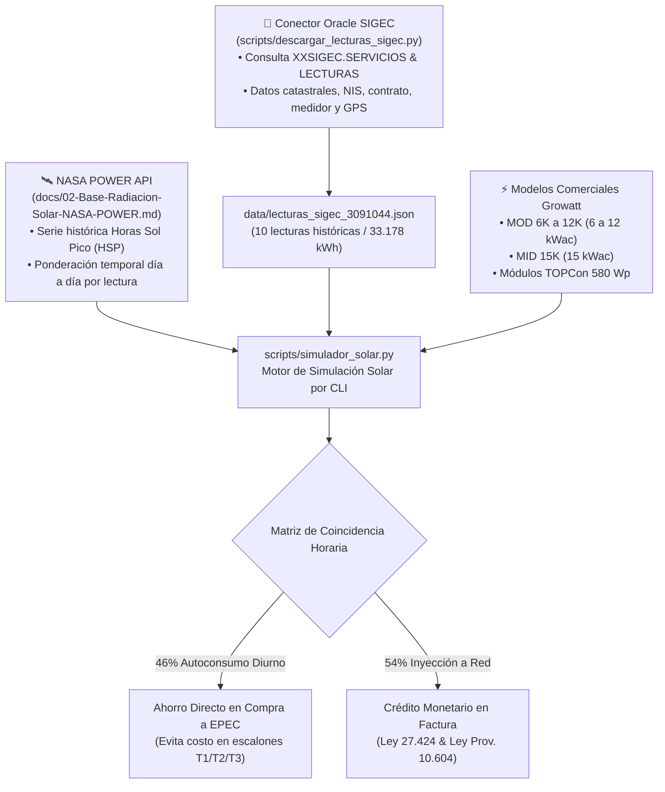

# ☀️ Análisis Estratégico de Sinergia: Habilidad Solar Renovables & Ecosistema PROTELEM-EPEC
### Integración del Simulador Fotovoltaico, Facturación Comercial SIGEC, Redes Inteligentes AMI y Escalamiento Multi-Nivel

---

## 📌 1. Resumen Ejecutivo y Diagnóstico de Repositorios

El análisis técnico conducido por el **Squad de Ingeniería Reversa** sobre el ecosistema de repositorios de **`PROTELEM-EPEC`** y **`protelemepec-coder`** determinó que la nueva habilidad del **Agente 13 (`desarrollador-parques-solares-renovables`)** no opera como un módulo aislado, sino como el eslabón faltante para articular una **suite integral de energía solar y transición energética para EPEC**.

### Diagnóstico de Acceso:
- **`PROTELEM-EPEC/SimuladorFotovoltaico`**: Repositorio privado dentro de la organización `PROTELEM-EPEC` (devuelve `404 Not Found` en llamadas públicas no autenticadas, requiriendo token de colaborador para clonación directa).
- **`protelemepec-coder/asesoramiento-parque-solar-fotovoltaico`**: Repositorio activo y homólogo en el cual reside la implementación original del **Simulador Fotovoltaico Georreferenciado**, conectores de base de datos Oracle SIGEC y modelos de inversores Growatt.

---

## ⚙️ 2. Radiografía del Motor de Simulación Existente (`asesoramiento-parque-solar-fotovoltaico`)

La auditoría del código fuente reveló un motor matemático sólido con tres componentes esenciales:



1. **`scripts/descargar_lecturas_sigec.py`**:
   - Conexión vía cliente nativo `oracledb` al ERP comercial de EPEC.
   - Extrae lecturas históricas de energía activa, cálculo de días del período y coordenadas geográficas WGS 84 (`srv_gps_latitud`, `srv_gps_longitud`).
2. **`scripts/simulador_solar.py`**:
   - Pondera las Horas Sol Pico (HSP) mensuales de la NASA entre las fechas exactas de lectura del medidor, eliminando el sesgo de promedios mensuales planos.
   - Aplica un **factor de coincidencia diurna del 46%** (autoconsumo instantáneo) y **54% de inyección a la red**.
3. **Modelado Comercial de la Gama Growatt**:
   - Inversores trifásicos certificados `MOD-6K` (6,38 kWp), `MOD-8K` (8,70 kWp), `MOD-10K` (10,44 kWp - óptimo), `MOD-12K` (12,76 kWp) y `MID-15K` (15,08 kWp) con módulos TOPCon de 580 Wp.

---

## 🚀 3. Los 6 Vectores de Potenciación con el Ecosistema PROTELEM-EPEC

| Vector de Sinergia | Repositorio / Skill EPEC | Aporte de la Nueva Skill (Agente 13) | Impacto / Entregable Unificado |
| :--- | :--- | :--- | :--- |
| **1. Liquidación de Facturas & Reparto LET** | `facturacion-reverse-engineering` (Agente 12) | Perfiles de generación solar horaria ($E_{\text{gen}}(t)$). | **Motor Bimonetario de Usuario-Generador**: Liquidación exacta en las 31 tablas de SIGEC de créditos por inyección, bandas horarias (Pico/Resto/Valle) y reparto proporcional de energía comunitaria (Reparto LET). |
| **2. Telemetría y Calidad de Red** | `despliegue-medidores-inteligentes-ami` | Códigos de red **IEEE 1547-2018 / IEEE 2800** (LVRT y Volt-VAr). | **Control de Inversión de Flujo (*Reverse Power Flow*)**: Mitigación de sobretensiones locales y balance de fases en transformadores de distribución (SET) utilizando los medidores inteligentes CLOU. |
| **3. Prospección Catastral Automatizada** | `sigec-ruta-nueva-catastro-georef` (IDECOR) | Criterios de *Land Scouting* solar (pendientes $<3\%$, buffer a líneas MT). | **Buscador de Terrenos Solares en Córdoba**: Script GeoPandas que cruza las 580.330 parcelas catastrales de IDECOR con la traza de líneas de 33 kV y 13,2 kV de EPEC. |
| **4. Factura Digital & Portal Ciudadano** | `demo-dashboard` | Funciones matemáticas y series de irradiancia NASA/PVGIS. | **Simulador de Autoconsumo Interactivo**: Widget en la interfaz web de EPEC donde el cliente ingresa su NIS y visualiza paneles sugeridos, ahorro mensual y huella de $CO_2$ evitada. |
| **5. Alivio de Subestaciones Saturadas (NWA)** | `qvd-explorer` & `sigec-explorer` | Dimensionamiento de plantas solares fijas y con trackers. | **Non-Wires Alternatives (NWA)**: Sustitución de costosas obras de repotenciación en transformadores sobrecargados en verano mediante miniparques solares de 1 a 3 MW en cabecera de alimentador. |
| **6. Pliegos Licitatorios CIS / MDM** | `arquitecto-sistemas-epec` (Agente 6) | Protocolos de comunicación IEC 61850, DNP3 y SunSpec Modbus. | **Especificación Técnica de Medición Neta**: Blindaje de los pliegos de compra de software de EPEC para soportar medición bidireccional y smart inverters a escala masiva. |

---

## 📐 4. Arquitectura del Simulador Fotovoltaico Multi-Nivel Propuesto

```text
┌────────────────────────────────────────────────────────────────────────────────────────┐
│               SIMULADOR FOTOVOLTAICO INTEGRAL PROTELEM-EPEC / ANTIGRAVITY               │
├──────────────────────────────┬────────────────────────────┬────────────────────────────┤
│   NIVEL 1: MICRO (DG PyME)   │  NIVEL 2: MESO (COMUNIDAD) │ NIVEL 3: MACRO (UTILITY)   │
├──────────────────────────────┼────────────────────────────┼────────────────────────────┤
│ • Potencia: 5 kW a 100 kW    │ • Potencia: 500 kW a 5 MW  │ • Potencia: 10 MW a 100 MW │
│ • Conexión: Baja Tensión BT  │ • Conexión: MT (13,2 kV)   │ • Conexión: MT/AT (33/132) │
│ • Equipos: Growatt MOD/MID   │ • Equipos: Inversores 100k │ • Equipos: Huawei 330kW+STS│
│ • Estructura: Coplanar Techo │ • Estructura: Tracker 1P   │ • Estructura: Tracker 2P   │
│ • Régimen: Ley 27.424 / EPEC │ • Régimen: Reparto LET     │ • Régimen: CAMMESA MATER   │
│ • Facturación: SIGEC T1/T2/T3│ • Facturación: Multiusuario│ • Facturación: PPA Privado │
│ • ROI Típico: 3,5 a 5 años   │ • ROI Típico: 4 a 6 años   │ • TIR Equity: 15% a 18%    │
└──────────────────────────────┴────────────────────────────┴────────────────────────────┘
```

---

## 🔗 Referencias Cruzadas en la Bóveda Obsidian
- [[00-Dashboard-MOC]]
- [[docs/PROTELEM/00-Indice-PROTELEM-EPEC]]
- [[docs/Agentes/13-Desarrollador-Parques-Solares-Renovables]]
- [[docs/Modelos/Modelo-Ingenieria-Parques-Solares-Renovables-Argentina]]
- [[docs/Proyectos/2026-11-02_psfv-cutral-co-ii-30mw]]
- [[docs/Proyectos/2026-10-14_asesoramiento-parque-solar-fotovoltaico]]
- [[docs/Agentes/12-Especialista-Facturacion-Reverse-Engineering]]
- [[docs/Agentes/06-Arquitecto-Sistemas-EPEC]]
