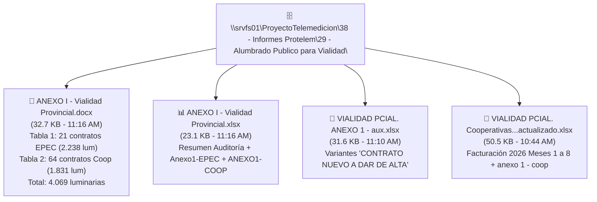

# 🛣️ Auditoría Integral: Cruce de Suministros de Alumbrado de Vialidad Provincial, Cooperativas y Base de Datos SIGEC (EPEC)

> **Expediente / Proyecto**: Alumbrado Público para Vialidad Provincial (Convenio SUAF / EPEC / Cooperativas).  
> **Ubicación en Red**: `\\srvfs01\ProyectoTelemedicion\38 - Informes Protelem\29 - Alumbrado Publico para Vialidad\`  
> **Entorno de Datos**: Cluster Oracle RAC EPEC (`PRODEBS_SEE` / `XXSIGEC`).  
> **Fecha de Ejecución**: 6 de noviembre de 2026.  
> **Squad Responsable**: Squad Ágil Multi-Agente (Arquitectura Adaptativa 4 Agentes: PM Top-1 Gemini Pro + 3 Operadores Top-2 Gemini Flash).

---

## 📌 1. Resumen Ejecutivo

Durante la jornada del **6 de noviembre de 2026**, se completó una exhaustiva investigación técnica y algorítmica sobre los contratos de suministro eléctrico para el alumbrado público vial administrado por la **Dirección Provincial de Vialidad (DPV)** en territorio provincial, tanto en áreas servidas directamente por **EPEC** como en concesiones de **Cooperativas Eléctricas**.

El relevamiento abordó:
1. **Ingesta y Snapshot de Nuevos Archivos de Red**: Procesamiento no bloqueante de los documentos emitidos en `\\srvfs01`:
   - `ANEXO I - Vialidad Provincial.docx` (Documento formal para expediente con tablas ejecutivas).
   - `ANEXO I - Vialidad Provincial.xlsx` (Planilla unificada de contratos EPEC y Cooperativas).
   - `VIALIDAD PCIAL. ANEXO 1 - aux.xlsx` (Planilla de trabajo auxiliar con variantes de alta).
   - `VIALIDAD PCIAL. Cooperativas -EPEC_Vialidad_Provincial_actualizado_3_11_26_actualizado.xlsx` (Matriz de facturación mensual 2026).
2. **Cruce en Vivo contra Oracle SIGEC**:
   - Conexión segura de solo lectura a la base de datos comercial corporativa de EPEC (`xxsigec.personas`, `xxsigec.contratos`, `xxsigec.servicios`, `xxsigec.tarifas`).
   - Identificación de los suministros mayoristas y de peaje de las **26 Cooperativas Eléctricas** involucradas en el ANEXO I.
   - Detección de la marca **GUDIS** (`CNT_GUDI = GD7264XI` en Arroyito) y suministros expresamente contratados para iluminación de autopistas y distribuidores viales (ej. `SRV_CODIGO: 2077749` de CEPRA en Villa Nueva sobre la Autopista Córdoba-Rosario).
3. **Resolución de la Ambigüedad de "Número de Suministro"**:
   - Se discriminó con absoluta claridad el **Punto de Medición / Cliente Técnico de la Cooperativa** (utilizado para el cobro que la Cooperativa remite a Vialidad) del **Suministro Oficial EPEC (`SRV_CODIGO`)** registrado en SIGEC para la interconexión mayorista o peaje.

---

## 🗂️ 2. Auditoría de los Nuevos Archivos Creados en Red (`\\srvfs01`)

### A. `ANEXO I - Vialidad Provincial.docx`
* **Naturaleza**: Documento contractual/resolutivo formalizado para tramitación de expediente entre la Dirección Provincial de Vialidad y EPEC/Ministerio.
* **Estructura Interna**:
  * **Tabla 1 (Contratos en Distritos EPEC)**: 21 filas de suministros formalizados con número de contrato EPEC (ej. `273403901`, `285655201`, `285655401`), zona comercial (predominio Zona A), georreferenciación decimal validada y un subtotal de **2.238 luminarias**.
  * **Tabla 2 (Contratos con Cooperativas)**: 64 filas correspondientes a las cooperativas del interior provincial. Registra `RAZÓN SOCIAL = 'DIREC.PROV.VIALIDAD'`, `CONTRATO = '[NOMBRE COOP] - [NOMBRE INMUEBLE]'`, `LUMINARIAS` y define las coordenadas como `'SEGÚN ALTA NUEVA'`, con un subtotal de **1.831 luminarias**.
  * **Cómputo Total Consolidado**: **4.069 luminarias de alumbrado vial**.

### B. `ANEXO I - Vialidad Provincial.xlsx`
* **Pestaña `Resumen Auditoria`**: Establece el cruce entre el Sistema Comercial EPEC (XXSIGEC - PRODEBS_SEE) y los relevamientos de campo:
  * EPEC SUAF: 42 casos auditados (25 de Vialidad Provincial, 17 de Otros Entes / 59.5% efectividad).
  * EPEC No Cargados formalmente en SUAF: 31 casos (3 de Vialidad, 28 de Otros Entes).
  * Total EPEC auditado: 73 casos (28 de Vialidad Provincial).
* **Pestaña `RESUMEN`**: Consolida 1.831 luminarias de cooperativas + 2.238 de EPEC = 4.069 luminarias.
* **Pestañas `Anexo1-EPEC` y `ANEXO1-COOP`**: Base tabular idéntica a las tablas del documento Word.

### C. `VIALIDAD PCIAL. ANEXO 1 - aux.xlsx`
* Contiene versiones de trabajo que exploran la asignación de titulares en el sistema:
  * Variante 1 (`ANEXO1-COOP`): La razón social es la propia Cooperativa y el contrato figura como `'CONTRATO NUEVO A DAR DE ALTA - [INMUEBLE]'`.
  * Variante 2 (`ANEXO1-COOP (2)`): La razón social es `DIREC.PROV.VIALIDAD` y el contrato agrupa Cooperativa + Inmueble.

### D. `VIALIDAD PCIAL. Cooperativas -EPEC_Vialidad_Provincial_actualizado_3_11_26_actualizado.xlsx`
* Incorpora la nueva pestaña `anexo 1 - coop` vinculada con la matriz histórica de facturación mensual del año 2026 (meses 1 a 8), permitiendo auditar la erogación mensualizada por cada cruce vial.

---

## 🗄️ 3. Cruce con el Motor de Base de Datos SIGEC (Oracle RAC)

El Squad consultó el cluster de base de datos corporativo de EPEC, filtrando contratos vigentes (`c.CNT_ESTADO = 'V'`) de las 26 Cooperativas del listado para rescatar los campos descriptivos de conexión:

### 🌟 Casos Testigo de Alto Valor Descubiertos en SIGEC

#### 1. Coop. Rural CEPRA (Villa Nueva - Rutas 2 y 4): Suministro Específico de Iluminación Vial
* **Suministro EPEC**: **`SRV_CODIGO: 2077749`** | `CNT_NUMERO: 1` | `TCL_CODIGO: 411 (4.2 Coop. Eléctricas)`
* **Ubicación en SIGEC**: `SRV_CALLE: RUTA PROV. NRO. 2 Y AUTOPISTA` | `Dir: ZONA RURAL CEPRA` (Zona 3 - C).
* **Observación Registrada en SIGEC**:
  > `CNT_OBSERVACIONES`: *"CONEXION TRIFASICA SOLICITADA MEDIANTE NOTA NRO. 490/08 (AUTORIZ. POR SUB-JEF. DELEG.INT.- ING. VILLORIA) **PARA ILUMINACION DEL DISTRIBUIDOR AUTOPISTA CORDOBA-ROSARIO SOBRE RUTA PROV. NRO. 2**."*
* **Suministros Auxiliares CEPRA**:
  * **`SRV_CODIGO: 1082785`**: *Ruta N° 2 a 800 mts desde Ana Zumarán a Alto Alegre*.
  * **`SRV_CODIGO: 2806863`**: *Ruta Prov. N° 2 y Nac. N° 9 (Barrio Las Playas)*.

#### 2. Coop. de Arroyito: Suministro de Peaje GUDIS
* **Suministro EPEC**: **`SRV_CODIGO: 1300052`** | `CNT_NUMERO: 3` | `TCL_CODIGO: 923 (9 SERVICIO DE PEAJE)`
* **Marca GUDIS**: **`CNT_GUDI = 'GD7264XI'`**
* **Ubicación en SIGEC**: `SRV_CALLE: FULVIO PAGANI` | `Nro: 47` | `Dir: ARROYITO`.
* **Observaciones**: `OBS_SRV: CONEXION PEAJE` | `OBS_CNT: CONEXION PEAJE`.
* **Suministro Mayorista**: **`SRV_CODIGO: 100223`** (`TCL: 411`, *Estación de Rebaje Arroyito*).

#### 3. Corredores de Rutas Provinciales Identificados en SIGEC
* **Coop. Ascochinga**: **`SRV_CODIGO: 827893`** (`TCL: 411`), calle *RUTA E53 EX RN 156 (LADO CEMENTERIO LA GRANJA)*. Coincidente con las luminarias de las RP E-53 y RP E-66.
* **Coop. La Para**: **`SRV_CODIGO: 100041`** (`TCL: 411`), calle *RUTA PROV. 10 (CNO. LA PARA)*. Coincidente con el alumbrado del Puente sobre el río Suquía en RP E-52.
* **Coop. General Roca**: **`SRV_CODIGO: 3000535`** (`TCL: 411`), calle *LOS SURGENTES - CRUZ ALTA / GRAL. ROCA*, y **`SRV_CODIGO: 127355`** (*Rebaje Marcos Juárez*).
* **Coop. Agua de Oro**: **`SRV_CODIGO: 1343516`** (`TCL: 411`), calle *CAMINO A CANDONGA / EL MANZANO*, y **`SRV_CODIGO: 359927`** (*Capisano S/N*).

---

## 📊 4. Matriz Maestra de Suministros: Cooperativas vs. SIGEC

| Fila | Cooperativa en ANEXO I | Inmueble / Ruta Informada | Zona | Lum | Suministro Técnico Cooperativa (Facturación a Vialidad) | Suministro EPEC SIGEC (`SRV_CODIGO`) | Tarifa SIGEC (`TCL`) / Marca GUDI | Calle / Dirección Registrada en SIGEC |
| :-: | :--- | :--- | :-: | :-: | :---: | :---: | :---: | :--- |
| **5** | CO.DI.EL.A.C. CARRILOBO | Int. Ruta E52 y S390 | D | 20 | `4126` | **`100242`** | 411 (4.2 Coop) | CARRILOBO (Zona 4 - D). |
| **6** | COOP. VILLA RUMIPAL | RP 5 y RP 23 Km 1 (Amboy) | H | 25 | `3807` | **`362374`** | 411 (4.2 Coop) | SARMIENTO / VILLA RUMIPAL (Zona 8 - H). |
| **7** | COOP. HUANCHILLA | Cruce RP 4 y RP 24 | F | 31 | `108226` | **`278422`** | 411 (4.2 Coop) | CORONEL MAYOL S/N / HUANCHILLA (Zona 6 - F). |
| **8** | COOP. PROD. RURALES | Coop. Villa Nueva 1667 | C | 39 | `4883548` | **`2077749`** | 411 (4.2 Coop) | RUTA PROV. 2 Y AUTOPISTA (Ilum. Distribuidor). |
| **9** | COOP. PROD. RURALES | Coop. Villa Nueva 1668 | C | 33 | `4883546` | **`2077749`** | 411 (4.2 Coop) | RUTA PROV. 2 Y AUTOPISTA (Ilum. Distribuidor). |
| **10** | COOP. COLAZO | RP S-353 e int. RP 6 | C | 62 | `04997282` *(Cli: 01220)* | **`897441`** | 411 (4.2 Coop) | ADALGISA 277 / COLAZO. |
| **11** | COOP. TICINO | RP S-358 e int. RP 6 | C | 66 | `9043853` *(Cli: 1844)* | **`168248`** | 411 (4.2 Coop) | TICINO / COOP.ELECT. TICINO (Zona 3 - C). |
| **12** | COOP. ASCOCHINGA | coop ascochinga 20495 | E | 10 | `20495` | **`827893`** | 411 (4.2 Coop) | RUTA E53 EX RN 156 (La Granja). |
| **13** | COOP. ASCOCHINGA | coop ascochinga 20497 | E | 6 | `20497` | **`827893`** | 411 (4.2 Coop) | RUTA E53 EX RN 156 (La Granja). |
| **14** | COOP. ASCOCHINGA | coop ascohinga 20496 | E | 8 | `20496` | **`827893`** | 411 (4.2 Coop) | RUTA E53 EX RN 156 (La Granja). |
| **15** | COOP. LA TORDILLA | Coop. La Tordilla | D | 0 | `16391928` *(Cli: 20718)* | **`100227`** | 411 (4.2 Coop) | EST. REBAJE ARROYITO (Zona 4 - D). |
| **16** | COOP. ANISACATE | Calle Champgnean Villa La Bolsa | H | 25 | `129245` *(Cli: 50153)* | **`362394`** | 411 (4.2 Coop) | ANISACATE (Zona 8 - H). |
| **17** | COOP. ANISACATE | Lt. 45 Mz. 12 Villa La Bolsa | H | 0 | `123085` *(Cli: 50152)* | **`362394`** | 411 (4.2 Coop) | ANISACATE (Zona 8 - H). |
| **18** | COOP. GENERAL ROCA | RP 6 Km 258 | G | 10 | `780545` *(Cli: 5794)* | **`127355`** | 411 (4.2 Coop) | REBAJE MARCOS JUAREZ (Zona 7 - G). |
| **19** | COOP. GENERAL ROCA | Vía Blanca - RP 2 y 12 | G | 78 | `02801310` *(Cli: 27861)* | **`3000535`** | 411 (4.2 Coop) | LOS SURGENTES - CRUZ ALTA / GRAL. ROCA. |
| **20** | COOP. ISLA VERDE | Alumbrado Ruta RP 11 | G | 14 | `16061 / 05573989` | **`127356`** | 411 (4.2 Coop) | COLONIA ITALIANA / ISLA VERDE (Zona 7 - G). |
| **21** | COOP. ISLA VERDE | Cruce RP 11 y 12 | G | 31 | `14640` | **`3000555`** | 411 (4.2 Coop) | CENTRAL ISLA VERDE. |
| **22** | COOP. ISLA VERDE | RP 11 y E58 (Baldissera) | G | 17 | `12197` *(Cli: 11805)* | **`127356`** | 411 (4.2 Coop) | COLONIA ITALIANA / ISLA VERDE. |
| **23** | COOP. ARROYITO | RN 19 y RP E-52 | D | 48 | `107718` *(Cli: 182063)* | **`1300052`** | 923 / **`GD7264XI`** | FULVIO PAGANI 47 (Conexión Peaje GUDI). |
| **25** | COOP. ARROYITO | Rotonda RP E52 salida Sacanta | D | 7 | `34606` *(Cli: 182063)* | **`100223`** | 411 (4.2 Coop) | EST. DE REBAJE ARROYITO (Zona 4 - D). |
| **26** | COOP. INRIVILLE | Cruce RP 6 y Acceso | G | 22 | `1785492` *(Cli: 90205)* | **`127353`** | 411 (4.2 Coop) | INRIVILLE (Zona 7 - G). |
| **27** | COOP. INRIVILLE | Cruce RP 6 y Acceso | G | 32 | `2119373` *(Cli: 92065)* | **`127353`** | 411 (4.2 Coop) | INRIVILLE (Zona 7 - G). |
| **28** | COOP. INRIVILLE | Puente RP 12 | G | 8 | `6456004` *(Cli: 90334)* | **`127353`** | 411 (4.2 Coop) | INRIVILLE (Zona 7 - G). |
| **29** | COOP. LA CUMBRECITA | Acceso Villa Berna / RP 109 | H | 20 | `06-0750-E` | **`362153`** | 411 (4.2 Coop) | LA CUMBRECITA (Zona 8 - H). |
| **30** | COOP. NONO | Acceso Norte localidad Nono | I | 12 | `3366` *(Cli: 3264)* | **`362992`** | 411 (4.2 Coop) | SARMIENTO 296 (Zona 9 - I). |
| **31** | COOP. NONO | RP N° 14 Travesía Urbana | I | 20 | `3365` *(Cli: 3264)* | **`1027533`** | 411 (4.2 Coop) | SAN HUBERTO / NONO (Zona 9 - I). |
| **32** | COOP. RIO TERCERO | Autovía RP 6 tramo Almafuerte | H | 28 | `1301114` *(Cli: 33100)* | **`362387`** | 411 (4.2 Coop) | DEAN FUNES 15 / RIO TERCERO (Zona 8 - H). |
| **36** | COOP. RIO TERCERO | Coop. Rio III 63550 | H | 28 | `63550` | **`362387`** | 411 (4.2 Coop) | DEAN FUNES 15 / RIO TERCERO. |
| **37** | COOP. RIO TERCERO | Coop. Rio III 63551 | H | 28 | `63551` | **`362387`** | 411 (4.2 Coop) | DEAN FUNES 15 / RIO TERCERO. |
| **38** | COOP. AGUA DE ORO | Cuenta 1169728 - RP E-53 Km 36 | E | 75 | `1169728 / 283904` | **`1343516`** | 411 (4.2 Coop) | CAMINO A CANDONGA / EL MANZANO (Zona 5 - E). |
| **39** | COOP. AGUA DE ORO | Cuenta 1169729 - RP E-53 Km 36 | E | 0 | `1169729 / 19383757` | **`1343516`** | 411 (4.2 Coop) | CAMINO A CANDONGA / EL MANZANO. |
| **40** | COOP. AGUA DE ORO | Cuenta 1169730 - RP E-53 Km 38 | E | 0 | `1169730 / 1959538` | **`359927`** | 411 (4.2 Coop) | CAPISANO S/N / AGUA DE ORO (Zona 5 - E). |
| **41** | COOP. AGUA DE ORO | Cuenta 1169731 - RP E-53 Km 38 | E | 0 | `1169731 / 780639` | **`359927`** | 411 (4.2 Coop) | CAPISANO S/N / AGUA DE ORO. |
| **42** | COOP. AGUA DE ORO | Cuenta 1169732 - RP E-53 Km 40 | E | 0 | `1169732 / 1B-0149B` | **`359927`** | 411 (4.2 Coop) | CAPISANO S/N / AGUA DE ORO. |
| **43** | COOP. AGUA DE ORO | Cuenta 1169733 - RP E-53 Km 40 | E | 0 | `1169733 / 24010931` | **`359927`** | 411 (4.2 Coop) | CAPISANO S/N / AGUA DE ORO. |
| **44** | COOP. AGUA DE ORO | Cuenta 1169734 - RP E-53 Km 42 | E | 0 | `1169734 / 24006988` | **`359927`** | 411 (4.2 Coop) | CAPISANO S/N / AGUA DE ORO. |
| **45** | COOP. AGUA DE ORO | Cuenta 1169735 - RP E-53 Km 42 | E | 0 | `1169735 / 2211716` | **`359927`** | 411 (4.2 Coop) | CAPISANO S/N / AGUA DE ORO. |
| **46** | COOP. OLIVA | Autopista Cba-Rosario / RN 9 | C | 309 | `7528` *(Cli: 20470)* | **`168262`** | 411 (4.2 Coop) | OLIVA (Zona 3 - C). |
| **47** | COOP. ALMAFUERTE | 1er Retorno Autovía RP 6 | H | 30 | `4164867` *(Cnt: 12461)* | **`362377`** | 411 (4.2 Coop) | ALMAFUERTE (Zona 8 - H). |
| **48** | COOP. ALMAFUERTE | 2do Retorno Autovía RP 6 | H | 46 | `21002503` *(Cnt: 70378)* | **`362377`** | 411 (4.2 Coop) | ALMAFUERTE (Zona 8 - H). |
| **49** | COOP. ALMAFUERTE | RP 6 Paraje La Barca | H | 24 | `DTPA00112814` *(Cnt: 71815)* | **`362377`** | 411 (4.2 Coop) | ALMAFUERTE (Zona 8 - H). |
| **50** | COOP. ALMAFUERTE | RP 6 Sector UCOOP | H | 24 | `4887448` *(Cnt: 71832)* | **`362377`** | 411 (4.2 Coop) | ALMAFUERTE (Zona 8 - H). |
| **51** | COOP. ALMAFUERTE | RP 6 Campo Abrile | H | 60 | `4887432` *(Cnt: 71929)* | **`362377`** | 411 (4.2 Coop) | ALMAFUERTE (Zona 8 - H). |
| **52** | COOP. ALMAFUERTE | RP 6 Campo Álvarez | H | 48 | `4887444` *(Cnt: 71914)* | **`362377`** | 411 (4.2 Coop) | ALMAFUERTE (Zona 8 - H). |
| **53** | COOP. ALMAFUERTE | RP 6 Campo Mugas | H | 48 | `4887437` *(Cnt: 71924)* | **`362377`** | 411 (4.2 Coop) | ALMAFUERTE (Zona 8 - H). |
| **54** | COOP. ALMAFUERTE | RP 6 Cementerio Parque | H | 10 | `4887443` *(Cnt: 71925)* | **`362377`** | 411 (4.2 Coop) | ALMAFUERTE (Zona 8 - H). |
| **55** | COOP. ALMAFUERTE | Rotonda RP 6 y ex RN 36 | H | 37 | `DTPA00076668` *(Cnt: 12460)* | **`362377`** | 411 (4.2 Coop) | ALMAFUERTE (Zona 8 - H). |
| **56** | COOP. ALMAFUERTE | Zona Rural 260 | H | 30 | `842356` *(Cnt: 12103)* | **`362377`** | 411 (4.2 Coop) | ALMAFUERTE (Zona 8 - H). |
| **57** | COOP. LA LAGUNA | RP 4 y 6 (Cruce Hubeli) | C | 80 | `902` | **`168246`** | 411 (4.2 Coop) | LA LAGUNA (Zona 3 - C). |
| **58** | COOP. LA LAGUNA | RP 4 y 6 (Cruce La Copa) | C | 0 | `901` | **`168246`** | 411 (4.2 Coop) | LA LAGUNA (Zona 3 - C). |
| **59-60**| COOP. LA LAGUNA | RP 4 y 6 (Cruce Maní) | C | 0 | `900` | **`168246`** | 411 (4.2 Coop) | LA LAGUNA (Zona 3 - C). |
| **61** | COOP. GUATIMOZÍN | Alumbrado Ruta RP 12 | G | 20 | `DMGA 00002398` *(Cli: 05283)* | **`127357`** | 411 (4.2 Coop) | J POSSE / GUATIMOZIN (Zona 7 - G). |
| **62** | COOP. ALICIA | Int. RP 13 y RP 3 | D | 25 | `-` *(Aforo / Cli: 80000)* | **`100246`** | 411 (4.2 Coop) | PTE. QUINTANA 759 / ALICIA (Zona 4 - D). |
| **63** | COOP. ALICIA | RP N° 13 Urbana | D | 33 | `-` *(Aforo / Cli: 80001)* | **`100246`** | 411 (4.2 Coop) | PTE. QUINTANA 759 / ALICIA (Zona 4 - D). |
| **64** | COOP. UCACHA | RP 11 y Acceso Este | C | 47 | `127149 / 5293643` *(Cli: 44592)*| **`168224`** | 411 (4.2 Coop) | ENTRE RIOS 98 / UCACHA (Zona 3 - C). |
| **65** | COOP. FEL LABOULAYE | Variante Norte RP 4 | F | 25 | `5054741` *(Cli: 81786)* | **`278425`** | 411 (4.2 Coop) | ENOGLIO Y NEWBERY / LABOULAYE. |
| **66** | COOP. FEL LABOULAYE | Variante Sur RP 4 | F | 15 | `5054746` *(Cli: 81787)* | **`278425`** | 411 (4.2 Coop) | ENOGLIO Y NEWBERY / LABOULAYE. |
| **67** | COOP. FEL LABOULAYE | Ingreso RP 4 y RN 7 | F | 30 | `5052499` *(Cli: 81838)* | **`278425`** | 411 (4.2 Coop) | ENOGLIO Y NEWBERY / LABOULAYE. |
| **68** | COOP. MARULL | Acceso Norte RP 17 | D | 36 | `100305` *(Cli: 1261)* | **`100044`** | 411 (4.2 Coop) | BALNEARIA / MARULL (Zona 4 - D). |
| **69** | COOP. MARULL | Puente sobre canal RP 17 | D | 0 | `100306` *(Cli: 1261)* | **`100044`** | 411 (4.2 Coop) | BALNEARIA / MARULL (Zona 4 - D). |
| **70** | COOP. LA PARA | Puente Col. La Argentina RP E-52 | D | 13 | `19282500` *(Cli: 13322)* | **`100041`** | 411 (4.2 Coop) | RUTA PROV. 10 / CNO. LA PARA (Zona 4 - D). |

---

## 🎯 5. Recomendaciones Normativas para la Tramitación del Expediente

1. **Para la Certificación de Obras y Altas de Servicio de Vialidad**:
   * Las planillas formalizadas en `ANEXO I - Vialidad Provincial.docx` y `.xlsx` asignan temporalmente el estado `'SEGÚN ALTA NUEVA'` para las coordenadas y contratos de las cooperativas. 
   * Se recomienda remitir la columna de **Suministro Técnico de Cooperativa** a los inspectores de obra de Vialidad para que certifiquen el medidor de campo físico, y registrar el **`SRV_CODIGO` de EPEC** en la Gerencia Comercial para la imputación presupuestaria cruzada bajo el régimen de Peajes GUDIS o Tarifa 4.
2. **Saneamiento de Registros Fantasma**:
   * Desestimar formalmente las filas 33, 34 y 35 (Río Tercero vacías con 0 luminarias) y la fila 60 (duplicado de La Laguna), evitando distorsiones en los balances de luminarias.

---
[[00-Indice-PROTELEM-EPEC|⬅️ Volver al Índice General PROTELEM-EPEC]] | [[00-Dashboard-MOC|🏠 Dashboard MOC]]
