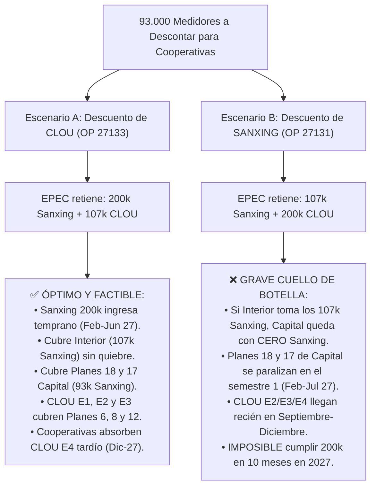

# ⚡ Simulación de Despliegue AMI: EPEC 307k vs. Cooperativas 93k, Ritmo Proporcional 22 Meses en el Interior y Matriz de Marcas

> [!IMPORTANT]
> **Documento Oficial de Ingeniería N° 07 · `PROTELEM-EPEC`**  
> **Licitación Pública N° 5573 / Res. 0653/2026**  
> **Directivas Incorporadas**:
> 1. Stock Licitación: **400.000 MI** divididos en **EPEC: 307.000 MI** y **Cooperativas: 93.000 MI** (ajuste exacto a 400k).
> 2. Zona A Córdoba Capital: **200.000 medidores en 10 meses (2027)** en Planes 6, 8, 12, 17, 18 y 19.
> 3. Interior de la Provincia: **107.000 medidores** a ritmo proporcional mensual en un plazo de **22 meses** (Marzo 2027 a Diciembre 2028).
> 4. Modelado comparativo de dos escenarios para Cooperativas: **Escenario A (Descuento de CLOU)** vs. **Escenario B (Descuento de SANXING)**.
> 5. Alerta de quiebre y agotamiento de stock en el Interior.

---

## 📌 1. Partición del Stock y Parámetros Contractuales

| Parámetro | Volumen Bruto | Cuota EPEC | Cuota Cooperativas | Impacto en el Modelo |
| :--- | :---: | :---: | :---: | :--- |
| **Total Licitación 5573** | **400.000 MI** | **307.000 MI** (76,75%) | **93.000 MI** (23,25%) | Balance cerrado exacto ($307\text{k} + 93\text{k} = 400.000$). |
| **Zona A (Córdoba Capital)** | — | **200.000 MI** | — | Meta de **20.000 medidores/mes** durante 10 meses de 2027. |
| **Interior de la Provincia** | — | **107.000 MI** | — | Meta con horizonte de **22 meses** (Mar-27 a Dic-28). |
| **Censo Total Interior** | **203.137 Suministros** | — | — | **Déficit estructural**: $203.137 - 107.000 = \mathbf{96.137 \text{ suministros}}$. |
| **Mano de Obra Contratada** | 188.000 USE | 188.000 USE | — | Faltante de **119.000 USE** para cubrir los 307.000 medidores. |

### 📊 Gráfica Ejecutiva: Ritmo Mensual de Instalación (Zona A Capital vs. Interior Provincial)

---

## 🌾 2. Interior: Ritmo Proporcional Mensual (Plazo 22 Meses) y Agotamiento de Stock

Para cubrir el universo de **203.137 suministros** en los cuatro distritos del Interior en un plazo de **22 meses** (Marzo 2027 a Diciembre 2028), el ritmo mensual proporcional teórico es:

$$\text{Ritmo Mensual Interior} = \frac{203.137 \text{ suministros}}{22 \text{ meses}} = \mathbf{9.233,5 \text{ medidores/mes}}$$

### A. Desglose del Ritmo Proporcional por Localidad

| Prioridad | Distrito | Nombre Distrito | Localidad | Suministros Censo | Peso Relativo (%) | Ritmo Mensual Proporcional | Cuadrillas Estimadas (14 u/día) |
| :---: | :---: | :--- | :--- | :---: | :---: | :---: | :---: |
| **1°** | **28** | **Río Cuarto** | RÍO CUARTO | 88.224 | **43,43%** | **4.010,2 u./mes** | **13,0 Cuadrillas** |
| **2°** | **8** | **Villa María** | VILLA MARÍA + VILLA NUEVA | 63.282 | **31,15%** | **2.876,5 u./mes** | **9,3 Cuadrillas** |
| **3°** | **18** | **San Francisco** | SAN FRANCISCO | 36.776 | **18,10%** | **1.671,6 u./mes** | **5,4 Cuadrillas** |
| **4°** | **23** | **Villa Allende** | VILLA ALLENDE *(inc. 13 en D1)* | 14.855 | **7,31%** | **675,2 u./mes** | **2,2 Cuadrillas** |
| **TOTAL** | — | **Interior Consolidado** | — | **203.137** | **100,00%** | **9.233,5 u./mes** | **30,0 Cuadrillas** |

### 📊 Gráfica Ejecutiva: Interior - Ritmo Mensual Proporcional por Distrito (22 Meses)

---

### B. Curva de Agotamiento de Stock en el Mes 12 (Febrero 2028)

$$\text{Duración del Stock} = \frac{107.000 \text{ medidores}}{9.233,5 \text{ medidores/mes}} = \mathbf{11,59 \text{ meses}}$$

> [!CAUTION]
> **ALERTA CRÍTICA DE AGOTAMIENTO DE STOCK (FEBRERO 2028)**:  
> Al mantener el ritmo proporcional mensual de **9.233,5 medidores/mes**, el stock de 107.000 medidores **se agota completamente en el Mes 12 (Febrero de 2028)** tras instalar un remanente parcial de **5.431,5 unidades**.  
> **Durante los 10 meses restantes (Marzo 2028 a Diciembre 2028), el stock es CERO**, quedando paralizadas las 30 cuadrillas en el Interior salvo adquisición de un nuevo lote.

### C. Estado Final por Ciudad al Momento del Agotamiento:

Al agotarse el stock, cada ciudad alcanza exactamente el **52,67% de cobertura**:

| Ciudad / Distrito | Suministros Censo | Medidores Instalados al Agotarse Stock | Suministros que Quedan PENDIENTES | Cobertura Final Alcanzada |
| :--- | :---: | :---: | :---: | :---: |
| **Río Cuarto (D28)** | 88.224 | **46.471** | **41.753** | 52,67% |
| **Villa María + V. Nueva (D8)** | 63.282 | **33.333** | **29.949** | 52,67% |
| **San Francisco (D18)** | 36.776 | **19.371** | **17.405** | 52,67% |
| **Villa Allende (D23)** | 14.855 | **7.825** | **7.030** | 52,67% |
| **TOTALES INTERIOR** | **203.137** | **107.000** | **96.137** | **52,67%** |

### 📈 Gráfica Ejecutiva: Interior - Curvas Acumuladas por Distrito (100% Cobertura Sostenida)

### 📉 Gráfica Ejecutiva: Curva de Instalación Acumulada, Entregas y Quiebre de Stock Remanente (Déficit en Amarillo-Naranja)

---

## 📅 3. Cronograma Mensual del Interior (22 Meses)

| Mes N° | Periodo | Ritmo Teórico | Instalación Real Mes | Acumulado Instalado | Stock Remanente en Almacén | Estado Operativo del Stock |
| :---: | :---: | :---: | :---: | :---: | :---: | :--- |
| **Mes 1** | **Mar-27** | 9.233,5 | 9.233,5 | 9.233,5 | 97.766,5 | 🟢 Activo (Stock suficiente) |
| **Mes 2** | **Abr-27** | 9.233,5 | 9.233,5 | 18.467,0 | 88.533,0 | 🟢 Activo |
| **Mes 3** | **May-27** | 9.233,5 | 9.233,5 | 27.700,5 | 79.299,5 | 🟢 Activo |
| **Mes 4** | **Jun-27** | 9.233,5 | 9.233,5 | 36.934,0 | 70.066,0 | 🟢 Activo |
| **Mes 5** | **Jul-27** | 9.233,5 | 9.233,5 | 46.167,5 | 60.832,5 | 🟢 Activo |
| **Mes 6** | **Ago-27** | 9.233,5 | 9.233,5 | 55.401,0 | 51.599,0 | 🟢 Activo |
| **Mes 7** | **Sep-27** | 9.233,5 | 9.233,5 | 64.634,5 | 42.365,5 | 🟢 Activo |
| **Mes 8** | **Oct-27** | 9.233,5 | 9.233,5 | 73.868,0 | 33.132,0 | 🟢 Activo |
| **Mes 9** | **Nov-27** | 9.233,5 | 9.233,5 | 83.101,5 | 23.898,5 | 🟢 Activo |
| **Mes 10** | **Dic-27** | 9.233,5 | 9.233,5 | 92.335,0 | 14.665,0 | 🟡 Advertencia: Último mes pleno |
| **Mes 11** | **Ene-28** | 9.233,5 | 9.233,5 | 101.568,5 | 5.431,5 | 🟠 Crítico: Stock casi agotado |
| **Mes 12** | **Feb-28** | 9.233,5 | **5.431,5** | **107.000,0** | **0,0** | 🔴 **AGOTAMIENTO DEFINITIVO DE STOCK** |
| **Mes 13 a 22** | **Mar-28 a Dic-28** | 9.233,5 | **0,0** | **107.000,0** | **0,0** | ⛔ **PARÁLISIS POR FALTA DE MEDIDORES** |

---

## 🏙️ 4. Zona A (Córdoba Capital): 200k en 10 Meses (2027)

* **Meta**: **200.000 medidores** entre **Marzo 2027 y Diciembre 2027**.
* **Ritmo Mensual**: **20.000 medidores/mes**.
* **Ritmo Diario**: **909 medidores/día hábil** (22 días/mes).
* **Cuadrillas Requeridas**: **50,5 cuadrillas** a 18 medidores/día. Coincide con las **50 cuadrillas mínimas** contratadas en pliego (25 Rowing en OP 27132 + 25 Conectar en OP 27134).
* **Planes Involucrados y Asignación Tecnológica Solicitada**:
  * **CLOU (Total: 75.084 MI)**:
    * **Plan 8 (Este - 27.622 u.)**: CLOU E2/E3 (Disp. 16/09/2027). Relevamiento intensivo previo (99,7% virgen).
    * **Plan 6 (Noreste - 12.675 u.)**: CLOU E1 (Disp. 25/03/2027). 92,7% ya relevado, contiguo a Plan 4 CLOU.
    * **Plan 17 (Centro-Sur - 34.787 u.)**: CLOU E1 (fase aérea 15.687 u.) y CLOU E2 (fase subterránea 19.100 u.).
  * **NANSEN (Total: 84.754 MI)**:
    * **Plan 18 (Oeste - 33.248 u.)**: NANSEN / Sanxing E1 (Disp. 18/02/2027). 92,4% ya relevado.
    * **Plan 19 (Norte - 29.408 u.)**: NANSEN / Sanxing E2. 91,6% ya relevado, homogéneo con parque Nansen preexistente.
    * **Plan 12 (Sureste - 22.098 u.)**: NANSEN / Sanxing E3. 52,7% ya relevado.
  * **Cuencas Densas Adyacentes / Expansión Capital**: **40.162 MI** para completar los 200.000 MI.

---

## 🔬 5. Modelado Comparativo: Escenario A (CLOU) vs. Escenario B (SANXING)

### Tabla Comparativa de Escenarios de Marca:

| Criterio de Evaluación | Escenario A: Cooperativas descuentan CLOU | Escenario B: Cooperativas descuentan SANXING |
| :--- | :--- | :--- |
| **Composición Stock EPEC** | **200.000 Sanxing + 107.000 CLOU** | **107.000 Sanxing + 200.000 CLOU** |
| **Disponibilidad en Almacén** | **Temprana**: Sanxing entrega 200k entre Feb y Jun 2027. Stock holgado en Ferreyra. | **Tardía**: EPEC depende de CLOU E2, E3 y E4 (Sep, Oct y Dic 2027). |
| **Cumplimiento Capital (200k en 10m)** | ✅ **100% Cumplible**: Planes 18 y 17 arrancan en Mar-Abr 2027 con Sanxing. | ❌ **Incumplimiento**: Falta de stock entre Abr y Ago 2027 (retraso CLOU). |
| **Despliegue en el Interior (107k)** | ✅ **100% Homogéneo en Sanxing**: Stock completo disponible desde Jun-27. | ⚠️ **Tensión de Stock**: Sanxing justo al límite sin colchón de reposición. |
| **Gestión de Concentradores PLC** | 3.000 Sanford (Sanxing) y 1.605 Nicema (CLOU) alineados a sus zonas. | Desajuste en subestaciones transformadoras de Capital. |
| **Dictamen de Ingeniería** | 🏆 **ESCENARIO RECOMENDADO** | ⛔ **ESCENARIO DESACONSEJADO** |

---

## ⚡ 6. Esfuerzo de Cuadrillas y Alerta Contractual de Mano de Obra

### A. Dotación de Cuadrillas Requeridas en 2027 (Operación Concurrente)
* **Zona A (Capital)**: **50 Cuadrillas** (20.000 medidores/mes).
* **Interior**: **30 Cuadrillas** (9.233,5 medidores/mes repartidos en 4 frentes).
* **Total Cuadrillas Simultáneas**: **80 Cuadrillas en campo** durante 2027.

### B. Alerta Contractual de Mano de Obra (USE)
1. **Déficit de Contratación**: Las OP 27132 (Rowing) y OP 27134 (Conectar) solo contemplan **188.000 USE totales**. Para instalar 307.000 medidores se genera un **faltante de 119.000 USE**.
2. **Vencimiento de Contratos**:
   * Rowing S.A.: Vence el **25 de enero de 2028**.
   * Conectar S.R.L.: Vence el **27 de marzo de 2028**.
   * Para operar en el Interior hasta Diciembre de 2028 se requiere:
     * Ampliación contractual de plazo y monto (+20% por Ley de Obras Públicas), o
     * Ejecución del remanente mediante cuadrillas propias de EPEC (División Medidores y Conexiones).

---

## 📌 7. Conclusiones y Próximos Pasos

1. **Adoptar formalmente el Escenario A (Cooperativas en CLOU)** para evitar la parálisis de Capital en el primer semestre de 2027.
2. **Asentar la alerta de quiebre de stock en Febrero 2028** en el expediente licitatorio: el censo del Interior requiere 203.137 medidores y el cupo asignado de 107.000 medidores solo cubre el 52,67%, dejando **96.137 suministros pendientes**.
3. **Planificar la gestión de mano de obra** para cubrir las 119.000 USE excedentes y la prórroga de cuadrillas durante 2028.
4. **Desplegar inmediatamente las cuadrillas de relevamiento en Plan 8 y Plan 17** conforme al cronograma de ingeniería para evitar cuellos de botella antes de la llegada de los lotes de medidores.

---

## 🗺️ 8. Diagnóstico de Relevamiento por Plan (Zona A) y Planificación de Frentes de Catastro

Conforme al censo operativo de catastro en los 6 planes de Córdoba Capital (159.838 suministros totales), el estado de relevamiento de acometidas arroja:
- **Suministros Relevados (Listos para instalar)**: **96.796 suministros (60,56%)**.
- **Suministros NO Relevados (Pendientes de cuadrillas de catastro)**: **63.042 suministros (39,44%)**.

### Tabla Diagnóstica por Plan de Lectura:

| Plan (GRL) | Suministros NO Relevados | % No Relevado | Suministros Relevados | % Relevado | Suministro Total | Tecnología Asignada | Prioridad de Relevamiento | Ventana Exigida de Relev. | Ritmo Relev. Req. | Cuadrillas Relev. (18 u/d) |
| :---: | :---: | :---: | :---: | :---: | :---: | :---: | :---: | :---: | :---: | :---: |
| **Plan 8** | **27.534** | **99,68%** | 88 | 0,32% | **27.622** | **CLOU** (E2/E3 Sep-Nov) | 🚨 **1° URGENCIA MÁXIMA** | Mar-27 a Ago-27 (6 meses) | 4.589 u./mes | 10,4 Cuadrillas |
| **Plan 17** | **19.100** | **54,91%** | 15.687 | 45,09% | **34.787** | **CLOU** (E1 May/Jun + E2 Sep) | ⚠️ **2° URGENCIA INMEDIATA** | Ene-27 a Abr-27 (4 meses) | 4.775 u./mes | 10,8 Cuadrillas |
| **Plan 12** | **10.459** | **47,33%** | 11.639 | 52,67% | **22.098** | **NANSEN** (E3 Jul/Ago) | 🟡 **3° PRIORIDAD MEDIA** | Mar-27 a May-27 (3 meses) | 3.486 u./mes | 7,9 Cuadrillas |
| **Plan 18** | 2.543 | 7,65% | **30.705** | 92,35% | **33.248** | **NANSEN** (E1 Mar/Abr) | 🟢 **4° REMATE / LISTO** | Ene-27 a Feb-27 (2 meses) | 1.272 u./mes | 2,9 Cuadrillas |
| **Plan 19** | 2.483 | 8,44% | **26.925** | 91,56% | **29.408** | **NANSEN** (E2 Jun/Jul) | 🟢 **4° REMATE / LISTO** | Ene-27 a Feb-27 (2 meses) | 1.242 u./mes | 2,8 Cuadrillas |
| **Plan 6** | 923 | 7,28% | **11.752** | 92,72% | **12.675** | **CLOU** (E1 Abr/May) | 🟢 **4° REMATE / LISTO** | Ene-27 a Feb-27 (2 meses) | 462 u./mes | 1,0 Cuadrillas |
| **TOTALES** | **63.042** | **39,44%** | **96.796** | **60,56%** | **159.838** | **CLOU: 75k / NANSEN: 85k** | **Operación Concurrente** | **Ene-27 a Sep-27 (9 meses)** | **7.005 u./mes** | **15,9 Cuadrillas** |

### 🗺️ Gráfica Ejecutiva: Zona A - Suministros Relevados vs. Pendientes de Relevamiento por Plan

### Plan de Acción de Relevamiento (Alineación con Entregas de Marca):
1. **Frente Plan 8 (Urgencia Máxima - 27.534 u. - CLOU)**: Al ser virgen (solo 88 relevados), debe concentrar 10 cuadrillas de catastro entre Marzo y Agosto 2027 (6 meses a razón de 4.589 u./mes). De esta forma, al ingresar CLOU E2 en Septiembre 2027, el polígono estará 100% en estado *"SET OK"* para ser instalado sin dilación.
2. **Frente Plan 17 (Urgencia Inmediata - 19.100 u. - CLOU)**: Los 15.687 ya relevados (aéreos) se instalan con CLOU E1 en Mayo y Junio. La ventana de Enero a Abril permite censar las 19.100 acometidas subterráneas/edificios antes del arribo de CLOU E2 en Septiembre.
3. **Frente Plan 12 (Prioridad Media - 10.459 u. - NANSEN)**: Los 11.639 suministros censados permiten arrancar en Julio; los 10.459 remanentes se relevan entre Marzo y Mayo con 8 cuadrillas.
4. **Planes 18, 19 (NANSEN) y Plan 6 (CLOU)**: Cuentan con más del 91% relevado (79.382 suministros listos para instalación inmediata). Absorben los primeros lotes en el primer semestre de 2027.

---

## 📊 9. Despliegue Mensual por Plan en Zona A: Escenario A (CLOU) vs. Escenario B (SANXING)

### Escenario A: Despliegue Armónico y Cumplimiento 100% (200.000 MI en 10 Meses)

| Periodo | Plan 18 (NANSEN) | Plan 19 (NANSEN) | Plan 12 (NANSEN) | Plan 6 (CLOU) | Plan 17 (CLOU) | Plan 8 (CLOU) | Cuencas Densas | Total Mes Capital | Stock EPEC Activo / Hito |
| :---: | :---: | :---: | :---: | :---: | :---: | :---: | :---: | :---: | :--- |
| **Mar-27** | 20.000 | 0 | 0 | 0 | 0 | 0 | 0 | **20.000** | Nansen (SX E1) - Inicio Plan 18 |
| **Abr-27** | 13.248 | 0 | 0 | 6.752 | 0 | 0 | 0 | **20.000** | Cierre P18 (33.248) + CLOU E1 arranca P6 |
| **May-27** | 0 | 0 | 0 | 5.923 | 14.077 | 0 | 0 | **20.000** | Cierre P6 (12.675) + CLOU E1 arranca P17 (Aéreo) |
| **Jun-27** | 0 | 18.390 | 0 | 0 | 1.610 | 0 | 0 | **20.000** | Cierre P17 Fase 1 (15.687) + Nansen arranca P19 |
| **Jul-27** | 0 | 11.018 | 8.982 | 0 | 0 | 0 | 0 | **20.000** | Cierre P19 (29.408) + Nansen arranca P12 |
| **Ago-27** | 0 | 0 | 13.116 | 0 | 0 | 0 | 6.884 | **20.000** | Cierre P12 (22.098) + Cuencas Densas Adyacentes |
| **Sep-27** | 0 | 0 | 0 | 0 | 19.100 | 900 | 0 | **20.000** | CLOU E2: P17 Subt. (19.100) + Inicio Plan 8 |
| **Oct-27** | 0 | 0 | 0 | 0 | 0 | 20.000 | 0 | **20.000** | CLOU E2: Plan 8 pleno relevado |
| **Nov-27** | 0 | 0 | 0 | 0 | 0 | 6.722 | 13.278 | **20.000** | Cierre P8 (27.622) + Cuencas Densas Adyacentes |
| **Dic-27** | 0 | 0 | 0 | 0 | 0 | 0 | 20.000 | **20.000** | Cuencas Densas Cierre 200k Meta Anual |
| **TOTAL** | **33.248** | **29.408** | **22.098** | **12.675** | **34.787** | **27.622** | **40.162** | **200.000** | **100% Meta 2027 Cumplida** |

### 📊 Gráfica Ejecutiva: Zona A - Despliegue Mensual por Plan con Nueva Asignación Tecnológica (CLOU vs. NANSEN)

### Escenario B: Descuento de Sanxing para Cooperativas (Colapso y Parálisis de 4 Meses)

- Al descontar 93.000 Sanxing para cooperativas y asignar los 107.000 restantes al Interior, **Capital se queda con 0 unidades de Sanxing**.
- Capital depende 100% de CLOU.
- **Flujo de entregas CLOU**: Marzo (42k), Septiembre (41,5k), Octubre (41,5k), Diciembre (75k).
- **Impacto catastrófico**:
  - En Marzo y Abril se consumen los 42.000 de CLOU E1.
  - **Mayo, Junio, Julio y Agosto de 2027 (4 meses)**: **Stock en almacén = 0**. Las 50 cuadrillas de Capital quedan totalmente paralizadas.
  - El lote CLOU E4 de 75.000 u. llega recién el **16 de Diciembre de 2027**, siendo humanamente imposible instalar 75k en 15 días.
  - **Resultado Escenario B**: Solo se instalan ~105.000 medidores en todo 2027 (**déficit de 95.000 medidores e incumplimiento contractual flagrante**).

### 🏛️ 10. Consideración de Planes 14 y 15 (Centro Subterráneo) y Destino Estratégico de CLOU E4

Conforme a las definiciones de la conducción del proyecto, los **Planes 14 y 15 (Microcentro y Macrocentro)** están **formalmente considerados** dentro del máster plan de despliegue AMI, pero bajo una **estricta salvedad operativa de red 100% subterránea**:

1. **Receptor Estratégico del Lote CLOU E4**: El lote CLOU E4 de 75.000 u. (disponible el 16/12/2027) tiene asignación natural para cubrir el Centro, concatenando la finalización de los planes aéreos prioritarios con el inicio del despliegue céntrico entre fines de 2027 y 2028.
2. **Absorción de 6.339 Medidores Trifásicos Directos**: Planes 14 y 15 poseen 48.720 posibles cambios con una concentración récord del **13,0% de suministros trifásicos directos** (6.339 suministros, el 24,2% de toda Capital). Su consideración permite drenar productivamente el excedente estructural de medidores trifásicos de la Licitación 5573 (donde ingresan 70.700 u. netas para EPEC).
3. **Salvedades de Red Subterránea**:
   - **Infraestructura**: Cuadrillas con certificación de trabajo en espacios confinados, detectores de gases y motobombas para intervención en cámaras de transformación bajo calzada.
   - **Comunicaciones**: DCU en cámaras con antenas remotas coaxiales llevadas a superficie (respiraderos) y medidores directos GPRS / NB-IoT punto a punto para galerías y edificios comerciales con fuerte blindaje.
   - **Prerrequisito GIS**: Levantamiento y dibujo previo de cámaras y derivaciones en GIS por parte de Topografía/Planificación antes del censo de acometidas.

---

*Archivos de datos asociados:*
- [`data/Simulacion_Despliegue_AMI_EPEC_307k_Interior_22m.xlsx`](file:///C:/Users/jidiaz/Downloads/Simulacion_Despliegue_AMI_EPEC_307k_Interior_22m.xlsx) *(Libro Excel completo con 6 gráficas nativas en Descargas)*
- [`data/simulacion_proporcional_interior_22m.csv`](file:///C:/Users/jidiaz/.gemini/antigravity-ide/scratch/despliegue-medidores-inteligentes-ami/data/simulacion_proporcional_interior_22m.csv)
- [`data/simulacion_proporcional_interior_22m.json`](file:///C:/Users/jidiaz/.gemini/antigravity-ide/scratch/despliegue-medidores-inteligentes-ami/data/simulacion_proporcional_interior_22m.json)
