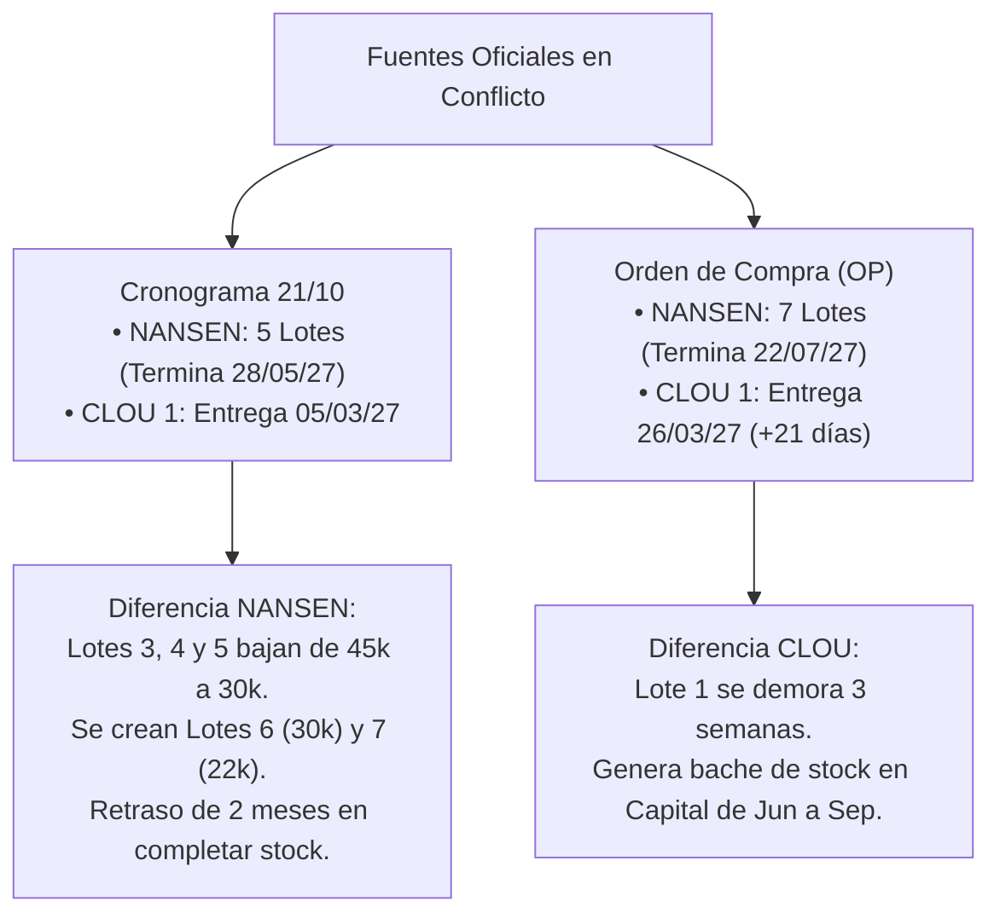

# ⚡ Documento Técnico N° 09: Propuesta Operativa de Despliegue MI 2027
## Escenarios de Capacidad de Contratistas (2 vs. 3), Gestión Dinámica de Stock NANSEN/CLOU, Curva de Entregas y Matriz de Decisiones

> [!IMPORTANT]
> **Documento Oficial de Ingeniería y Planificación Operativa N° 09 · `PROTELEM-EPEC`**  
> **Referencia Primaria:** Documento emitido el **28/10/2026** [`docs/licitacion_5573/Propuesta-despliegue-MI-2027.pdf`](file:///D:/Proyectos/despliegue-medidores-inteligentes-ami/docs/licitacion_5573/Propuesta-despliegue-MI-2027.pdf)  
> **Proyecto:** Despliegue Masivo de Medidores Inteligentes AMI (Licitación Pública N° 5573 / Res. 0653/2026).  
> **Objetivo:** Documentar exhaustivamente la propuesta de despliegue para el año 2027, el ordenamiento secuencial de planes en Córdoba Capital, el cronograma escalonado del Interior, la comparativa de escenarios de ritmo de contratistas (14.000 vs. 21.000 u./mes), el desbalance estructural entre monofásicos y trifásicos, la política de reserva dinámica y el pliego de **24 temas críticos a resolver por la superioridad técnica y comercial**.

---

## 📌 1. Resumen Ejecutivo y Premisas Operativas Fundamentales

La propuesta formaliza un esquema de despliegue pragmático y blindado contra desabastecimientos de obra, estructurado bajo las siguientes reglas cardinales:

1. **Prioridad Absoluta 2027 a Córdoba Capital (Zona A)**:  
   Se asigna un cupo bruto de **200.000 medidores** para Capital, consumiendo la marca que haya disponible en Almacén Ferreyra: **CLOU cuando hay existencias** (dado que CLOU no tiene otro destino asignado dentro del modelo EPEC) y **NANSEN para completar el ritmo** mensual exigido.
2. **El Interior es 100% NANSEN y toma el Excedente**:  
   Los distritos del Interior (**D28 Río Cuarto, D8 Villa María, D18 San Francisco y D23 Villa Allende**) se abastecen exclusivamente con tecnología **NANSEN** y reciben el saldo remanente que deja Capital tras abastecer su meta.
3. **Traspaso a Cooperativas (93.000 CLOU)**:  
   Las cooperativas eléctricas absorben **93.000 medidores, todos de marca CLOU**, descontados de forma proporcional de cada uno de los 4 lotes CLOU contratados (bajo el supuesto de que el 10% corresponde a trifásicos: 83.701 mono + 9.300 tri).
4. **Arranque Masivo en Marzo 2027**:  
   El inicio de instalación a gran escala en campo se programa para **Marzo de 2027** en el **Plan 19** de Capital, sirviéndose del lote **NANSEN 1** (disponible el 18/02/2027 tras cumplir los 20 días de Verificación Primitiva `VP`).
5. **Diferimiento Mandatorio del Lote CLOU 4**:  
   El lote **CLOU 4 (75.000 unidades brutas / 40.125 netas para EPEC)** tiene fecha disponible en campo recién el **16/12/2027**, resultando inviable su colocación en los últimos 15 días del año. **Se traslada íntegramente al cronograma 2028 en cualquier escenario**.
6. **Política de Stock de Seguridad Dinámico**:  
   Para evitar roturas de stock y contingencias de laboratorio, se establece una reserva escalonada que arranca en **3% del acumulado recibido el primer mes**, aumentando **+0,5 puntos porcentuales por mes hasta alcanzar un tope del 10%**.  
   *Consecuencia directa*: Al finalizar el despliegue queda reservado en depósito el 10% neto de cada marca: **20.000 NANSEN y 10.700 CLOU**. Por lo tanto, de cada cupo se instala efectivamente el **90%**: **Capital instala 180.000 de los 200.000 asignados**.
7. **Desbalance Estructural de Fases**:  
   Existe un **sobrante crítico de medidores trifásicos** (entran 80.000, quedan 70.700 netos para EPEC y el cronograma sólo utiliza entre 23.597 y 28.141 unidades) y una **tensión extrema en monofásicos**, donde el escenario de 2 contratistas demanda el **105%** de los monofásicos disponibles.

---

## 🚚 2. Entregas, Lotes y Análisis de Discrepancias Contractuales

### A. Matriz Oficial de Lotes y Descuento de Cooperativas
*Lotes y plazos según cronograma del 21/10. "Disponible" contempla la fecha de entrega más 20 días de Verificación Primitiva (`VP`). Reparto monofásico/trifásico (80%/20%) conforme a la Orden de Provisión.*

| Marca | Lote | Mono (80%) | Tri (20%) | DCU (Cabeceras) | Total Lote | Descuento Cooperativas (Mono / Tri) | Neto EPEC (Mono / Tri) | Fecha Entrega | Fecha Disponible en Campo (`Disp.`) |
| :---: | :---: | :---: | :---: | :---: | :---: | :---: | :---: | :---: | :---: |
| **NANSEN** | **1** | 27.200 | 6.800 | 3.000 | **34.000** | — | **34.000** (27.200 / 6.800) | 29/01/2027 | **18/02/2027** |
| **NANSEN** | **2** | 24.800 | 6.200 | — | **31.000** | — | **31.000** (24.800 / 6.200) | 26/02/2027 | **18/03/2027** |
| **CLOU** | **1** | 33.600 | 8.400 | 3.000 | **42.000** | 19.530 (17.577 / 1.953) | **22.470** (16.023 / 6.447) | 05/03/2027 | **25/03/2027** |
| **NANSEN** | **3** | 36.000 | 9.000 | — | **45.000** | — | **45.000** (36.000 / 9.000) | 26/03/2027 | **15/04/2027** |
| **NANSEN** | **4** | 36.000 | 9.000 | — | **45.000** | — | **45.000** (36.000 / 9.000) | 30/04/2027 | **20/05/2027** |
| **NANSEN** | **5** | 36.000 | 9.000 | — | **45.000** | — | **45.000** (36.000 / 9.000) | 28/05/2027 | **17/06/2027** |
| **CLOU** | **2** | 33.200 | 8.300 | — | **41.500** | 19.298 (17.368 / 1.930) | **22.202** (15.832 / 6.370) | 27/08/2027 | **16/09/2027** |
| **CLOU** | **3** | 33.200 | 8.300 | — | **41.500** | 19.298 (17.368 / 1.930) | **22.202** (15.832 / 6.370) | 17/09/2027 | **07/10/2027** |
| **CLOU** | **4** | 60.000 | 15.000 | — | **75.000** | 34.875 (31.388 / 3.487) | **40.125** (28.612 / 11.513) | 26/11/2027 | **16/12/2027** |

#### Totales Consolidados por Destino y Fases:
| Segmento | NANSEN (u.) | CLOU (u.) | Total Medidores | Monofásicos | Trifásicos | Concentradores (DCU) |
| :--- | :---: | :---: | :---: | :---: | :---: | :---: |
| **Entrada Bruta Total** | **200.000** | **200.000** | **400.000** | 320.000 (80%) | 80.000 (20%) | 6.000 |
| **Descuento Cooperativas** | 0 | **93.000** | **93.000** | 83.701 (90%) | 9.300 (10%) | 0 |
| **Disponibilidad Neta EPEC** | **200.000** | **107.000** | **307.000** | **236.299** | **70.700** | **6.000** |

---

### B. Discrepancias entre el Cronograma Anterior (21/10) y la Orden de Compra (OP)

El informe pone de manifiesto una divergencia de fondo entre dos fuentes documentales oficiales de EPEC:

| Lote | Cronograma 21/10 (Cantidad / Entrega) | Orden de Compra (Cantidad / Entrega) | Discrepancia Identificada |
| :--- | :---: | :---: | :--- |
| **NANSEN 1** | 34.000 / 29/01/2027 | 28.000 / 25/01/2027 | -6.000 medidores; entrega 4 días antes. |
| **NANSEN 2** | 31.000 / 26/02/2027 | 30.000 / 22/02/2027 | -1.000 medidores; entrega 4 días antes. |
| **NANSEN 3** | 45.000 / 26/03/2027 | 30.000 / 24/03/2027 | -15.000 medidores; entrega 2 días antes. |
| **NANSEN 4** | 45.000 / 30/04/2027 | 30.000 / 23/04/2027 | -15.000 medidores; entrega 7 días antes. |
| **NANSEN 5** | 45.000 / 28/05/2027 | 30.000 / 26/05/2027 | -15.000 medidores; entrega 2 días antes. |
| **NANSEN 6** | *No existía* | 30.000 / 22/06/2027 | **Lote nuevo**: 30.000 unidades. |
| **NANSEN 7** | *No existía* | 22.000 / 22/07/2027 | **Lote nuevo**: 22.000 unidades. |
| **CLOU 1** | 42.000 / 05/03/2027 | 42.000 / 26/03/2027 | **Demora de 21 días** (3 semanas más tarde). |
| **CLOU 2** | 41.500 / 27/08/2027 | 41.500 / 27/08/2027 | Idéntico. |
| **CLOU 3** | 41.500 / 17/09/2027 | 41.500 / 17/09/2027 | Idéntico. |
| **CLOU 4** | 75.000 / 26/11/2027 | 75.000 / 26/11/2027 | Idéntico. |

> [!WARNING]
> **Consecuencia Operativa Inmediata:**  
> Al aplicar el descuento de cooperativas sobre el Lote 1 de CLOU, éste queda reducido a **22.470 unidades netas**. En consecuencia, el frente CLOU de Córdoba Capital **se queda totalmente sin medidores entre Junio y Septiembre de 2027**.  
> Para evitar que las cuadrillas se detengan, Capital debe recurrir obligatoriamente a stock **NANSEN** originalmente planificado para el Interior.

---

## 🗺️ 3. Universo de Suministros y Matriz de Posibles Cambios

El censo operativo depura el padrón comercial discriminando suministros vigentes, parques existentes con telemedición y exclusiones técnicas:

### A. Consolidado General por Distrito

* **Vigentes**: Suministros `SN` con contrato activo `V` o servicio `FC`.
* **Posibles Cambios**: Vigentes sin medidor inteligente instalado, no chupetes (`S`) ni autoadministrados (`SG`), con tarifa que pasa el filtro y medición de conexión directa en baja tensión.

| Distrito | Zona Comercial | Suministros Vigentes | Parque Actual con MI (CLOU / NANSEN) | Chupetes Telemedibles (`S`) / `SG` | Posibles Cambios Reales | Desglose Monofásicos | Desglose Trifásicos |
| :--- | :---: | :---: | :---: | :---: | :---: | :---: | :---: |
| **1 Córdoba Capital** | **A** | 604.728 | 144.174 / 92.064 | 62.906 / 2.107 | **287.356** | 261.033 (90,8%) | 26.221 (9,2%) |
| **28 Río Cuarto** | **F** | 87.775 | 15 / 22.451 | 0 / 302 | **64.909** | 56.446 (86,9%) | 7.039 (10,8%) |
| **8 Villa María / V. Nueva** | **C** | 62.214 | 265 / 18.782 | 0 / 329 | **42.815** | 37.467 (87,5%) | 5.058 (11,8%) |
| **18 San Francisco** | **D** | 36.440 | 48 / 1.043 | 0 / 201 | **35.118** | 30.270 (86,2%) | 4.832 (13,8%) |
| **23 Villa Allende / Sierras** | **E** | 28.814 | 141 / 2.357 | 0 / 71 | **26.229** | 22.442 (85,6%) | 3.783 (14,4%) |
| **TOTALES CONSOLIDADOS** | — | **819.971** | **144.643 / 136.697** | **62.906 / 3.010** | **456.427** | **407.658** | **46.933** |

---

### B. Matriz de Planes de Lectura en Córdoba Capital (Zona A)

El informe establece un ranking técnico y operativo para intervenir los planes de Capital:

| Plan | Posibles Cambios | Trifásicos | MI Preexistentes | Estado de Relevamiento | Criterio Técnico y Marca Asignada |
| :---: | :---: | :---: | :---: | :--- | :--- |
| **19** | **17.590** | 1.225 | 5.610 NSEN | **100% Relevado** | **Terminar con NANSEN** (homogeneidad con parque preexistente). |
| **6** | **12.380** | 1.051 | 268 CLOU | **100% Relevado** | **CLOU** (contiguo a la cuenca del Plan 4 CLOU). |
| **18** | **27.800** | 1.409 | 2.582 CL / 2.050 NS | **100% Relevado** | **NANSEN / CLOU** según disponibilidad. |
| **17** | **25.500** | 1.890 | 407 CLOU | Relevado salvo subterráneo | **CLOU** (cuenta con concentrador cabecera CLOU). |
| **12** | **18.880** | 1.512 | 6 | Parcial (zona colindante a P17) | **NANSEN** (transición). |
| **8** | **20.490** | 2.154 | 20 | **Falta relevar**; SET dibujadas | **CLOU** (requiere cuadrillas urgentes de catastro). |
| **7** | **25.000** | 1.700 | 11 | **Falta relevar** | **CLOU** (segundo semestre). |
| **11** | **23.690** | 1.388 | 290 NSEN | **Falta relevar** | **CLOU / NANSEN**. |
| **5** | **27.330** | 1.700 | 132 CLOU | **Falta relevar** (0% MI) | **NANSEN** (se programa al último lugar). |
| **9 y 10** | 16.670 / 17.000 | 1.087 / 949 | 4 / 3 | Falta relevar | Reserva operativa. |
| **14 y 15** | 25.010 / 23.710 | 2.858 / 3.481 | 8 / 8 | Sin SET dibujadas | **CONSIDERADOS con Salvedad Estricta de Red Subterránea** (Microcentro y Macrocentro. Absorbe 6.339 trifásicos y enlaza con Lote CLOU E4). |

> [!NOTE]
> Todos los planes de Capital, independientemente de si ya están relevados o no, requieren una **repasada previa de catastro** para incorporar suministros nuevos, bajas y regularizaciones antes de la entrada de las cuadrillas instaladoras.

### C. Protocolo de Incorporación de Planes 14 y 15 (Centro): Consideraciones Operativas y Salvedades por Red Subterránea

A requerimiento de la conducción del proyecto, los **Planes 14 y 15 (Microcentro y Macrocentro de Córdoba Capital)** se **incorporan formalmente en la consideración del plan de despliegue AMI**, pero sujetos a una **estricta salvedad operativa derivada de su topología de red 100% subterránea**.

| Parámetro Clave | Plan 14 (Microcentro) | Plan 15 (Macrocentro) | Total Consolidado Centro (P14 + P15) |
| :--- | :---: | :---: | :---: |
| **Suministros Posibles Cambios** | **25.010** | **23.710** | **48.720** |
| **Monofásicos Directos** | 22.152 (88,6%) | 20.229 (85,3%) | **42.381 (87,0%)** |
| **Trifásicos Directos** | **2.858 (11,4%)** | **3.481 (14,7%)** | **6.339 (13,0%)** |
| **Parque Preexistente MI** | 8 | 8 | 16 |
| **Lote Tecnológico Asociado** | **CLOU E4** (~75.000 u. arribo 16/12/2027) | **CLOU E4** (~75.000 u. arribo 16/12/2027) | **CLOU E4 + Módems Celulares GPRS** |

#### Las 5 Salvedades Técnicas y Operativas de la Red Subterránea:

1. **Topología Confinada y Cámaras Subterráneas (No Vereda Convencional)**:
   - La red de distribución de baja tensión y los centros de transformación del Centro operan en **cámaras subterráneas bajo calzada y acera**, bóvedas de hormigón y ductos cerrados. No existen líneas aéreas sobre postes.
   - **Salvedad Operativa**: Las cuadrillas instaladoras no pueden ser de tipo estándar; requieren habilitación técnica en **Espacios Confinados (Norma de Higiene y Seguridad)**, detectores de gases tóxicos/explosivos ($O_2, CO, H_2S, LEL$), motobombas de achique y protocolo conjunto de consignación con la Guardia de Redes Subterráneas de EPEC.
2. **Propagación PLC Atenuada y Uplink Celular (GPRS/NB-IoT)**:
   - Las paredes de hormigón armado de las cámaras y el blindaje metálico de los cables subterráneos armados generan una atenuación drástica sobre las frecuencias PLC (PRIME / G3).
   - **Salvedad Técnica**: La concentración de datos no puede resolverse con concentradores aéreos. Requiere:
     - Concentradores (DCU) instalados en el interior de la cámara con **antenas remotas de alta ganancia** canalizadas al exterior (respiraderos de ventilación o nichos a nivel rasante).
     - Despliegue de medidores directos con **módem celular GPRS / NB-IoT punto a punto** para suministros comerciales de alto consumo o galerías comerciales donde la señal PLC no cruce las losas.
3. **Absorción Masiva del Excedente de Medidores Trifásicos (6.339 suministros)**:
   - La Licitación 5573 presenta un desbalance de stock: ingresan 70.700 medidores trifásicos netos a EPEC, mientras que la demanda habitual del interior y la periferia aérea es de solo 9% a 11% (dejando ~45.000 trifásicos ociosos).
   - **Oportunidad Estratégica**: Con una densidad del **13,0% de trifásicos directos (6.339 puntos)** —la mayor concentración comercial de la provincia, representando el 24,2% de todos los trifásicos de Capital—, los Planes 14 y 15 se convierten en el **canal de drenaje y balanceo natural** para absorber el lote trifásico de la licitación.
4. **Prerrequisito Excluyente de Cartografía GIS y Digitalización de Cámaras**:
   - Actualmente ambos planes figuran con estatus *"Sin SET dibujadas"*.
   - **Condición Previa**: La Gerencia de Planificación / Topografía GIS debe digitalizar y georreferenciar las cámaras subterráneas, centros de maniobra y acometidas a edificios en propiedad horizontal **antes** de enviar las cuadrillas de relevamiento comercial.
5. **Articulación Temporal con Lote CLOU E4**:
   - Dado que el lote CLOU E4 (75.000 u.) tiene fecha de ingreso a depósito el **16/12/2027** (liberación de VP a inicios de 2028), los Planes 14 y 15 se planifican como la **fase natural de continuidad inmediata** tras la finalización de los planes aéreos prioritarios (19, 6, 18, 17, 12, 8).

---

## ⚙️ 4. Reglas Operativas y Cronograma Mes a Mes (Modelado Comparativo)

### A. Reglas Maestras de la Simulación
1. **Capital Primero**: El stock se asigna primero a Córdoba Capital; el Interior arranca únicamente cuando Capital está plenamente abastecida.
2. **Capacidad de Capital (Dos Escenarios)**:
   - **Escenario 2 Contratistas**: Rampa de 10.000 u. en Marzo y sostenido en **14.000 medidores/mes** (máximo histórico registrado entre Marzo y Junio de 2023).
   - **Escenario 3 Contratistas**: Rampa de 15.000 u. en Marzo y sostenido en **21.000 medidores/mes**.
3. **Capacidad del Interior**:
   - Una contratista por distrito a convenir: Río Cuarto (3.000 u./mes desde Julio 2027), Villa María (3.000 u./mes desde Octubre 2027), San Francisco (2.500 u./mes desde Enero 2028) y Villa Allende (2.500 u./mes desde Enero 2028).
4. **Flujo Continuo sin Parálisis**:
   - Cuando falta stock de CLOU en Capital, las cuadrillas cambian inmediatamente a NANSEN para no suspender tareas.
5. **Condición Sine Qua Non**:
   - Sólo se interviene sobre **puntos relevados con acometida validada** y **subestaciones con concentrador (DCU) comunicando**.

---

### B. Comparación Global de Escenarios (3 Contratistas vs. 2 Contratistas)

| Parámetro Clave | Escenario 3 Contratistas (21.000 u./mes) | Escenario 2 Contratistas (14.000 u./mes) |
| :--- | :---: | :---: |
| **Total Instalados al 31/12/2027** | **207.000 medidores** (Capital 180k, Interior 27k) | **163.000 medidores** (Capital 136k, Interior 27k) |
| **Fecha de Finalización en Capital (180k netos)** | 🏁 **Noviembre de 2027** | 🏁 **Abril de 2028** (+5 meses) |
| **Mix de Marcas Usadas en Capital** | **119.429 NANSEN / 60.571 CLOU** | **83.701 NANSEN / 96.299 CLOU** |
| **Remanente de NANSEN que le queda al Interior** | **60.571 medidores** | **96.299 medidores** (+35.728 medidores) |
| **Fecha de Finalización en el Interior** | **Abril de 2028** | **Agosto de 2028** |
| **Pico de Stock NANSEN Inmovilizado en Almacén** | **119.571 unidades** | **152.571 unidades** |

---

### C. Evolución Mes a Mes – Escenario 3 Contratistas (21.000 u./mes en Capital)

| Mes | Cap. CLOU | Cap. NANSEN | Total Capital | D28 R. Cuarto | D8 V. María | D18 S. Fco | D23 V. Allende | Total Interior | Total Mes | Acumulado Total | Stock NANSEN | Stock CLOU | Reserva % |
| :---: | :---: | :---: | :---: | :---: | :---: | :---: | :---: | :---: | :---: | :---: | :---: | :---: | :---: |
| **feb 27** | 0 | 0 | 0 | 0 | 0 | 0 | 0 | 0 | 0 | 0 | 0 | 0 | 0,0% |
| **mar 27** | 0 | 15.000 | **15.000** | 0 | 0 | 0 | 0 | 0 | **15.000** | 15.000 | 19.000 | 0 | 3,0% |
| **abr 27** | 21.000 | 0 | **21.000** | 0 | 0 | 0 | 0 | 0 | **21.000** | 36.000 | 95.000 | 1.470 | 3,5% |
| **may 27** | 571 | 20.429 | **21.000** | 0 | 0 | 0 | 0 | 0 | **21.000** | 57.000 | 74.571 | 899 | 4,0% |
| **jun 27** | 0 | 21.000 | **21.000** | 0 | 0 | 0 | 0 | 0 | **21.000** | 78.000 | 98.571 | 899 | 4,5% |
| **jul 27** | 0 | 21.000 | **21.000** | 3.000 | 0 | 0 | 0 | 3.000 | **24.000** | 102.000 | 119.571 | 899 | 5,0% |
| **ago 27** | 0 | 21.000 | **21.000** | 3.000 | 0 | 0 | 0 | 3.000 | **24.000** | 126.000 | 95.571 | 899 | 5,5% |
| **sep 27** | 0 | 21.000 | **21.000** | 3.000 | 0 | 0 | 0 | 3.000 | **24.000** | 150.000 | 71.571 | 899 | 6,0% |
| **oct 27** | 21.000 | 0 | **21.000** | 3.000 | 3.000 | 0 | 0 | 6.000 | **27.000** | 177.000 | 65.571 | 24.303 | 6,5% |
| **nov 27** | 18.000 | 0 | **18.000** | 3.000 | 3.000 | 0 | 0 | 6.000 | **24.000** | 201.000 | 59.571 | 6.303 | 7,0% |
| **dic 27** | 0 | 0 | **0** | 3.000 | 3.000 | 0 | 0 | 6.000 | **6.000** | 207.000 | 53.571 | 6.303 | 7,5% |
| **ene 28** | 0 | 0 | **0** | 3.000 | 3.000 | 2.500 | 2.500 | 11.000 | **11.000** | 218.000 | 42.571 | 46.428 | 8,0% |
| **feb 28** | 0 | 0 | **0** | 3.000 | 3.000 | 2.500 | 2.500 | 11.000 | **11.000** | 229.000 | 31.571 | 46.428 | 8,5% |
| **mar 28** | 0 | 0 | **0** | 3.000 | 3.000 | 2.500 | 2.500 | 11.000 | **11.000** | 240.000 | 20.571 | 46.428 | 9,0% |
| **abr 28** | 0 | 0 | **0** | 571 | 0 | 0 | 0 | 571 | **571** | **240.571** | **20.000** | 46.428 | 9,5% |
| **may 28** | 0 | 0 | **0** | 0 | 0 | 0 | 0 | 0 | **0** | **240.571** | **20.000** | **10.700** | 10,0% |

---

### D. Evolución Mes a Mes – Escenario 2 Contratistas (14.000 u./mes en Capital)

| Mes | Cap. CLOU | Cap. NANSEN | Total Capital | D28 R. Cuarto | D8 V. María | D18 S. Fco | D23 V. Allende | Total Interior | Total Mes | Acumulado Total | Stock NANSEN | Stock CLOU | Reserva % |
| :---: | :---: | :---: | :---: | :---: | :---: | :---: | :---: | :---: | :---: | :---: | :---: | :---: | :---: |
| **feb 27** | 0 | 0 | 0 | 0 | 0 | 0 | 0 | 0 | 0 | 0 | 0 | 0 | 0,0% |
| **mar 27** | 0 | 10.000 | **10.000** | 0 | 0 | 0 | 0 | 0 | **10.000** | 10.000 | 24.000 | 0 | 3,0% |
| **abr 27** | 14.000 | 0 | **14.000** | 0 | 0 | 0 | 0 | 0 | **14.000** | 24.000 | 100.000 | 8.470 | 3,5% |
| **may 27** | 7.571 | 6.429 | **14.000** | 0 | 0 | 0 | 0 | 0 | **14.000** | 38.000 | 93.571 | 899 | 4,0% |
| **jun 27** | 0 | 14.000 | **14.000** | 0 | 0 | 0 | 0 | 0 | **14.000** | 52.000 | 124.571 | 899 | 4,5% |
| **jul 27** | 0 | 14.000 | **14.000** | 3.000 | 0 | 0 | 0 | 3.000 | **17.000** | 69.000 | 152.571 | 899 | 5,0% |
| **ago 27** | 0 | 14.000 | **14.000** | 3.000 | 0 | 0 | 0 | 3.000 | **17.000** | 86.000 | 135.571 | 899 | 5,5% |
| **sep 27** | 0 | 14.000 | **14.000** | 3.000 | 0 | 0 | 0 | 3.000 | **17.000** | 103.000 | 118.571 | 899 | 6,0% |
| **oct 27** | 14.000 | 0 | **14.000** | 3.000 | 3.000 | 0 | 0 | 6.000 | **20.000** | 123.000 | 112.571 | 31.303 | 6,5% |
| **nov 27** | 14.000 | 0 | **14.000** | 3.000 | 3.000 | 0 | 0 | 6.000 | **20.000** | 143.000 | 106.571 | 17.303 | 7,0% |
| **dic 27** | 12.287 | 1.713 | **14.000** | 3.000 | 3.000 | 0 | 0 | 6.000 | **20.000** | 163.000 | 98.858 | 5.016 | 7,5% |
| **ene 28** | 14.000 | 0 | **14.000** | 3.000 | 3.000 | 2.500 | 2.500 | 11.000 | **25.000** | 188.000 | 87.858 | 31.141 | 8,0% |
| **feb 28** | 14.000 | 0 | **14.000** | 3.000 | 3.000 | 2.500 | 2.500 | 11.000 | **25.000** | 213.000 | 76.858 | 17.141 | 8,5% |
| **mar 28** | 6.441 | 7.559 | **14.000** | 3.000 | 3.000 | 2.500 | 2.500 | 11.000 | **25.000** | 238.000 | 58.299 | 10.700 | 9,0% |
| **abr 28** | 0 | 2.000 | **2.000** | 3.000 | 3.000 | 2.500 | 2.500 | 11.000 | **13.000** | 251.000 | 45.299 | 10.700 | 9,5% |
| **may 28** | 0 | 0 | **0** | 3.000 | 3.000 | 2.500 | 2.500 | 11.000 | **11.000** | 262.000 | 34.299 | 10.700 | 10,0% |
| **jun 28** | 0 | 0 | **0** | 3.000 | 3.000 | 2.500 | 2.500 | 11.000 | **11.000** | 273.000 | 23.299 | 10.700 | 10,0% |
| **jul 28** | 0 | 0 | **0** | 0 | 0 | 2.500 | 300 | 2.800 | **2.800** | 275.800 | 20.499 | 10.700 | 10,0% |
| **ago 28** | 0 | 0 | **0** | 0 | 0 | 499 | 0 | 499 | **499** | **276.299** | **20.000** | 10.700 | 10,0% |

---

## ⚡ 5. Análisis Específico de Trifásicos y Tensión en Monofásicos

Cada marca contratada entra con un reparto estándar de **80% monofásicos y 20% trifásicos**. Sin embargo, la demanda real en campo no responde a esa simetría:

$$	ext{Cambios Trifásicos Reales} pprox 9\% 	ext{ en Capital} \quad | \quad 11\% 	ext{ a } 14\% 	ext{ en el Interior}$$

### Matriz de Oferta vs. Demanda por Tipo de Medidor:
| Tipo de Medidor | Entrada Bruta Contratada | Neto para EPEC (Descontando Coops) | Demanda en Escenario 3 Contratistas | Demanda en Escenario 2 Contratistas | Demanda Total Máxima (Todos los Cambios Posibles) | Diagnóstico Crítico |
| :--- | :---: | :---: | :---: | :---: | :---: | :--- |
| **Trifásicos** | **80.000** | **70.700** | 23.597 (**33%**) | 28.141 (**40%**) | 46.933 (**66%**) | 🟡 **SOBRANTE ESTRUCTURAL**: Ni cambiando todos los trifásicos de la provincia se consume el stock disponible. |
| **Monofásicos** | **320.000** | **236.299** | 216.974 (**92%**) | 248.158 (**105%**) | 407.658 (**173%**) | 🔴 **TENSIÓN SEVERA**: Con 2 contratistas faltan monofásicos (se requiere 105% de lo disponible). |

> [!CAUTION]
> **Riesgo Operativo en Medición Trifásica:**  
> Los medidores trifásicos NANSEN hoy en día se reutilizan del depósito y **vienen con lectura previa**. La toma y registro fehaciente de la lectura inicial al momento de la instalación en campo constituye el punto operativo más delicado de la auditoría comercial.

---

## 🛡️ 6. Matriz de Riesgos Operativos y Mitigaciones

| Riesgo Técnico Identificado | Impacto Operativo Directo | Acción de Mitigación Requerida |
| :--- | :--- | :--- |
| **SET sin concentrador (DCU) comunicando** | Medidores instalados que no telemiden, generando puntos ciegos. | Exigir lista de **"SET OK" comunicando** emitida por Técnica antes de iniciar el plan; prohibición estricta de instalar fuera de ella. |
| **Lote CLOU 1 reducido por Cooperativas** | Desabastecimiento del frente CLOU en Capital de Junio a Septiembre 2027. | Negociar formalmente que el cupo de Cooperativas se descuente de los **Lotes 2 a 4**. |
| **CLOU 4 disponible el 16/12/2027** | 40.125 unidades netas ociosas sin tiempo material de instalación en 2027. | Planificar formalmente su pase directo como colchón de arranque para **2028**. |
| **Capacidad en Capital < 14.000 u./mes** | No se alcanzan los 200.000 medidores ni siquiera en Abril de 2028. | Incorporar una **tercera contratista** desde Marzo o reducir contractualmente el cupo de Capital. |
| **Desbalance Mono / Tri** | Trifásicos inmovilizados en estanterías y faltante de monofásicos al cierre. | Revisar el mix de entrega a Cooperativas (que absorban más trifásicos) y reasignar a Grandes Clientes/Comercios. |

---

## ❓ 7. Las 24 Dudas y Temas Críticos a Definir

El documento técnico concluye con un cuestionario estructurado de **24 definiciones estratégicas** indispensables para la toma de decisiones:

### A. Medidores, Lotes y Logística (Puntos 1 al 11)
1. **Fechas y lotes**: Discrepancia entre cronograma 21/10 (5 lotes Nansen, entrega 28/05) y la OP (7 lotes Nansen, entrega 22/07). ¿Se confirma el cronograma extendido?
2. **Concepto de "VP"**: Se asumen 20 días de laboratorio/Verificación Primitiva hasta liberar a cuadrillas. ¿Es exacto?
3. **Destino de Trifásicos Excedentes**: ¿Las cooperativas se pueden llevar mayor proporción de trifásicos? ¿Se destinan a Grandes Clientes o Comercios T2/T3?
4. **Descuento de Cooperativas**: ¿Son 100% CLOU? ¿Se descuentan de todos los lotes proporcionalmente o de lotes puntuales para evitar el bache de Junio-Septiembre?
5. **Modalidad de Instalación en Cooperativas**: ¿Es sólo venta y entrega de equipos, o EPEC instala "llave en mano"?
6. **Proporción de Trifásicos en Cooperativas**: Se asumió un 10% (9.300 u.). Si absorben más, liberan monofásicos críticos para EPEC.
7. **Stock Preexistente**: Inventario remanente en depósito entre Noviembre 2026 y Febrero 2027.
8. **Alcance del Stock de Seguridad (10%)**: ¿Debe cubrir también el recambio del parque preexistente (236k en Capital y 45k en Interior)?
9. **Chupetes (Telemedibles `S`)**: 62.900 en Capital. ¿Se confirman fuera de 2027? ¿Con qué lote se recambiarán en 2028?
10. **Lote CLOU 4 (75k)**: Confirmar su asignación directa para iniciar el despliegue del Centro Subterráneo (Planes 14 y 15) hacia el cierre de 2027 y arranque de 2028.
11. **Concentradores (6.000 DCU)**: Llegan 3.000 por marca en el primer lote. Definir asignación por plan y subestación.

### B. Gestión de Planes en Córdoba Capital (Puntos 12 al 17)
12. **Secuencia de Planes**: ¿Se aprueba el orden propuesto: **19 ➔ 6 ➔ 18 ➔ 17 ➔ 12 ➔ 8 ➔ 7 ➔ 11 ➔ 5**?
13. **Asignación de Marcas**: Con 3 contratistas, Capital requiere más NANSEN (119k) que CLOU (60k). Requiere validar qué planes migran a Nansen.
14. **Repasada de Catastro**: Confirmación de cuadrillas para validar acometidas antes del despliegue en todos los planes.
15. **Sustitución de Marcas**: ¿Se autoriza formalmente que Capital consuma NANSEN cuando se agote CLOU?
16. **Planes 14 y 15 (Centro Subterráneo)**: **CONSIDERADOS con Salvedad Subterránea**. Ratificar su inclusión técnica en la planificación AMI con las salvedades de red subterránea (espacios confinados, antenas remotas en cámaras, absorción de 6.339 trifásicos y dibujo previo de SET en GIS) enlazados a la llegada de CLOU E4.
17. **Integración con Técnica**: Homologar el listado de SET con DCU comunicando como único filtro válido de habilitación de frentes.

### C. Despliegue en el Interior Provincial (Puntos 18 al 21)
18. **Criterio de Asignación Distrital**: ¿Se acepta que el Interior reciba lo que sobra tras abastecer a Capital (60.571 u. con 3 contratistas o 96.299 u. con 2)?
19. **Orden Distrital**: ¿Río Cuarto en Julio 2027, Villa María en Octubre 2027, San Francisco y Villa Allende en Enero 2028?
20. **Contratistas del Interior**: Negociación de capacidad mensual y confirmación de empresas para San Francisco y Villa Allende.
21. **Cartografía de SET**: Exigir como paso previo las subestaciones dibujadas en GIS antes de enviar cuadrillas de catastro.

### D. Capacidad y Contratistas (Puntos 22 al 24)
22. **Confirmación de Capacidad**: ¿Las 2 contratistas (Rowing y Conectar) garantizan 14.000 u./mes? ¿Es viable sumar una tercera o ampliar a 21.000 u./mes?
23. **Curva de Aprendizaje**: Rampa de inicio en Marzo (10k o 15k medidores).
24. **Meta de 200k en 2027**: Si no se llega a 200k en Diciembre 2027, ¿se declara oficialmente prórroga hasta Abril 2028 o se reduce la meta de Capital?

---

*Archivos oficiales asociados:*
- [`docs/licitacion_5573/Propuesta-despliegue-MI-2027.pdf`](file:///D:/Proyectos/despliegue-medidores-inteligentes-ami/docs/licitacion_5573/Propuesta-despliegue-MI-2027.pdf) *(Documento PDF original de 10 páginas)*
- [`data/Simulacion_Despliegue_AMI_EPEC_307k.xlsx`](file:///D:/Proyectos/despliegue-medidores-inteligentes-ami/data/Simulacion_Despliegue_AMI_EPEC_307k.xlsx)
