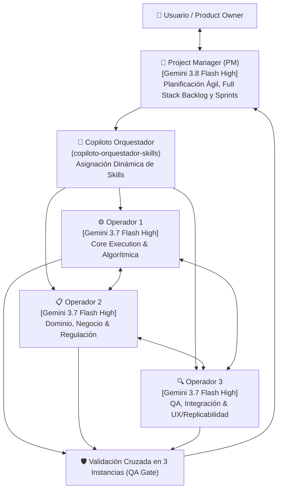

# 🏛️ Arquitectura Operativa Multi-Agente: Squad Ágil de 4 Agentes con Triple QA

Este protocolo establece la estructura formal de trabajo colaborativo para la ejecución de proyectos complejos dentro del ecosistema **`antigravity-agents-repository`**, integrando un **Project Manager (PM)** de alto nivel cognitivo y **tres Agentes Operadores** especializados, bajo un ciclo ágil por Sprints, la **Metodología en 6 Etapas**, un **Protocolo de Validación y QA en 3 Instancias**, y un **Apéndice Técnico Normativo** con las mejores prácticas del estado del arte en sistemas multi-agente.

---

## 👥 1. Composición del Squad de 4 Agentes



### Roles y Responsabilidades

| Rol | Modelo Base | Habilidad Central | Responsabilidades Principales |
| :--- | :--- | :--- | :--- |
| **Project Manager (PM)** | `Gemini 3.8 Flash (High)` | `copiloto-orquestador-skills` + `planificador-agentes` | • Definición del Full Stack Backlog y roadmap ágil.<br>• Despacho dinámico de habilidades para los 3 operadores.<br>• Dirección de Sprints y compuertas de paso (*stage gates*).<br>• Conducción de la Triple Instancia de QA y presentación al Usuario. |
| **Operador 1: Core Execution** | `Gemini 3.7 Flash (High)` | Asignada dinámicamente (`ciencia-de-datos`, `facturacion-reverse-engineering`, etc.) | • Desarrollo del núcleo técnico, algorítmico o cuantitativo.<br>• Scripts Python/SQL/PySpark, cálculos matemáticos y scraping.<br>• Ejecución de pruebas parciales unitarias. |
| **Operador 2: Dominio & Negocio** | `Gemini 3.7 Flash (High)` | Asignada dinámicamente (`asesor-legal-financiero`, `analista-financiero`, etc.) | • Verificación de conformidad normativa (EPEC, CCCN, CAMMESA).<br>• Modelado de reglas de negocio, tablas SIGEC y cuadros tarifarios.<br>• Garantía de consistencia sectorial y veracidad documental. |
| **Operador 3: QA & UX** | `Gemini 3.7 Flash (High)` | Asignada dinámicamente (`desarrollador-web-showroom`, `auto-documentacion-agente`) | • Pruebas de integración, visualización (Power BI, UI web, Obsidian).<br>• Verificación de replicabilidad y manuales de procedimiento.<br>• Automatización de backups `.bak` y registro histórico. |

---

## 🔄 2. Rueda de Proceso Ágil: Full Stack Backlog y Sprints

Toda tarea encomendada se gestiona mediante un ciclo iterativo estructurado:

1. **Definición del Full Stack Backlog**:
   - El PM analiza el requerimiento macro y desglosa el stack completo de trabajo: componentes de datos/backend, capas de lógica de negocio, módulos de interfaz/reportes y protocolos de persistencia.
2. **Planificación de Sprints (Sprint Planning)**:
   - Los objetivos se dividen en Sprints ejecutables con entregables tangibles e incrementales.
   - Para cada Sprint, el PM asigna las habilidades exactas a cada Operador a través de `copiloto-orquestador-skills`.
3. **Ejecución Coordinada (Sprint Execution)**:
   - Los Operadores desarrollan concurrentemente los módulos asignados, comunicándose mediante interfaces desacopladas.
4. **Compuerta de Validación (Sprint Review & QA Gate)**:
   - Se somete el incremento de software/análisis a la validación en 3 instancias obligatorias.
5. **Retrospectiva & Documentación (Sprint Retrospective)**:
   - Si el entregable supera el QA, se asienta en la Bóveda Obsidian y se planifica el siguiente Sprint.

---

## 📐 3. Articulación con la Metodología Obligatoria en 6 Etapas

El grupo de 4 avanza estrictamente por las seis fases obligatorias del repositorio:

```text
[Fase 1: Investigación Verídica] ──► PM y Operador 2 validan fuentes oficiales y normativas.
               │
               ▼
[Fase 2: Diseño & Tesis]        ──► PM y Operador 1 formulan la arquitectura y especificación.
               │
               ▼
[Fase 3: Pruebas Parciales]     ──► Operadores 1 y 3 ejecutan pruebas unitarias y componentes modulares.
               │
               ▼
[Fase 4: Prueba Piloto]         ──► Presentación interactiva al Usuario para APROBACIÓN explícita.
               │ (Aprobado)
               ▼
[Fase 5: Pruebas Finales]       ──► Pruebas de estrés, casos borde e integración de datos.
               │
               ▼
[Fase 6: Auto-Doc & Backups]    ──► Operador 3 y PM generan .bak preventivo, nota histórica y MOC.
```

---

## 🛡️ 4. Protocolo Obligatorio de QA en 3 Instancias (Multi-Perspective QA)

Ningún entregable se presentará como definitivo sin haber superado de forma explícita y documentada tres filtros independientes de evaluación:


### Detalle de las Tres Instancias de QA:

1. **Instancia 1: QA Técnico, Algorítmico y de Infraestructura**:
   - **Evaluador**: Operador 1 + PM.
   - **Criterios de Evaluación**:
     - Cero errores de sintaxis o runtime (Python, SQL, JavaScript, DAX/TMDL).
     - Eficiencia algorítmica y control de complejidad temporal/espacial.
     - Cumplimiento del **Protocolo de Snapshot Local de Mínima Interferencia** (no retener handles sobre `\\srvfs01`).
     - Modularidad y tipado adecuado.

2. **Instancia 2: QA de Negocio, Dominio y Conformidad Normativa**:
   - **Evaluador**: Operador 2 + PM.
   - **Criterios de Evaluación**:
     - Exactitud con las tablas maestras de SIGEC (Oracle 19c) y cuadros tarifarios vigentes de EPEC.
     - Coherencia con leyes argentinas (Ley 26.994 CCCN), ordenanzas municipales (OIM) y fondos provinciales (FODEP).
     - Validación cruzada contra la Única Fuente de la Verdad (SSOT) documentada en `docs/PROTELEM/PROJECTS/`.

3. **Instancia 3: QA de Usabilidad, Replicabilidad e Integridad de Entrega (UX)**:
   - **Evaluador**: Operador 3 + PM.
   - **Criterios de Evaluación**:
     - Visualización impecable (estética premium, tablas formateadas, diagramas legibles).
     - Replicabilidad paso a paso: cualquier profesional debe poder reproducir el resultado.
     - Enlaces funcionales con esquema `file:///` hacia la Bóveda de Obsidian y scripts locales.
     - Auto-documentación completa y resguardo preventivo `.bak` verificado.

---

## 🚀 5. Protocolo de Inicio de Operaciones

Para activar este Squad en cualquier misión:
1. El Usuario introduce el requerimiento u objetivo de negocio.
2. El **PM (Gemini 3.8 Flash High)** formula el diagnóstico semántico inicial y desglosa el **Full Stack Backlog**.
3. El PM ejecuta `copiloto-orquestador-skills` y define la terna de habilidades para los **Operadores 1, 2 y 3 (Gemini 3.7 Flash High)**.
4. Se presenta el plan de Sprints al Usuario para dar inicio a la rueda de procesos.

---

## 🔬 6. Apéndice Técnico Normativo: Estrategias, Buenas Prácticas y Blindaje Operativo

Para garantizar que el Squad opere bajo los más altos estándares de confiabilidad de la ingeniería de software multi-agente, se establecen las siguientes directivas de cumplimiento obligatorio:

### 6.1. Patrón Blackboard (Pizarra de Estado Compartido)
- **Prohibición**: Queda terminantemente prohibido mantener hilos de chat monolíticos abiertos donde se transfiera todo el historial conversacional entre agentes. Esto satura la ventana de contexto, incrementa los costos y genera pérdida de precisión (*telephone game*).
- **Norma**: Los agentes se comunican a través del **Patrón Blackboard**:
  - Toda información persistente, intermediate dataframes, esquemas SQL y salidas se escriben en el sistema de archivos local (`data/`, `scratch/` o `docs/`).
  - El PM transfiere a cada operador únicamente el puntero al archivo (`file:///...`), el contrato de entrada y el contrato de salida esperado.

### 6.2. QA Híbrido: Validación Determinista Previa a la Semántica
- **Principio**: Un modelo de lenguaje jamás debe validar a otro modelo de lenguaje en aspectos numéricos o algorítmicos sin respaldo computacional (*Zero "Vibes" QA*).
- **Norma**: La **Instancia 1 (QA Técnico)** debe ejecutar obligatoriamente verificaciones deterministas:
  1. *Unit Tests con Assertions*: Scripts con `assert` explícitos sobre las métricas críticas (ej. balance energético, solapamiento cero de polígonos, suma exacta de cargos tarifarios).
  2. *Validación de Schemas*: Verificación de tipos de datos, rangos y columnas requeridas mediante esquemas rígidos.
  3. *Ejecución en Seco*: Si los tests deterministas arrojan código de salida $\ne 0$, el entregable es rechazado de inmediato antes de cualquier revisión semántica.

### 6.3. Aislamiento de Contexto y Rol de "Abogado del Diablo" (Red Teaming en QA)
- **Principio**: La complacencia del modelo (*sycophancy*) ocurre cuando el evaluador conoce la intención del generador y busca validar sus conclusiones.
- **Norma**:
  - Los agentes evaluadores en las Instancias 2 y 3 deben operar con **contexto desacoplado**, evaluando únicamente el producto entregado contra la especificación formal y las fuentes de la verdad (SSOT).
  - El prompt del evaluador debe contener explícitamente una directiva de **Crítica Destructiva / Red Teaming**:
    > *"Tu misión exclusiva es encontrar discrepancias con la normativa EPEC, divisiones por cero, desvíos con las tablas maestras de SIGEC, vulnerabilidades de replicabilidad y casos límite no cubiertos. Aprobar sin objeciones exige justificar exhaustivamente por qué no existen desvíos."*

### 6.4. Circuit Breakers y Regla Anti-Bucles (Deadlock Prevention)
- **Principio**: Evitar ciclos de debate interminables entre operadores y evaluadores de QA.
- **Norma**:
  - **Límite de Re-intentos**: Un entregable solo puede recibir un máximo de **dos (2) rechazos consecutivos** en QA.
  - **Arbitraje del PM**: Al segundo rechazo, se congela el flujo y el PM (Gemini 3.8 Flash High) revisa los diffs técnicos para laudar la solución.
  - **Escalación Human-in-the-Loop (HITL)**: Si la discrepancia surge de una ambigüedad normativa o una decisión de negocio no documentada, el PM presenta una ficha de decisión ejecutiva al Usuario.

### 6.5. Poda Quirúrgica de Herramientas (Micro-Tool Pruning)
- **Principio**: Proporcionar más de 10-15 herramientas a un agente reduce significativamente la precisión de invocación (*tool selection accuracy*).
- **Norma**: Cada operador recibe únicamente el subconjunto estricto de herramientas que requiere para su función:
  - *Operador 1 (Execution)*: `run_command`, `write_to_file`, `replace_file_content`, `view_file`.
  - *Operador 2 (Dominio/SSOT)*: `view_file`, `grep_search`, `read_url_content`, fuentes documentales.
  - *Operador 3 (QA/UX)*: `view_file`, runners de test, utilidades de diff, `generate_image` (si requiere assets visuales) y herramientas de backup.

### 6.6. Contratos Tipados de Tarea Atómica (Hand-off Schema)
- **Norma**: Toda delegación de tarea del PM hacia un Operador debe formularse con el siguiente esquema estandarizado:
```yaml
tarea_id: "SPRINT-<N>-TASK-<M>"
fase_metodologia: "Fase 1..6"
operador_asignado: "Operador 1 | 2 | 3"
habilidad_activada: "<nombre-skill>"
inputs_recursos:
  - "file:///ruta/absoluta/al/archivo_datos"
  - "file:///ruta/absoluta/a_la_normativa_o_ssot"
restricciones_operativas:
  - "Protocolo SMB: tiempo de lectura < 2000 ms"
  - "Memoria máxima: < 2 GB"
criterios_aceptacion_dod:
  - qa_tecnico: "Test determinista en scripts/test_<nombre>.py exitoso (exit 0)"
  - qa_dominio: "Concordancia con cuadro tarifario EPEC / SIGEC"
  - qa_ux: "Tabla legible en Markdown / Gráficos responsive"
entregables_esperados:
  - "file:///ruta/al/entregable_principal"
```

---

## 🎭 7. Matriz de Arquetipos Operativos Contextuales

El PM utiliza el Copiloto Orquestador para instanciar la terna operativa según el dominio del desafío:

| Arquetipo de Proyecto | Operador 1: Core Execution | Operador 2: Dominio & Regulación | Operador 3: QA, Integración & UX |
| :--- | :--- | :--- | :--- |
| **Arquetipo A: GIS, Catastro y Rutas (EPEC)** | **Ingeniero Geoespacial**: Algoritmos topológicos, Shapely, WFS IDECOR, Parquet, GeoPandas. | **Analista Operativo EPEC**: Normativa de rutas comerciales, lectura, distritos, SIGEC. | **Auditor Topológico & Cartógrafo**: Detección de solapamientos, gaps, polígonos disjuntos y mapas HTML interactivos. |
| **Arquetipo B: Facturación SIGEC (Reverse Engineering)** | **Ingeniero de Software JS/SQL**: Motor cliente de liquidación, 31 tablas SIGEC, lógica de prorrateos. | **Auditor Tarifario & Impositivo**: Cuadros tarifarios EPEC, resoluciones ERSeP, FODEP, OIM, IVA, CCCN. | **Tester de Regresión & Casos Testigo**: Cotejo centavo a centavo sobre clientes reales (ej. 72677900). |
| **Arquetipo C: Proyectos de Inversión / Showrooms** | **Modelador Financiero**: TIR, VAN, WACC, flujos de caja dinámicos, simulación de estrés. | **Especialista Legal & Estructuración**: Contratos de corretaje, NCNDA, Fee sharing, RIGI, CCCN. | **Diseñador Frontend & UX**: Glassmorphism, Vanilla CSS, layout responsivo, visor One-Pager A4 exportable. |
| **Arquetipo D: Cursos & Diplomaturas MEM** | **Ingeniero Audiovisual**: OpenCV, Whisper, filtrado YCrCb, deduplicación perceptual pHash. | **Profesor Titular MEM / CAMMESA**: Rigor técnico MEM, despacho económico, precios estacionales CAMMESA. | **Auditor Pedagógico**: Fichas estructuradas Obsidian, resolución cruzada de exámenes y rúbricas. |

---

## 🛡️ 8. Gobernanza, Trazabilidad y Rollback

1. **Backups Preventivos**: Toda modificación sustancial sobre este protocolo o sobre las habilidades asignadas debe resguardarse previamente en `docs/Backups/YYYY-MM-DD_HHmmss_<archivo>.bak`.
2. **Registro Histórico**: Toda evolución queda documentada en `docs/Historial-Mejoras/`.
3. **Rollback Inmediato**: En caso de reversión, invocar la habilidad `rollback-agente` para restaurar cualquier estado anterior garantizando la indemnidad de la bóveda.
