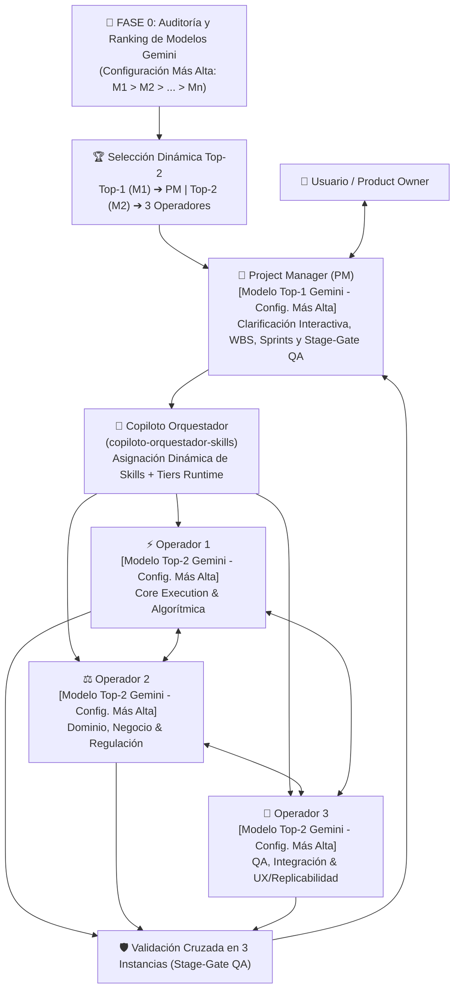
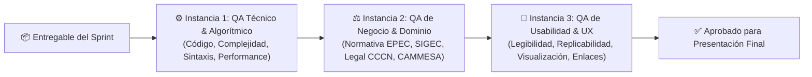
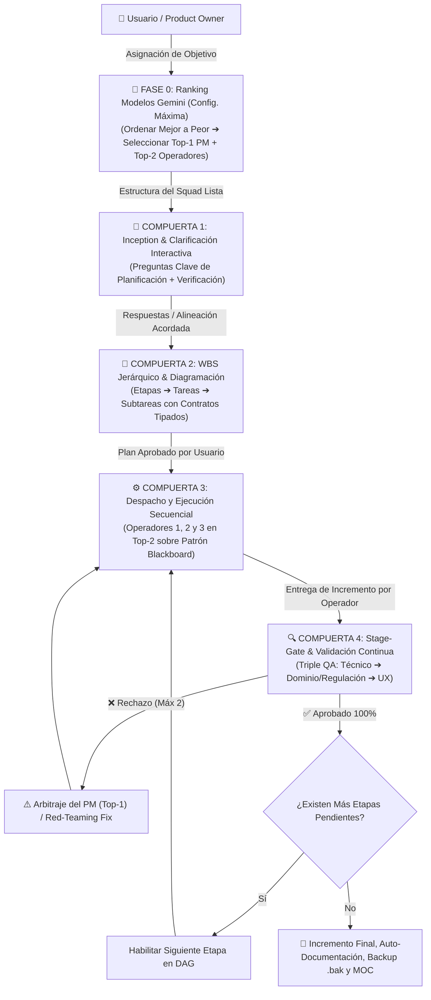

# 🛡️ Arquitectura Operativa Multi-Agente: Squad Ágil Adaptativo de 4 Agentes con Selección Dinámica Top-2 de Modelos Gemini y Triple QA

Este protocolo establece la estructura formal y **100% adaptable ante evoluciones de modelos Gemini** para la ejecución de proyectos complejos dentro del ecosistema **`antigravity-agents-repository`**, integrando un **Project Manager (PM)** sobre el **Mejor Modelo Disponible (`Top-1` en su configuración más alta)** y **tres Agentes Operadores** especializados sobre el **Segundo Mejor Modelo Disponible (`Top-2` en su configuración más alta)**, bajo un ciclo ágil por Sprints, la **Metodología en 6 Etapas**, un **Protocolo de Validación y QA en 3 Instancias**, la **Compuerta de Clarificación e Inception**, la **Diagramación Jerárquica WBS (Etapas, Tareas y Subtareas)**, la **Validación Continua por Etapas (Stage-Gate)** y un **Apéndice Técnico Normativo** con las mejores prácticas del estado del arte en sistemas multi-agente (Google DeepMind, Anthropic Orchestrator-Workers, Microsoft AutoGen y PMI Agile).

---

## 👥 1. Composición del Squad de 4 Agentes y Selección Dinámica Top-2 de Modelos



### 1.1. Fase 0 de Ensamblaje: Análisis, Ordenamiento y Selección Top-2 de Modelos Gemini
Para garantizar que la arquitectura multi-agente se adapte automáticamente ante cualquier actualización de modelos de Google (evolución de familias históricas 3.7/3.8 hacia **Gemini 4.x** y generaciones futuras), **en el proceso de armar el Squad** se ejecuta obligatoriamente el siguiente algoritmo de cuatro pasos:

1. **Detección de Modelos Disponibles en su Configuración Más Alta**:
   - Inspeccionar todos los modelos de la familia Gemini disponibles en el entorno activo (selector de modelo de la sesión principal en Antigravity UI y selectores dinámicos de runtime en `invoke_subagent`: `pro`, `inherit`, `flash`, `flash_lite`).
   - Evaluar cada modelo disponible asumiendo su **configuración más alta de razonamiento y esfuerzo cognitivo** (`High` / `Thinking` / `Max Effort`) y verificando su disponibilidad efectiva de cuota.
2. **Ordenamiento Estricto del Mejor al Peor ($M_1 > M_2 > \dots > M_n$)**:
   - Clasificar todos los modelos detectados desde el mejor hasta el menor según tres ejes jerárquicos:
     - **Eje 1 — Generación y Frontera Cognitiva**: Generación más reciente y mayor capacidad de razonamiento profundo (`Pro / Ultra / Thinking High` de última generación por encima de variantes previas o estándar).
     - **Eje 2 — Desempeño Agéntico y Throughput**: Precisión en *tool use / function calling*, síntesis de código, ventana de contexto efectiva y velocidad operativa (`Flash High` de última generación por encima de familias anteriores o variantes ligeras).
     - **Eje 3 — Estado Operativo y Cuota**: Modelos activos y con cuota plena por encima de modelos restringidos o deprecados.
3. **Selección de los Dos Mejores Modelos (`Top-1` y `Top-2`) para Estructurar el Squad**:
   - **`Top-1` ($M_1$ — Mejor Modelo Disponible en Configuración Más Alta) ➔ Project Manager (PM)**: Asume la conducción estratégica, Compuerta de Clarificación, diseño del WBS Jerárquico, arbitraje ante *Circuit Breakers* y validación final Stage-Gate (`Model: "pro"` o `"inherit"` sobre el modelo líder activo).
   - **`Top-2` ($M_2$ — Segundo Mejor Modelo Disponible en Configuración Más Alta) ➔ Los 3 Agentes Operadores**: Motoriza a **Operador 1 (Core Execution)**, **Operador 2 (Dominio & Regulación)** y **Operador 3 (QA, Integración & UX)** mediante `invoke_subagent` (`Model: "flash"` de última generación en configuración alta o `"inherit"`, según corresponda al 2.° lugar del ranking). Los modelos restantes ($M_3 \dots M_n$, ej. `flash_lite`) quedan en reserva como auxiliares para chequeos mecánicos o contingencia.
4. **Declaración Explícita de Ensamblaje y Conmutación Dinámica (Failover)**:
   - Al constituir el Squad, el PM presenta al usuario la **Tabla de Ranking Detectada ($M_1 \dots M_n$ de mejor a peor)** e informa la dupla asignada **`[PM = Top-1 | 3 Operadores = Top-2]`** antes de formular las preguntas de Clarificación.
   - Si en futuras sesiones cambia el catálogo de Gemini o un modelo entra en límite temporal de cuota, la selección Top-2 se desplaza automáticamente al siguiente par óptimo del ranking (ej. $(M_2, M_3)$ en contingencia o $(M_{\text{nuevo}}, M_1)$ ante un nuevo lanzamiento), sin alterar habilidades, contratos WBS ni el Patrón Blackboard.

### Roles y Responsabilidades

| Rol | Modelo Asignado (Regla Top-2) | Habilidad Central | Responsabilidades Principales |
| :--- | :--- | :--- | :--- |
| **Project Manager (PM)** | **`Top-1` Gemini (Config. Más Alta)**<br>*(Runtime: Modelo Tope UI / `pro` / `inherit`)* | `copiloto-orquestador-skills` + `planificador-agentes` | • Ejecución de Fase 0: Análisis de modelos Gemini disponibles, ranking de mejor a peor y selección Top-2.<br>• Activación obligatoria de la Compuerta de Clarificación (Preguntas de Planificación y Verificación).<br>• Definición del WBS jerárquico (Etapas ➔ Tareas ➔ Subtareas).<br>• Despacho dinámico y secuencial de habilidades para los 3 operadores.<br>• Dirección de Sprints, compuertas *Stage-Gate* y conducción del Triple QA. |
| **Operador 1: Core Execution** | **`Top-2` Gemini (Config. Más Alta)**<br>*(Runtime: `flash` / `inherit` \| `WriteTools: true`)* | Asignada dinámicamente (`ciencia-de-datos`, `facturacion-reverse-engineering`, etc.) | • Desarrollo del núcleo técnico, algorítmico o cuantitativo.<br>• Scripts Python/SQL/PySpark, cálculos matemáticos y scraping.<br>• Ejecución de pruebas parciales unitarias deterministas. |
| **Operador 2: Dominio & Negocio** | **`Top-2` Gemini (Config. Más Alta)**<br>*(Runtime: `flash` / `pro` \| `WriteTools: false`)* | Asignada dinámicamente (`asesor-legal-financiero`, `analista-financiero`, etc.) | • Verificación de conformidad normativa (EPEC, CCCN, CAMMESA).<br>• Modelado de reglas de negocio, tablas SIGEC y cuadros tarifarios.<br>• Garantía de consistencia sectorial, veracidad documental y red-teaming aislado. |
| **Operador 3: QA & UX** | **`Top-2` Gemini (Config. Más Alta)**<br>*(Runtime: `flash` / `inherit` + aux `flash_lite`)* | Asignada dinámicamente (`desarrollador-web-showroom`, `auto-documentacion-agente`) | • Pruebas de integración, visualización (Power BI, UI web, Obsidian).<br>• Verificación de replicabilidad y manuales de procedimiento.<br>• Automatización de backups `.bak` y registro histórico. |

---

## 🔄 2. Rueda de Proceso Ágil: Ranking Top-2, Inception, WBS y Sprints

Toda tarea encomendada se gestiona mediante un ciclo iterativo estructurado:

0. **Ensamblaje Adaptativo del Squad (Model Ranking Top-2)**:
   - El PM evalúa los modelos Gemini disponibles en su configuración más alta, los ordena del mejor al peor ($M_1 > M_2 > \dots > M_n$) y prepara el Squad asignando `Top-1` al PM y `Top-2` a los 3 Operadores.
1. **Inception & Clarificación Interactiva**:
   - El PM formula proactivamente las preguntas clave tanto para la planificación (alcance, insumos, restricciones) como para la verificación (criterios de aceptación, DoD, tests deterministas).
2. **Definición del WBS y Full Stack Backlog**:
   - Con las variables acordadas, el PM desglosa el stack completo de trabajo en una jerarquía estricta de Etapas, Tareas Atómicas y Subtareas Específicas en un grafo acíclico dirigido (DAG).
3. **Planificación y Despacho de Sprints (Sprint Planning)**:
   - Para cada Sprint/Etapa, el PM asigna las habilidades exactas a cada Operador a través de `copiloto-orquestador-skills` mediante contratos tipados de tarea.
4. **Ejecución Coordinada Secuencial (Sprint Execution)**:
   - Los Operadores desarrollan secuencialmente los módulos asignados, comunicándose exclusivamente mediante el **Patrón Blackboard** (archivos en disco).
5. **Compuerta de Validación (Sprint Review & Stage-Gate QA)**:
   - Se somete el incremento a la validación obligatoria en 3 instancias. Ninguna etapa avanza sin aprobación del 100% de los criterios.
6. **Retrospectiva & Documentación (Sprint Retrospective)**:
   - Si el entregable supera el QA, se asienta en la Bóveda Obsidian, se generan respaldos preventivos `.bak` y se habilita la siguiente etapa.

---

## 🧩 3. Articulación con la Metodología Obligatoria en 6 Etapas

El grupo de 4 avanza estrictamente por las seis fases obligatorias del repositorio:

```text
[Fase 1: Investigación Verídica] ──▶ PM (Top-1) y Operador 2 (Top-2) validan fuentes oficiales y normativas.
               │
               ▼
[Fase 2: Diseño & Tesis]        ──▶ PM (Top-1) y Operador 1 (Top-2) formulan la arquitectura y especificación.
               │
               ▼
[Fase 3: Pruebas Parciales]     ──▶ Operadores 1 y 3 (Top-2) ejecutan pruebas unitarias y componentes modulares.
               │
               ▼
[Fase 4: Prueba Piloto]         ──▶ Presentación interactiva al Usuario para APROBACIÓN explícita.
               │ (Aprobado)
               ▼
[Fase 5: Pruebas Finales]       ──▶ Pruebas de estrés, casos borde e integración de datos.
               │
               ▼
[Fase 6: Auto-Doc & Backups]    ──▶ Operador 3 (Top-2) y PM (Top-1) generan .bak preventivo, nota histórica y MOC.
```

---

## 🛡️ 4. Protocolo Obligatorio de QA en 3 Instancias (Multi-Perspective QA)

Ningún entregable se presentará como definitivo sin haber superado de forma explícita y documentada tres filtros independientes de evaluación:



### Detalle de las Tres Instancias de QA:

1. **Instancia 1: QA Técnico, Algorítmico y de Infraestructura**:
   - **Evaluador**: Operador 1 + PM.
   - **Criterios de Evaluación**:
     - Cero errores de sintaxis o runtime (Python, SQL, JavaScript, DAX/TMDL).
     - Eficiencia algorítmica y control de complejidad temporal/espacial.
     - Cumplimiento del **Protocolo de Snapshot Local de Mínima Interferencia** (no retener handles sobre `\\srvfs01`).
     - Modularidad, esquemas tipados y tests unitarios deterministas con exit code 0.

2. **Instancia 2: QA de Negocio, Dominio y Conformidad Normativa**:
   - **Evaluador**: Operador 2 + PM.
   - **Criterios de Evaluación**:
     - Exactitud con las tablas maestras de SIGEC (Oracle 19c) y cuadros tarifarios vigentes de EPEC.
     - Coherencia con leyes argentinas (Ley 26.994 CCCN), ordenanzas municipales (OIM) y fondos provinciales (FODEP).
     - Validación cruzada contra la Única Fuente de la Verdad (SSOT) documentada en `docs/PROTELEM/PROJECTS/` o fuentes oficiales.

3. **Instancia 3: QA de Usabilidad, Replicabilidad e Integridad de Entrega (UX)**:
   - **Evaluador**: Operador 3 + PM.
   - **Criterios de Evaluación**:
     - Visualización impecable (estética premium, tablas formateadas, diagramas legibles).
     - Replicabilidad paso a paso: cualquier profesional debe poder reproducir el resultado.
     - Enlaces funcionales con esquema `file:///` hacia la Bóveda de Obsidian y scripts locales.
     - Auto-documentación completa y resguardo preventivo `.bak` verificado.

---

## 🚀 5. Protocolo de Gestión y Organización del PM con SQUAD

Este protocolo define el estándar de excelencia para el **Project Manager (PM - Modelo Top-1 Gemini en Configuración Más Alta)** al momento de recibir una asignación u objetivo, estructurado en una Fase 0 de selección de modelos y cuatro compuertas obligatorias y secuenciales:



### 5.1. Compuerta 1: Inception y Cuestionario Obligatorio de Clarificación
Tras presentar la selección dinámica Top-2 de modelos (Fase 0), el PM **TIENE TERMINANTEMENTE PROHIBIDO** asumir supuestos a ciegas o comenzar de inmediato la delegación de código o tareas. Debe activar la **Compuerta de Inception**, formulando proactivamente al usuario un cuestionario estructurado en dos ejes críticos:

#### Eje A: Preguntas para la Planificación (Scope, Insumos y Límites)
1. **Alcance y Fronteras del Proyecto**:
   - ¿Cuáles son los módulos y entregables estrictamente incluidos?
   - ¿Qué componentes, funcionalidades o integraciones quedan explícitamente fuera del alcance de este ciclo?
2. **Insumos y Fuentes de la Verdad (SSOT)**:
   - ¿Dónde residen los datos de origen (rutas absolutas locales, carpetas de red SMB `\\srvfs01`, APIs, repositorios satélites en GitHub, o Google Drive)?
   - ¿Qué archivos maestros, esquemas o tablas testigo deben considerarse la única fuente de la verdad?
3. **Restricciones Técnicas y de Entorno**:
   - ¿Cuáles son las restricciones de stack tecnológico (Python, Vanilla CSS, SQL, Parquet, TMDL/Power BI, etc.)?
   - ¿Existen límites de tiempo de respuesta, volumen de datos o memoria máxima?
4. **Arquetipo Operativo Sugerido**:
   - ¿Se adopta uno de los arquetipos estándar (A: GIS/Catastro, B: Facturación EPEC/SIGEC, C: Finanzas/Showrooms, D: Académico MEM) o se requiere una configuración a medida (Custom)?

#### Eje B: Preguntas para la Verificación (Criterios de Aceptación & Definition of Done)
1. **Criterios de Aceptación Técnica (QA Instancia 1)**:
   - ¿Qué pruebas deterministas (unit tests, assertions numéricos, validación de schemas) deben pasar con exit code 0?
   - ¿Cuáles son las tolerancias matemáticas admisibles (ej. diferencia cero centavos, balance volumétrico exacto)?
2. **Criterios de Cumplimiento de Dominio y Regulatorio (QA Instancia 2)**:
   - ¿Contra qué normativas específicas (Reglamento EPEC, resoluciones ERSeP, cuadros tarifarios, CCCN Ley 26.994, CAMMESA) debe contrastarse el resultado?
   - ¿Quién actúa como auditor de negocio (SSOT) para validar los casos de prueba?
3. **Criterios de Usabilidad, Replicabilidad y UX (QA Instancia 3)**:
   - ¿En qué formato debe entregarse el producto final (tablas interactivas Markdown, diagramas Mermaid, scripts reproducibles con rutas relativas/absolutas `file:///`)?
   - ¿Qué manuales, notas Obsidian (`docs/`) o backups preventivos `.bak` deben quedar consolidados?

---

### 5.2. Compuerta 2: WBS Jerárquico, Diagramación de Precedencia y Contratos Tipados
Una vez acordadas las respuestas con el usuario (o confirmadas las opciones recomendadas por el PM), el PM elabora la **Estructura de Desglose del Trabajo (Work Breakdown Structure - WBS)** y el diagrama de precedencias secuenciales (DAG):

1. **Jerarquía Estricta en 3 Niveles**:
   - **Etapa (Sprint / Milestone)**: Bloque macro secuencial alineado a la Metodología en 6 Etapas.
   - **Tarea Atómica (Task)**: Módulo funcional autónomo con entregable verificable.
   - **Subtarea Específica (Sub-task)**: Unidad mínima de ejecución asignable a un operador individual.
2. **Tablero de Estado en Vivo (Progress Checklist)**:
   El PM publica y mantiene visible un tablero interactivo con los siguientes estados estándar:
   - `[ ]` **Pendiente**: No iniciada, a la espera de dependencias previas.
   - `[⏳]` **En Ejecución**: Operador trabajando activamente en el entorno local/Blackboard.
   - `[🔍]` **En Validación QA**: Finalizada por el operador, bajo evaluación en las 3 instancias.
   - `[✅]` **Validado y Aprobado**: Superó el 100% de los criterios; etapa sellada.
3. **Contrato Tipado de Delegación (WBS Hand-off Schema)**:
   Cada tarea y subtarea se formaliza bajo el contrato estandarizado (ver Sección 6.6) con precondiciones, modelo `Top-2` asignado, inputs en disco, outputs esperados y reglas de validación explícitas.

---

### 5.3. Compuerta 3: Despacho y Ejecución Secuencial sobre el Patrón Blackboard
1. **Secuencialidad Estricta**: Los operadores ejecutan de forma secuencial y coordinada según el grafo de dependencias definido por el PM. Ningún operador inicia una tarea si sus dependencias previas no han sido validadas.
2. **Comunicación Desacoplada (Blackboard Pattern)**:
   - Toda información, dataframes intermedios, scripts, archivos JSON/Parquet y notas se guardan en el sistema de archivos (`data/`, `scratch/` o `docs/`).
   - El PM suministra a cada operador únicamente el puntero al archivo (`file:///...`), el contrato de entrada y el contrato de salida esperado, evitando la saturación del contexto conversacional.
3. **Micro-Tool Pruning**: Cada operador recibe el set mínimo y necesario de herramientas para su función, maximizando la precisión de invocación.

---

### 5.4. Compuerta 4: Stage-Gate y Validación Continua por Etapas (Triple QA)
Al completar un operador una tarea o subtarea, el PM asume el rol de **Comisario de Validación (Gatekeeper)** antes de permitir cualquier avance:

1. **Evaluación de Triple QA**:
   - **Paso 1: QA Técnico & Algorítmico (Instancia 1)**: El PM (o runner de test) ejecuta scripts deterministas con assertions, validación de schemas y verificación de cero errores de ejecución.
   - **Paso 2: QA de Negocio & Dominio (Instancia 2)**: Validación semántica y red-teaming desacoplado contra el cuadro normativo y SSOT.
   - **Paso 3: QA de Usabilidad & Replicabilidad (Instancia 3)**: Verificación de estética, diseño, enlaces locales funcionales y resguardos.
2. **Compuerta de Aprobación (Pass / Fail)**:
   - **Aprobado**: Si se aprueban las 3 instancias, la subtarea pasa a `[✅]` y se habilita la siguiente tarea en el grafo.
   - **Rechazado (Circuit Breaker)**: Se emite un informe de objeciones específicas al operador correspondiente. Máximo 2 reintentos permitidos antes de intervención del PM o escalación HITL (Human-in-the-Loop).

---

### 5.5. Flexibilidad Universal para Múltiples Misiones y Dominios
Este marco operativo está diseñado con máxima flexibilidad para orquestar indistintamente:
- **Desarrollo de Software y Web Apps**: Clarificación de stack, endpoints y UI; WBS de frontend/backend; tests unitarios y auditoría UX.
- **Data Pipelines y Georreferenciación (GIS)**: Clarificación de capas WFS y tolerancias espaciales; WBS de extracción y topología; asserts de solapamiento cero.
- **Ingeniería Inversa y Tarifas (SIGEC/Oracle)**: Clarificación de fórmulas y cuentas contrato testigo; WBS de extracción SQL y simulación JS; validación centavo a centavo.
- **Modelos Financieros y Legales**: Clarificación de supuestos macroeconómicos y jurisdicción; WBS de DCF y contratos; validación de fórmulas de retorno y cláusulas de protección.
- **Investigación Académica y Documentación**: Clarificación de programas y cátedras; WBS de ingesta audiovisual y transcripción; auditoría de suficiencia conceptual.

---

## 🛠️ 6. Apéndice Técnico Normativo: Estrategias, Buenas Prácticas y Blindaje Operativo

Para garantizar que el Squad opere bajo los más altos estándares de confiabilidad de la ingeniería de software multi-agente, se establecen las siguientes directivas de cumplimiento obligatorio:

### 6.1. Patrón Blackboard (Pizarra de Estado Compartido)
- **Prohibición**: Queda terminantemente prohibido mantener hilos de chat monolíticos abiertos donde se transfiera todo el historial conversacional entre agentes. Esto satura la ventana de contexto, incrementa los costos y genera pérdida de precisión (*telephone game*).
- **Norma**: Los agentes se comunican a través del **Patrón Blackboard**:
  - Toda información persistente, intermediate dataframes, esquemas SQL y salidas se escriben en el sistema de archivos local (`data/`, `scratch/` o `docs/`).
  - El PM transfiere a cada operador únicamente el puntero al archivo (`file:///...`), el contrato de entrada y el contrato de salida esperado.

### 6.2. QA Híbrido: Validación Determinista Previa a la Semántica
- **Principio**: Un modelo de lenguaje jamás debe validar a otro modelo de lenguaje en aspectos numéricos o algorítmicos sin respaldo computacional (*Zero "Vibes" QA*).
- **Norma**: La **Instancia 1 (QA Técnico)** debe ejecutar obligatoriamente verificaciones deterministas:
  1. *Unit Tests con Assertions*: Scripts con `assert` explícitos sobre las métricas críticas (ej. balance energético, solapamiento cero de polígonos, suma exacta de cargos tarifarios).
  2. *Validación de Schemas*: Verificación de tipos de datos, rangos y columnas requeridas mediante esquemas rígidos.
  3. *Ejecución en Seco*: Si los tests deterministas arrojan código de salida $\ne 0$, el entregable es rechazado de inmediato antes de cualquier revisión semántica.

### 6.3. Aislamiento de Contexto y Rol de "Abogado del Diablo" (Red Teaming en QA)
- **Principio**: La complacencia del modelo (*sycophancy*) ocurre cuando el evaluador conoce la intención del generador y busca validar sus conclusiones.
- **Norma**:
  - Los agentes evaluadores en las Instancias 2 y 3 deben operar con **contexto desacoplado**, evaluando únicamente el producto entregado contra la especificación formal y las fuentes de la verdad (SSOT).
  - El prompt del evaluador debe contener explícitamente una directiva de **Crítica Destructiva / Red Teaming**:
    > *"Tu misión exclusiva es encontrar discrepancias con la normativa EPEC, divisiones por cero, desvíos con las tablas maestras de SIGEC, vulnerabilidades de replicabilidad y casos límite no cubiertos. Aprobar sin objeciones exige justificar exhaustivamente por qué no existen desvíos."*

### 6.4. Circuit Breakers y Regla Anti-Bucles (Deadlock Prevention)
- **Principio**: Evitar ciclos de debate interminables entre operadores y evaluadores de QA.
- **Norma**:
  - **Límite de Re-intentos**: Un entregable solo puede recibir un máximo de **dos (2) rechazos consecutivos** en QA.
  - **Arbitraje del PM**: Al segundo rechazo, se congela el flujo y el PM (**Modelo `Top-1` Gemini en Configuración Más Alta**) revisa los diffs técnicos para laudar la solución.
  - **Escalación Human-in-the-Loop (HITL)**: Si la discrepancia surge de una ambigüedad normativa o una decisión de negocio no documentada, el PM presenta una ficha de decisión ejecutiva al Usuario.

### 6.5. Poda Quirúrgica de Herramientas (Micro-Tool Pruning)
- **Principio**: Proporcionar más de 10-15 herramientas a un agente reduce significativamente la precisión de invocación (*tool selection accuracy*).
- **Norma**: Cada operador recibe únicamente el subconjunto estricto de herramientas que requiere para su función (`define_subagent`):
  - *Operador 1 (Execution)*: `EnableWriteTools: true` (`run_command`, `write_file`, `edit_file`, `read_file`).
  - *Operador 2 (Dominio/SSOT)*: `EnableWriteTools: false` (lectura pura, búsqueda documental y red-teaming aislado sin riesgo de alterar artefactos).
  - *Operador 3 (QA/UX)*: Runners de test, utilidades de diff, generación visual (si requiere assets) y herramientas de backup/auto-documentación.

### 6.6. Contratos Tipados de Tarea Atómica (WBS Hand-off Schema)
- **Norma**: Toda delegación de tarea del PM hacia un Operador debe formularse con el siguiente esquema estandarizado:
```yaml
tarea_id: "ETAPA-<X>-TAREA-<Y>-SUB-<Z>"
fase_metodologia: "Fase 1..6"
operador_asignado: "Operador 1 | 2 | 3"
modelo_asignado_top2: "<Nombre del 2do mejor modelo Gemini detectado | invoke_subagent Model: flash/inherit>"
habilidad_activada: "<nombre-skill>"
inputs_recursos:
  - "file:///ruta/absoluta/al/archivo_datos"
  - "file:///ruta/absoluta/a_la_normativa_o_ssot"
restricciones_operativas:
  - "Protocolo SMB: tiempo de lectura < 2000 ms"
  - "Memoria máxima: < 2 GB"
criterios_aceptacion_dod:
  - qa_tecnico: "Test determinista en scripts/test_<nombre>.py exitoso (exit 0)"
  - qa_dominio: "Concordancia con cuadro tarifario EPEC / SIGEC"
  - qa_ux: "Tabla legible en Markdown / Gráficos responsive"
entregables_esperados:
  - "file:///ruta/al/entregable_principal"
```

---

## 🗺️ 7. Matriz de Arquetipos Operativos Contextuales

El PM utiliza el Copiloto Orquestador para instanciar la terna operativa (sobre el modelo `Top-2` detectado en Fase 0) según el dominio del desafío:

| Arquetipo de Proyecto | Operador 1: Core Execution (`Top-2`) | Operador 2: Dominio & Regulación (`Top-2`) | Operador 3: QA, Integración & UX (`Top-2`) |
| :--- | :--- | :--- | :--- |
| **Arquetipo A: GIS, Catastro y Rutas (EPEC)** | **Ingeniero Geoespacial**: Algoritmos topológicos, Shapely, WFS IDECOR, Parquet, GeoPandas. | **Analista Operativo EPEC**: Normativa de rutas comerciales, lectura, distritos, SIGEC. | **Auditor Topológico & Cartógrafo**: Detección de solapamientos, gaps, polígonos disjuntos y mapas HTML interactivos. |
| **Arquetipo B: Facturación SIGEC (Reverse Engineering)** | **Ingeniero de Software JS/SQL**: Motor cliente de liquidación, 31 tablas SIGEC, lógica de prorrateos. | **Auditor Tarifario & Impositivo**: Cuadros tarifarios EPEC, resoluciones ERSeP, FODEP, OIM, IVA, CCCN. | **Tester de Regresión & Casos Testigo**: Cotejo centavo a centavo sobre clientes reales (ej. 72677900). |
| **Arquetipo C: Proyectos de Inversión / Showrooms** | **Modelador Financiero**: TIR, VAN, WACC, flujos de caja dinámicos, simulación de estrés. | **Especialista Legal & Estructuración**: Contratos de corretaje, NCNDA, Fee sharing, RIGI, CCCN. | **Diseñador Frontend & UX**: Glassmorphism, Vanilla CSS, `DESIGN.md`, layout responsivo, visor One-Pager A4 exportable. |
| **Arquetipo D: Cursos & Diplomaturas MEM** | **Ingeniero Audiovisual**: OpenCV, Whisper, filtrado YCrCb, deduplicación perceptual pHash. | **Profesor Titular MEM / CAMMESA**: Rigor técnico MEM, despacho económico, precios estacionales CAMMESA. | **Auditor Pedagógico**: Fichas estructuradas Obsidian, resolución cruzada de exámenes y rúbricas. |

---

## 🔒 8. Gobernanza, Trazabilidad y Rollback

1. **Backups Preventivos**: Toda modificación sustancial sobre este protocolo o sobre las habilidades asignadas debe resguardarse previamente en `docs/Backups/YYYY-MM-DD_HHmmss_<archivo>.bak`.
2. **Registro Histórico**: Toda evolución queda documentada en `docs/Historial-Mejoras/`.
3. **Rollback Inmediato**: En caso de reversión, invocar la habilidad `rollback-agente` para restaurar cualquier estado anterior garantizando la indemnidad de la bóveda.
