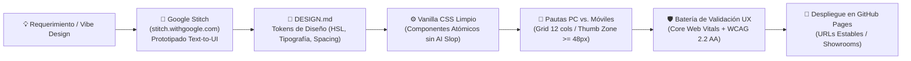

# 🌐 Guía Maestra: Diseño Web con Google Stitch, Estándar `DESIGN.md`, Ergonomía PC/Móviles y Validación UX

Esta guía establece el marco normativo, metodológico y técnico para la concepción, prototipado, maquetación y aseguramiento de la calidad (QA) de interfaces de usuario (UI/UX) dentro del ecosistema de agentes, integrando **Google Stitch (`stitch.withgoogle.com`)**, la especificación **`DESIGN.md`**, maquetación pura en **Vanilla CSS moderno** y la **Batería de Validación UX Integral**.

---

## 🧭 1. Arquitectura del Pipeline: De la Ideación a la Producción



---

## 🎨 2. Google Stitch (`stitch.withgoogle.com`) y Buenas Prácticas de Prototipado

**Google Stitch** es el entorno de diseño asistido por IA de Google Labs que permite transformar ideas conceptuales, wireframes o capturas en interfaces de alta fidelidad.

### Principios Operativos con Stitch:
1. **Refinamiento de Intención Pre-Exportación**:
   - Bloquear la jerarquía visual antes de solicitar la exportación. Ajustar mediante prompts conversacionales en Stitch los márgenes, contraste de colores y espaciados de componentes.
2. **Modularización por Lotes Lógicos**:
   - Prototipar y exportar en bloques funcionales coherentes (ej. *Módulo de Navegación*, *Hero & KPIs*, *Grid de Proyectos*, *Modal de Diapositivas*) en lugar de un lienzo monolítico indivisible.
3. **Instrucciones Estructurales en Prompts**:
   - Incluir directivas claras de jerarquía en los prompts hacia Stitch (ej.: *"Diseña una interfaz oscura para un showroom de inversiones corporativo, con paleta HSL azul noche y dorado, sistema de tarjetas glassmorphic y layout responsive con contenedor centrado a 1400px"*).
4. **Eliminación de Residuos de IA ("AI Slop")**:
   - Descartar anidamientos excesivos de `<div>` generados automáticamente.
   - Extraer y estandarizar selectores semánticos (`<header>`, `<nav>`, `<main>`, `<section>`, `<article>`, `<aside>`, `<footer>`).
   - Sustituir cualquier imagen o icono de muestra por código vectorial **SVG inline** o imágenes WebP comprimidas.

---

## 📄 3. Estándar `DESIGN.md` (Plantilla Maestra de Tokens de Diseño)

Todo proyecto web debe incluir un archivo **`DESIGN.md`** en su raíz que sirve como contrato de diseño inmutable entre diseñadores, modelos de IA y desarrolladores:

```markdown
# Design Tokens & System Specification (DESIGN.md)

## 1. Palette Tokens (HSL Color System)
- `--color-bg-primary`: hsl(222, 47%, 7%);        /* Fondo oscuro principal */
- `--color-bg-surface`: hsl(217, 33%, 12%);       /* Fondo de tarjetas / superficies */
- `--color-bg-glass`: hsla(217, 33%, 15%, 0.7);   /* Glassmorphism con backdrop-filter */
- `--color-border`: hsla(215, 25%, 27%, 0.5);     /* Bordes sutiles */
- `--color-text-main`: hsl(210, 40%, 98%);        /* Texto de alto contraste */
- `--color-text-muted`: hsl(215, 20%, 65%);       /* Texto secundario / leyendas */
- `--color-accent-gold`: hsl(45, 93%, 47%);       /* Acento corporativo primario */
- `--color-accent-cyan`: hsl(199, 89%, 48%);      /* Acento secundario tecnológico */
- `--color-success`: hsl(152, 69%, 41%);          /* Indicadores positivos */
- `--color-danger`: hsl(0, 84%, 60%);             /* Alertas / errores */

## 2. Typography Scale (Fluid Clamping)
- **Primary Font Family**: 'Outfit', system-ui, -apple-system, sans-serif;
- **Monospace Font Family**: 'JetBrains Mono', 'Fira Code', monospace;
- `--font-size-hero`: clamp(2.25rem, 5vw + 1rem, 4rem);
- `--font-size-h1`: clamp(1.85rem, 3.5vw + 0.5rem, 2.75rem);
- `--font-size-h2`: clamp(1.4rem, 2vw + 0.5rem, 2rem);
- `--font-size-h3`: clamp(1.15rem, 1.2vw + 0.2rem, 1.5rem);
- `--font-size-body`: clamp(1rem, 0.5vw + 0.8rem, 1.125rem);
- `--font-size-small`: clamp(0.85rem, 0.3vw + 0.7rem, 0.95rem);

## 3. Spacing Scale (Base 8px)
- `--space-1`: 0.25rem (4px);
- `--space-2`: 0.5rem (8px);
- `--space-3`: 0.75rem (12px);
- `--space-4`: 1rem (16px);
- `--space-6`: 1.5rem (24px);
- `--space-8`: 2rem (32px);
- `--space-12`: 3rem (48px);
- `--space-16`: 4rem (64px);

## 4. Radii & Elevations
- `--radius-sm`: 6px;
- `--radius-md`: 12px;
- `--radius-lg`: 20px;
- `--radius-pill`: 9999px;
- `--shadow-card`: 0 10px 30px -10px rgba(0, 0, 0, 0.5);
- `--shadow-glow`: 0 0 25px -5px hsla(45, 93%, 47%, 0.3);
```

---

## 🖥️📱 4. Pautas de Diseño Diferenciadas: PC vs. Móviles

### A. Para Computadoras de Escritorio (PC / Desktop):
1. **Aprovechamiento Espacial**:
   - Diseñar sobre una grilla CSS Grid de 12 o 24 columnas con gutter fluido (`gap: clamp(1rem, 2vw, 2rem)`).
   - Ancho máximo contenido (`max-width: 1400px`) centrado automáticamente en pantallas ultrawide ($2560\text{px}$ / $4K$) para evitar líneas de texto excesivamente largas (> 75 caracteres por línea).
2. **Ergonomía de Teclado y Mouse**:
   - Estados `:hover` claros en todas las áreas interactivas con transiciones de 200ms a 300ms.
   - Anillos de foco visibles (`:focus-visible { outline: 2px solid var(--color-accent-gold); outline-offset: 3px; }`).
   - Soporte de atajos de teclado para modales (`Escape` para cerrar, `Flechas` para sliders o galerías).
3. **Densidad de Información**:
   - Visualizadores de métricas clave (KPIs) en horizontal (4 a 6 tarjetas alineadas).
   - Tablas de datos extensas con encabezados fijos (`position: sticky; top: 0;`).

### B. Para Dispositivos Móviles (Smartphones & Tablets):
1. **Regla de la Zona del Pulgar (Thumb Zone)**:
   - Los elementos clave de interacción (botones de acción principal, menús de navegación, filtros de búsqueda) deben situarse en la mitad inferior de la pantalla, accesibles con el dedo pulgar con una sola mano.
2. **Tamaños de Toque Mínimos (Touch Targets)**:
   - Todo elemento interactivo debe tener un tamaño mínimo de **$48 \times 48\text{px}$** (según especificación Google Material Design 3 y WCAG).
   - Separación mínima entre elementos clickeables de **$8\text{px}$** para prevenir toques accidentales.
3. **Tipografía y Zoom en iOS**:
   - Todo campo `<input>`, `<select>` y `<textarea>` debe tener obligatoriamente un `font-size: 16px` o superior en móvil. Tamaños menores activan un auto-zoom indeseado en Safari iOS que rompe la estética de la página.
4. **Cero Desborde Horizontal**:
   - Regla obligatoria en `body`:
     ```css
     html, body {
       max-width: 100%;
       overflow-x: hidden;
     }
     ```
   - Las imágenes, tablas y canvas deben tener `max-width: 100%; height: auto;`. Para tablas anchas, encapsular en un contenedor con scroll horizontal explícito (`overflow-x: auto; -webkit-overflow-scrolling: touch;`).

---

## 🛡️ 5. Batería de Pruebas de Validación UX (Triple QA Web Gate)

Toda entrega web debe superar la siguiente matriz de verificación antes de ser dada por aprobada:

| Dimensión de QA | Criterio de Verificación | Método de Validación | Umbral de Aprobación |
| :--- | :--- | :--- | :---: |
| **Rendimiento Técnico** | Largest Contentful Paint (LCP) | Google Lighthouse / DevTools | $\le 2.5\text{ s}$ |
| **Estabilidad Visual** | Cumulative Layout Shift (CLS) | DevTools Performance Panel | $\le 0.1$ |
| **Interactividad** | Interaction to Next Paint (INP) | DevTools Interaction Check | $\le 200\text{ ms}$ |
| **Responsividad PC** | Layout a $1440\text{px}$ y $1920\text{px}$ | Emulación DevTools | Cero solapamientos, Grid balanceada |
| **Responsividad Móvil** | Layout a $375\text{px}$ y $412\text{px}$ | Emulación DevTools | Cero scroll horizontal, legibilidad 100% |
| **Ergonomía Táctil** | Tamaño mínimo de botones/enlaces | Inspección CSS Box-Model | $\ge 48 \times 48\text{px}$ |
| **Accesibilidad (Color)** | Contraste de texto normal | Calculador de Contraste WCAG | $\ge 4.5:1$ (AA) |
| **Accesibilidad (Grande)** | Contraste de texto grande / iconos | Calculador de Contraste WCAG | $\ge 3.0:1$ (AA) |
| **Navegación Teclado** | Navegación por `Tab` sin trampas | Test manual por teclado | 100% interactuable sin mouse |

---

## 🧪 6. Script Automatizado de Verificación de Salud Web (UX Checker)

Para validar localmente una página web antes de su publicación, se suministra el siguiente script en Node/Python para inspeccionar desbordes y tamaños táctiles:

```javascript
// ux_health_check.js
// Ejecutar en consola del navegador sobre la página renderizada:
(function() {
  console.log("🔍 Iniciando Batería de Validación UX...");
  
  // 1. Detección de Desbordes Horizontales
  const docWidth = document.documentElement.offsetWidth;
  const overflowElements = [];
  document.querySelectorAll('*').forEach(el => {
    if (el.offsetWidth > docWidth) {
      overflowElements.push(el);
    }
  });
  console.log(overflowElements.length === 0 
    ? "✅ [PASS] Cero elementos con desborde horizontal." 
    : `❌ [FAIL] ${overflowElements.length} elementos desbordan la pantalla.`);

  // 2. Detección de Touch Targets menores a 48x48px en elementos interactivos
  const smallTargets = [];
  document.querySelectorAll('a, button, input, select').forEach(el => {
    const rect = el.getBoundingClientRect();
    if (rect.width > 0 && rect.height > 0 && (rect.width < 44 || rect.height < 44)) {
      smallTargets.push({ el, width: rect.width, height: rect.height });
    }
  });
  console.log(smallTargets.length === 0
    ? "✅ [PASS] Todos los Touch Targets cumplen la norma ergonómica (>= 44/48px)."
    : `⚠️ [WARN] ${smallTargets.length} elementos interactivos tienen área táctil reducida.`);

  // 3. Verificación de fuentes base en inputs
  const smallInputs = [];
  document.querySelectorAll('input, select, textarea').forEach(el => {
    const fontSize = parseFloat(window.getComputedStyle(el).fontSize);
    if (fontSize < 16) smallInputs.push({ el, fontSize });
  });
  console.log(smallInputs.length === 0
    ? "✅ [PASS] Tipografía de inputs adecuada (>= 16px, previene zoom iOS)."
    : `⚠️ [WARN] ${smallInputs.length} inputs con fuente menor a 16px.`);
})();
```

---

## 🔒 7. Gobernanza, Backups y Registro
Toda evolución sobre este marco o sobre los sitios web de showrooms debe respaldarse mediante copia `.bak` en `docs/Backups/` y registrarse en `docs/Historial-Mejoras/`.