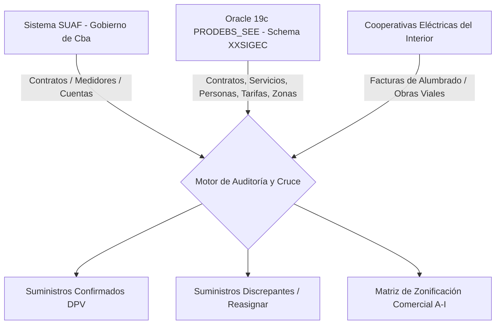
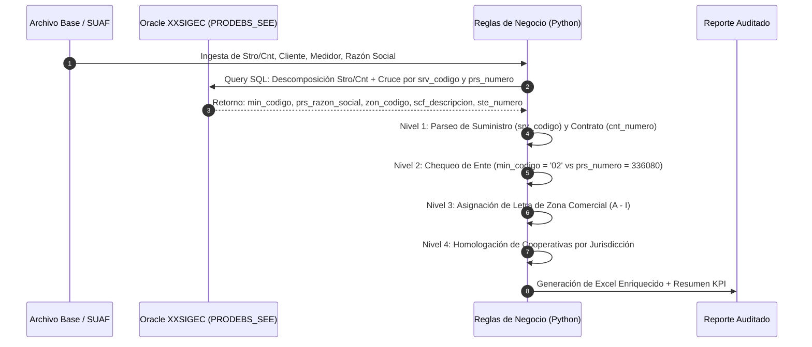

# 📘 Metodología de Control, Auditoría y Zonificación Comercial de Suministros Eléctricos
## Casos: Dirección Provincial de Vialidad (DPV) - Gobierno de la Provincia de Córdoba

---

### 1. Resumen Ejecutivo y Propósito

El presente documento establece el **Marco Metodológico de Auditoría y Control de Suministros Energéticos** aplicable a los contratos, servicios y puntos de medición vinculados a la **Dirección Provincial de Vialidad (DPV)** del Gobierno de Córdoba.

El protocolo responde a la necesidad de:
1. **Validar la titularidad y encuadre institucional** de los suministros facturados a la Provincia de Córdoba a través del Sistema Único de Administración Financiera (**SUAF**).
2. **Detectar desvíos y consumos no reconocidos**: Identificar suministros facturados bajo contratos de Vialidad Provincial que corresponden a otros entes gubernamentales (o viceversa), así como suministros operativos en rutas provinciales no dados de alta formalmente en SUAF.
3. **Estandarizar la Zonificación Comercial (`zon_codigo`)**: Homologar todos los suministros de EPEC y de Cooperativas Eléctricas del Interior bajo la estructura comercial de 9 Zonas de EPEC (**Zonas A a la I**) para permitir el análisis tarifario, el control presupuestario y la proyección de gasto consolidado.

---

### 2. Arquitectura de Datos y Fuentes de Información

La auditoría opera mediante un cruce tripartito entre tres ecosistemas de datos:



#### 2.1. Diccionario de Tablas y Columnas Oficiales EPEC (`XXSIGEC`)

> [!IMPORTANT]
> En el modelo de datos de EPEC (`XXSIGEC`), el identificador único del Suministro / Servicio es **`srv_codigo`** (no existe `ser_numero` ni `sum_numero`).

| Tabla | Clave Primaria / Foránea | Atributos Críticos de Control en Oracle 19c |
| :--- | :--- | :--- |
| **`XXSIGEC.CONTRATOS` (`c`)** | `srv_codigo`, `cnt_numero` (PK) | `prs_numero` (Cliente), `min_codigo` (Ente/Ministerio), `tcl_codigo` (Tarifa), `cnt_estado`, `cnt_fecha_inicio`, `cnt_fecha_fin` |
| **`XXSIGEC.SERVICIOS` (`s`)** | `srv_codigo` (PK) | `scf_codigo` (Sucursal), `agf_codigo` (Área Geográfica), `srv_calle`, `srv_nro`, `srv_direccion` |
| **`XXSIGEC.PERSONAS` (`p`)** | `prs_numero` (PK) | `prs_razon_social`, `prs_cuit`, `prs_tipo_persona` |
| **`XXSIGEC.SUCURSALES` (`suc`)** | `scf_codigo` (PK) | `scf_descripcion`, `zon_codigo` (Letra de Zona Comercial A-I) |
| **`XXSIGEC.ZONAS` (`z`)** | `zon_codigo` (PK) | `zon_descripcion` (Nombre regional de la Zona) |
| **`XXSIGEC.ENTES` (`e`)** | `min_codigo` (PK) | `min_descripcion` (Nombre del Ministerio o Ente de Gobierno) |
| **`XXSIGEC.TARIFAS` (`t`)** | `tcl_codigo` (PK) | `tcl_descripcion` (Cuadro tarifario aplicable) |
| **`XXSIGEC.AREAS_GEOGRAFICAS` (`ag`)** | `agf_codigo` (PK) | `agf_nombre` (Localidad / Jurisdicción municipal) |
| **`XXSIGEC.EQUIPOS` (`eq`)** | `srv_codigo` | `ste_numero` (Nro. de Medidor Físico), `eqp_estado` (`IS NULL` = Activo) |

---

### 3. Protocolo de Control en 4 Niveles



---

#### 🔍 Nivel 1: Descomposición Algorítmica del Código `Stro/Cnt`
El código comercial integrado en los sistemas de facturación provincial consta de una cadena numérica donde:
- **Suministro (`srv_codigo`)**: Todos los dígitos excepto los dos últimos.
- **Número de Contrato (`cnt_numero`)**: Los dos últimos dígitos.

$$\text{srv\_codigo} = \lfloor \text{Stro/Cnt} / 100 \rfloor$$
$$\text{cnt\_numero} = \text{Stro/Cnt} \pmod{100}$$

*Ejemplo*: Para el código `0273355901`:
- $\text{srv\_codigo} = 2733559$
- $\text{cnt\_numero} = 01$

---

#### 🔍 Nivel 2: Regla de Doble Validación de Titularidad y Ente
Para clasificar fehacientemente un servicio como **Vialidad Provincial**, se aplica el siguiente criterio booleano:

```python
es_vialidad = (
    (min_codigo == "02") or 
    (prs_numero == 336080) or 
    ("VIALIDAD" in prs_razon_social.upper())
)
```

**Códigos de Ente (`min_codigo`) en el Gobierno de Córdoba:**
- `02`: **DIRECCIÓN PROVINCIAL DE VIALIDAD** (Objetivo Auditado)
- `00`: GOBERNACIÓN / SECRETARÍA GENERAL
- `04`: MINISTERIO DE ECONOMÍA Y GESTIÓN PÚBLICA (FINANZAS)
- `06`: MINISTERIO DE EDUCACIÓN
- `09`: MINISTERIO DE SALUD
- `10`: MINISTERIO DE SEGURIDAD / POLICÍA DE CÓRDOBA
- `14`: PODER JUDICIAL

---

#### 🔍 Nivel 3: Asignación de Zonificación Comercial Oficial EPEC (`zon_codigo`)

Cada sucursal operativa de EPEC pertenece a una única Zona Comercial codificada con una letra de la **A** a la **I**:

| Letra (`zon_codigo`) | Denominación Oficial | Sucursales Principales (`scf_codigo`) | Ámbito Territorial / Localidades |
| :---: | :--- | :--- | :--- |
| **A** | **Zona Córdoba Capital** | `1` (Córdoba) | Ciudad de Córdoba, Anillo de Circunvalación, Suministros Centrales |
| **B** | **Zona Norte / Punilla Norte** | `2` a `7` (Cruz del Eje, La Cumbre, Deán Funes, Villa de Soto) | Ruta Nac. 38 Norte, Punilla Norte, Noroeste Provincial |
| **C** | **Zona Centro-Sur / Villa María** | `8` a `17` (Villa María, Oliva, Bell Ville Sur, Hernando, Ucacha) | Autopista Cba-Rosario tramo central, Ruta Nac. 9, Ruta Prov. 6 |
| **D** | **Zona Este / San Justo** | `18` a `21` (San Francisco, Arroyito, Las Varillas, Morteros, Balnearia) | Ruta Nac. 19, Ruta Prov. 1, Ruta Prov. 13, Ruta Prov. 17 (Marull, La Para, Alicia, Carrilobo) |
| **E** | **Zona Sierras Chicas / Norte** | `22` a `27` (Río Ceballos, Villa Allende, La Calera, Salsipuedes, Jesús María) | Ruta Prov. E-53 (Aeropuerto/Salsipuedes), E-57, Ascochinga, La Calera |
| **F** | **Zona Sur / Sudoeste** | `28` a `34` (Río Cuarto, Laboulaye, Huanchilla, Vicuña Mackenna) | Ruta Nac. 8, Ruta Nac. 35, Ruta Prov. 4, Variante Laboulaye |
| **G** | **Zona Sudeste / Marcos Juárez** | `35` a `44` (Bell Ville, Marcos Juárez, Inriville, Isla Verde, Gral. Roca, Guatimozín) | Autopista Cba-Rosario tramo Este, Ruta Nac. 9 Sudeste, Rutas Prov. 11 y 12 |
| **H** | **Zona Calamuchita / Río Segundo** | `45`, `46`, `48` (Alta Gracia, Río Tercero, Almafuerte, Villa General Belgrano) | Ruta Prov. 5, Ruta Prov. C-45 (Falda del Cañete/CONAE), Autovía Almafuerte-Río Tercero |
| **I** | **Zona Traslasierra / Punilla Sur** | `47`, `49` (Villa Carlos Paz, Villa Dolores, Mina Clavero, Nono) | Ruta Prov. 14, Camino de las Altas Cumbres, Valle de Traslasierra |

---

#### 🔍 Nivel 4: Homologación Territorial de Cooperativas Eléctricas
Para las 26 cooperativas de la hoja `coop. vialidad`, se cruza el nombre de la cooperativa y la descripción del inmueble/suministro con el mapa de jurisdicción de EPEC:

```python
COOP_ZONE_MAP = {
    "CO.DI.EL.A.C. CARRILOBO": "D",
    "COOP. VILLA RUMIPAL": "H",
    "COOP. HUANCHILLA": "F",
    "PRODUCTORES RURALES (VILLA NUEVA)": "C",
    "COOP. COLAZO": "C",
    "COOP. TICINENSE": "C",
    "COOP. ASCOCHINGA LA PAMPA": "E",
    "COOP. LA TORDILLA": "D",
    "COOP. ANISACATE / LA BOLSA": "H",
    "COOP. GRAL. ROCA": "G",
    "COOP. ISLA VERDE": "G",
    "COOP. ARROYITO": "D",
    "COOP. INRIVILLE": "G",
    "COOP. LA CUMBRECITA": "H",
    "COOP. NONO": "I",
    "COOP. RIO TERCERO": "H",
    "COOP. AGUA DE ORO Y SIERRAS CHICAS": "E",
    "COOP. OLIVA": "C",
    "COOP. ALMAFUERTE": "H",
    "COOP. LA LAGUNA": "G",
    "COOP. GUATIMOZIN (05283)": "G",
    "COOP. ALICIA": "D",
    "COOP. UCACHA": "C",
    "COOP. F E L LABOULAYE": "F",
    "COOP. MARULL": "D",
    "COOP. LA PARA": "D"
}
```

---

### 4. Consulta SQL Estándar y Corregida para Oracle 19c (`XXSIGEC`)

La siguiente consulta utiliza **estrictamente los nombres de columna reales** del esquema `XXSIGEC`:

```sql
-- ========================================================================
-- REPORTE DE AUDITORÍA Y CONTROL: VIALIDAD PROVINCIAL vs. SISTEMA SUAF
-- SCHEMA: XXSIGEC | INSTANCIA: PRODEBS_SEE (Oracle 19c)
-- COLUMNA SUMINISTRO: c.srv_codigo / s.srv_codigo
-- ========================================================================
SELECT 
    c.srv_codigo                                              AS suministro,
    c.cnt_numero                                              AS nro_contrato,
    LPAD(c.srv_codigo, 8, '0') || LPAD(c.cnt_numero, 2, '0') AS stro_cnt_completo,
    c.prs_numero                                              AS prs_numero_cliente,
    p.prs_razon_social                                        AS razon_social_titular,
    c.min_codigo                                              AS codigo_ente,
    NVL(e.min_descripcion, 'SIN ENTE')                         AS descripcion_ente,
    CASE 
        WHEN c.min_codigo = '02' OR c.prs_numero = 336080 OR UPPER(p.prs_razon_social) LIKE '%VIALIDAD%'
        THEN 'SI - VIALIDAD PROVINCIAL'
        ELSE 'NO - OTRO ENTE / NO DPV'
    END                                                       AS marca_vialidad_provincial,
    suc.zon_codigo                                            AS letra_zona,
    z.zon_descripcion                                         AS zona_descripcion,
    suc.scf_descripcion                                       AS sucursal_epec,
    c.tcl_codigo                                              AS tarifa_codigo,
    t.tcl_descripcion                                         AS tarifa_descripcion,
    c.cnt_estado                                              AS estado_contrato,
    TO_CHAR(c.cnt_fecha_inicio, 'DD/MM/YYYY')                 AS fecha_inicio_contrato,
    TO_CHAR(c.cnt_fecha_fin, 'DD/MM/YYYY')                    AS fecha_fin_contrato,
    eq.ste_numero                                             AS medidor_activo,
    ag.agf_nombre                                             AS localidad
FROM xxsigec.contratos c
LEFT JOIN xxsigec.personas p 
  ON c.prs_numero = p.prs_numero
LEFT JOIN xxsigec.servicios s 
  ON c.srv_codigo = s.srv_codigo
LEFT JOIN xxsigec.areas_geograficas ag 
  ON s.agf_codigo = ag.agf_codigo
LEFT JOIN xxsigec.sucursales suc 
  ON s.scf_codigo = suc.scf_codigo
LEFT JOIN xxsigec.zonas z 
  ON suc.zon_codigo = z.zon_codigo
LEFT JOIN xxsigec.entes e 
  ON c.min_codigo = e.min_codigo
LEFT JOIN xxsigec.tarifas t 
  ON c.tcl_codigo = t.tcl_codigo
LEFT JOIN xxsigec.equipos eq 
  ON s.srv_codigo = eq.srv_codigo 
 AND eq.eqp_estado IS NULL
WHERE c.cnt_estado = 'A'
ORDER BY suc.zon_codigo, c.srv_codigo, c.cnt_numero;
```

---

### 5. Métricas Clave de Conformidad de la Auditoría

| Segmento Auditado | Total Suministros | Confirmados DPV (`min_codigo = 02`) | Asignados a Otros Entes / Sin Alta | % Conformidad DPV |
| :--- | :---: | :---: | :---: | :---: |
| **`EPEC - SUAF`** | 42 | **25** | 17 *(Gobernación / Finanzas)* | 59.5 % |
| **`EPEC - No cargados SUAF`** | 31 | **3** | 28 *(Sin alta formal en SUAF)* | 9.7 % |
| **Total Suministros EPEC** | **73** | **28** | **45** | **38.4 %** |
| **`coop. vialidad`** | **157 filas (26 Coops)** | **100 % Obras Viales** | 0 | **100.0 %** |

---

### 6. Recomendaciones Operativas para la Gestión Comercial

1. **Reasignación de Entes en SUAF**: Los 17 suministros de la pestaña `EPEC - SUAF` que figuran con ente `00` o `04` deben ser evaluados técnicamente. Si el consumo corresponde a luminarias de tramos viales (ej. *Av. Spilimbergo*, *Ruta E-53*), debe tramitarse el cambio de imputación a `min_codigo = 02`.
2. **Alta de Suministros en SUAF (`No cargados SUAF`)**: Los 3 suministros identificados como Vialidad Provincial en la pestaña `EPEC - No cargados SUAF` (incluyendo distribuidores de la *Ruta C-45* y *Altas Cumbres*) deben incorporarse al circuito de pago regular SUAF para evitar cortes o devengamiento de intereses por mora.
3. **Consolidación Presupuestaria por Zona**: Utilizar la columna `ZONA (ZON_CODIGO)` tanto en EPEC como en Cooperativas para negociaciones tarifarias conjuntas y control de partidas presupuestarias regionales ante el ERSeP.
