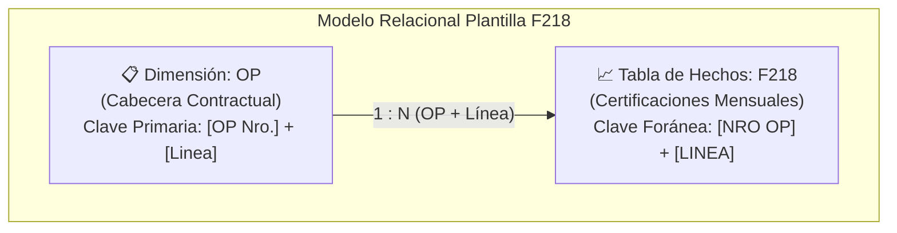
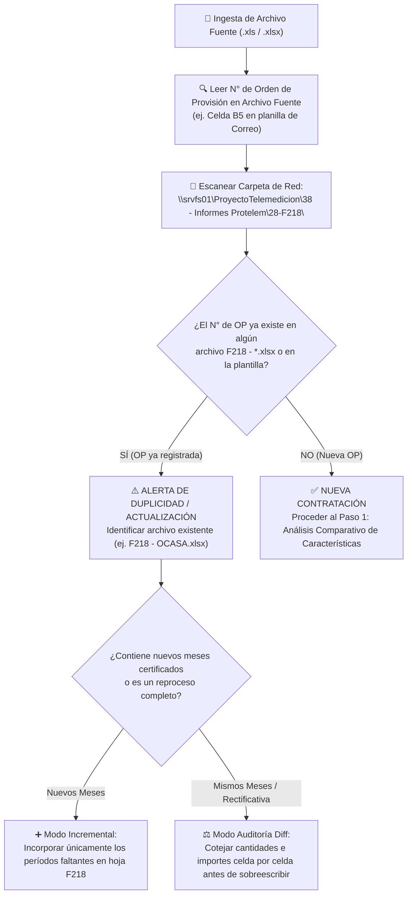

# 📘 Instructivo Operativo: Procedimiento de Carga, Control Previo y Normalización de Plantillas F-218

Este documento establece la metodología oficial y el estándar técnico obligatorio para la ingesta, validación, transformación columnar y normalización de datos provenientes de planillas de liquidación hacia la **Plantilla de Datos F-218**, insumo directo de los tableros analíticos de **Power BI** (`Saldo OP - PROTELEM - F218 MI`).

---

## 🏗️ 1. Arquitectura Relacional del Modelo de Datos

La plantilla está diseñada bajo un modelo dimensional en **esquema de estrella simple (1:N)** compuesto exclusivamente por dos tablas:



1. **Tabla Dimensión `OP`**: Almacena las condiciones contractuales maestras de cada línea de servicio adjudicada (cantidades pactadas, precios unitarios pactados, fechas de vigencia y sector solicitante).
2. **Tabla de Hechos `F218`**: Almacena el detalle granular des-pivotado (unpivoted) de cada formulario F-218 certificado mes a mes, indicando la cantidad consumida y el monto neto devengado s/IVA.

---

## 🛑 2. Paso 0: Control Previo de Duplicidad y Detección de OP

Antes de abrir, transformar o cargar cualquier archivo fuente, **es obligatorio ejecutar el siguiente protocolo de control**:



### Reglas de Control de Duplicidad:
1. **Identificador Unívoco**: El N° de Orden de Provisión (`OP Nro.`) es la clave rectora de la contratación en el sistema de gestión de compras/SAP de EPEC.
2. **Chequeo de Archivos Existentes**:
   - Revisar `F218 - <ADJUDICATARIO>.xlsx` en la carpeta `28-F218`.
   - Si la OP ya fue cargada, verificar el último mes registrado en la columna `AÑOMES`.
   - **Prohibido duplicar filas** que compartan la combinación `NRO OP` + `NRO F218` + `LINEA`.

---

## ⚖️ 3. Paso 1: Análisis Comparativo de Características (Similitudes y Diferencias)

Cada servicio y contratista presenta casuísticas operativas distintas. Se debe realizar el contraste de características antes de estructurar las tablas:

| Característica | Tipología Correo Postal (ej. OCASA - OP 26211) | Tipología Atención Virtual / Call Center (ej. EVOLTIS) | Tipología Medición Inteligente (ej. CONECTAR / EMA) |
| :--- | :--- | :--- | :--- |
| **N° de Líneas** | 4 líneas (Impresión, Braille, Dist. Facturas, Dist. Notificaciones). | 3 líneas (0800, LUZ, EVA). | 1 o 2 líneas (Instalación, Relevamiento MI). |
| **Unidad de Medida (`Uni`)** | `UNID` (Piezas postales físicas impresas/distribuidas). | `USE` (Unidades de Servicio) u `HORAS`. | `PUNTOS`, `TRAB`, `UNID`. |
| **Precio Unitario** | Costo fijo contractual por pieza postal neta s/IVA. | Costo por transacción/unidad operativa s/IVA. | Tarifa fija por punto/medidor intervenido. |
| **Sector Demandante** | `DEPARTAMENTO FACTURACION` (Gerencia Comercial). | `ATENCION AL PUBLICO VIRTUAL` / CAT. | `TELEMEDICION` / PROTELEM. |
| **Plazo Contractual** | Usualmente 24 meses corridos. | Anual o bianual. | Anual con prórrogas. |
| **Formato de Fecha** | Serial Excel mensual (inicio de mes, ej. `01/09/2025`). | Período mensual o quincenal. | Mensual cerrado por lote de actas. |

### ⚠️ Matriz de Advertencias y Puntos Críticos:
1. **Cálculo Neto s/IVA vs. Bruto c/IVA**:
   - La tabla `F218` debe almacenar **estrictamente el Importe Neto s/IVA**. El IVA (21% o alícuota correspondiente) se calcula dinámicamente mediante medidas DAX en Power BI.
2. **Meses Proyectados vs. Meses Certificados**:
   - Las planillas de origen suelen incluir filas para todos los 24 meses del contrato, dejando en `0,00` los meses futuros aún no devengados.
   - **Regla Estricta**: **NO cargar filas con Cantidad = 0 o Importe = 0 correspondientes a meses futuros**. Solo deben volcarse períodos efectivamente certificados con su correspondiente número de formulario F-218.
3. **Numeración de Formulario F-218**:
   - Cada certificación mensual posee un correlativo numérico único emitido por EPEC (ej. `25998`, `26298`). Debe capturarse como valor entero sin decimales.

---

## 📋 4. Paso 2: Especificación y Carga Hoja por Hoja

### A. Hoja `OP` (Dimensión Contractual)
Esta hoja define la estructura de las líneas de la Orden de Provisión.

#### Estructura de Columnas:
1. `OP Nro.` *(Numérico Entero)*: Número de Orden de Provisión (ej. `26211`).
2. `Adjudicatario` *(Texto)*: Razón social formal de la empresa contratista (ej. `ORGANIZACION COURIER ARGENTINA S.A. (OCASA)`).
3. `Linea` *(Numérico Entero)*: Número secuencial del ítem/renglón contractual (`1`, `2`, `3`, `4`...).
4. `Uni` *(Texto)*: Unidad de medida contractual (`UNID`, `USE`, `HORAS`).
5. `Cantidad` *(Numérico Entero, formato `#,##0`)*: Cantidad total de piezas o unidades contratadas en la adjudicación.
6. `Descripcion` *(Texto en mayúsculas)*: Denominación técnica del renglón (ej. `IMPRESION DE FACTURAS Y NOTIFICACIONES`).
7. `Precio Unitario` *(Decimal, formato `#,##0.00`)*: Valor unitario fijado en la OP, **neto s/IVA**.
8. `Precio Total` *(Decimal, formato `#,##0.00`)*: Monto total contratado s/IVA (`Cantidad * Precio Unitario`).
9. `Fecha Inicio` *(Fecha, formato `DD/MM/YYYY`)*: Fecha formal de inicio de vigencia de la prestación.
10. `Fecha limite` *(Fecha, formato `DD/MM/YYYY`)*: Fecha formal de finalización contractual.
11. `Plazo en meses` *(Numérico Entero)*: Duración total del contrato en meses (ej. `24`).
12. `Sector` *(Texto)*: Área o departamento responsable de la certificación (ej. `DEPARTAMENTO FACTURACION`).

---

### B. Hoja `F218` (Tabla de Hechos - Certificaciones Mensuales)
Esta hoja almacena los consumos mensuales reales liquidados.

#### Estructura de Columnas:
1. `NRO OP` *(Numérico Entero)*: Vinculación con la cabecera contractual (ej. `26211`).
2. `NRO F218` *(Numérico Entero)*: Número de comprobante del Formulario F-218 emitido (ej. `25998`).
3. `AÑOMES` *(Numérico Entero, formato `YYYYMM`)*: Clave temporal del período devengado (ej. `202509` para Septiembre 2025).
4. `LINEA` *(Numérico Entero)*: Renglón correspondiente a la hoja `OP` (`1`, `2`, `3` o `4`).
5. `CANTIDAD` *(Numérico Entero, formato `#,##0`)*: Cantidad de piezas/unidades certificadas en dicho mes para esa línea.
6. `IMPORTE` *(Decimal, formato `#,##0.00`)*: Monto neto liquidado en el mes s/IVA (`CANTIDAD * Precio Unitario`).

#### Algoritmo de De-pivotado (Unpivot):
En la planilla origen (matriz ancha), cada mes ocupa una fila con columnas distribuidas horizontalmente para cada ítem:
- *Mes 1*: Columnas de Línea 1, Línea 2, Línea 3, Línea 4.
Para volcar a la hoja `F218`, se deben generar **tantas filas individuales como líneas de servicio existan** en dicho mes:
$$	ext{Total Filas F218} = 	ext{Meses Certificados} 	imes 	ext{Líneas Activas}$$
*(Ejemplo OP 26211: 13 meses certificados $	imes$ 4 líneas = 52 filas en `F218`).*

---

## 🔍 5. Paso 3: Protocolo de Validación y Cuadre Matemático

Antes de dar por finalizada la carga, se debe ejecutar el siguiente checklist de control:

```text
[ ] CONTROL 1: Total Piezas Físicas
    Sumatoria de la columna 'CANTIDAD' en F218 == Sumatoria de piezas de todas las líneas en origen.
    (Ejemplo OP 26211: 22.588.442 piezas exactas).

[ ] CONTROL 2: Total Importe Neto s/IVA
    Sumatoria de la columna 'IMPORTE' en F218 == Total Importe Neto s/IVA de la planilla origen.
    (Ejemplo OP 26211: $ 3.478.151.192,02 exactos).
    DIFERENCIA PERMITIDA: $ 0,00.

[ ] CONTROL 3: Integridad Referencial
    Todo par (NRO OP, LINEA) en la hoja 'F218' debe existir unívocamente en la hoja 'OP'.

[ ] CONTROL 4: Exclusión de Meses Futuros
    Confirmar que no existan filas con CANTIDAD = 0 e IMPORTE = 0.

[ ] CONTROL 5: Formatos Numéricos
    Confirmar que las columnas de importes tengan dos decimales y las de cantidades no contengan decimales.
```

---

## 💾 6. Paso 4: Publicación, Nomenclatura y Respaldo

1. **Ubicación Oficial**:
   Todos los archivos de datos normalizados deben residir en:
   `\srvfs01\ProyectoTelemedicion8 - Informes Protelem8-F218\`
2. **Nomenclatura Estandarizada**:
   - `F218 - <ADJUDICATARIO>.xlsx` (ej. `F218 - OCASA.xlsx`, `F218 - EVOLTIS.xlsx`).
   - O bien `F218 - <ADJUDICATARIO> - OP <NRO>.xlsx` en caso de que una misma empresa posea múltiples órdenes de provisión históricas sucesivas.
3. **Respaldo Preventivo**:
   - En caso de actualizar un archivo existente, crear una copia con extensión `.bak` con fecha y hora (`YYYY-MM-DD_HHmmss_archivo.xlsx.bak`) antes de guardar los cambios definitivos.
