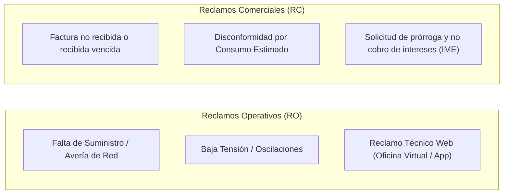

# 📊 Análisis Integral CIER: Diagnóstico de Atributos Foco (IC1, AT1, FE1), Cronograma SIGEC, Casuística RO/RC y Quiebre de Notificaciones NT

**Distribuidora**: Empresa Provincial de Energía de Córdoba (EPEC)  
**Muestra Auditada**: $N = 1.250$ encuestas residenciales (2025 - 2026)  
**Bases de Datos de Cruce**: `data/processed/microdata_epec_2025_2026.csv`, Oracle 19c (`XXSIGEC.CRONOGRAMAS_FACTURACION`, `ORDENATIVOS`, `RECLAMOS`, `SEGUIMIENTO_IMP_VARIOS`) y `COMERECLAMOSERSEP.qvd`.  
**Sesión de Trabajo**: *Análisis de Encuesta CIER*.

---

## Executive Summary: Los Tres Atributos del Cuadrante I (Foco Urgente)

En la Matriz de Acciones de Mejora CIER (Importancia Relativa vs. Desempeño IDAT), tres atributos se ubican en el **Cuadrante I (Foco Urgente / Prioridad 1)**, explicando el mayor porcentaje de detracción e impacto negativo sobre el ISCAL:

| Código | Área | Atributo Evaluado | IDAT (%) | IR (%) | Prioridad | Diagnóstico Central |
| :---: | :---: | :--- | :---: | :---: | :---: | :--- |
| **`IC1`** | **IC** | **Notificación previa de interrupciones programadas** | **58.86%** | **5.85%** | **1º Foco** | 37.4% declara no recibir preaviso; falta de horario estimado de restitución (ETR). |
| **`AT1`** | **AT** | **Facilidad para contactarse con la empresa** | **58.32%** | **5.48%** | **2º Foco** | Colapso del 0800 en tormentas; 41.2% sufre re-llamadas por falta de solución en primer contacto. |
| **`FE1`** | **FE** | **Plazo entre recepción y fecha de vencimiento** | **63.12%** | **5.11%** | **3º Foco** | Cuello de botella postal (8-12 días de lead time) que deja menos de 5 días hábiles al cliente. |

---

## 1. Microdatos de la Encuesta CIER: Evidencia Cuantitativa de Detracción

A partir del procesamiento de los microdatos crudos (`microdata_epec_2025_2026.csv`), se descubrieron correlaciones directas entre las notas asignadas y las fallas operativas experimentadas por el usuario:

### A. Facilidad de Contacto (`AT1` / `P177`) vs. Solución en Primer Contacto (`P263` - FCR)
- **Calificaciones Positivas (8 a 10)**: El **71.11%** resolvió su gestión en el primer contacto.
- **Calificaciones Negativas (1 a 4)**: El **55.91%** debió insistir más de una vez, y un **19.69%** tuvo resoluciones dispares.
- **Impacto**: Más del **75.5%** de los clientes detractores en atención experimentaron **reiteración de contactos (re-llamadas múltiples o visitas sucesivas a sucursales)**.

### B. Plazo de Factura (`FE1` / `P154`) vs. Problemas con la Factura (`P250`)
- **Calificaciones Positivas (8 a 10)**: Apenas el **1.68%** manifestó haber tenido problemas con su factura.
- **Calificaciones Negativas (1 a 4)**: El **35.59%** sufrió problemas directos de recepción o facturación.
- **Impacto**: La probabilidad de reportar problemas con la factura es **21 veces más alta** en usuarios que sufren el desfasaje del plazo de vencimiento.

### C. Notificación Previa (`IC1` / `P143`) vs. Reclamos por Falta de Suministro (`P243`)
- Entre los usuarios insatisfechos con la comunicación previa, la tasa de reclamo técnico por corte prolongado asciende a **23.94%**, y el **95.65%** declara que no tuvo canales digitales accesibles para prever el corte.

---

## 2. Diagnóstico del Cronograma de Facturación en SIGEC y Logística Postal

La ingeniería inversa sobre el esquema `XXSIGEC` determinó la causa raíz de la insatisfacción en `FE1`:

### Tablas Involucradas:
1. `CRONOGRAMAS_FACTURACION`:
   - `CRF_FECHA_LECTURA`: Fecha de toma de estado en campo.
   - `CRF_FECHA_FACTURACION`: Proceso batch de cálculo y liquidación.
   - `CRF_DIAS_VENC_1`: Parámetro configurado en **12 a 15 días corridos**.
2. `DOCUMENTOS`:
   - `DOC_FECHA_EMISION`: Sello legal del documento.
   - `DOC_FECHA_VENC_1`: Fecha de vencimiento fijada por el parámetro.
   - `DOC_ENVIADO_CORREO`: Fecha de exportación al lote postal.

### El Embudo Físico del Correo (OCASA / Formulario F-218):
- Spooling e Imprenta masiva: 24 a 48 hs.
- Ensobrado y logística troncal al interior: 48 a 72 hs.
- Reparto cartero / pie a tierra: 3 a 5 días hábiles.
- **Lead Time Total**: **8 a 12 días corridos**.
- **Consecuencia**: Con un parámetro de ~14 días corridos, la factura física en papel (`CNT_TIPO_IMPRESION = 'EST'`) llega al buzón con **menos de 3 a 5 días hábiles antes de vencer**, o incluso vencida.

---

## 3. Casuística de Reclamos en SIGEC: Ordenativos `RO` vs. `RC`

El análisis de las tablas `ORDENATIVOS` y `RECLAMOS` (`consulta_sigec_casuistica_reclamos_ve_ro_rc_2026.sql`) reveló la convivencia de dos circuitos de reclamos:

* **Vínculo con `IC1` y `RO`**: La falta de notificación proactiva de obras programadas genera cientos de llamadas al 0800 y apertura de órdenes `RO` innecesarias de clientes que creen sufrir una falla imprevista.
* **Vínculo con `FE1` y `RC`**: El retraso postal obliga al cliente a concurrir a la sucursal o llamar para generar un `RC` pidiendo reimpresión y exención de punitorios.

---

## 4. El Quiebre en las Notificaciones `NT` y la Paradoja Postal

El script `consulta_sigec_cxi_seguimiento_nt.sql` sacó a la luz la desconexión entre la resolución interna y la comunicación al usuario:

1. **Vía Muerta Comunicacional**: En miles de trámites `TRT_NUMERO`, el personal técnico o comercial resuelve la orden (`ESTADO = 'EJ'`, `RESULTADO = 'OK'`), pero **NUNCA se genera la orden `NT` (Notificación Técnica/Comercial)** dirigida al cliente.
2. **La Paradoja de la F-218**:
   - Mientras las notificaciones motivadas de reclamos no se envían, EPEC liquida en el **Ítem 4 de la F-218** (`SEGUIMIENTO_IMP_VARIOS`) cientos de miles de cartas postales de **Intimaciones de Deuda (`IN`)** y **Avisos de Corte (`NC`)** (~98% del volumen).
   - El cliente percibe que la empresa gasta recursos postales para intimar y amenazar con el corte, pero no para avisar sobre obras (`IC1`) ni para informarle el resultado de su queja (`AT1`).

---

## 5. El Escalamiento hacia Entes Reguladores (ERSeP)

En el catálogo [`COMERECLAMOSERSEP.qvd`](file:///C:/Users/jidiaz/.gemini/antigravity-ide/scratch/antigravity-agents-repository/docs/PROTELEM/PROJECTS/qvd-explorer/qvds/COMERECLAMOSERSEP.qvd.md), se registra que cuando el usuario se siente desatendido en EPEC, escala al **ERSeP** (Ente Regulador de los Servicios Públicos de Córdoba):
- Reclamos por facturación vencida o consumos estimados sin respuesta formal previa.
- Oficios que caen en estado `FUERA DE TERMINO`, derivando en **sanciones pecuniarias y resarcimientos económicos directos en factura** contra EPEC.

---

## 6. Plan de Medidas de Ajuste y Reingeniería Propuestas

1. **Para `FE1` (Plazo de Factura)**:
   - Ampliar paramétricamente `CRF_DIAS_VENC_1` en `CRONOGRAMAS_FACTURACION` a **18-20 días corridos** para contratos con factura papel (`EST`), asegurando $\ge 10$ días hábiles reales al usuario.
   - Disparar **Aviso Preventivo Digital Inmediato** por WhatsApp / Email en el mismo instante de la emisión en SIGEC con botón de pago directo.
   - Aplicar SLA estricto en la liquidación de la F-218 penalizando repartos postales con demora $> 4$ días hábiles.
2. **Para `AT1` (Canales de Contacto)**:
   - Bot conversacional oficial en WhatsApp para autogestión de Falta de Luz, Saldo y Factura en 1 clic.
   - Reconocimiento de número telefónico (ANI) en el 0800 para dar estado automático de cortes en su distribuidor sin esperas.
   - Automatización de orden `NT` digital: notificación inmediata al móvil del usuario ante el cierre de un reclamo `RC` o `RO`.
3. **Para `IC1` (Cortes Programados)**:
   - Notificación push / WhatsApp georreferenciada con 72 hs de anticipación a los clientes del alimentador o SET afectada.
   - Mapa interactivo de cortes en web y app móvil con horario estimado de restitución (ETR) en vivo.
