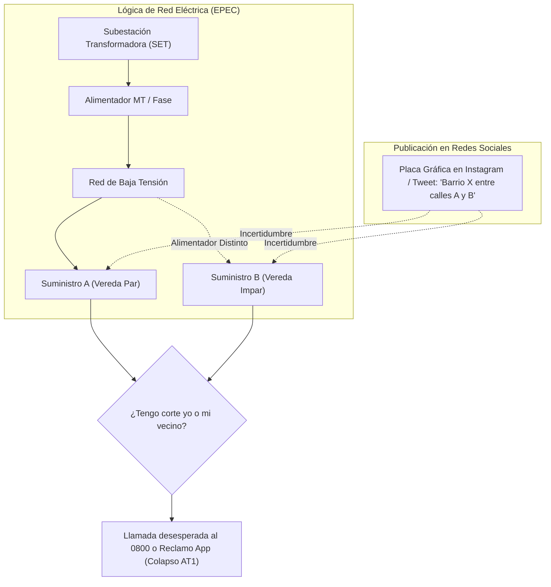
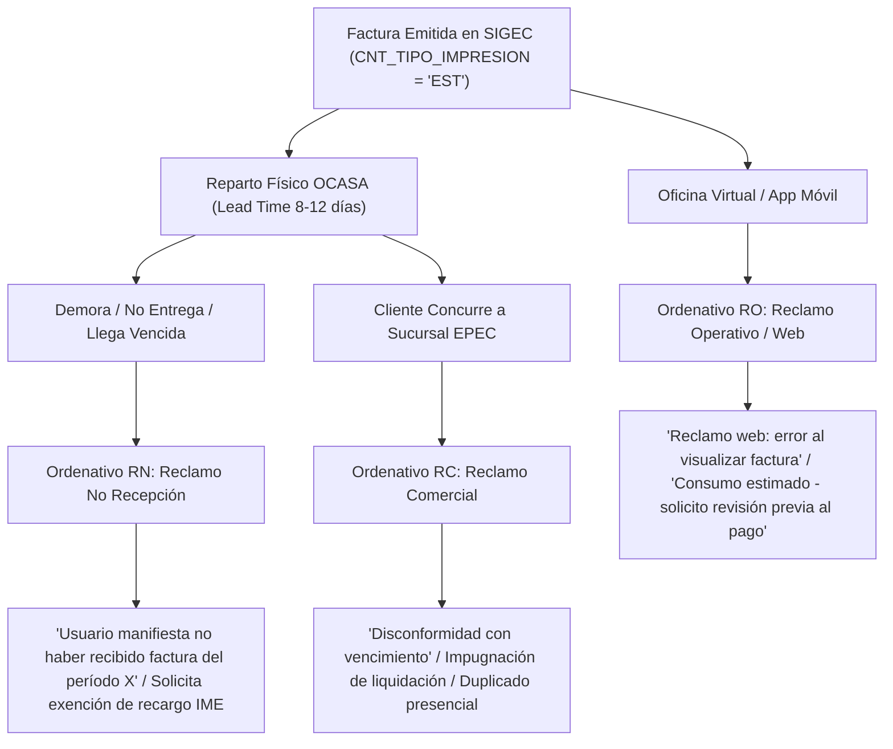

# 📊 Análisis Crítico de Atributos CIER Cuadrante I: IC1, AT1 y FE1 frente a Canales Masivos, SIGEC y Migración a Factura Digital

**Distribuidora**: Empresa Provincial de Energía de Córdoba (EPEC)  
**Proyecto**: `encuesta-cier-epec` (`D:\Proyectos\encuesta_cier`)  
**Metodología**: CIER / IPA (Importance-Performance Analysis) & Cruces de Microdatos ($N=1.250$)  
**Fecha de Auditoría**: 22 de Octubre de 2026  

---

## 📌 Resumen Ejecutivo y Diagnóstico Global

En la matriz de acciones de mejora de la Encuesta CIER, los tres atributos prioritarios del **Cuadrante I (Foco Urgente / Prioridad 1)** concentran el descontento estructural del usuario residencial:

```
[IC1] Notificación previa cortes programados  --> IDAT: 58.86% | IR: 5.85% (1º Foco)
[AT1] Facilidad para contactarse con empresa   --> IDAT: 58.32% | IR: 5.48% (2º Foco)
[FE1] Plazo entre recepción y vencimiento      --> IDAT: 63.12% | IR: 5.11% (3º Foco)
```

El presente análisis profundiza en:
1. **La brecha comunicacional en `IC1` y `AT1`**: Cómo publica EPEC en redes masivas (X/Twitter, Instagram, Facebook, Web), la imposibilidad del usuario de saber si su suministro está afectado y el consecuente colapso de los canales de atención.
2. **La casuística en SIGEC para `FE1`**: Qué revelan los ordenativos `RN`, `RO` y `RC` sobre la factura y cómo estructurar una estrategia de conversión masiva hacia la **Factura Digital (`SIM`)** eliminando la dependencia del reparto postal impreso (`EST`).

---

## 🔍 Parte 1: IC1 y AT1 en Medios Masivos (X, Instagram, Facebook y Web)

### 1. Formato y Anatomía Real de las Publicaciones de EPEC

EPEC difunde diariamente sus avisos bajo la denominación institucional de **"Trabajos por Mejoras"** o **"Mantenimiento Programado"** en:
- **X / Twitter** (`@EPECoficial`): Hilos de texto diario y placas con texto condensado.
- **Instagram** (`@epecoficial`): Carruseles de imágenes estáticas (placas gráficas en formato flyer) en feed e Historias (Stories).
- **Facebook** (`EPEC - Oficial`): Publicaciones periódicas de texto con imágenes adjuntas.
- **Sitio Web Institucional** (`epec.com.ar`): Sección *Mantenimiento y Mejoras* con tabla cronológica.

#### Estructura Estándar del Comunicado:
```text
TRABAJOS POR MEJORAS PARA HOY [DÍA / FECHA]
--------------------------------------------------------------------------------
• De: 08:00 a 11:30 hs
  Localidad: Córdoba Capital
  Zona afectada: Barrio Villa Belgrano, perímetro comprendido por calles 
  Av. Gauss, Laplace, Neper y Recta Martinoli.
  Motivo: Mantenimiento en red aérea de media tensión / Subestación transformadora.
--------------------------------------------------------------------------------
• De: 13:00 a 16:30 hs
  Zona: Barrio Alta Córdoba en forma parcial.
  Motivo: Poda preventiva sobre línea de media tensión.
```

---

### 2. ¿Cómo lo Interpreta el Cliente vs. ¿Por qué es Imposible Saber si su Suministro está Listado?

Existe una **falla conceptual insalvable** entre la lógica operativa de la red eléctrica y la forma en que el usuario percibe su domicilio:



#### Barreras Críticas de Comprensión:
1. **Discrepancia Eléctrica vs. Geográfica**:
   - La red de distribución no corta por manzanas catastrales ni por límites barriales políticos. Corta por circuitos de alimentadores de media tensión y subestaciones transformadoras (SET).
   - En una misma calle o manzana, un edificio o comercio puede estar conectado a la **SET 4223** (con corte programado) y la casa vecina a la **SET 4225** (con servicio normal).
2. **Inexistencia de Búsqueda Parametrizada por Suministro (NIS / Contrato)**:
   - El usuario común conoce su número de Contrato, NIS o número de medidor, pero en las redes sociales no hay forma de consultar su suministro. Tiene que leer un listado extenso de texto e intentar adivinar si su número de puerta está incluido.
3. **Ambigüedades Inoperantes ("En forma parcial")**:
   - Frases recurrentes como *"Barrio Argüello en forma parcial"* o *"Sector de Nueva Córdoba"* generan incertidumbre total en decenas de miles de hogares.
4. **Fricción de Formato (Imágenes no indexables)**:
   - En Instagram y Facebook, la información se difunde en placas gráficas (PNG/JPG). El texto **no se puede copiar ni buscar con `Ctrl + F`** desde un navegador o teléfono celular.
5. **Modelo Pasivo (Pull) en vez de Activo (Push)**:
   - EPEC exige que el usuario se despierte, recuerde abrir Instagram o X, busque el perfil oficial y lea si su zona figura. Si no lo hace, el corte lo toma por sorpresa en medio de su jornada laboral, estudio o actividad comercial.

---

### 3. El Vínculo Directo entre `IC1` y el Colapso de `AT1`

El microdato de la encuesta CIER corrobora este fenómeno:
- **`P143` vs. `P243`**: El **37.4%** de los clientes declara que jamás recibe aviso de corte y el **95.6%** carece de canales digitales de preaviso con horario estimado de restitución (ETR).
- **Reacción Inmediata**: Al interrumpirse el suministro sin previo aviso, el cliente asume que se trata de una avería imprevista y recurre inmediatamente a los canales de contacto:
  1. Marca el **0800-777-0000**: Miles de llamadas simultáneas saturan las líneas troncales.
  2. Tiempo de espera superior a 15-30 minutos o caída de llamada ➔ Puntuación mínima en `AT1` (58.32%).
  3. Ingresa a la App / Oficina Virtual y genera un reclamo operativo `RO` (Falta de Luz).
  4. Los operadores y cuadrillas se saturan registrando incidencias por cortes que ya estaban programados en el sistema técnico.

---

### 4. Propuesta de Reingeniería Operativa para IC1 y AT1

1. **Notificación Push Proactiva por Suministro (WhatsApp / SMS / App Push)**:
   - SIGEC posee la relación directa entre el contrato (`CNT_NUMERO`), el suministro (`SRV_CODIGO`), la subestación (`SET`) y el alimentador.
   - Cuando Mantenimiento apruebe una orden de corte programado, un bot automático debe enviar un mensaje 48 hs antes y 2 hs antes al WhatsApp registrado del titular:
     > *"Hola [Nombre]. Te informamos que por obras de mejora técnica en tu zona, el suministro N.° [SRV_CODIGO] ([Dirección]) tendrá una interrupción programada el día [Fecha] de [Hora Inicio] a [Hora Fin]. No necesitas generar reclamo."*
2. **Módulo de Consulta Web/App "Estado de mi Suministro"**:
   - En el home de la web y app: un campo directo donde ingresar el número de contrato o NIS y ver de inmediato: **Servicio Normal** o **Corte Programado en curso / previsto (con horario ETR)**.
3. **IVR Inteligente con Reconocimiento de Llamante (ANI) en 0800**:
   - Si el número que llama coincide con el teléfono de un contrato en zona de corte programado, la contestadora automática debe informar de inmediato sin derivar a operador: *"Detectamos que en tu zona se están realizando trabajos programados hasta las 11:30 hs. El servicio se restablecerá automáticamente."*

---

## 📑 Parte 2: FE1 frente a los Ordenativos RN, RO y RC en SIGEC

> **Nota Metodológica**: En cumplimiento de las directivas, la modificación de los plazos de vencimiento (`CRF_DIAS_VENC_1` en `CRONOGRAMAS_FACTURACION`) queda **fuera de los límites de alcance** del presente análisis y será evaluada por las áreas de finanzas y gerencia comercial.

El foco se sitúa en **qué registran los ordenativos de reclamo sobre la factura** y **cómo migrar la base a Factura Digital (`SIM`)**.

---

### 1. Diagnóstico de los Ordenativos en SIGEC (`RN`, `RO`, `RC`)

En la tabla `XXSIGEC.ORDENATIVOS`, los reclamos vinculados a la factura se tipifican a través de tres compuertas:



#### A. Ordenativo `RN` (Reclamo por No Recepción de Factura):
- **Causa Raíz Documentada**: Es la orden emitida cuando el cartero no pasa, el buzón no es accesible, o la factura física llegó días después del vencimiento.
- **Contenido Habitual**:
  - *"Usuario manifiesta no haber recibido en término la liquidación del mes."*
  - *"Solicita cupón de pago actualizado sin intereses por mora (`IME`)."*
  - *"Zona rural / loteo nuevo sin cartero asignado."*
- **Impacto**: Origina un costo transaccional altísimo para EPEC (atención personalizada, reemisión manual del documento, anulación de punitorios) debido a una falla de la logística física externa.

#### B. Ordenativo `RC` (Reclamo Comercial en Sucursal):
- **Causa Raíz Documentada**: Trámite abierto por el cliente en el Centro de Atención Comercial (CAC).
- **Contenido Habitual**:
  - Impugnación de consumo estimado mientras la factura corre hacia el vencimiento.
  - Solicitud de prórrogas o planes de facilidad de pago para evitar que se dispare el corte.
- **Falla Crítica**: Como se identificó en el informe anterior, el trámite suele cerrarse operativamente (`ESTADO = 'EJ'`), pero **no se emite orden `NT`** de notificación, dejando al cliente en la incertidumbre y provocando que el sistema automatizado le envíe una intimación `IN`.

#### C. Ordenativo `RO` (Reclamos Operativos / Reclamos Web):
- **Causa Raíz Documentada**: Ingresos a través de la Oficina Virtual o la App.
- **Contenido Habitual**:
  - Trámites donde el usuario no puede descargar el PDF digital o reclama por diferencias entre lo leído y lo facturado.
  - Al ingresar como `RO`, muchas veces viaja a cuadrillas de medición en vez de resolverse administrativamente en línea.

---

### 2. Estrategia Integral de Migración: De Factura Impresa (`EST`) a Factura Digital (`SIM`)

En el esquema de SIGEC (`XXSIGEC.CONTRATOS`):
- `CNT_TIPO_IMPRESION = 'EST'`: Estándar (Factura papel enviada al lote de impresión F-218 y repartida por OCASA).
- `CNT_TIPO_IMPRESION = 'SIM'`: Sin Impresión (Factura Digital adherida).

La dependencia del formato papel (`EST`) es la causante directa del 35.6% de insatisfacción en `FE1`. Si el cliente está en `SIM`, **el plazo de recepción es de 0 días** (recibe la factura digital en el mismo instante en que se ejecuta el proceso batch de facturación).

#### Plan de Acción para la Conversión Masiva a `SIM`:

| Eje Estratégico | Mecanismo de Implementación | Impacto Esperado |
| :--- | :--- | :--- |
| **1. Resolución de `RN` con Adhesión Inmediata (Nudge)** | Al ingresar un `RN`, el operador/bot envía el PDF en el acto por WhatsApp y pregunta: *"¿Deseas recibir tu factura siempre 12 días antes directamente en tu WhatsApp y evitar demoras del correo? Presiona 1 para Sí"*. | Conversión del $\ge 60\%$ de usuarios que sufren demoras postales. |
| **2. Adhesión Obligatoria por Defecto (`Opt-Out`)** | En todo trámite web o presencial (cambio de titularidad, nuevo suministro, plan de pago, descargo de reclamo), la opción predeterminada es Factura Digital (`SIM`). Para pedir papel, el usuario debe justificarlo expresamente. | Incremento sostenido del padrón digital en nuevas altas y gestiones. |
| **3. Notificación Activa por WhatsApp (Push con Botón de Pago)** | No exigir que el usuario entre a la Oficina Virtual con clave. Enviar mensualmente el PDF al WhatsApp oficial verificado de EPEC con botón de pago directo interoperable (QR / Transferencia 3.0 / MODO). | Tasa de apertura $> 95\%$ vs. 15-20% del correo electrónico tradicional. |
| **4. Campaña de Comunicación "Ganale al Vencimiento"** | Comunicación comparativa explícita: *"Con la factura papel te quedan 3 a 5 días para pagar. Con Factura Digital tenés 15 días completos desde el primer día."* | Neutralización psicológica de la fricción de vencimiento en `FE1`. |
| **5. Incentivo Tarifario / Segmentación Regulada** | Proponer ante ERSeP una bonificación única o descuento en cargo fijo por adhesión a Factura Digital + Débito Automático, financiada con el ahorro del costo de imprenta y franqueo postal (OP 26211). | Alineación de incentivos económicos entre distribuidora y usuario. |

---

## 🚀 Conclusiones y Próximos Entregables

1. **Para `IC1` y `AT1`**: Las publicaciones actuales en redes sociales (Instagram/X) son inefectivas para que el cliente identifique su suministro particular, provocando desinformación y el colapso sistemático del 0800. La solución definitiva radica en la **notificación push segmentada por SET/Alimentador vía WhatsApp** y un buscador interactivo por NIS/Contrato.
2. **Para `FE1`**: Los ordenativos `RN`, `RC` y `RO` confirman que la factura papel llega tarde o genera conflictos que derivan en reclamos por punitorios. La transición a **Factura Digital (`SIM`)** elimina el embudo postal de 8-12 días, garantizando que el usuario disponga de todo el período de gracia para abonar.

---
*Documento registrado en la Bóveda de Obsidian bajo la metodología estandarizada de proyectos CIER y SIGEC.*
