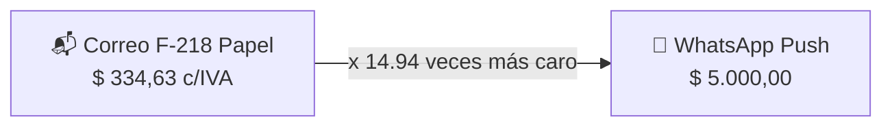
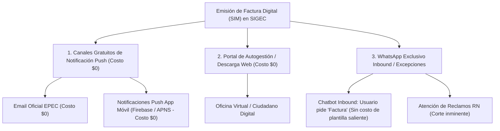

# 💰 Modelo Financiero: Estimación del Ahorro Anual por Migración a Factura Digital en EPEC

**Distribuidora**: Empresa Provincial de Energía de Córdoba (EPEC)  
**Fuente de Datos Contractuales**: Orden de Provisión **O.P. 26211** (OCASA) y Formularios F-218 certificados (2025-2026)  
**Agente Responsable**: Agente 01 (Analista Financiero) & Agente 02 (Ciencia de Datos)  
**Período de Modelado**: Proyección a 12 Meses (Año Base 2026 - 2027)  

---

## 📌 1. Costo Anual del Correo Postal por Suministro (Licitación OCASA - OP 26211)

A partir de los precios unitarios de la licitación postal vigente (**O.P. 26211** / Formulario F-218):

### A. Estructura de Costo Unitario por Factura Papel Repartida
- **Línea 1 (Impresión y Ensobrado)**: **$ 39,57** s/IVA ($ 47,88 c/IVA)
- **Línea 3 (Distribución Postal Domiciliaria)**: **$ 236,98** s/IVA ($ 286,75 c/IVA)
- **Costo Total por Factura Papel Física**:
  - **Neto s/IVA**: **$ 276,55 ARS**
  - **Final con IVA (21%)**: **$ 334,63 ARS**

### B. Costo Anual del Correo Postal por Suministro (12 Liquidaciones Mensuales)
En el régimen de facturación mensual residencial de EPEC (12 facturas al año por cliente):

$$\text{Costo Anual Correo s/IVA por Suministro} = 12 \times \$ 276,55 = \mathbf{\$ 3.318,60 \text{ ARS / año}}$$
$$\text{Costo Anual Correo c/IVA por Suministro} = 12 \times \$ 334,63 = \mathbf{\$ 4.015,51 \text{ ARS / año}}$$

> **Costo Anual Postal por Suministro**: Cada cliente que recibe la factura en papel le cuesta a EPEC **$ 4.015,51 ARS al año (c/IVA)** en logística postal directa.

### C. Gasto Global Anual de Correo para EPEC (~8 Millones de Facturas)
Con un promedio mensual certificado de **665.490 facturas papel** (7.985.884 piezas proyectadas al año):
- **Gasto Anual Postal Facturas (s/IVA)**: **$ 2.208,50 Millones de Pesos**
- **Gasto Anual Postal Facturas (c/IVA)**: **$ 2.672,28 Millones de Pesos**

---

## ⚠️ 2. Análisis de Sensibilidad Crítico: WhatsApp a $ 5.000 ARS por Mensaje

A solicitud del usuario, se incorpora la hipótesis de un costo unitario de **$ 5.000,00 ARS** por mensaje saliente de WhatsApp.

### A. Comparativa Unitaria y Anual por Suministro: Correo vs. WhatsApp ($5.000)

| Canal de Distribución | Costo Unitario por Factura | Costo Anual por Suministro (12 Facturas) | Ratio de Costo |
| :--- | :---: | :---: | :---: |
| **Correo Postal F-218 (OCASA)** | **$ 334,63 c/IVA** | **$ 4.015,51 c/IVA** | **1,00x** (Base) |
| **WhatsApp Push ($5.000 / mensaje)** | **$ 5.000,00** | **$ 60.000,00** | **14,94x** (Casi 15 veces más caro) |

### B. Impacto Presupuestario Global si se aplicara WhatsApp a $ 5.000 ARS
Si EPEC reemplazara los 7.985.884 envíos de correo postal físico por mensajes salientes de WhatsApp a $ 5.000:

$$\text{Gasto Total WhatsApp Anual} = 7.985.884 \times \$ 5.000 = \mathbf{\$ 39.929.420.000 \text{ ARS}}$$
$$\text{Gasto Actual Correo Papel (c/IVA)} = 7.985.884 \times \$ 334,63 = \mathbf{\$ 2.672.280.426 \text{ ARS}}$$
$$\text{Sobrecosto / Pérdida Neta} = \$ 39.929,42 \text{ M} - \$ 2.672,28 \text{ M} = \mathbf{+\$ 37.257,14 \text{ Millones de Pesos}}$$

> 🚨 **Conclusión Financiera Inapelable**:  
> Si el mensaje de WhatsApp cuesta **$ 5.000 ARS**, **no es económicamente viable utilizar WhatsApp como canal masivo de despacho mensual**. Generaría un sobrecosto astronómico de **+$ 37.257 Millones de Pesos al año** (+1.394% de incremento presupuestario respecto al correo papel).

---

## 🎯 3. Arquitectura Digital Híbrida: Cómo Lograr el Ahorro Real de $ 2.600 M

Para capturar el ahorro del contrato de correo sin incurrir en el costo de los $5.000 por mensaje de WhatsApp, la estrategia de Factura Digital (`SIM`) debe basarse en una **arquitectura multicanal de costo marginal cero**:

### Los 3 Ejes de Costo Marginal Cero:
1. **Canal Email (Costo $0 ARS)**: Envío masivo automatizado del PDF de liquidación mensual a la casilla validada del cliente.
2. **App Móvil EPEC & Push Notifications (Costo $0 ARS)**: Notificación en el teléfono móvil del usuario con botón de pago directo, con costo cero por mensaje.
3. **Oficina Virtual Web (Costo $0 ARS)**: Consulta y descarga directa.

### Uso Inteligente de WhatsApp (Inbound vs. Push):
- **NO hacer Push Masivo Saliente Mensual** (evitando pagar los $5.000 por cada cliente).
- **Habilitar el canal Inbound (Bot de Autogestión)**: El cliente que desee su factura le escribe a EPEC *"Factura"* y el bot responde dentro de la ventana de conversación iniciada por el usuario (o redirige a la descarga en 1 clic).
- **Reservar WhatsApp Push solo para eventos críticos**: Notificaciones de reclamos `RN` o preavisos de corte programado (`IC1`), donde el valor operativo supera ampliamente el costo.

---

## 📊 4. Matriz de Ahorro Real para EPEC (Estrategia Multicanal Costo Cero)

Sustituyendo el correo postal por la tríada **Email + App Push + Web (Costo ~ $0 ARS)**:

| Escenario de Adopción | % Penetración Digital | Suministros Migrados | Facturas Papel Ahorradas / Año | Ahorro Postal Anual s/IVA | **Ahorro Postal Anual c/IVA (Bolsillo EPEC)** |
| :--- | :---: | :---: | :---: | :---: | :---: |
| **1. Conservador** | **30%** | ~200.000 | 2.395.765 | $ 662,55 M | **$ 801,69 Millones** |
| **2. Moderado (Meta 2027)** | **60%** | ~400.000 | 4.791.530 | $ 1.325,10 M | **$ 1.603,39 Millones** |
| **3. Papel por Excepción** | **85%** | ~565.000 | 6.788.001 | $ 1.877,22 M | **$ 2.271,47 Millones** |
| **4. Pleno Teórico** | **100%** | ~665.490 | 7.985.884 | $ 2.208,50 M | **$ 2.672,28 Millones** |

---

## 📌 Resumen de Cifras Clave

1. **Costo Anual del Correo por Suministro**:
   - **$ 3.318,60 ARS (s/IVA)** / **$ 4.015,51 ARS (c/IVA)** al año por cada cliente que recibe factura impresa.
2. **Impacto de WhatsApp a $ 5.000**:
   - Representa **$ 60.000 ARS anuales por suministro** (15 veces más caro que el cartero físico).
   - El despacho masivo mensual por WhatsApp saliente queda descartado por inviabilidad económica (+ $37.257 M de déficit).
3. **Ruta Óptima de Ahorro**:
   - Migrar hacia **Email + Notificaciones Push en App Móvil de EPEC + Oficina Virtual (Costo $0)**.
   - Con el **60% de adhesión digital**, EPEC logra un ahorro neto real de **$ 1.603 Millones de Pesos al año** ($ 4.015 por cada suministro migrado).
