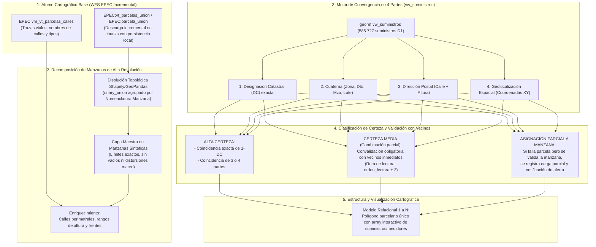

# 🗺️ Plan de Proyecto: Asignación Parcelaria Multivariada y Recomposición de Manzanas de Alta Resolución

## 1. Resumen Ejecutivo y Nuevo Vector de Acercamiento (Bottom-Up)

El presente proyecto formaliza una reingeniería profunda sobre la infraestructura de datos geoespaciales y comerciales de EPEC, transitando desde un enfoque **Top-Down** (basado en polígonos de manzanas macro de IDECOR que requerían recortes y bufferizado preventivo) hacia un **Vector de Acercamiento Bottom-Up** fundamentado en la parcela catastral oficial como unidad indivisible:

---

## 2. Decisiones de Diseño y Especificaciones del Usuario

A partir del proceso de consulta formal del Project Manager, se fijan las siguientes pautas directrices:

### A. Estrategia de Descarga: Ingesta Incremental con Tolerancia a Fallos
- **Mecanismo**: Pipeline en Python que divide el área objetivo en cuadrículas espaciales (BBOX chunks) o paginación indexada (`startIndex` / `maxFeatures`).
- **Persistencia Transaccional**: Cada bloque descargado se consolida inmediatamente en disco local (`.parquet` / `.geojson`), permitiendo reanudar descargas interrumpidas sin reprocesamiento redundante y minimizando la carga sobre `maaysp-ws.cba.gov.ar`.

### B. Matriz de Convergencia en 4 Partes y Niveles de Certeza
El cruce entre `georef.vw_suministros` y las parcelas descargadas opera sobre una matriz de 4 dimensiones analíticas:

| Dimensión Analítica | Campo Suministro (`vw_suministros`) | Campo Cartográfico (`vt_parcelas_union` / `calles`) | Tipo de Comparación |
| :--- | :--- | :--- | :--- |
| **1. DC Exacta** | `DC` (14 a 18 dígitos normalizados) | `nomenclatura` / `parcela` | Hash alfanumérico exacto |
| **2. Cuaterna Catastral** | `ZONA_CATASTRAL`, `DISTRITO_CATASTRAL`, `MANZANA_CATASTRAL`, `LOTE_CATASTRAL` | Subcampos de nomenclatura catastral | Coincidencia combinada de 4 campos |
| **3. Dirección Postal** | `CALLE` + `ALTURA` normalizados | `nombrecall` + rango numérico de parcela | Fuzzy matching toponímico + rango par/impar |
| **4. Geolocalización** | `LATITUD`, `LONGITUD` de suministro | `geom` (polígono parcelario) | `ST_Contains` / `Within` espacial |

#### Reglas de Decisión:
1. **Nivel 1 - Alta Certeza Directa**:
   - Coincidencia exacta de **1-DC**, O coincidencia concurrente de **3 o 4 dimensiones**.
   - Asignación parcelaria directa e irreversible.
2. **Nivel 2 - Certeza Media / Convalidación con Vecinos de Ruta**:
   - Coincidencia de 2 dimensiones (ej. Dirección + Geoloc, o Cuaterna + Geoloc).
   - Se activa la regla de vecindad operativa: se inspeccionan los suministros ancla inmediatos del mismo recorrido (`distrito`, `grupo_lectura`, `ruta_lectura`, `orden_lectura ± 3`). Si los vecinos confirman la traza o la manzana, se valida la asignación.
3. **Nivel 3 - Asignación Parcial de Manzana (Fallback & Alerta)**:
   - Casos donde la ambigüedad parcelaria no pueda disiparse pero la pertenencia a la Manzana Sintética sea inequívoca.
   - Se asigna el suministro a la Manzana, se etiqueta con el flag `ASIGNACION_PARCIAL_MANZANA = TRUE` y se emite la notificación en el reporte de excepciones.

### C. Modelo de Cardinalidad para Propiedad Horizontal (PH)
- **Estructura 1 a N**: La geometría parcelaria permanece como un polígono único.
- **Microdata Interactiva**: Cada parcela aloja un array de suministros vinculados (con número de medidor, NIS, titular y estado). Al interactuar con la parcela en el visor web, se despliega una tarjeta interactiva con la lista completa de unidades funcionales.

---

## 3. Asignación de Roles del Squad Ágil (Arquetipo A: GIS, Catastro & Rutas)

| Rol del Squad | Agente Especialista | Responsabilidades en el Proyecto |
| :--- | :--- | :--- |
| **Project Manager** | `Gemini 3.8 Flash High` | Orquestación general, definición y seguimiento de Sprints, control de DoD y reporte ejecutivo al usuario. |
| **Operador 1: Core GIS & WFS** | `Gemini 3.7 Flash High` (`ciencia-de-datos`) | Scripting de descarga incremental WFS chunked de `vt_parcelas_union`, disolución Shapely de manzanas sintéticas y extracción de frentes viales. |
| **Operador 2: Oracle & Dominio** | `Gemini 3.7 Flash High` (`arquitecto-sistemas-epec`) | Extracción y normalización de `vw_suministros`, motor de convergencia de 4 partes y algoritmo de vecindad de ruta $\pm 3$. |
| **Operador 3: QA & Cartografía** | `Gemini 3.7 Flash High` (`desarrollador-web-showroom`) | Validación de consistencia topológica, auditoría de asignaciones parciales y visor web Leaflet Canvas con soporte 1 a N para PHs. |

---

## 4. Plan de Sprints

### Sprint 1: Pipeline de Ingesta Incremental y Recomposición de Manzanas Sintéticas
- [x] **E1.1**: Desarrollo del script de descarga incremental WFS por bloques espaciales (BBOX / chunks) de `EPEC:vt_parcelas_union` y `EPEC:vm_vt_parcelas_calles`.
- [x] **E1.2**: Normalización geométrica y persistencia local en formato Parquet / GeoPackage con tolerancia a interrupciones de red.
- [x] **E1.3**: Pipeline de disolución topológica (`unary_union`) agrupado por nomenclatura de manzana para sintetizar la Capa Maestra de Manzanas de Alta Resolución.
- [x] **E1.4**: Enriquecimiento de atributos por manzana (calles perimetrales, rangos de alturas y superficie neta).

### Sprint 2: Motor de Convergencia en 4 Partes (Fase 1 - Alta Certeza)
- [x] **E2.1**: Extracción de `georef.vw_suministros` (Distrito 1) con normalización de DC, cuaterna, calle y altura.
- [x] **E2.2**: Implementación del motor de convergencia multivariada (DC exacta y coincidencia $\ge 3$ partes).
- [x] **E2.3**: Consolidación del primer lote de suministros ancla de Alta Certeza.

### Sprint 3: Propagación por Vecindad de Ruta (Orden $\pm 3$) y Casos Parciales
- [x] **E3.1**: Algoritmo de convalidación con vecinos inmediatos de la misma ruta de lectura (`orden_lectura ± 3`).
- [x] **E3.2**: Resolución de suministros ambiguos y etiquetado de Asignaciones Parciales a Manzana.
- [x] **E3.3**: Reporte estadístico de cobertura y matriz de excepciones.

### Sprint 4: Visor Geoespacial Interactivo Parcela-Suministro (1 a N) y Consolidación
- [x] **E4.1**: Generación del visor web Leaflet Canvas con capas conmutables: Manzanas Sintéticas de Alta Resolución, Parcelas y Suministros.
- [x] **E4.2**: Despliegue interactivo de PHs con tarjeta modal de suministros asociados.
- [ ] **E4.3**: Documentación formal, backups `.bak` y sincronización con GitHub.

---

## 5. Fase 2: Escalamiento Provincial Unificado (919.122 Parcelas y 1.208.097 Suministros)

- **Estado**: ✅ COMPLETADO Y VALIDADO PROVINCIALMENTE
- **Fecha de Ejecución**: 25 de Octubre de 2026
- **Resultados Globales**:
  - **953.367 registros parcelarios** descargados en 571 chunks sin timeouts.
  - **580.330 parcelas físicas únicas** consolidadas en 9 departamentos.
  - **33.655 Manzanas Sintéticas de Alta Resolución** sintetizadas en 55 particiones.
  - **1.208.097 suministros comerciales** evaluados mediante convergencia en 4 partes y propagación de ruta $\pm 3$.
  - **771.428 suministros en Alta Certeza (63.85% provincial)**.
  - **91.60% de Alta Certeza en Distrito 1 (Capital - 567.637 suministros)**.
  - **Visor Web Jerárquico Standalone** desplegado con carga diferida (60 FPS).
