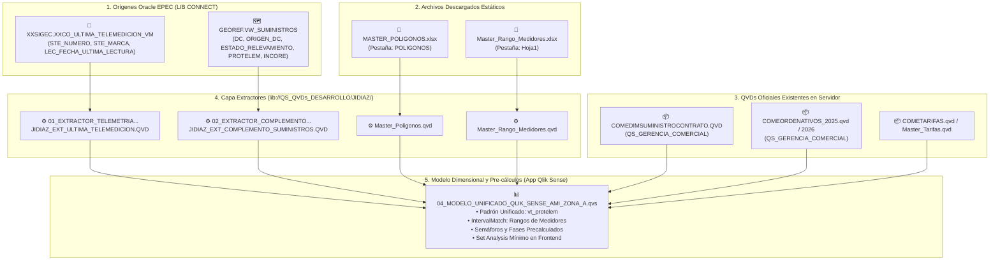

# 🚀 Conversión Integral de Power BI a Qlik Sense: Tablero MI - Zona A

Documento técnico elaborado por el **Squad Ágil Multi-Agente** bajo el liderazgo del **Copiloto Orquestador (Agente 11 / PM en Gemini 3.8 Flash High)** y el **Especialista en Ciencia de Datos (Agente 02)**, adoptando como Única Fuente de la Verdad (SSOT) todo el acervo de `docs/PROTELEM/PROJECTS/`.

---

## 🏗️ 1. Arquitectura de Carga y Flujo de Datos

---

## 📂 2. Inventario de Scripts Operativos Entregados

Todos los scripts ejecutables se encuentran disponibles en [`%USERPROFILE%\Downloads\`](file:///D:/Usuarios/jidiaz/Downloads/) y versionados en [`scripts/`](file:///C:/Users/jidiaz/.gemini/antigravity-ide/scratch/antigravity-agents-repository/scripts/):

1. **[`01_EXTRACTOR_TELEMETRIA_XXCO_ULTIMA_TELEMEDICION.qvs`](file:///D:/Usuarios/jidiaz/Downloads/01_EXTRACTOR_TELEMETRIA_XXCO_ULTIMA_TELEMEDICION.qvs)**:
   - Conexión: `Oracle_jidiaz_prod (epec_jidiaz)`.
   - Consulta: `XXSIGEC.XXCO_ULTIMA_TELEMEDICION_VM`.
   - Salida: `[lib://QS_QVDs_DESARROLLO/JIDIAZ/JIDIAZ_EXT_ULTIMA_TELEMEDICION.QVD]`.
2. **[`02_EXTRACTOR_COMPLEMENTO_COLUMNAS_ORACLE.qvs`](file:///D:/Usuarios/jidiaz/Downloads/02_EXTRACTOR_COMPLEMENTO_COLUMNAS_ORACLE.qvs)**:
   - Conexión: `Oracle_jidiaz_prod (epec_jidiaz)`.
   - Consulta: `GEOREF.VW_SUMINISTROS` para extraer `ESTADO_RELEVAMIENTO`, `DC`, `ORIGEN_DC`, `PROTELEM`, `TIPO_ORDENATIVO`, `INCORE`, coordenadas y catastro.
   - Salida: `[lib://QS_QVDs_DESARROLLO/JIDIAZ/JIDIAZ_EXT_COMPLEMENTO_SUMINISTROS.QVD]`.
3. **[`03_CARGA_ESTATICA_EXCEL_POLIGONOS_RANGOS.qvs`](file:///D:/Usuarios/jidiaz/Downloads/03_CARGA_ESTATICA_EXCEL_POLIGONOS_RANGOS.qvs)**:
   - Ingesta de `MASTER_POLIGONOS.xlsx` (pestaña `POLIGONOS`) $\rightarrow$ `Master_Poligonos.qvd`.
   - Ingesta de `Master_Rango_Medidores.xlsx` (pestaña `Hoja1`, fila 4) $\rightarrow$ `Master_Rango_Medidores.qvd`.
4. **[`04_MODELO_UNIFICADO_QLIK_SENSE_AMI_ZONA_A.qvs`](file:///D:/Usuarios/jidiaz/Downloads/04_MODELO_UNIFICADO_QLIK_SENSE_AMI_ZONA_A.qvs)**:
   - Script maestro de la app que orquesta los QVDs equivalentes de `QS_GERENCIA_COMERCIAL`, integra los dos extractores de desarrollo, ejecuta el `IntervalMatch` de medidores y precalcula los semáforos protelem.
5. **[`05_SPRINT2_SECCION_SUMINISTROS_MEDIDAS_Y_VISUALES.qvs`](file:///D:/Usuarios/jidiaz/Downloads/05_SPRINT2_SECCION_SUMINISTROS_MEDIDAS_Y_VISUALES.qvs)**:
   - Catálogo formal de variables de agregación, Set Analysis óptimo, dimensiones maestras y especificación de los 7 componentes visuales de la sección Suministros.

---

## 📊 3. Sprint 2: Sección Suministros (Métricas y Componentes Visuales)

| Componente Visual | Métrica / Expresión Qlik Sense | Equivalente DAX Power BI |
| :--- | :--- | :--- |
| **KPI Total Suministros** | `Count({1<ZONA={'A'}>} DISTINCT SUMINISTRO)` | `CALCULATE(DISTINCTCOUNT(SUMINISTRO), ALL(vt_protelem_))` |
| **KPI Suministros Selección** | `Count(DISTINCT SUMINISTRO)` | `DISTINCTCOUNT(vt_protelem_[SUMINISTRO])` |
| **KPI Suministros CLOU** | `Count({<TELEMEDIBLE={'CLOU'}>} DISTINCT SUMINISTRO)` | `CALCULATE(DISTINCTCOUNT(SUMINISTRO), TELEMEDIBLE="CLOU")` |
| **KPI Suministros NANSEN** | `Count({<TELEMEDIBLE={'NANSEN'}>} DISTINCT SUMINISTRO)` | `CALCULATE(DISTINCTCOUNT(SUMINISTRO), TELEMEDIBLE="NANSEN")` |
| **KPI Suministros CHUPETE** | `Count({<TELEMEDIBLE={'CHUPETE'}>} DISTINCT SUMINISTRO)` | `CALCULATE(DISTINCTCOUNT(SUMINISTRO), TELEMEDIBLE="CHUPETE")` |
| **KPI Común No Inteligente** | `Count({<TELEMEDIBLE={'OTROS'}>} DISTINCT SUMINISTRO)` | `CALCULATE(DISTINCTCOUNT(SUMINISTRO), TELEMEDIBLE="OTROS")` |
| **KPI Conectados Telemetría** | `Count({<Estado_Telemetria={'Ok'}>} DISTINCT SUMINISTRO)` | Filtro `Estado_Telemetria="Ok"` sobre `[sumis_select]` |
| **Pivot: Suministros x Tarifa/Clase** | Filas: `ZONA`, `TARIFA` \| Cols: `CLASE` \| Medida: `Count(DISTINCT SUMINISTRO)` | Matriz `ZONA`/`TARIFA` vs `CLASE` con recuento de suministros |
| **Pivot: Medidores x Marca/Plan** | Filas: `NOMBRES_TELEMEDIBLE`, `suministro_plan` \| Cols: `nombre_FASES` \| Medida: `Count(DISTINCT SUMINISTRO)` | Matriz `MARCA`/`PLAN` vs `FASES` con recuento de suministros |
| **Gráfico Temporal de Ejecución** | Dim: `AñoMes`, `Día` \| Medida: `Count({<EJECUTADOSvsPENDIENTES={'EJECUTADOS'}>} DISTINCT SUMINISTRO)` | Combo chart `FECHA_EJECUCION` vs recuento de ejecutados |
| **Tabla Detalle Operativa** | 27 columnas normalizadas con semaforización de celda: `If(Semaforo_protelem_color='Verde', RGB(40,167,69)...)` | Tabla `LISTADO DETALLES DE SUMINISTROS` |

---

## 📋 4. Sprint 3: Sección Ordenativos (Control y Gestión de Asignación)

Comprende la migración completa de las dos páginas operativas del informe Power BI:
1. **Página `Control de Ordenativos` (`25c8dd2c1083b40231b0`)**
2. **Página `Ordenativos` (`ReportSection158c797dac10109b5bd7`)**

### 4.1. Reglas de Negocio Precalculadas en Script (ETL)

Para erradicar la sobrecarga de DAX en tiempo de renderizado y minimizar el uso de Set Analysis complejo en el frontend, se incorporaron directamente en el script maestro ([`04_MODELO_UNIFICADO_QLIK_SENSE_AMI_ZONA_A.qvs`](file:///D:/Usuarios/jidiaz/Downloads/04_MODELO_UNIFICADO_QLIK_SENSE_AMI_ZONA_A.qvs)) y en ([`06_SPRINT3_SECCION_ORDENATIVOS_MEDIDAS_Y_VISUALES.qvs`](file:///D:/Usuarios/jidiaz/Downloads/06_SPRINT3_SECCION_ORDENATIVOS_MEDIDAS_Y_VISUALES.qvs)):

| Campo Calculado Qlik Sense | Expresión Qlik Script | Lógica DAX Original |
| :--- | :--- | :--- |
| `EJECUTADOSvsPENDIENTES` | `If(Len(Trim(ORD_RESULTADO)) = 0 or IsNull(ORD_RESULTADO), 'PENDIENTES', 'EJECUTADOS')` | `IF(vt_protelem_[ORD_RESULTADO]=BLANK(), "PENDIENTES", "EJECUTADOS")` |
| `ASIGNACION` | `If(ORD_SITUACION = 'P', 'ORDENATIVOS SIN ASIGNAR', If(ORD_SITUACION = 'I' and (Len(Trim(ORD_RESULTADO)) = 0 or IsNull(ORD_RESULTADO)), 'ORDENATIVOS ASIGNADOS SIN EJECUTAR', 'ORDENATIVOS EJECUTADOS'))` | `IF(ORD_SITUACION="P","ORDENATIVOS SIN ASIGNAR", IF(ORD_SITUACION="I" && ORD_RESULTADO=BLANK(),"ORDENATIVOS ASIGNADOS SIN EJECUTAR","ORDENATIVOS EJECUTADOS"))` |
| `FLAG_ORD_EJECUTADO` | `If(Len(Trim(ORD_RESULTADO)) > 0, 1, 0)` | Filtro DAX sobre `EJECUTADOS` |
| `FLAG_ORD_PENDIENTE` | `If(Len(Trim(ORD_RESULTADO)) = 0 or IsNull(ORD_RESULTADO), 1, 0)` | Filtro DAX sobre `PENDIENTES` |
| `FLAG_ORD_SIN_ASIGNAR` | `If(ORD_SITUACION = 'P', 1, 0)` | Filtro DAX sobre `ORDENATIVOS SIN ASIGNAR` |
| `FLAG_ORD_ASIG_SIN_EJEC`| `If(ORD_SITUACION = 'I' and (Len(Trim(ORD_RESULTADO)) = 0 or IsNull(ORD_RESULTADO)), 1, 0)` | Filtro DAX sobre `ORDENATIVOS ASIGNADOS SIN EJECUTAR` |
| `PERIODO_EJECUCION` | `Date(MonthStart(FECHA_EJECUCION), 'YYYY-MM')` | Jerarquía temporal de `FECHA_EJECUCION` |

### 4.2. Mapeo de Componentes Visuales

| Componente Visual | Hoja Qlik Sense | Métrica / Dimensión Qlik Sense |
| :--- | :--- | :--- |
| **KPI Ordenativos Ejecutados** | Control de Ordenativos / Gestión | `Count({<FLAG_ORD_EJECUTADO={1}>} DISTINCT SUMINISTRO)` |
| **KPI Ordenativos Pendientes** | Control de Ordenativos / Gestión | `Count({<FLAG_ORD_PENDIENTE={1}>} DISTINCT SUMINISTRO)` |
| **KPI Sin Asignar** | Gestión de Asignación | `Count({<FLAG_ORD_SIN_ASIGNAR={1}>} DISTINCT NUMERO_ORDENATIVO)` |
| **KPI Asignados Sin Ejecutar**| Gestión de Asignación | `Count({<FLAG_ORD_ASIG_SIN_EJEC={1}>} DISTINCT NUMERO_ORDENATIVO)` |
| **Pivot: Ejecución x Tipo Medidor** | Ambas Hojas | Filas: `EJECUTADOSvsPENDIENTES` \| Cols: `MedidorTipo` \| Medida: `Count(DISTINCT SUMINISTRO)` |
| **Combo Chart: Evolución Anual/Mensual** | Ambas Hojas | Dim: `PERIODO_EJECUCION` \| Barras: `Count({<FLAG_ORD_EJECUTADO={1}>} DISTINCT NUMERO_ORDENATIVO)` |
| **Combo Chart: Evolución Diaria** | Ambas Hojas | Dim: `DIA_EJECUCION` \| Barras: `Count({<FLAG_ORD_EJECUTADO={1}>} DISTINCT NUMERO_ORDENATIVO)` |
| **Mapa Georreferenciado** | Ambas Hojas | Lat/Long: `DC_LATITUD`, `DC_LONGITUD` \| Dim: `SUMINISTRO` \| Color por `EJECUTADOSvsPENDIENTES` o `ASIGNACION` |
| **Tabla 1: Detalle Operativo (17 cols)**| Control de Ordenativos | `NUMERO_ORDENATIVO`, `SECTOR_ASIGNADO`, `SECTOR_EJECUTANTE`, `FECHA_EJECUCION`, `ORD_RESULTADO`, `ORD_DATOS_RESULTADO`, `SUMINISTRO`, `RAZON_SOCIAL`, `PCT`, `DC_LATITUD`, `DC_LONGITUD`, `TIPO_ORDENATIVO`, `PROTELEM`, `MEDIDOR`, `OBSERVACIONES_MEDIDOR`, `CALLE`, `ALTURA` |
| **Tabla 2: Seguimiento Estados (9 cols)** | Ambas Hojas | `SUMINISTRO`, `CONTRATO`, `NUMERO_ORDENATIVO`, `ORD_ESTADO`, `ORD_SITUACION`, `ORD_RESULTADO`, `FECHA_GENERACION`, `FECHA_EJECUCION`, `SECTOR_EJECUTANTE` |

---

## 🧭 5. Roadmap de Sprints

- [x] **Sprint 1**: Extracción de Datos, Cruce de Catálogo QVD EPEC, Ingesta Estática Excel y Arquitectura Base.
- [x] **Sprint 2**: Sección Suministros (KPIs, Matrices Tarifarias y por Medidor, Tabla de Detalle y Filtros).
- [x] **Sprint 3**: Sección Ordenativos (Control de Ordenativos, Gestión de Asignación, Mapas y Seguimiento Operativo).
- [ ] **Sprint 4**: Sección Telemetría (Página `ReportSection5bc8ee0e61c683a81806`, análisis de última telemedida, histogramas y estados de comunicación).
- [ ] **Sprint 5**: Sección Relevamiento (Página `ReportSectiond4110ead790635916b9b`, estados de relevamiento, fotos, inconsistencias de campo y control de calidad).
- [ ] **Sprint 6**: Secciones Tarifas y Lecturas (Páginas `ReportSection5007fbda819c24e70b01` y `ReportSection5765ed7d9baec9ee31e9`).

