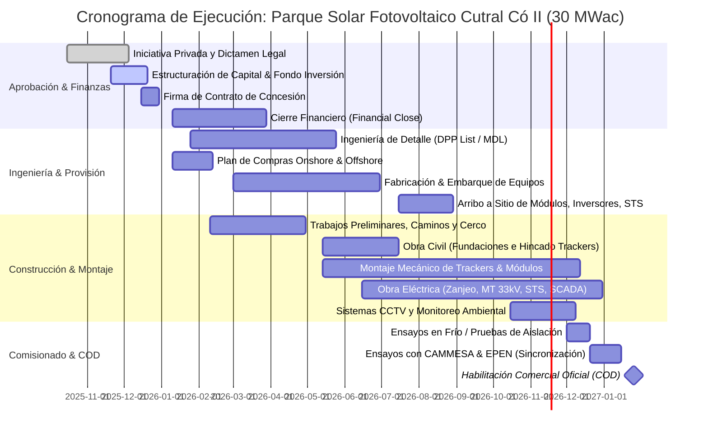

# ☀️ Proyecto Parque Solar Fotovoltaico Cutral Có II (30 MWac / 36.29 MWdc)
### Memoria Técnica Integral, Análisis del Data Room, Estructuración Legal y Cronograma de Ejecución

- **Ubicación Física del Data Room Original**: [`C:\Users\majon\Downloads\Data Room Cutral Co II - FCS`](file:///C:/Users/majon/Downloads/Data%20Room%20Cutral%20Co%20II%20-%20FCS)
- **Repositorio Central**: [`https://github.com/inventarioenergycpy/antigravity-agents-repository.git`](https://github.com/inventarioenergycpy/antigravity-agents-repository.git)
- **Proponente y Autoría de Ingeniería**: Consorcio **FCS Ingeniería SRL** (Ing. Martín Nostrala) & **Sol Litio SA** / **VR Austral LLC**.
- **Acuerdo de Confidencialidad (NDA)**: Suscrito el **26 de octubre de 2026** entre Martín Nostrala y la Parte Receptora integrada por Carlos Luis Percossi, Carlos Alejandro Castagnola, Javier Ignacio Díaz (Antigravity IDE / Área Sostenible) y Daniel Marcelo González.

---

## 🎯 1. Resumen Ejecutivo del Proyecto

El **Parque Solar Fotovoltaico Cutral Có II (PSFV Cutral Có)** es un proyecto *Utility-Scale* de generación renovable de **30 MWac** de potencia nominal en corriente alterna y **36,29 MWdc (36.290 kWp)** en corriente continua, proyectado en la localidad de Cutral Có, Departamento Confluencia, Provincia del Neuquén, Argentina.

El proyecto representa una **ampliación estratégica directa** de la capacidad de generación solar municipal de Cutral Có, escalando de los **3,5 MWp operativos actuales** a **33,5 MWp consolidados** (y con potencial de expansión a 100 MW). 

### Puntos Fuertes Diferenciales del Proyecto:
1. **Riesgo de Venta Mitigado a Cero**: Carta de intención vinculante de la cooperativa distribuidora local **COPELCO** para la compra del 100% de la energía eléctrica inyectada a tarifa acordada, complementado con la opción de despacho al **Mercado a Término de Energías Renovables (MATER)**.
2. **Acceso a Transporte Garantizado (Barra 33 kV en ET Cutral Có)**: Punto de Interconexión #151 del EPEN con reserva y capacidad disponible de evacuación sin restricciones de saturación en alta tensión.
3. **Estatus de Agente Generador del MEM**: El Municipio de Cutral Có es el **primer y único municipio de Argentina habilitado como Agente Generador del Mercado Eléctrico Mayorista (MEM)** ante CAMMESA por la Secretaría de Energía de la Nación.
4. **Terreno Aportado por el Municipio**: Predio de **40 hectáreas** en el Lote JA4 sobre el margen norte de la Ruta Nacional 22, cedido en usufructo/alquiler durante la vida útil del proyecto (30 años prorrogables por 20 años más).
5. **Canon Municipal Atractivo**: Pago del **6% de la facturación bruta mensual** al Municipio de Cutral Có, preservando la indemnidad del patrimonio público bajo el principio de riesgo empresario (sin garantías de repago estatal).

---

## 📐 2. Ficha Técnica y Especificaciones de Ingeniería Básica

| Parámetro de Diseño | Valor Específico de Proyecto | Unidad / Norma de Referencia |
| :--- | :---: | :--- |
| **Potencia Nominal en Inversores (AC)** | **30.000** | **kVA / kWac** (con $\cos \varphi = 0,90 - 1,00$) |
| **Potencia Pico Instalada (DC)** | **36.290** | **kWp / MWdc** (STC: 1000 W/m², 25°C, AM 1.5) |
| **Relación de Sobredimensionamiento (DC/AC Ratio)** | **1,210** | Óptimo tecno-económico para recurso patagónico |
| **Módulos Fotovoltaicos** | **Trina Solar Vertex TSM-NEG-21C-20-720** | 720 Wp Bifacial N-Type TOPCon, 132 celdas |
| **Cantidad Total de Módulos** | **50.400** | Módulos (28 módulos por string) |
| **Tensión Máxima del Sistema DC** | **1.500** | Vcc (Cumplimiento IEC 61215 / IEC 61730) |
| **Inversores de String** | **Huawei SUN2000-330KTL-H1** | 330 kWac nominal a 800 Vca, IP66, 6 MPPTs |
| **Centros de Transformación (Smart Transformer Stations)** | **Huawei STS-9000K-H1 (3 u.) + STS-3000K-H1 (1 u.)** | 3 x 9.000 kVA + 1 x 3.150 kVA (800 V a 33 kV) |
| **Estructuras de Soporte (Trackers)** | **ARCTECH Skysmart II Single Axis Tracker (2P)** | 900 seguidores solares (configuración 2x28 módulos) |
| **Paso Este-Oeste (Pitch entre Trackers)** | **7,00** | metros (Optimizado para evitar inter-sombras) |
| **Algoritmo de Movimiento** | **Backtracking Inteligente + Modo Flag de Viento** | Rango angular $\pm 60^\circ$, posición horizontal ante viento |
| **Línea de Evacuación de MT** | **33 kV Doble Terna Subterránea** | Hacia Punto de Interconexión #151 (ET Cutral Có) |
| **Celdas de Media Tensión (Switchgear)** | **Aislamiento en SF6 en cuba estanca de acero inox** | 2 celdas entrada, 2 salida, 2 medición, 1 SSAA |
| **Vida Útil de Diseño** | **30 años** | Degradación contractual $< 0,40\%$ anual |

---

## 🗺️ 3. Emplazamiento, Topografía, Viento y Sismicidad

### 3.1. Localización y Coordenadas
- **Localidad**: Cutral Có, Departamento Confluencia, Provincia del Neuquén.
- **Predio**: Margen norte de la **Ruta Nacional 22**, Lote JA4 (Plano de mensura 8224-EXPM 22214/2021-0).
- **Superficie Afectada**: **40 hectáreas** reservadas exclusivamente para la planta generadora, caminos perimetrales e instalaciones auxiliares.
- **Georreferenciación WGS 84**:
  - **Latitud**: $-38.9369265^\circ$ S
  - **Longitud**: $-69.2479557^\circ$ O
  - **Altitud Media**: **646 msnm** (relieve estepario patagónico entre 569 y 701 msnm).
  - **Pendiente Promedio del Terreno**: $1,5\%$ en sentido Este-Oeste y $1,5\%$ en sentido Norte-Sur (óptimo para hincado de perfiles sin movimientos masivos de suelo).

### 3.2. Condiciones Geotécnicas y Riesgo Sísmico
- **Clasificación Sísmica (INPRES-CIRSOC 103)**: **Zona Sísmica 1** (*Peligrosidad Sísmica Reducida*).
- **Perfil de Suelo**:
  - Estratos I y II: Suelos Tipo 3 - Sitio SE (arenas y gravas eólicas no cohesivas).
  - Estrato III: Suelos Tipo 2 - Sitio SD.
  - **Potencial de Licuación**: Muy bajo / nulo bajo el sismo de diseño reglamentario.

### 3.3. Régimen de Vientos (CIRSOC 102)
- **Dirección Predominante**: Cuadrante Oeste y Sudoeste durante el $40\%$ a $50\%$ del tiempo anual.
- **Velocidades Medias**: Varían de 8 km/h en invierno (julio) a 16 km/h en verano (diciembre), con ráfagas máximas características de la meseta neuquina.
- **Medida de Mitigación Estructural**: Trackers ARCTECH Skysmart II programados para posicionamiento en **Modo Bandera / Stow horizontal ($0^\circ$)** ante velocidades de viento sostenidas $\ge 60\text{ km/h}$, garantizando la integridad aeroelástica de las matrices fotovoltaicas.

---

## ☀️ 4. Estudio del Recurso Solar y Simulación Energética (PVSyst 8.0.14)

El balance energético fue simulado utilizando el software estándar de la industria **PVSyst 8.0.14**, comparando dos bases de datos satelitales reconocidas para mitigar la incertidumbre estadística:

### 4.1. Comparativa de Generación Anual y Performance Ratio (PR)

| Parámetro de Producción | Base Satelital Meteonorm 8.2 | Base Satelital PVGis 5.3 (Principal) |
| :--- | :---: | :---: |
| **Energía Inyectada Año 1 (E_Grid)** | **74.735 MWh/año** | **80.967 MWh/año** |
| **Performance Ratio (PR) Año 1** | **84,84%** | **82,92%** |
| **Producción Específica** | $2.059\text{ kWh/kWp/año}$ | $2.231\text{ kWh/kWp/año}$ |
| **Energía Inyectada Año 10** | $71.802\text{ MWh/año}$ | $78.311\text{ MWh/año}$ |
| **Energía Inyectada Año 25** | $66.529\text{ MWh/año}$ | $72.564\text{ MWh/año}$ |
| **Degradación Anual del Módulo** | $-0,40\%\text{ anual}$ | $-0,40\%\text{ anual}$ |

### 4.2. Análisis de Probabilidad de Excedencia (P50 - P90 - P95)
Considerando una variabilidad climática global de **5,32 GWh**:
- **P50 (Probabilidad 50% / Caso Base)**: **72,49 GWh / año**
- **P90 (Probabilidad 90% / Caso Conservador Bancable)**: **68,91 GWh / año**
- **P95 (Probabilidad 95% / Límite de Cobertura de Deuda)**: **65,67 GWh / año**

### 4.3. Desglose del Árbol de Pérdidas de la Planta (System Losses)
1. Pérdidas por irradiancia global y sombras lejanas del horizonte (Far Shading): $-0,6\%$.
2. Modificador del Ángulo de Incidencia (IAM): $-1,8\%$.
3. Suciedad superficial (Soiling patagónico con limpieza programada): $-2,5\%$.
4. Pérdidas térmicas de operación en celda (temperatura de módulo vs STC): $-6,8\%$.
5. Pérdida LID (Light Induced Degradation) y mismatch de módulos TOPCon: $-1,2\%$.
6. Pérdidas óhmicas en cableado de continua (DC): $-1,1\%$.
7. Rendimiento del inversor Huawei SUN2000: $-1,4\%$ (eficiencia europea 98,6%).
8. Pérdidas de cableado CA y transformador elevador 800V/33kV: $-1,3\%$.
9. Indisponibilidad global de planta y mantenimiento preventivo: $-1,5\%$.

---

## 🏛️ 5. Marco Normativo, Institucional y Estructura Legal

### 5.1. Instrumentos Jurídicos Municipales y Provinciales
- **Ordenanza Municipal N° 2959/2025** (Sancionada el 24 de Septiembre de 2025 por el Concejo Deliberante de Cutral Có):
  - Declara de **interés público y utilidad pública municipal**, sin afectación a servicio público de distribución, la construcción, operación y mantenimiento del parque de 30 MWp.
  - Faculta al Departamento Ejecutivo a suscribir contratos de concesión, ceder el terreno de 40 ha, otorgar exenciones impositivas de tasas municipales y gestionar autorizaciones ambientales.
  - Establece la obligación de incorporar mano de obra local en el marco de la **transición energética justa** y contratación prioritaria de proveedores y cooperativas locales.
- **Régimen de Iniciativa Privada Municipal (Ordenanzas 1734/99, 1749/99 y 2134/07)**:
  - Marco regulatorio procedimental para la admisión formal de la propuesta presentada por el consorcio FCS - Sol Litio.
- **Ley Provincial de Neuquén N° 2685**: Régimen de concesiones de obras y servicios públicos de la Provincia del Neuquén.

### 5.2. Marco Regulatorio Nacional
- **Ley Nacional N° 27.742 (Ley Bases)**: Anexo III *Régimen de Iniciativa Privada Nacional* y Título VII *Régimen de Incentivo para Grandes Inversiones (RIGI)*.
- **Ley Nacional N° 24.065**: Marco Regulatorio Eléctrico Nacional (despacho por mérito económico y libre acceso a la red de transporte).
- **Leyes Nacionales N° 26.190 y N° 27.191 (Decreto 531/2016)**: Régimen de Fomento de Energías Renovables, exenciones aduaneras para bienes de capital y operación en el Mercado a Término de Energías Renovables (MATER).

### 5.3. Principio Rector de Riesgo Empresario
La propuesta de Iniciativa Privada establece expresamente que:
- La concesión es a **exclusivo riesgo y costo del concesionario**.
- El Municipio de Cutral Có **no compromete avales, garantías de repago de deuda ni ingresos mínimos garantizados**.
- Los ingresos del Municipio consisten en un canon directo del **6% de la facturación bruta mensual libre de costos**.

---

## 📅 6. Cronograma Maestro y Carta Gantt (Duración: 14 Meses)

---

## 📁 7. Inventario Exhaustivo de Documentos del Data Room

| Archivo / Subcarpeta | Formato / Tamaño | Contenido y Relevancia Técnica |
| :--- | :---: | :--- |
| [`PSFV Cutral Co - DRAFT.pdf`](file:///C:/Users/majon/Downloads/Data%20Room%20Cutral%20Co%20II%20-%20FCS/PSFV%20Cutral%20Co%20-%20DRAFT.pdf) | PDF (28,6 MB / 44 págs.) | **Memoria Técnica Oficial NQN-CC-30-MT-PSFV-01**. Diseños de string, PVSyst 8.0.14, Huawei SUN2000, Trina 720Wp, ARCTECH Skysmart II, interconexión ET Cutral Có en 33 kV. |
| [`Rta Parque Solar Cutral CO 30 MW a Sol Litio.pdf`](file:///C:/Users/majon/Downloads/Data%20Room%20Cutral%20Co%20II%20-%20FCS/Rta%20Parque%20Solar%20Cutral%20CO%2030%20MW%20a%20Sol%20Litio.pdf) | PDF (3,2 MB / 3 págs.) | **Nota I.M. N° 738/2025 del Municipio de Cutral Có**. Respuesta formal del Jefe de Gabinete comprometiendo el terreno, acceso a la ET Cutral Có, rol como Agente MEM y garantía de compra COPELCO. |
| [`SOLICITUD DE INCIATIVA PRIVADA-Municipio de Cutralco.docx`](file:///C:/Users/majon/Downloads/Data%20Room%20Cutral%20Co%20II%20-%20FCS/Iniciativa%20Privada%20Docs/SOLICITUD%20DE%20INCIATIVA%20PRIVADA-Municipio%20de%20Cutralco.docx) | DOCX / PDF (2,4 MB) | **Pliego de Presentación Formal de la Iniciativa Privada**. Modelo de concesión a 30 años, canon del 6%, respeto estricto del riesgo empresario, estructura fiduciaria y de O&M. |
| [`MCC Ordenanza 2959 IP PSFV\PSFV Cutral Co Interes Publico 2959.pdf`](file:///C:/Users/majon/Downloads/Data%20Room%20Cutral%20Co%20II%20-%20FCS/Iniciativa%20Privada%20Docs/MCC%20Ordenanza%202959%20IP%20PSFV/PSFV%20Cutral%20Co%20Interes%20Publico%202959.pdf) | PDF (152 KB / 4 págs.) | **Ordenanza N° 2959/2025**. Declaración de utilidad e interés público municipal por el Concejo Deliberante, autorización de cesión de tierras y exención de tasas. |
| [`MCC Ordenanza 2959 IP PSFV\2959-ANEXO-I.pdf`](file:///C:/Users/majon/Downloads/Data%20Room%20Cutral%20Co%20II%20-%20FCS/Iniciativa%20Privada%20Docs/MCC%20Ordenanza%202959%20IP%20PSFV/2959-ANEXO-I.pdf) | PDF (27,5 MB / 28 págs.) | **Anexo I Oficial Protocolizado**. Antecedentes técnicos, mensura catastral del Lote JA4 y articulado de adjudicación. |
| [`MCC Ordenanza 2959 IP PSFV\2959-ANEXO-II.pdf`](file:///C:/Users/majon/Downloads/Data%20Room%20Cutral%20Co%20II%20-%20FCS/Iniciativa%20Privada%20Docs/MCC%20Ordenanza%202959%20IP%20PSFV/2959-ANEXO-II.pdf) | PDF (1,7 MB / 3 págs.) | **Anexo II Oficial**. Firma de las autoridades legislativas (San Martín / Bivanco). |
| [`Carta Gantt Tentativa - PSFV Cutral-Co 36.29 Signed MW.pdf`](file:///C:/Users/majon/Downloads/Data%20Room%20Cutral%20Co%20II%20-%20FCS/Iniciativa%20Privada%20Docs/Carta%20Gantt%20Tentativa%20-%20PSFV%20Cutral-Co%2036.29%20Signed%20MW.pdf) | PDF (200 KB / 1 pág.) | **Cronograma Gantt Contractual de 28 Tareas**. Desde presentación de IP (05/12/2025) hasta comisionado e inyección comercial. |
| [`Proyect Fotovoltaico 30MW Neuquen Argentina - NDA - 26-10-2026 - FIRMAS copy.pdf`](file:///C:/Users/majon/Downloads/Data%20Room%20Cutral%20Co%20II%20-%20FCS/Proyect%20Fotovoltaico%2030MW%20Neuquen%20Argentina%20-%20NDA%20-%2026-10-2026%20-%20FIRMAS%20copy.pdf) | PDF (2,2 MB / 6 págs.) | **Acuerdo de Confidencialidad Bilingüe (NDA)**. Firmado entre Martín Nostrala (FCS) y Carlos Percossi, Carlos Castagnola, Javier Ignacio Díaz y Daniel Marcelo González. |
| [`Iniciativa Privada Docs\ANEXO III REGIMEN DE INICIATIVA PRIVADA.pdf`](file:///C:/Users/majon/Downloads/Data%20Room%20Cutral%20Co%20II%20-%20FCS/Iniciativa%20Privada%20Docs/ANEXO%20III%20REGIMEN%20DE%20INICIATIVA%20PRIVADA.pdf) | PDF (100 KB / 4 págs.) | **Decreto Reglamentario Anexo III Ley 27.742**. Procedimiento nacional de presentación, admisibilidad y preferencia del iniciador privado. |
| [`Iniciativa Privada Docs\Ordenanza IP Municipal\*.pdf`](file:///C:/Users/majon/Downloads/Data%20Room%20Cutral%20Co%20II%20-%20FCS/Iniciativa%20Privada%20Docs/Ordenanza%20IP%20Municipal) | PDFs (4 archivos) | **Ordenanzas Municipales N° 1734/99, 1749/99 y 2134/07**. Normativa histórica de iniciativas privadas y concesiones en Cutral Có. |
| [`Iniciativa Privada Docs\Ref Docs NQN\*.docx`](file:///C:/Users/majon/Downloads/Data%20Room%20Cutral%20Co%20II%20-%20FCS/Iniciativa%20Privada%20Docs/Ref%20Docs%20NQN) | DOCX (4 archivos / ~21 MB) | **Precedentes Provinciales en Neuquén**. Modelo de Línea de Alta Tensión 132 kV Las Lajas - Chos Malal (Gezhouba-Yutong) y checklist de documentos para IP. |

---

## 🔗 Referencias Cruzadas en la Bóveda Obsidian
- [[00-Dashboard-MOC]]
- [[docs/Agentes/13-Desarrollador-Parques-Solares-Renovables]]
- [[docs/Agentes/01-Analista-Financiero]]
- [[docs/Agentes/02-Ciencia-de-Datos]]
- [[docs/Agentes/11-Copiloto-Orquestador-de-Skills]]
- [[docs/Modelos/Modelo-Ingenieria-Parques-Solares-Renovables-Argentina]]
- [[docs/Proyectos/2026-10-14_asesoramiento-parque-solar-fotovoltaico]]

