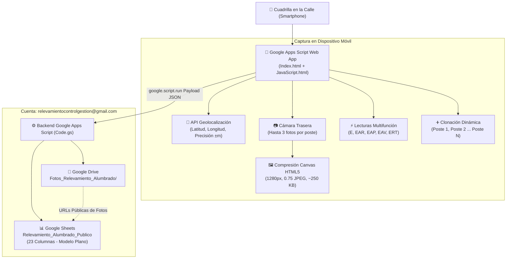

# ⚡ Relevamiento de Alumbrado Público Conectado a Medidores

Ficha técnica del desarrollo para cuadrillas operativas de campo encargadas del relevamiento del parque de luminarias de alumbrado público y su vinculación con medidores de energía eléctrica instalados.

---

## 📌 Metadatos del Proyecto
- **Estado**: ✅ **100% Operativo y Validado en Campo**
- **Enlace Web App (Google Apps Script)**: [https://script.google.com/macros/s/AKfycbxVGx8m5z6aRxQG7CJBp403RGS4e7jhpi__3OMvVQkZ3a8guJDd5CUlf7uI53R4N3qB/exec](https://script.google.com/macros/s/AKfycbxVGx8m5z6aRxQG7CJBp403RGS4e7jhpi__3OMvVQkZ3a8guJDd5CUlf7uI53R4N3qB/exec)
- **Enlace Web App (GitHub Pages - Sin login Google)**: [https://protelem-epec.github.io/relevamiento-alumbrado-publico-medidores/](https://protelem-epec.github.io/relevamiento-alumbrado-publico-medidores/)
- **Cuenta de Google Asignada**: `relevamientocontrolgestion@gmail.com`
- **Ubicación del Proyecto Local**: [`D:/Proyectos/relevamiento-alumbrado-publico-medidores`](file:///D:/Proyectos/relevamiento-alumbrado-publico-medidores)
- **Repositorio Remoto GitHub**: [PROTELEM-EPEC/relevamiento-alumbrado-publico-medidores](https://github.com/PROTELEM-EPEC/relevamiento-alumbrado-publico-medidores)
- **Organización GitHub**: `PROTELEM-EPEC`
- **Ruta Local**: `D:\Proyectos\relevamiento-alumbrado-publico-medidores`
- **Rama Activa**: `main`
- **Base de Datos Tabular**: Google Sheets (`Relevamiento_Alumbrado_Publico` - Hoja `Relevamientos_Plano`)
- **Almacenamiento de Fotos**: Google Drive (`Fotos_Relevamiento_Alumbrado`)
- **Arquitectura**: Google Apps Script Web App (HTML5 + CSS + JS ES6 + DriveApp + SpreadsheetApp)
- **Modo de Operación**: 100% Mobile-First para cuadrilla en la calle.

---

## 🏗️ Arquitectura y Componentes Clave

---

## 📋 Modelo de Datos Plano Normalizado (17 Columnas en Google Sheets)
La estructura consolida una fila por cada poste relevado repitiendo los datos del medidor de cabecera:
1. ID_Registro (UUID)
2. Timestamp_Carga
3. Fecha_Relevamiento
4. Numero_Medidor
5. Poste_Numero (1, 2, ... N)
6. Cantidad_Lamparas (≥ 1)
7. Tipo_Luminaria (LED, SAP, Mercurio, Mezcladora, Otro)
8. Potencia_Luminaria (50W, 100W, 150W, 200W, 250W, Opcional)
9. Estado_Luminaria (Encienden Todas, Apagada, Parcial, Titilando)
10. Latitud_GPS
11. Longitud_GPS
12. Precision_GPS_m
13. Foto_1_URL (Google Drive)
14. Foto_2_URL (Google Drive)
15. Foto_3_URL (Google Drive)
16. Observaciones_Poste
17. Total_Postes_Medidor

---

## 🛡️ Optimizaciones Recientes (Versión 2.1)
- **Persistencia Continua Local (LocalStorage Anti-Pérdida)**: Si el usuario actualiza la página o el celular reinicia el navegador para liberar RAM, la Web App restaura de forma automática e íntegra el relevamiento en curso (datos de medidor, postes, selecciones de tecnología/potencia, fotos y coordenadas GPS). Muestra un banner informativo con opción de descarte.
- **Selector de Potencia de Luminarias en Watts**: Menú desplegable opcional inmediatamente posterior a la tecnología de luminaria con los valores `50W`, `100W`, `150W`, `200W` y `250W`.

---

## 🔗 Enlaces a Recursos del Proyecto
- [Directorio Local del Proyecto](file:///D:/Proyectos/relevamiento-alumbrado-publico-medidores)
- [Instructivo Paso a Paso de Despliegue](file:///D:/Proyectos/relevamiento-alumbrado-publico-medidores/INSTRUCTIVO_DESPLIEGUE_GOOGLE.md)
- [Guía Operativa Ilustrada Markdown](file:///D:/Proyectos/relevamiento-alumbrado-publico-medidores/docs/guia_operativa_paso_a_paso.md)
- [Guía Oficial en Archivo Word (.docx)](file:///D:/Proyectos/relevamiento-alumbrado-publico-medidores/docs/Guia_Paso_a_Paso_Relevamiento_Alumbrado_Publico.docx) (o en [Descargas](file:///C:/Users/jidiaz/Downloads/Guia_Paso_a_Paso_Relevamiento_Alumbrado_Publico.docx))
- [Plantilla de Mensaje de Correo Electrónico](file:///D:/Proyectos/relevamiento-alumbrado-publico-medidores/docs/Mensaje_Email_Relevamiento_Alumbrado.md) (o en [Descargas](file:///C:/Users/jidiaz/Downloads/Mensaje_Email_Relevamiento_Alumbrado.txt))
- [Galería de Capturas de Pantalla Móvil](file:///D:/Proyectos/relevamiento-alumbrado-publico-medidores/docs/img_guia)
- [Instructivo Paso a Paso de Despliegue](file:///D:/Proyectos/relevamiento-alumbrado-publico-medidores/INSTRUCTIVO_DESPLIEGUE_GOOGLE.md)
- [Especificación Funcional y Diccionario](file:///D:/Proyectos/relevamiento-alumbrado-publico-medidores/docs/especificacion_funcional.md)
- [Suite de Pruebas Deterministas](file:///D:/Proyectos/relevamiento-alumbrado-publico-medidores/tests/test_payload_validation.py)
- [Código Backend (Code.gs)](file:///D:/Proyectos/relevamiento-alumbrado-publico-medidores/src/Code.gs)
- [Bundle Todo-en-Uno para Apps Script](file:///D:/Proyectos/relevamiento-alumbrado-publico-medidores/src/Bundle_Standalone_AppsScript.html)

