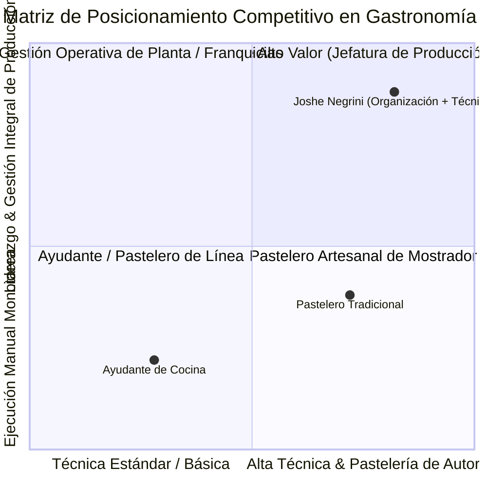

# 🧭 Diagnóstico Laboral y Radar de Oportunidades: Joshe Negrini

- **Perfil Evaluado**: [Joshe Negrini](https://ar.linkedin.com/in/joshe-negrini)
- **Especialidad Destacada**: **Altas destrezas en la organización integral, planificación y gestión gastronómica de pastelería**.
- **Agente Evaluador**: `[[docs/Agentes/14-Investigador-Mercado-Laboral-Talento|Agente 14: Investigador de Talento y Mercado Laboral]]`
- **Suite de Software**: [`D:\Proyectos\career-market-intelligence`](file:///D:/Proyectos/career-market-intelligence)
- **Dashboard Interactivo Local**: [`D:\Proyectos\career-market-intelligence\output\joshe_negrini\dashboard_mercado_laboral.html`](file:///D:/Proyectos/career-market-intelligence/output/joshe_negrini/dashboard_mercado_laboral.html)

---

## 📊 1. Resumen Ejecutivo y Posicionamiento

> [!NOTE]
> Profesional gastronómico con destacadas destrezas en la organización integral, planificación y gestión de pastelería a escala comercial y artesanal. Combina un refinado criterio técnico en la elaboración dulce con una sólida capacidad de liderazgo operativo: control de escandallos y mermas, gestión eficiente de materias primas, estandarización de recetas para múltiples puntos de venta y cumplimiento estricto de normas de inocuidad y bromatología (BPM/HACCP).

### Roles Objetivo de Mayor Compatibilidad (Fit >= 80%)
1. **Jefe/a de Pastelería para Central de Producción / Dark Kitchen** (Fit: **100.0%**)
2. **Encargado/a de Producción y Calidad Gastronómica para Franquicias** (Fit: **100.0%**)
3. **Head Pastry Chef / Pastry Supervisor en Cruceros Internacionales / Resorts de Lujo** (Fit: **100.0%**)
4. **Chef Pastelero / Jefe de Partida en Hotelería 5 Estrellas & Catering de Eventos** (Fit: **83.3%**)

---

## 📈 2. Matriz FODA Gastronómica

- **Fortaleza Crítica**: En el mercado gastronómico abunda la mano de obra con técnica manual pero **escasean perfiles con capacidad organizativa y liderazgo de costos**. La habilidad de coordinar cuadrillas, calcular escandallos y evitar quiebres de stock posiciona a Joshe en el cuadrante superior derecho de mayor cotización.
- **Debilidad a Subsanar**: Su perfil público de LinkedIn requiere optimización urgente del titular y la inclusión de métricas cuantificadas (volumen diario de piezas, reducción porcentual de mermas, tamaño de la brigada liderada).

---

## 💰 3. Benchmarks Salariales del Sector (2025–2026)

| Puesto / Ámbito | Rango Salarial Estimado | Características |
| :--- | :--- | :--- |
| **Jefe/a de Pastelería (Planta Central / Fábrica)** | **$1.400.000 – $2.100.000 ARS/mes netos + Bonos** | Cadenas de Alta Gama, Dark Kitchens Centrales |
| **Encargado/a de Producción (Franquicias)** | **$1.200.000 – $1.800.000 ARS/mes netos** | Empresas Alimenticias, Panaderías y Cafeterías |
| **Chef Pastelero / Jefe de Partida (Hotelería 5*)** | **$1.500.000 – $2.400.000 ARS/mes netos + Propinas** | Hoteles 5 Estrellas (Faena, NH, Minor), Bodegas |
| **Head Pastry Chef (Cruceros Internacionales)** | **$2.200 – $3.600 USD/mes netos** | Libres de gastos (Alojamiento y comidas 100% cubiertos) |

---

## 🎯 4. Radar de Búsqueda Activa (Enlaces Directos)

- [LinkedIn Jobs - Jefatura de Pastelería y Producción](https://www.linkedin.com/jobs/search/?keywords=%28%22Jefe+de+Pasteleria%22+OR+%22Chef+Pastelero%22+OR+%22Encargado+de+Pasteleria%22%29+AND+%28%22Produccion%22+OR+%22Planta%22+OR+%22Central%22%29&f_WT=2)
- [LinkedIn Jobs - Organización Gastronómica (Costos, Stock, BPM)](https://www.linkedin.com/jobs/search/?keywords=%28%22Encargado+de+Pasteleria%22+OR+%22Coordinador+Gastronomico%22+OR+%22Lider+de+Produccion%22%29+AND+%28%22Stock%22+OR+%22Costos%22+OR+%22BPM%22%29&f_WT=2)
- [Indeed Argentina - Pastelería en Hotelería y Catering](https://www.indeed.com/jobs?q=%28%22Pastry+Chef%22+OR+%22Jefe+de+Partida%22+OR+%22Pasteleria%22%29+AND+%28%22Hotel%22+OR+%22Catering%22+OR+%22Eventos%22%29&l=Argentina)
- [Google Jobs - Oportunidades Internacionales y Cruceros](https://www.google.com/search?q=%28%22Head+Pastry+Chef%22+OR+%22Pastry+Supervisor%22+OR+%22Pastelero%22%29+AND+%28%22Cruise%22+OR+%22Resort%22+OR+%22International%22%29+jobs&ibp=htl;jobs)

