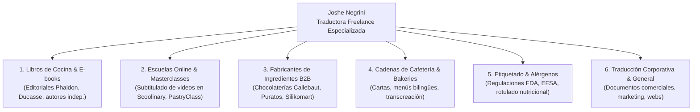
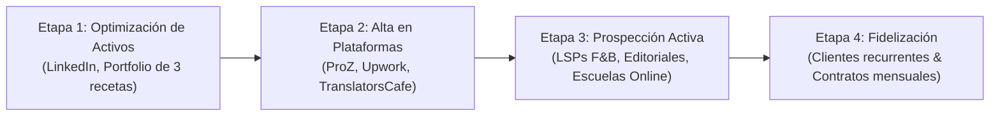

# Ficha Técnica y Estrategia de Inserción Laboral: Traductora Freelance Remota con Especialización en Pastelería y Gastronomía

- **Candidata / Perfil**: Joshe Negrini ([Perfil de LinkedIn](https://www.linkedin.com/in/joshe-negrini/))
- **Objetivo Profesional**: Inserción y consolidación en el mercado internacional como **Traductora a Distancia Freelance** (USD).
- **Factor Diferencial Clave**: **Experticia Profesional en Pastelería y Gastronomía Dulce**.
- **Fecha de Análisis**: 2026-11-04
- **Agente Responsable**: Agente 14 (`career-market-intelligence`) en articulación con el PM y el Squad Ágil.

---

## 📌 1. Diagnóstico de Mercado y Veredicto sobre la Habilidad en Pastelería

### ¿Aporta valor sumar la pastelería como habilidad?
> **VEREDICTO: APORTA UN VALOR ESTRATÉGICO Y ECONÓMICO EXTRAORDINARIO.**
> En el mercado global de traducción freelance (2024–2026), los traductores generalistas enfrentan una feroz comoditización y presión de precios (\$0.03 a \$0.05 USD/palabra) debido a herramientas de traducción automática no supervisadas. Sin embargo, la **traducción culinaria y de pastelería (*Culinary Translation & Transcreation*)** es uno de los nichos más cotizados y mejor remunerados (**\$0.08 a \$0.18+ USD/palabra** y **\$30 a \$60 USD/hora**).

### ¿Por Qué la Pastelería es un Nicho de Oro en Traducción?
1. **La Pastelería es Química de Alta Precisión**: A diferencia de la cocina salada ("a ojo"), la pastelería requiere proporciones moleculares exactas. Un traductor generalista suele cometer errores críticos como traducir *baking powder* como bicarbonato en vez de polvo para hornear, o no distinguir entre *double cream*, *heavy whipping cream*, *crème fraîche* o *crema de leche al 36%*. Un solo error arruina la receta.
2. **Equivalencias Culturales de Ingredientes**: Las harinas se clasifican de forma totalmente diferente según el país (T45/T55 en Francia, 000/0000 en Argentina, *All-Purpose* / *Cake Flour* / *Bread Flour* en EE.UU., *Tipo 00* en Italia). Joshe puede adaptar recetas para que funcionen con los ingredientes locales del mercado objetivo.
3. **Conversión Dual de Unidades**: Traducir de tazas (*cups*), onzas líquidas (*fl oz*) y grados Fahrenheit ($^\circ\text{F}$) a gramos (g), mililitros (ml) y grados Celsius ($^\circ\text{C}$), requiriendo entender la densidad de cada ingrediente (1 taza de harina $\ne$ 1 taza de azúcar).
4. **Transcreación Sensorial y Apetitosa**: Los menús de repostería y libros de cocina no se traducen literalmente; se "transcrean" para generar deseo de compra (*mouth-watering copywriting*).

---

## 🎯 2. Matriz de Servicios y Clientes Objetivo

---

## 💵 3. Comparativa de Tarifas de Mercado (USD)

| Modalidad de Servicio | Tarifa Traductor Generalista | Tarifa Joshe (Especialista Culinario/Pastelería) | Impacto Económico |
| :--- | :---: | :---: | :--- |
| **Por Palabra (Traducción)** | \$0.03 – \$0.05 USD | **\$0.08 – \$0.15 USD** | **+150% a +200%** de ingresos por texto. |
| **Transcreación (Marketing/Menús)** | \$0.05 – \$0.07 USD | **\$0.12 – \$0.22 USD** | Alta demanda en marcas boutique. |
| **Por Hora (Revisión/Consultoría)** | \$15 – \$25 USD/h | **\$30 – \$55 USD/h** | Asesoría en adaptación de recetas. |
| **Subtitulado de Clases en Video** | \$3 – \$6 USD / min video | **\$8 – \$14 USD / min video** | Transcripción + timecode + traducción. |

---

## 🛠️ 4. Plan de Acción en 4 Etapas para el Lanzamiento

### Etapa 1: Optimización del Perfil de LinkedIn y Portfolio Inicial
- **Titular (Headline) Estratégico**:
  > *English < > Spanish Freelance Translator \| Specialized in Culinary Arts, Pastry & Food Localization \| Recipe Transcreation & Hospitality Content*
- **Extracto (About)**: Narrativa que combine su pasión por los idiomas con su dominio técnico de la pastelería.
- **Micro-Portfolio (3 Muestras Clave en PDF)**:
  1. *Traducción y adaptación de una receta de alta pastelería francesa/estadounidense* (ej. Macarons o Entremet con tabla de sustitución de ingredientes y conversión de temperaturas).
  2. *Transcreación de un Menú de Postres de Restaurante Boutique*.
  3. *Ficha técnica de etiquetado y alérgenos de un producto de repostería*.

### Etapa 2: Posicionamiento en Plataformas de Traducción y Freelance
1. **ProZ.com**:
   - Crear perfil profesional y seleccionar las áreas temáticas: *Gastronomy / Culinary, Tourism & Hospitality, Food & Beverage*.
   - Participar en los foros KudoZ respondiendo dudas terminológicas de cocina/pastelería para ganar visibilidad entre agencias internacionales (LSP).
2. **Upwork**:
   - Crear perfil especializado ("Specialized Profile"): *Culinary Translation & Recipe Localization*.
   - Configurar tarifa por hora inicial de **\$25 - \$30 USD/h** para conseguir los primeros 3 trabajos y reviews de 5 estrellas, luego escalar a **\$40 - \$50 USD/h**.
3. **Smartcat & TranslatorsCafe**:
   - Darse de alta en los directorios donde buscan agencias europeas y norteamericanas.

### Etapa 3: Prospección Activa y Outreach a Clientes Directos
- **Escuelas de Cocina Online y Creadores de Contenido**: Contactar a chefs pasteleros con canales de YouTube o cursos en plataformas (Hotmart, Domestika, Teachable) que quieran exportar sus cursos a mercados hispanohablantes o angloparlantes.
- **Editoriales Gastronómicas Independientes**: Ofrecer servicios de traducción de recetarios en plataformas como Amazon KDP.
- **Marcas de Insumos de Repostería**: Contactar a distribuidores de ingredientes y moldes para traducir manuales de uso y blogs de recetas.

---

## 📈 5. Proyección Financiera (Escenario Realista Freelance)

- **Fase de Arranque (Meses 1 a 3)**:
  - 1 a 2 proyectos semanales (menús, artículos de blog, recetas individuales).
  - Producción: 5.000 a 8.000 palabras/mes a \$0.07 USD = **\$350 a \$560 USD/mes**.
- **Fase de Consolidación (Meses 4 a 6)**:
  - 1 cliente recurrente (ej. escuela online o marca de alimentos) + proyectos en Upwork/ProZ.
  - Producción: 15.000 a 20.000 palabras/mes a \$0.09 USD = **\$1.350 a \$1.800 USD/mes**.
- **Fase de Madurez (Mes 7 en adelante)**:
  - Contratos fijos de localización + traducción de libros o cursos completos.
  - Facturación estimada: **\$2.000 a \$3.500+ USD/mes** trabajando a distancia desde Argentina.
